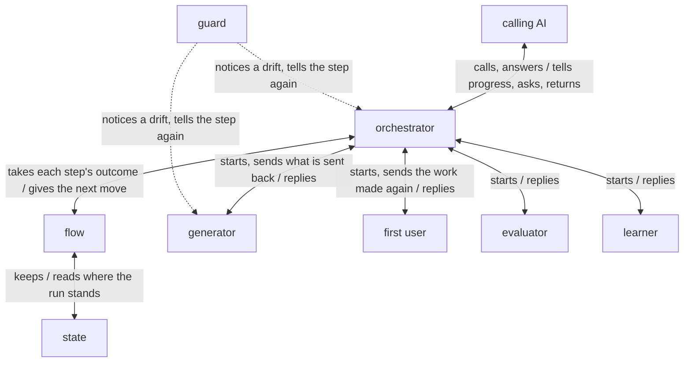

# turn design

turn is built on [how a plugin works](../architecture.md): `turn:up`, the orchestrator the calling
AI starts, runs a fixed loop kept in a script, in which one role makes the work and makes it again
until another, using it in its receiver's place, finds every item's Good, and the orchestrator
decides from those readings which items get their Good. Each role's steps are held by lanes laid
with lane. The goal, the key results, and what a checklist, the receiver and a Good are, are in
[turn's UX](ux.md).

## User stories

- As the calling AI, I want to start turn with the path of a CCS, its kinds and where the result
  goes, and get the work back where it goes, with each item's Good and its lines, each item still
  without Good, and the lessons on how the run went.
- As the calling AI, I want to be told, as the run goes, what it will do and what is done, to pass
  on to the user.
- As the calling AI, I want to be sent each point only the user can decide, before the work that
  rests on it is made, and to send back the answer for the run to go on.
- As the calling AI, I want to call turn again with the same result after a run stopped anywhere,
  and have it go on from its last step.

## Architecture

### Logical view



The guard acts in every role as it does in the generator; the figure draws it once.

- The calling AI starts the orchestrator with the call: the CCS's path, where the result goes, and
  the kinds it uses in the CCS for where the work goes, the checklists, the receiver, what the
  receiver uses the work for and what they have with it, such as the whole repository for a
  maintainer of code.

  The CCS is the calling AI's, and turn defines nothing of it but these: what turn needs is found by
  these kinds, and the values stay in the CCS alone, so the call and the CCS cannot differ. Each is
  needed, since without what the receiver uses the work for and has with it no reader can stand in
  their place. Where the result goes is this call's answer, not the task's state, so it is not in
  the CCS.
- The orchestrator first has the flow check the call, and the flow, where the call names a missing
  file or leaves a kind without an entry, says so and the orchestrator returns it, with no run
  started.
- The flow keeps where the run stands in the state, beside the result, and gives the orchestrator
  each next move: the role to start or to send more work, with what it is given, the check, the
  decision, a question, or the run returned. The orchestrator makes the move and hands the flow its
  outcome.

  The run is a fixed loop, so its course and its bounds are kept in code, which holds them the same
  way each time where an AI counting may slip unseen (dev/architecture.md, Where the course is
  kept).
- A call naming a result whose state is there goes on from the move the state was last at: a role
  that had not replied is started anew with what it was given, and one kept started is started anew
  with what it was given and what was sent to it since.

  A conversation ends, is cleared or is compacted, and what lives only in it is lost; a role's
  context is lost with its conversation, so what it is given is kept in the state to give again.
- Before any work is made, the orchestrator checks that the CCS holds everything the run needs: it
  reads the CCS, the files it names and the checklists, and finds for every item what in them gives
  its Good, and that what the receiver has lets the first user do with the work what the receiver
  does, such as running its tests; each item that lacks it waits on a question, saying what is
  lacking with the items it settles.

  A Good the CCS cannot give, the generator cannot give either, and a reader that has less than the
  receiver cannot find the Good they get; the making and the readings after it would be spent for
  nothing, and an answer may also change how the whole work is laid out.
- A question goes to the calling AI as the orchestrator's reply, with the answer it recommends, and
  the calling AI sends the answer back to the orchestrator, which hands it to the flow and goes on.
  A question found before the work is made waits for nothing to be made; one the generator or the
  decision finds is sent once the round has its decision, with the items it settles.

  A subagent cannot ask the person (dev/architecture.md, Where the orchestrator runs); the calling
  AI fills what it can from its sources and asks the user the rest. The calling AI keeps the answer
  in its CCS too, so a call again reads it there.
- As each move is made, the orchestrator tells the calling AI what the move will do, how far and
  how, and as each outcome comes, what is done and what comes next, each line made by the flow; no
  one answers it, and no role tells it.

  The calling AI gets nothing else until the run returns, so a run going a slow or wrong way would
  show only once its time is spent; the flow makes the line from the move, so it says what the run
  does, not what an agent means to do.
- Every role that judges the work looks only for the Good each item gets and the lines that give
  it; only the flow doubts, and only by coverage: it names each item no role gave its Good.

  An AI that looks for what more the work needs finds more without end, and each find is patched
  in, so the work drifts from what it should be. Each role has one aim, so it works to the aim
  rather than to a list of steps.
- Each item is answered by what the receiver gets using the work with what they have, never by
  whether the work matches the sources it was made from.

  What the receiver gets is the work's purpose; matching the sources is a means to it, and checked
  on its own it draws the work toward the sources' words and the product's edge cases rather than
  toward the receiver. The receiver has no sources, so no reading in their place could answer it.
- Each item is answered where its checklist's `Scope` line says: `its part`, at the lines that give
  it; `each part`, in every part of the work on its own, a Good for each; `whole`, of the work at
  once. The flow splits the work into its parts, a document's sections under its top headings with
  the title and opening as one, and each other file whole, stops a reply that gives an each-part
  item without every part, and gives such an item its Good only where every part has one.

  A Good found where one part gives it passes a part that does not, so a remake that breaks one
  part for another item goes unseen; what lies between the parts, such as one name for each thing,
  is found only in the whole. The checklist says it once, so every role and every run answers an
  item at the same place.
- The generator first sets, from the whole CCS, the Good the receiver is to get from the work for
  each item and where the work gives it, then makes the work to give each, runs what it wrote as
  the receiver would, and replies with each item's Good with its lines and the questions only the
  user can decide.

  A work made to Goods set first gives each where it was meant; one written first and matched to
  the items after is patched item by item. What is not run is not known to work, and a receiver who
  meets it failing gets nothing from the rest. What the CCS does not say becomes a question, not
  its own guess. Its Goods are its claim, not a judgment.
- Where a path of the work already holds a file, the generator makes the work from it rather than
  from nothing, so what already gives its Good stays as it is.
- The first user uses the work in the receiver's place, with everything the receiver has and doing
  all they do with it, and gives for each item the Good it found in the work, with its lines, and
  for each it finds none, the places of the work where it looked for it, what it did there and what
  it did not get.

  A reader that did not make the work finds only the Good its lines give; the maker finds the Good
  it meant. What the receiver gets lies also in what they have and do beside the work: a reader
  with less misses a Good the receiver gets, and one that only reads passes what a run shows to
  fail. A place alone does not show the maker what was missing; what the reader did there and did
  not get does.
- The generator is sent each item the first user found no Good for, as the first user gave it, and
  the first user is sent the work made again, with no reading between, until it finds every item's
  Good, each item left waits on a question, or it has been sent back three times in a round. The
  generator and the first user stay started until then; the next round starts both anew.

  The generator holds the sources it read and the Good it meant at each line, so it changes only
  what is sent back, without reading the sources again; how the work gives the Good is the
  generator's to decide, since an edit told per item broke other items. A first user that stays
  started reads again whether the places it stopped at now give the Good, so what is left only
  shrinks. A bound keeps a reading that does not settle from going on without end, and what it
  leaves goes on to the evaluator, the decision and the second round.
- From the generator's first making to the evaluator's reply, the orchestrator makes only the moves
  the flow gives, reading no work; it judges at the check and at the decision.

  The orchestrator holds the sources and the call, so its reading of the work finds the Good the
  work meant, not the one the receiver gets; put between the remake and the first user, it costs a
  reading each time and pulls the remake toward its own view.
- What passes between the roles goes through the flow: the first user is not given the generator's
  reply, and the generator gets only what the first user gave.

  A reader shown the maker's claim finds the Good it was told to find.
- The evaluator, started anew and given what the first user was given and its last reading, looks
  through the whole work for every item's Good as the receiver first meets it, holding each Good of
  the reading to what its item asks, and gives every Good with its lines. The orchestrator then
  reads the work whole and decides every item from both readers' Goods: a Good only where a reader
  found one, none where neither did or a doubt stays inside a Good.

  One reader misses a Good the work gives, and an item judged without it is made again for nothing;
  a Good held to its item is one the calling AI can rely on. A Good held only at the lines the
  reading named passes a place elsewhere that does not give it. Readers that agree may still carry a
  doubt inside a Good, so agreement is decided too. A Good only the orchestrator found would be
  judged by one that read the work knowing what it meant, so the flow stops it.
- Once the orchestrator has decided, the learner reads every item's finding and the record of every
  agent of the run, the orchestrator's included, and gives, from what they show, with the words it
  rests on quoted, how the run went: whether the Goods came without waste and not by chance, each
  lesson for the role it is for, on how it read, checked and replied, or that it found none and what
  it checked.

  A lesson on what the work should say tells the generator how to give a Good, which is the
  generator's to decide: told to put every change in the opening, it made the opening one sentence
  of five changes. What fell short often lies in what a role did, which only its record shows; a
  run where every item got its Good may still have got it by chance, or spent time for nothing, and
  what is not learnt from is met again. A lesson without the facts it rests on is a guess.
- The orchestrator takes the lessons it finds hold: each goes to its role in the next round and into
  the result, for the calling AI to hand on to turn's makers.

  The learner sees what each agent did, but the orchestrator decided every step of the run, so it
  judges which lessons hold.
- When every item has its Good or is a question, the run returns; otherwise the generator, started
  anew, is given each item without Good with what the decision found, the work is made again and
  read once more, from the first user to the decision and the learner, and then the run returns,
  with each item still without Good, what the receiver gets once it has it and where it was not
  found.

  A Good the receiver is to get may fall short in one round; a second settles what the first found,
  and what is left costs the calling AI less to fix than more readings would.
- The flow writes the result where the call says, and the orchestrator ends only once it is there.

  A reply would be copied into a file by the calling AI, where a slip goes unseen.
- Each step of a role, the orchestrator's included, that alone is not sure to hold has a lane, and
  the guard notices a drift from it and tells the role the step again: a role reads what it is given
  alone, and whole; writes only its work and its reply, its reply in its form; answers every item;
  commits and pushes nothing; and ends only once its reply is there. The orchestrator begins with
  the flow, makes only the move the flow gave, hands on the flow's lines as they are, and ends only
  once the result is there.

  A role that reads only what it is given is not bent by what it was not meant to see, and an item
  judged on a part read is judged on a guess for the rest. The calling AI keeps the work in git on
  its own judgment, after checking it.

### Physical view

```
turn/                      the plugin, installed by Claude Code
├── agents/
│   ├── up.md              the orchestrator <agent>
│   ├── generator.md       <agent>
│   ├── first-user.md      <agent>
│   ├── evaluator.md       <agent>
│   └── learner.md         <agent>
├── scripts/
│   ├── turn.py            the flow <Python 3>
│   └── *.py               the call's check, the forms, the parts, the records <Python 3>
└── hooks/
    ├── hooks.json         the lanes on every agent, laid by lane:up
    └── lane/              lane's code, the guard, a link to lane's <Python 3>
```

- turn runs on Claude Code, python3 3.9 or later, and git.
- The calling AI starts `turn:up` in the background with the call as JSON, from the main
  conversation or from an agent it started; turn's agents take the two layers below it, and Claude
  Code starts agents down to three layers below the main conversation.

  The calling AI can still take the user's pause while it waits, and stops a run with TaskStop. The
  user sees the run's agents in the panel below the prompt input.
- The state is a JSON file beside the result, the result's path with `.run.json` added, read and
  written by the flow alone.

  It is kept in the calling AI's work folder, each run its own, so several runs go at once without
  meeting, and a call again finds it by the result it names.
- `turn.py` prints each next move as one JSON line `{"tool": ..., "input": {...}}`, last in its
  output, an Agent call starting a role or a SendMessage to a role kept started; the line telling
  the calling AI stands before it. A role's prompt is a JSON object of what it is given: the files
  it reads, the work, the reply file and the checklists, each a path, and the flow's message what is
  sent back.

  The move printed as the tool call itself is a form lane holds the orchestrator to, and a role
  given its inputs as JSON is held by lanes on the values it starts from.
- Each role writes its reply to the reply file its prompt names, in a JSON form of its own, held to
  its JSON Schema in `scripts/`; the flow reads it there once the orchestrator runs `turn.py next`.
  A role sent more work writes its reply again, and `turn.py next` waits until it has been written
  since the send, as the reply of a subagent sent a message comes back later, not with the send.

  Tried: an orchestrator that ended its turn after the send never got the reply; one that waited on
  a script reading what was kept got it word for word. The file is read by the flow alone, so no AI
  copies a reply, and the first user's lane on what it reads keeps it from the generator's.
- The orchestrator gives the flow the agent ID each Agent call returns, by which the flow names the
  role to send more work to, and the learner's records are found by those IDs.

  The Agent tool gives a subagent no name to be messaged by, so a role is reached by its ID.
- The orchestrator replies with a question and ends its turn; the calling AI sends the answer to its
  agent ID with SendMessage, which resumes it, as `lane:up` is reached.
- The orchestrator tells the calling AI with SendMessage to `main`, loaded with ToolSearch; called
  from an agent, the lines reach the main conversation, which alone talks with the user
  (dev/architecture.md), as that agent cannot be messaged by a name.

  Tried with an agent started by an agent started in the background: its message to `main` reached
  the conversation while the agent that started it was still running.
- The lanes, laid with `lane:up` from each agent's steps, run values taken from what the agent
  starts from: on each role, read_only and read_whole on `{given}`, write_only on `{work}` and
  `{reply}`, in_form on `{reply}` and its schema, every_item on `{checklists}`, hands_off on
  `git commit` and `git push`, and end_when on `{reply}`; on the orchestrator, start_with on
  `turn.py start`, follow_next on `turn.py next`, as_printed on the questions and lines it hands
  on, hands_off as on the roles, and end_when on `{result}`, taken from what `turn.py start` prints.

  Each lane acts in its own agent alone, by `agent_type`, and reads that agent's own record and
  what it started from, so runs at once are told apart without turn tracing them; turn keeps no
  hooks of its own.

## Verification

### Units

Each agent is checked on Claude Code's default model, the one users run turn on, and judged from
the records of every conversation and agent the check started.

- The flow: each move follows from the state and the outcome handed to it in this design's order,
  the call's check stops what it must, a stopped run goes on from its last move, and the result and
  each reply are held to their forms.
  - Flow: unittest in `dev/turn/tests/`, fed the calls, states and replies each receives, by
    [`dev/check.sh`](../check.sh) with lines and branches 100% covered and by
    [`dev/mutate.sh`](../mutate.sh) with no mutant surviving.
- The lanes: `hooks/hooks.json` holds the lanes the steps call for, and each agent's steps their
  sentences.
  - Flow: unittest reading the agents and `hooks/hooks.json`; each lane's check is lane's, tested in
    lane.
- The orchestrator: takes each move in this design's order, from the call to the result.
  - Flow: on a task of two items, one answered at its part and one in each part, with the four roles
    stood in for by agents that read what their step reads and write a reply set beforehand, one
    set for each way a run goes: every item Good at the first reading, an item the first user finds
    no Good for given at its next reading, an item sent back three times going on to the evaluator,
    the evaluator differing from the first user, and an item left without Good through the second
    round, with the learner after each round; on the same task with its decision taken out, the
    question sent and the run going on with the answer; and the run stopped after the first user's
    reading and called again. Passes when its records show each move in this design's order, no
    reading by the orchestrator between the generator's first making and the evaluator's reply, no
    lane stopping a call that keeps its step, a line told for each move, and the result as the set
    replies make it.
- Each of the four roles: works to its aim with what it is given, writing its form.
  - Flow: started on its own with a prompt set beforehand, as the flow would give it, on a task of
    two items, one answered at its part and one in each part; passes when its record shows it read
    only and whole what it is given, and its reply fills its form; the generator runs what it wrote
    and the first user what the receiver runs; the generator, sent back by message, remakes the
    work without reading its sources again, and the first user, sent the work made again, gives the
    places it stopped at their Good.
  - Content: what it makes in the acceptance trials below, read against its record.

### Acceptance

Each trial runs in a clone of `lovaizu/playground` of its own, on a branch of its own, pushing
nothing, removed after: a stand-in for the calling AI is handed a small task's CCS and checklist and
calls turn, and is judged from the records of every agent it started and from the work. Each
acceptance trial is run three times at once.

What an AI does varies from run to run, and one run shows one of its ways; runs that push nothing
and keep their own folders do not touch each other.

- Flow: a stand-in for the calling AI calls turn on a task of one item, with every role real, and
  the work comes back with the result in its form.
- The work back: it comes back where it goes, and every item has a Good with its lines, or what the
  receiver gets once it has its Good.
  - Each Good is checked by reading its lines in the work.
- Told as it goes: the stand-in is told a line before each move and after each outcome.
  - Read from the stand-in's record against the orchestrator's moves.
- A point asked: on a CCS that leaves the license open, the question reaches the stand-in before any
  work is made, and the run goes on with its answer.
  - Read from the records.
- Gone on: a run stopped during the first user's reading and called again with the same result goes
  on from that move and returns.
  - Read from the records: no move before it is made again.
- KR1.1: the points where the work falls short of the purpose the calling AI gave it, each judged as
  the UX's KR1.1 says.
  - Each point the stand-in fixes in its record, and each the work still misses, counted apart by
    whether it was told and fixed at once or would go on unseen, and compared with the version in
    use on the same task, kept with the trial in `dev/turn/trials/`.
- KR1.2: the time from the call to the work coming back.
  - Taken from the records' timestamps for a README-sized work, and compared with the version in use
    on the same task.
  - Read move by move from the same timestamps; time that adds nothing to the stories or KR1.1 is
    cut first.

A change is taken when every story is still achieved and KR1.2 does not come closer at the cost of
KR1.1.
