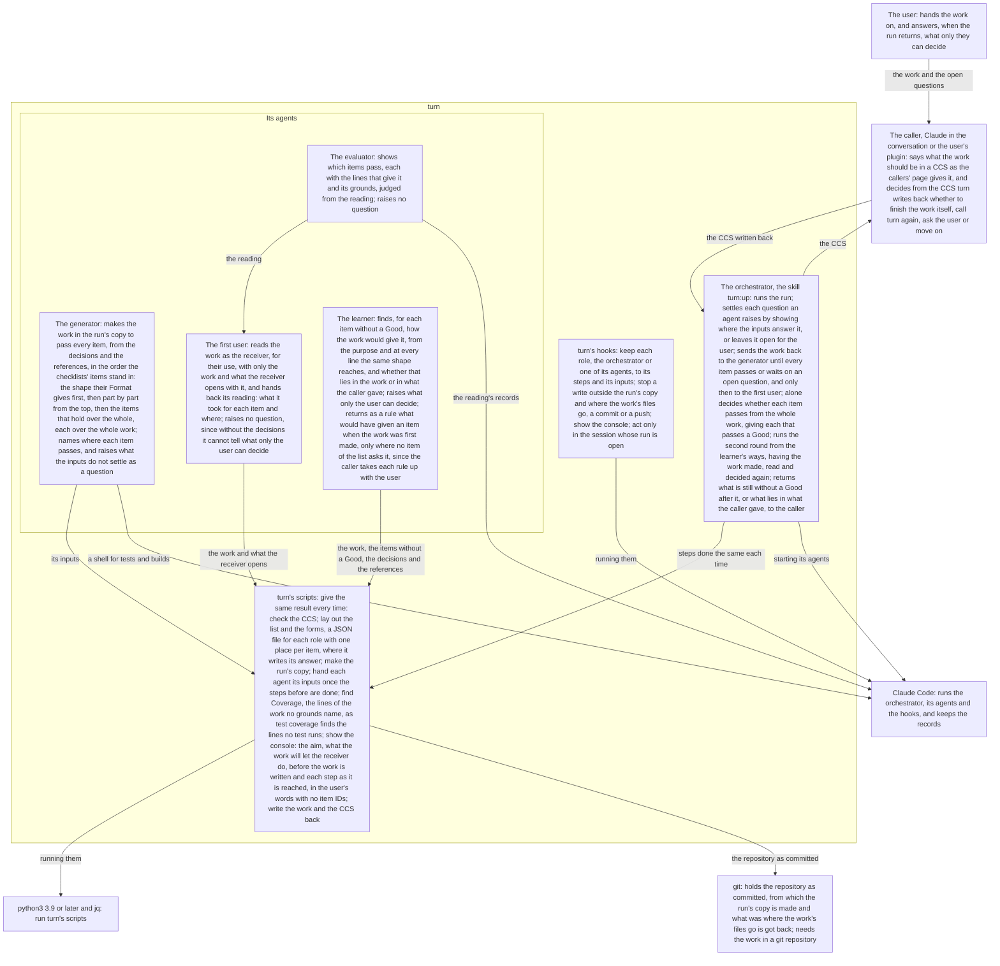

# turn design

turn keeps what its [README](../../turn/README.md) promises by one idea: the work is read in its
receiver's place by an agent that did not write it, and one orchestrator, the skill that runs each
task, decides whether each item of the checklists passes from the whole work, so nothing passes
that the work does not show. How to use turn is in that README, and what a caller writes and reads
is on the [callers' page](../../turn/calling-from-a-plugin.md).

## Goals

### Attractive quality

Each is said in the README's words, since the reader comes from it.

- Read in the place of the person the work is for

  The work, what one task asks turn to make for one purpose, one file or several such as code and
  its tests, comes back already read as that person, its receiver, would read it, by an AI that did
  not write it and has only what the receiver would open, and what that reading could not take is
  made again. An item passes only where lines of the work give it, and a Good is the orchestrator's
  decision that it passes, with its grounds, the lines it rests on. The files of the work are
  written, read and decided together, since what the receiver needs may be given only by them
  together. The user hands the work on without first reading it in the receiver's place.

- Made from what you decided

  The work follows the user's notes and checklists, not whatever turn happened to open. turn takes
  the notes as the decisions, what was decided the work must say or do, and leave out, item by
  item, holding nothing a reference holds; the checklists put together as the list; and the
  references, files or folders the work follows or draws on, read in place of a copy so a fact has
  one source. These, with where the work's files go, the receiver, their use of the work when
  named, what they must be able to do with it, what they open with it, and the constraints, such as
  the language to write in, are the inputs, from which the same request is always made the same.

- Asked only what only the user can decide, all at once at the end

  Nothing is asked that the notes and checklists already answer, and nothing is asked while turn
  works, so the user can leave it at work.

- Seeing the work as it goes

  The user can tell from what turn shows how far it has come, and stop it with Esc, saying what they
  want instead, when what the work will let the receiver do is not what they want, before the work
  is written.

- A plugin decides from what turn returns

  The caller, Claude in the user's conversation or a step of the user's plugin, hands turn one task
  in a CCS, a JSON file, and turn writes back a CCS with what the caller needs next, as a function
  takes arguments and returns a value. A run goes from the one CCS to the other. In its first
  round, the work is made, read in the receiver's place and decided item by item, and for each item
  left without a Good, the way the work would get one is found. Then, once, a second round makes
  the work again from those ways and has it read and decided again as the first, since the work
  turn writes must be the version last read; the run returns to the caller what is still without a
  Good. A plugin's step decides from the CCS turn writes back alone whether to finish the work
  itself, call turn again, ask the user or move on.

- Following each item back

  The user can later find in `.turn/`, for each item, the lines that give it or how the work would
  give it, and the version of the checklist it was judged by.

### One-dimensional quality

Each must be no worse than in the version in use, the released version users run now, which the
version being built replaces, as 0.1.0 is for 0.2.0.

- The first-run share

  The share of requests whose first run passes every item. The more work is right when first made,
  the less the user waits and the less is spent.

- Time and tokens

  What one run takes, from the request to the result.

### Must-be quality

- Nothing passes unshown

  An item passes only where lines the work holds give it; every other item comes back without a
  Good, with how the work would give it.

- What the caller gave unchanged

  turn never rewrites the task a caller hands it or the files the task names as inputs.

- Nothing unread

  The work turn writes is the version last read.

- Repository untouched

  During a run, turn writes nothing in the repository but where the work's files go and `.turn/`,
  where it keeps the run's evidence: the work, what was taken from it and decided for each item,
  how each item without a Good would get one, and the list with each checklist's name and version,
  for the user and for later runs. turn names to the user any other file a run's commands changed,
  and never commits or pushes, so the user takes turn's change as one diff and decides what to
  commit; what was where the work's files go can always be got back. Outside its runs, turn blocks
  nothing.

- Stop and start over

  A stopped run says so; asked again with the user's words, turn makes the work anew from them. A
  run stopped or cut off leaves where the work's files go as they were before the run.

- Missing tools

  Without python3 or jq, turn ends before any work and says what to install; outside a run, a
  missing tool breaks nothing.

### Backward compatibility

- The call

  Plugins call the skill `turn:up` with the arguments the callers' page gives, and name `turn` in
  their dependencies. An argument may be added only if a call without it runs as before.

- The CCS

  Every caller relies on the CCS's parts, kinds of entry and values of `next`, the part that tells
  the caller what to do next, as the callers' page gives them. From 0.2.0 on, none is added,
  removed or renamed, since a caller breaks on one it does not know as on one that is gone; the
  wording in an entry may change, since callers do not act on it. A CCS an earlier version from
  0.2.0 on returned is accepted, so a stopped task carries on after an update. A CCS of 0.1.0 is not
  accepted, since no caller relies on one.

- How a checklist is written

  Users, and plugins built on turn such as rn, write checklists as the README's Requirements gives:
  a checklist that opens with its name and version and gives its items as headings with IDs keeps
  being read. What turn takes from a checklist beyond that may change, as long as a checklist so
  written needs nothing more.

- What a returned CCS points to

  The user opens a returned CCS to follow each item back, so every place it points to exists. The
  run's evidence is kept under `.turn/` at the top of the repository, since the README names that
  place to the user; how it is laid out inside `.turn/` may change.

### Non-goals

- Deciding what the work should say

  The caller does it, knowing what was already agreed, and gives it as the decisions.

- Making the work from one already there

  The caller reads it and puts what it says into the decisions, or gives it as a reference; turn
  makes new work only, since what it is handed it follows, wording and slips included.

- Deciding whether to run again after a run's second round

  The caller does it from what the run returns, knowing what was agreed.

- Finding what no item asks, and holding checklists

  What no item asks goes into the checklist, and checklists belong to whoever knows the kind of
  work, such as rn.

### Constraints

- turn is used by Claude, on a person's behalf, in a conversation or a plugin's step.
- turn runs in Claude Code and holds only skills, agents, hooks and scripts.

  Installing copies only its folder; its hooks run in every session where it is installed; a
  subagent can neither ask the user nor hear from its caller while it works.

- Users' machines run Python 3.9 or later with the standard library only, and jq.
- The work is in a git repository.
- The tests and builds a work needs run by shell commands, so the agents' shell stays open.

  They run in the run's copy, a working copy of the repository as it is committed, kept in the
  run's evidence while the run goes, so they run in place.

## Verification

### Attractive quality

Each is judged from the records, the JSONL of every conversation and agent of the run. What the work
gives its receiver is tried on real work, rn's and turn's own documents and prompts, against the
items in question, since a made-up task shows only that it passes.

- Read in the place of the person the work is for

  Tried on work for a receiver who lacks what the maker of the work knows, where a writer checking
  their own work passes what a newcomer would miss; that this is where the difference shows is an
  assumption, not yet checked. The check passes when a fresh agent outside the run, reading the
  returned work as the same receiver with the same files they open and the same list, decides that
  every item returned with a Good passes, including each an earlier run left without one.

- Made from what you decided

  Tried on a task in a repository holding files the inputs do not name: the records show nothing
  in the run reading one, and the work says nothing the inputs do not give. A test on the hooks
  also tries, in a run, a read outside the run's inputs.

- Asked only what only the user can decide, all at once at the end

  Tried on decisions that settle some choices and leave one open: nothing is asked while the run
  works, the run ends with `next` set to `ask the user` and that one choice, and no question is
  answered by the inputs.

- Seeing the work as it goes

  Tried on a run on real work called in the user's conversation, where the console, what turn shows
  as it goes, appears and Esc is pressed: once watched to its end, and once stopped with Esc when
  the console shows an aim, what the work will let the receiver do, that is not what the user
  wants. It passes when the user tells from the console alone the step the records show, and, after
  the stop, finds no work written toward that aim and then gets work made from what they said.

- A plugin decides from what turn returns

  Tried on runs that end in each value of `next`: the move decided from the returned CCS alone is
  the one decided after also reading the records.

- Following each item back

  Tried later, after a run has returned items that pass and items that do not, the checklist has
  gone to a newer version and the work has been changed. It passes when the user, from what the run
  left in `.turn/` alone, finds for any item the lines its Good rests on or how the work would get
  one, and the name and version of the checklist it was judged by.

### One-dimensional quality

Both are measured from the records of the same tasks, run on this version and on the version in use
from the same CCS, written in each version's kinds where they differ, as from 0.1.0 to 0.2.0.

- The first-run share

  The share of those tasks whose first run passes every item, against the version in use.

- Time and tokens

  The time and tokens each run takes, against the version in use.

### Must-be quality

Each is a test on the script or hook that holds it, in the case that would break it.

- Nothing passes unshown

  Grounds naming lines the work lacks.

- What the caller gave unchanged

  A returned CCS whose caller part differs.

- Nothing unread

  A version of the work written after it was last read.

- Repository untouched

  A write outside where the work's files go and the run's evidence, a commit or a push in a run; a
  shell command of the orchestrator's other than turn's scripts; a shell command in a run that
  changes another file; a file already where the work's files go with changes git lacks; the same
  outside a run, with another session's run open.

- Stop and start over

  A run stopped at each step, and one cut off.

- Missing tools

  Each tool missing, in a run and outside one.

### Backward compatibility

For each released version from 0.2.0 on, a test calls turn as its callers did.

- The call

  The call runs.

- The CCS

  Its CCS, a stopped one included, is accepted and carried on, and every `next` returned is one its
  callers know.

- How a checklist is written

  Its checklists give a list with every opening and item. Given a checklist without its name or
  version, turn ends before any work and names what the checklist lacks, since a Good must be
  followed back to the checklist name and version it was judged by.

- What a returned CCS points to

  Every place a returned CCS points to exists.

## Structure

Each arrow points from one that takes part to one it cannot work without, labelled with what it
needs from it. The orchestrator runs as a skill, where its caller runs: in a conversation the user
sees its console and presses Esc there; in a subagent the caller reads what it returns, at the cost
of room in the caller's context.

## Principles

- The orchestrator alone decides whether each item passes, from the work itself.

  For each item it reads the whole work for where the item is given, and what agents and scripts
  hand back only shows it where to look first, since an item shown passing in one part does not
  show what the whole gives. Protects: nothing passes unshown, read in the place of the person the
  work is for.

- Every role looks only for where items pass and aims at every item passing.

  None finds fault, and none is set to find something, since one set to find something finds it
  whether it is there or not; this is an assumption, not yet checked. Coverage, a script, is the
  one place that looks for what may be wrong. Each role answers in its form, read and changed with
  jq, and hands back that form alone, since the form, not the wording, holds it to its aim.
  Protects: nothing passes unshown, the first-run share.

- Every role works from the inputs it is handed alone.

  Each prompt names them as the whole of what it reads, says in positive words to work from them and
  gives why, sets as steps what its agent receives, hands back and must do in full, and leaves how
  it thinks within a step to it. Protects: made from what you decided, read in the place of the
  person the work is for.

- turn asks nothing while it works.

  So it runs the same wherever it is called, a subagent included, and is stopped or corrected only
  from where it was called; every question comes back at once when the run returns. Protects: asked
  only what only the user can decide, all at once at the end; a plugin decides from what turn
  returns.

- Everything that measures the work measures by the same list, receiver and use.

  The list carries every checklist's opening, and a checklist says its own name and version, so a
  Good is followed back to the text it was judged by. Protects: read in the place of the person the
  work is for, the first-run share, following each item back, how a checklist is written.

- A run starts from its CCS alone and returns the caller's parts as they came.

  It makes the work in the run's copy and keeps the work in the run's evidence until the run
  returns, and the copy is gone by then; the received CCS is never written over. Protects: what the
  caller gave unchanged, repository untouched, stop and start over, the CCS.

- What must come out the same every time is done by a script or a hook.

  A script does what a step asks and refuses a step whose steps before it are not done; a hook stops
  a step left out or done otherwise, saying which step, what it needs and why, and acts only in the
  session whose run is open, even without python3. Protects: nothing passes unshown, what the
  caller gave unchanged, repository untouched, missing tools, following each item back.

- What can be told before it happens is stopped then, and what cannot is named to the user when the
  run returns.

  Stopped: a write outside the run's copy and where the work's files go, a commit or a push, a
  write over a file already where the work's files go unless git holds what is there or it is a
  work an earlier run returned, unchanged since. Named: a shell command's side effect. Protects:
  repository untouched.
