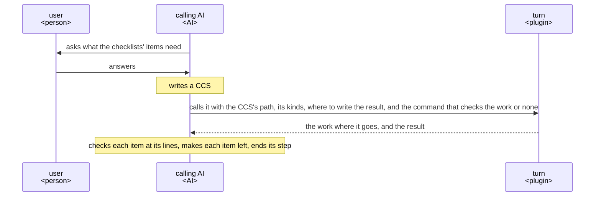
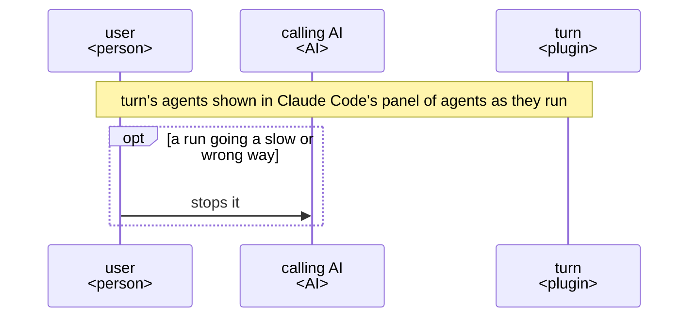
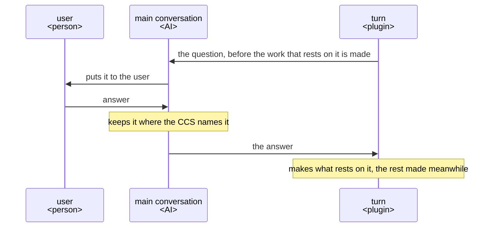
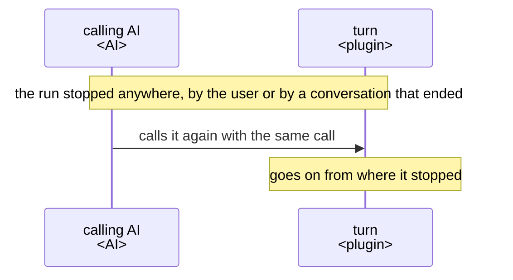

# turn UX

turn makes the work a plugin's step asks for and returns it with each item of the step's checklists
judged by a reader that did not make it. Build and change every part of turn so that the AI calling
it gets that on every run.

## Users and goals

- G1: The calling AI, the AI that runs a step of a plugin and calls turn from it, wants the work
  that step makes to come back meeting the step's checklists on every run.

  A checklist lists what the receiver, the one the work is for, should get from the work, one item
  each, asked as a question. An item's Good is the judgment that the receiver gets from the work
  what the item asks, with the lines of the work that give it.

## Key results

- KR1.1: How many items of the step's checklists the work meets when it comes back, as the calling
  AI judges it; more is better, and every item once the goal is reached.

  The calling AI judges each item by its own check of the work at the item's lines, not by turn's
  judgment of itself. So an item that turn says it meets and does not is not counted.
- KR1.2: The time from calling turn to the work coming back, for a work the size of one README;
  shorter is better.

  The calling AI cannot go on with its step while it waits, so the user waits as long.

They stand from the highest priority. turn never saves time by leaving the calling AI more to fix.
The user is the person using the plugin whose step the calling AI runs, and a work the calling AI
must fix costs them the fixing as well as the wait.

## Scenes

These take part:

- the user, a person;
- the main conversation, an AI: the Claude Code conversation the user talks in, and the only one
  that can ask the user;
- the calling AI, an AI: the main conversation itself, or an agent below it;
- turn, a plugin.

A CCS is the JSON file in which the calling AI keeps its task, in the shape
[ACC](https://arxiv.org/abs/2601.11653) gives it: parts, each a list of entries, each entry a kind
and its value. Every name in it is the calling AI's own. It holds what is decided, where the work
goes, the checklists, the receiver, what they use the work for and what they have with it. The call
gives the CCS's path and names the kind the calling AI uses in it for each of these. The result
holds the lines of each item's Good, each item left without it with what the receiver would need,
and each choice the work rests on that the CCS and its files leave open, with why.

### From a step that needs a work to the step's end

- turn returns each item it leaves without its Good with what the receiver would need to get it,
  and the calling AI makes that item.

  The work is mostly made by then, and the calling AI holds the step, so it makes the rest sooner
  than another round would.

### While turn runs

- The user sees a run going a slow or wrong way while it runs, before its time is spent, not after
  the work comes back.

### A point only the user can decide

- turn asks as soon as it meets a point only the user can decide. A choice the purpose settles,
  turn makes itself and names in the result.
- turn sends the question to the main conversation, whether the calling AI is the main conversation
  or an agent below it, as only the main conversation can ask the user.

### Stopped, and gone on

## Benefits

- The calling AI gets the work already read in the receiver's place by a reader that did not make
  it, and made again where that reading found no Good. So the calling AI does not judge an item on
  its own assumption.
- Each Good comes with the lines it rests on, so the calling AI checks it by reading those lines.
- Each choice the work rests on that the CCS left open comes back with why, so the calling AI shows
  the user what was decided without asking them.
- turn makes the work from the CCS and the files it names alone, so the work does not stray from
  what was decided.
- A run stopped anywhere goes on from what it had made when the calling AI calls turn again with
  the same call, so no work is made twice.
