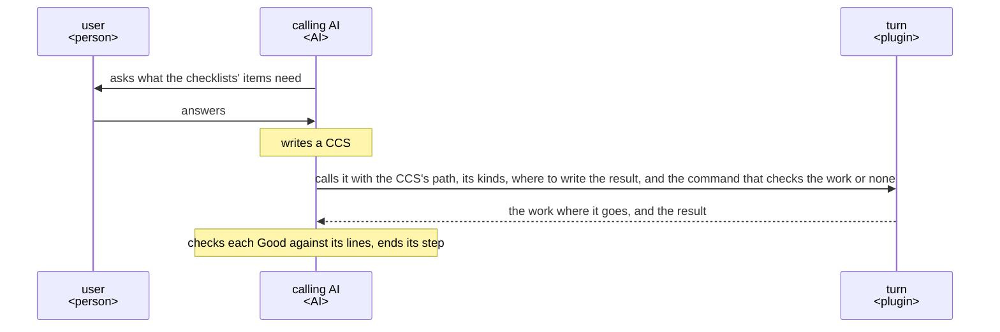
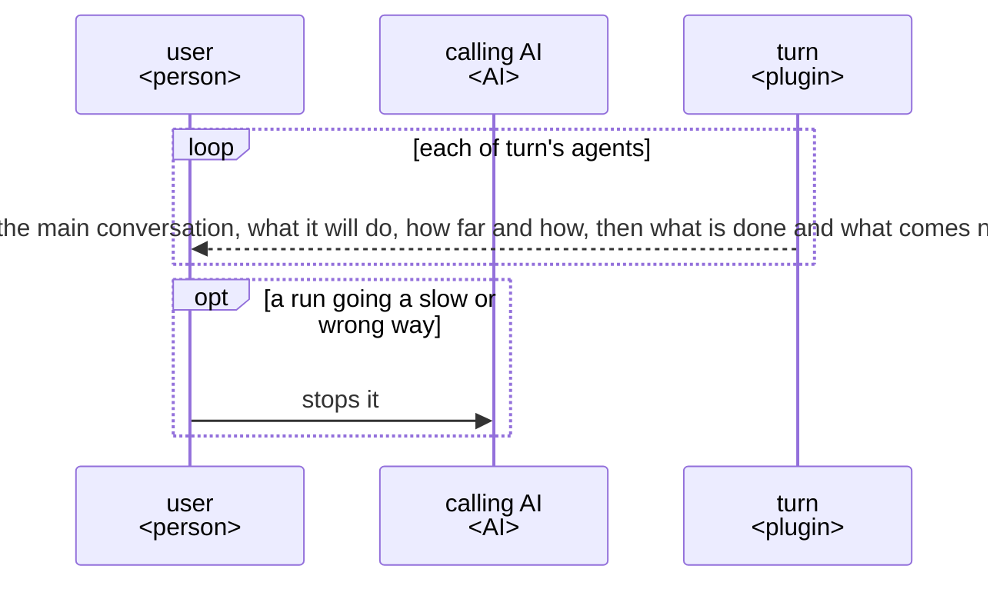
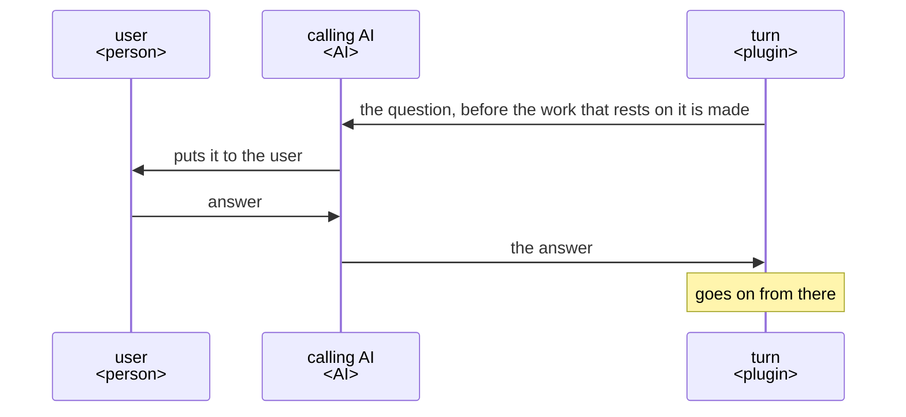
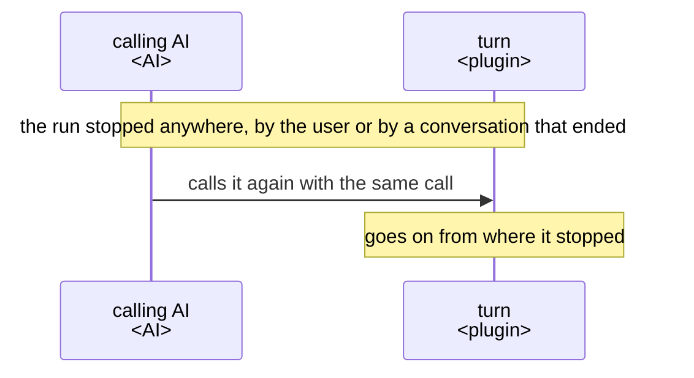

# turn UX

turn makes the work a plugin's step asks for and returns it with each item of the step's checklists
judged by a reader that did not make it. Build and change every part of turn so that the AI calling
it gets that on every run.

## Users and goals

- G1: The calling AI, the AI that runs a step of a plugin and calls turn from it, wants the work
  that step makes to come back meeting the step's checklists on every run.

  A checklist lists what the receiver, the one the work is for, should get from the work, one item
  each, asked as a question. An item's Good is the judgment that the receiver gets from the work
  what the item asks, with the lines of the work that give it.

## Key results

They stand from the highest priority: time is never saved by leaving the calling AI more to fix,
since a work it must fix costs the user, the person using the plugin the calling AI runs a step
of, the fixing as well as the wait.

- KR1.1: The items of the step's checklists the calling AI judges the work, when it comes back,
  to meet; more is better, and every item once the goal is reached.

  The calling AI judges each item from its own check of each Good at its lines, not from turn's
  judgment of itself, so an item turn says it meets and does not is not counted.
- KR1.2: The time from calling turn to the work coming back, for a work the size of one README;
  shorter is better.

  The calling AI cannot go on with its step while it waits, so the user waits as long.

## Scenes

The user, the calling AI and turn take part.

A CCS is the JSON file in which the calling AI keeps its task, in the shape
[ACC](https://arxiv.org/abs/2601.11653) gives it: parts, each a list of entries, each entry a kind
and its value, every name the calling AI's own. It holds what is decided, where the work goes, the
checklists, the receiver, what they use the work for and what they have with it; the call names the
kinds the calling AI uses in it for each of these. The result holds each item's Good with its lines,
and the lessons from the run, what fell short in it and why, for the calling AI to put to the user.

### From a step that needs a work to the step's end

### While turn runs

- A run going a slow or wrong way shows before its time is spent, not after the work comes back.
- Where the calling AI is an agent, the lines reach the main conversation above it, which alone
  talks with the user.

### A point only the user can decide

- turn asks where the CCS lacks what the run needs, making the work meets a point only the user
  can decide, or an item is still without Good after the readings turn allows.

### Stopped, and gone on

## Benefits

- The calling AI gets the work already read by a reader that did not make it, in the receiver's
  place, and made again where that reading found no Good, so it does not judge an item on its own
  assumption.
- Each Good comes with the lines it rests on, so the calling AI checks it by reading those lines.
- The work is made from the CCS and the files it names alone, so it does not stray from what was
  decided.
