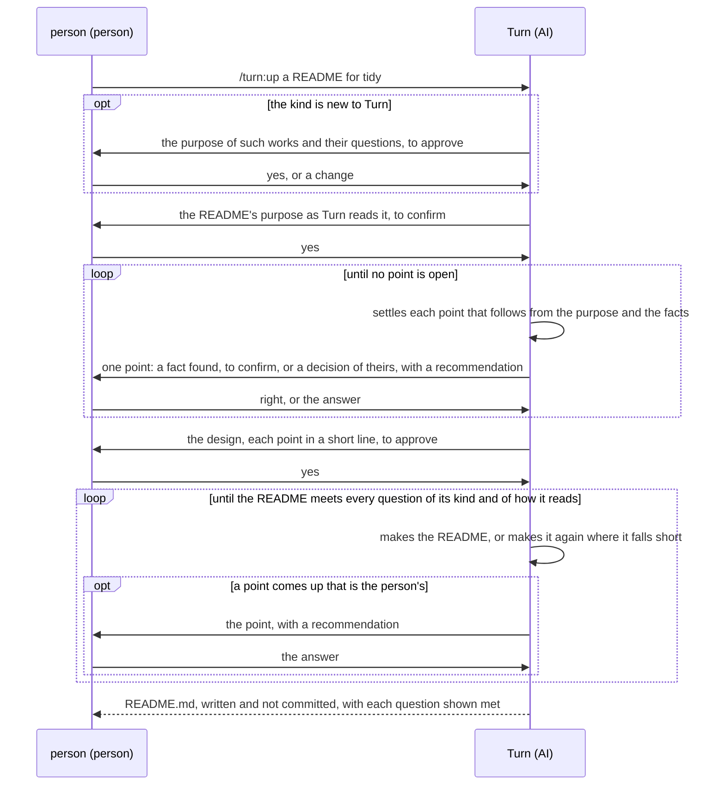
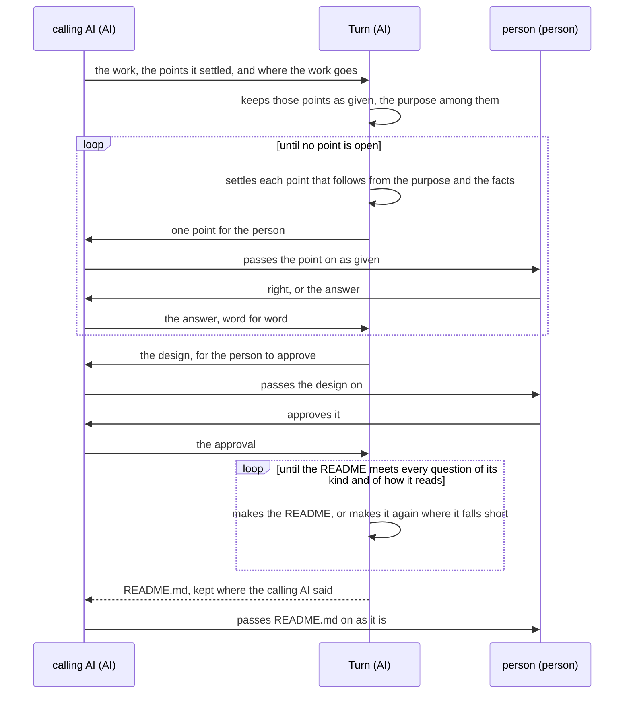

# Turn UX

Turn makes a work that someone asks for. A work is what the person wants made, such as a README
or a module of code. Its kind is the sort of work it is, such as a README. Turn has two users:

- **the person**: the one who wants the work made and will put it to use;
- **the calling AI**: an AI that connects a person and Turn, such as a role of another plugin that
  carries a larger plan for the person. It has Turn make a work the plan needs. It hands Turn the
  points it has already settled with the person, and passes the work on.

A point is one thing the work's design must settle: a fact, such as what a tool prints, or a
decision, such as which run a walkthrough shows. Each kind has its questions: those that a good
work of the kind answers yes to. For a kind new to Turn, the person approves its questions first.

## OKRs

Each objective (O) says what one user gains. Its key results (KR) measure how close it is.

- O1: The person gets a work they put to use as it is handed over, having decided only what is
  theirs.
  - KR1.1: Of the works the person has Turn make, directly or through a calling AI, the share that
    goes wrong. Lower is better. A work goes wrong in any of five ways, and counts once:
    - the person changes the work, or sends it back for a change, before they first put it to use;
    - the person is asked a point that is not theirs, such as a fact Turn could find, so they leave
      it to Turn or tell Turn the fact;
    - the person settles a point outside the run, or has the work made another way;
    - the person stops the run, or sets the work aside;
    - for a kind new to Turn, the person changes a question of the kind after they approved it.
  - KR1.2: The lead time from the person's request to the work they put to use, their answers and
    any rounds of change included. Shorter is better.
- O2: The calling AI has a work made for its person on the points it settled, and passes it on as
  it is.
  - KR2.1: Of the works the calling AI has Turn make, the share that goes wrong. Lower is better. A
    work goes wrong in any of four ways, and counts once:
    - Turn asks the person a point that the calling AI settled, or the work holds such a point
      otherwise than it was settled;
    - the calling AI cannot pass a question on as given, so it rewords or answers the question;
    - the calling AI changes the work, or settles a point with the person itself, before it passes
      the work on;
    - the calling AI gets no work back, as the run stops.
  - KR2.2: The lead time from the calling AI's request to the work it gets back, the person's
    answers included. Shorter is better.

In each objective, the first key result comes first. A change shortens the lead time only if it
keeps the first key result as good. For example, a change that asks the person fewer points
shortens KR1.2. It is kept only if each point that Turn then settles itself is one the person
would settle the same way.

Key results have no target values. A measure that becomes a target stops being a good measure
(Goodhart's law), so the key results serve only to judge how close the objective is.

## Scenarios

Both scenarios make a README for `tidy`, a command-line tool that sorts a Downloads folder. Turn
already knows the questions of a README. The participants:

- **person** (person): O1's user, and the one the calling AI works for in O2. Each step the person
  takes waits for them.
- **calling AI** (AI): has Turn make the README as part of the person's plan, in O2.
- **Turn** (AI): Claude running Turn. What runs inside Turn takes no part here, so no step here
  runs as a script.

### O1: The person has tidy's README made, deciding only what is theirs

### O2: The calling AI has tidy's README made on the points it settled

