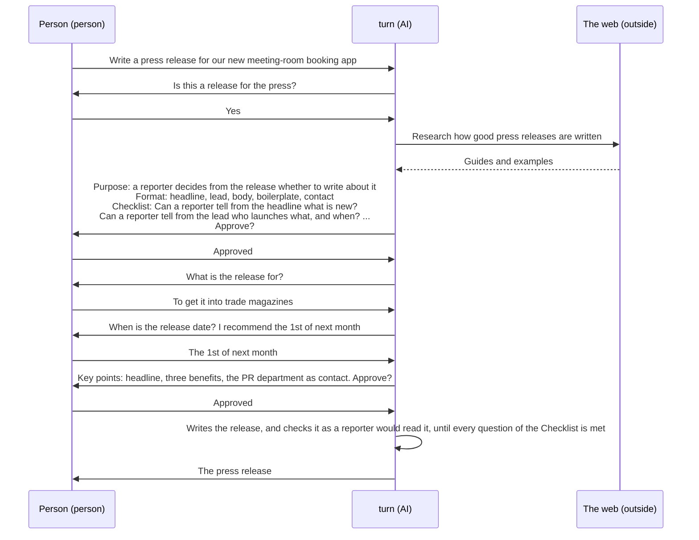

# turn UX

## OKRs

- O1: A person who wants a piece of work spends effort only on what only they can decide, and gets a
  work that meets their purpose well.
  - KR1.1: The changes the person asks for after delivery; fewer is better.
  - KR1.2: The times the person is asked something they did not need to decide; fewer is better.
  - KR1.3: The time the person spends answering questions and giving approvals; shorter is better.
  - KR1.4: The time from the request to delivery; shorter is better.

Key results have no target values. When a measure becomes a target, it stops being a good measure
(Goodhart's law). Use the key results to judge how close the objective is.

## Scenarios

The person who wants the work is a person. turn is an AI: a Claude Code plugin whose subagents make
the work. The web is outside turn, and turn reads guides and examples on it.

### O1: A press release for a new meeting-room booking app

