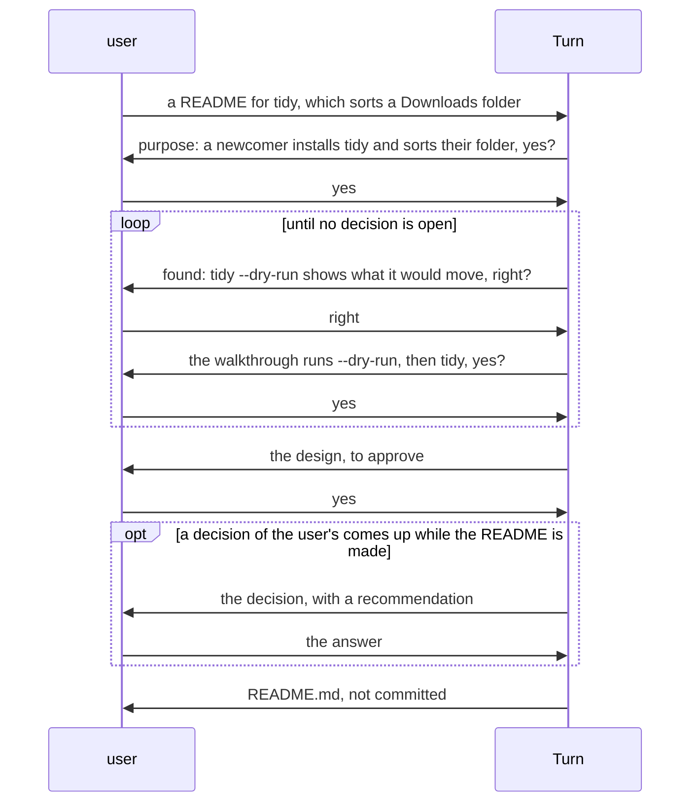

# Turn UX

## Roles

- **user**: one who asks Turn for a work, such as a README, and decides what is theirs.

## OKRs

- O1: The user gets a work they put to use as handed over, having decided only what is theirs.
  - KR1.1: Of the works the user asks for, the share they did not put to use as handed over,
    or for which they were asked a point that was not theirs. Lower is better.
  - KR1.2: The time from the user's request to a work they put to use. Shorter is better.

KR1.1 comes first: a change that improves KR1.2 is kept only if KR1.1 does not get worse. Key
results have no targets, as a measure made a target stops being a good measure (Goodhart's
law). They show whether a change brought its objective closer.

## Scenarios

### O1: The user has a README made for tidy

