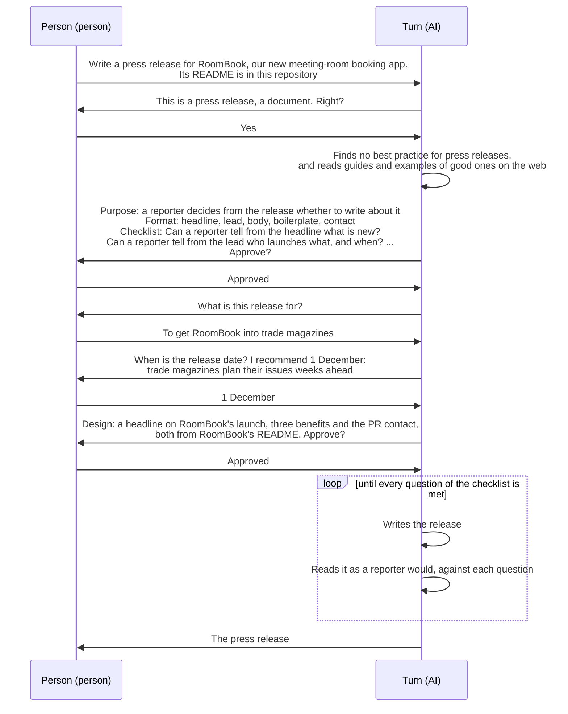

# Turn UX

## OKRs

- O1: A person who wants a piece of work gets one that meets their purpose well, for effort spent
  only on what only they can decide.
  - KR1.1: The share of requested works that the person puts to use as delivered, with no change
    that they ask for or make. Higher is better.
  - KR1.2: The questions per work that the person judges they did not need to decide. Fewer is
    better.
  - KR1.3: The time per work that the person spends answering questions and giving approvals.
    Shorter is better.
  - KR1.4: The time per work from the request to delivery. Shorter is better.

Where two key results of O1 move against each other:

- KR1.1 comes before KR1.2, KR1.3 and KR1.4: a work that the person cannot use as delivered is no
  gain, whatever it saved them.
- KR1.2 and KR1.3 come before KR1.4: O1 limits the person's effort, not Turn's time, so Turn does
  not save its own time with the person's.

Key results have no target values. When a measure becomes a target, it stops being a good measure
(Goodhart's law). Use the key results to judge how close the objective is.

## Scenarios

The person who wants the work is a person. Turn is an AI: a Claude Code plugin.

### O1: The person gets a press release by answering only their own points

