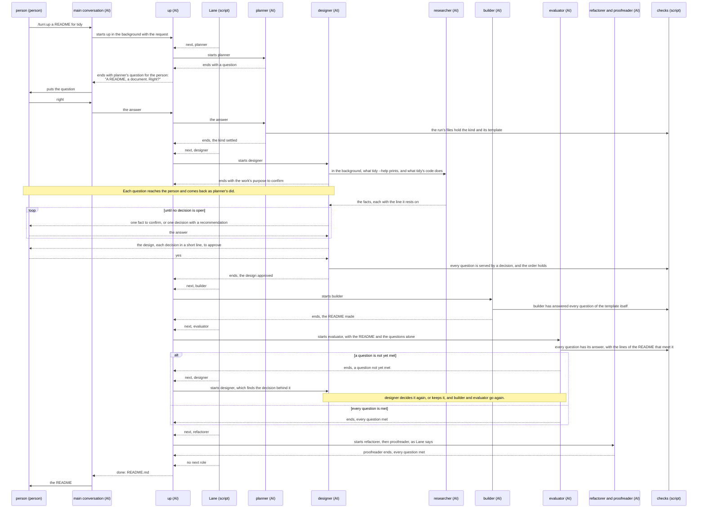
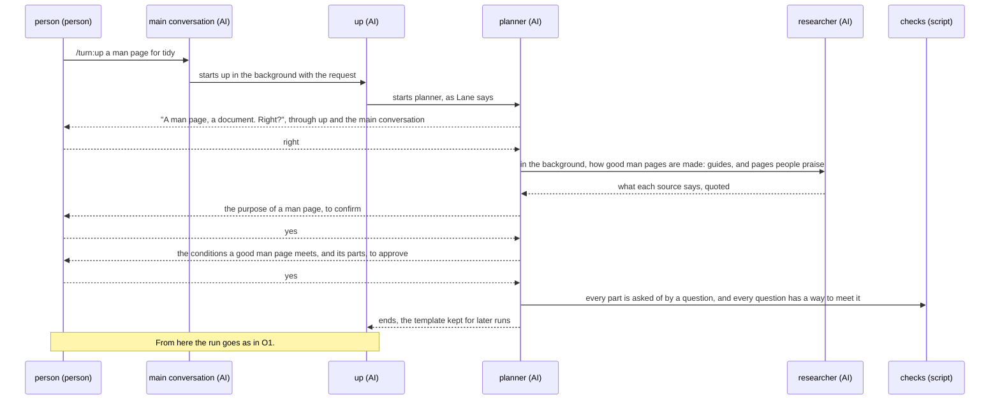
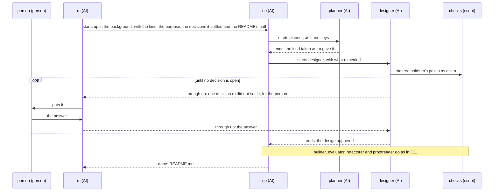

# Turn UX

Turn's user is the person who wants a work, such as a README or a module of code. A plugin such as
rn may stand between that person and Turn: rn calls Turn for each work its plan needs, and is then
Turn's caller.

## OKRs

- O1: The person gets a work that meets their purpose well, and decides only what only they can
  decide.
  - KR1.1: Of the works Turn hands back, and the questions it puts to the person on the way, the
    share that goes wrong: a work the person changes, or asks to have changed, before they put it to
    use; or a question about a point the person did not need to decide, such as a fact Turn could
    find. Lower is better.
  - KR1.2: The lead time from the person's request to the work handed back, their answers included.
    Shorter is better.
- O2: The person gets a work of a kind that Turn has made none of before, as well made as a work of
  a kind it knows, and approves only the purpose of the kind and the conditions a good work of it
  meets.
  - KR2.1: Of the works of a kind new to Turn, the share that goes wrong: as KR1.1 says, or a
    condition of the kind that the person adds or changes after they approved the conditions. Lower
    is better.
  - KR2.2: The lead time from the person's request to the work handed back, the making of the
    kind's conditions included. Shorter is better.
- O3: A caller such as rn hands Turn what it has already settled, and gets back a work it can pass
  on as it is.
  - KR3.1: Of the works Turn hands back to a caller, the share that goes wrong: a work the caller or
    the person changes before it is used, or a point the caller had settled that Turn puts to the
    person again. Lower is better.
  - KR3.2: The lead time from the caller's start of Turn to the work handed back. Shorter is
    better.

In each objective, the first key result comes first: the second is shortened only by a change that
keeps the first.

Key results have no target values. When a measure becomes a target, it stops being a good measure
(Goodhart's law). Use the key results to judge how close the objective is.

## Scenarios

Each scenario makes a work for `tidy`, a command-line tool that sorts a Downloads folder. The
participants:

- person (person): wants the work, and decides what is theirs.
- main conversation (AI): the Claude Code conversation the person talks in. It runs `/turn:up`, puts
  each question to the person as it comes, and hands each answer back.
- `up` (AI): Turn's orchestrator, the subagent that starts Turn's other subagents, its roles.
- planner (AI): the role that settles the kind of work and its template: the parts a good work of
  the kind has, and the questions it answers yes to.
- designer (AI): the role that settles this work's purpose and each decision the work needs, and
  asks the person what is theirs.
- builder (AI): the role that makes the work from the decisions.
- evaluator (AI): the role that uses the work as its user would, and answers each question of the
  template.
- refactorer and proofreader (AI): the roles that better how the finished work says what it says,
  and check it, without changing what it says.
- researcher (AI): a subagent that finds one fact, such as what `tidy --help` prints.
- Lane (script): the checks laid into Turn, which tell `up` each next role to start from how the
  last one ended, such as with every question met.
- checks (script): the scripts that check the run's files, such as that each question of the
  template has an answer.
- rn (AI): the caller in O3.

Every role runs in the background, so the main conversation stays free to put a question to the
person as soon as a role asks one. A role that asks ends with its question, and goes on with the
answer once it is handed back. Parts of the work that stand apart, such as two modules that use
nothing of each other, are made and checked at the same time.

### O1: The person gets a README for tidy

Turn knows the kind `readme`: it ships a template for it.

### O2: The person gets a man page for tidy

Turn ships no template for a man page, so planner makes one before designer starts.

### O3: rn has Turn make tidy's README

rn has already settled the kind, the README's purpose and where it lies.

