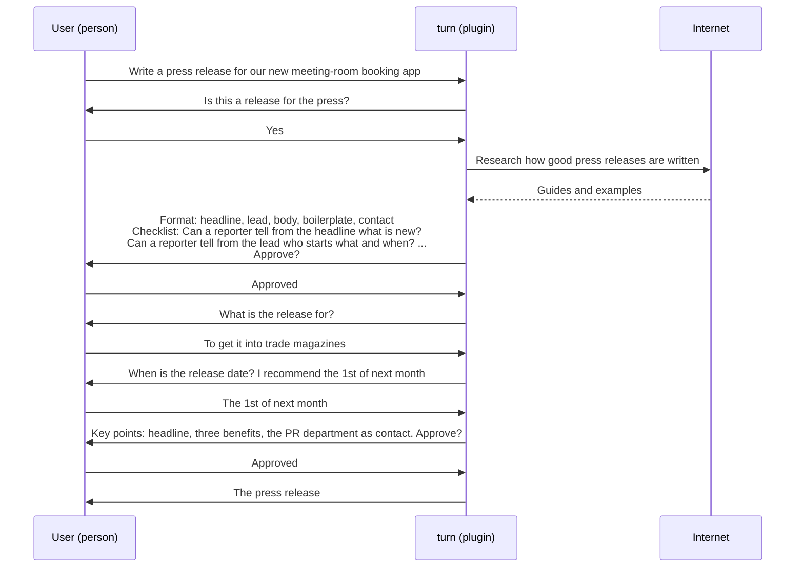

# turn UX

## OKRs

- O1: A person who wants a deliverable spends effort only on what only they can decide, and gets a
  deliverable that fully meets their purpose.
  - KR1.1: The changes the user asks for after delivery; fewer is better.
  - KR1.2: The times the user is asked something they did not need to decide; fewer is better.
  - KR1.3: The time the user spends answering questions and giving approvals; shorter is better.
  - KR1.4: The time from the request to delivery; shorter is better.

Key results have no target values. When a measure becomes a target, it stops being a good measure (Goodhart's law). Use the key results to judge how close the objective is.

## Scenarios

The participants are the user, a person; turn, a plugin; and the internet, where turn researches.

### O1: A press release for a new meeting-room booking app

