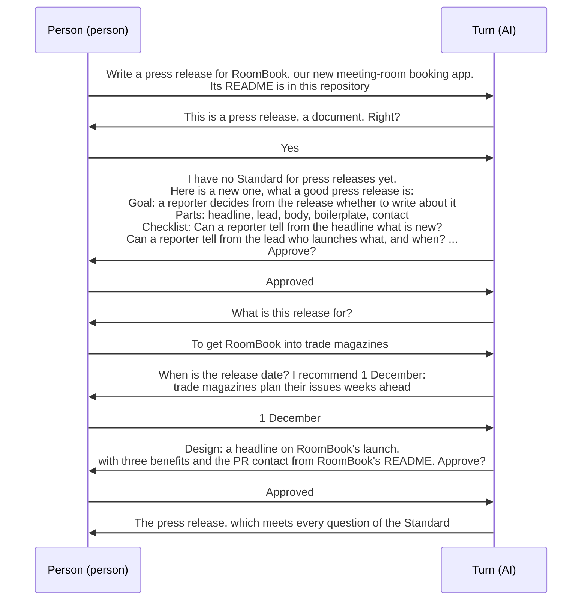

# Turn UX

## OKRs

- O1: A person who wants a piece of work gets one that meets their purpose well, soon after asking.
  - KR1.1: The share of requested works that the person puts to use as delivered, with no change
    that they ask for or make. Higher is better.
  - KR1.2: The lead time per work from the request to delivery, the person's answers and approvals
    included. Shorter is better.

KR1.1 comes first: KR1.2 is shortened only by a change that keeps KR1.1.

Key results have no target values. When a measure becomes a target, it stops being a good measure
(Goodhart's law). Use the key results to judge how close the objective is.

## Scenarios

The person who wants the work is a person. Turn is an AI: a Claude Code plugin.

### O1: The person gets a press release by answering only their own points

