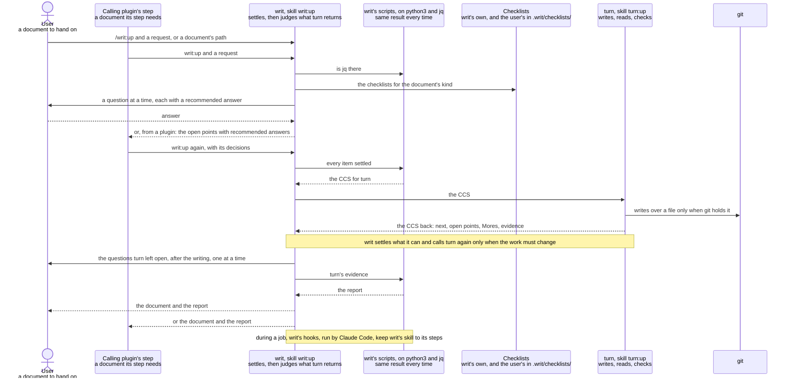

# writ design

This document is for whoever builds or changes writ: what writ must achieve, how each quality is
checked, and how writ is built to achieve it, for the benefits [writ](../../writ/README.md)
promises. How to use writ is in that README. How turn writes, reads and checks a work is in
[turn's design](../turn/design.md) and is taken here as given; what each checklist asks is in the
checklist itself; prompts' wording and steps are left to the code. A statement no trial has checked
yet is marked "(assumption)"; every other statement is a decision.

In one line: writ keeps the checklists and settles, with the user, what a document needs before it
is written; turn writes it, has it read and checks it; writ hands the user the document and turn's
decisions as a report.

The words used throughout:

- turn: the plugin writ depends on to make every document. A run of turn takes one task, writes the
  work, has an agent that did not write it read it as its reader, decides each item, and returns.
  writ is turn's caller, as [Calling turn from a plugin's step](../../turn/calling-from-a-plugin.md)
  describes; Good, More, a way to a Good and `next` are turn's words, used here as turn's design
  gives them.
- A document: any work writ makes, of every kind it has a checklist for, code and its tests among
  them, and of any other kind once its checklist is made.
- A checklist says what a document of one kind must give its reader, as items. The checklists of a
  job are the one for every document and the one for the document's kind, if there is one; code and
  its tests have their own, which stands alone.
- A job: one call of writ, from the request to the finished document with its report, or, when a
  plugin's step called it, to the points it hands back.
- A calling plugin: another plugin whose step calls writ, as rn's steps do.
- An open point: something an item of the checklists needs that the request, the repository and
  the sources named do not settle. A question is an open point put to the user, with the answer writ
  recommends where it can infer one.
- The report: what the user gets with the finished document; for each item, the lines that meet it.

## Goals

### Attractive quality

- Handed on without reading over: the user gets the document already read by an agent as its reader
  and checked against every item of its checklists, so they can pass it on without reading it in
  the reader's place.
- Asked only what the user alone can decide: before anything is written, writ looks up what the
  request, the repository and the sources settle, puts what it can infer to the user as a proposal
  to confirm, and asks only the rest, one question at a time; what turn finds open while it writes
  comes after the writing, so the user can leave writ at work.
- Judged from the report: the user judges the document item by item at the lines the report gives,
  instead of reading it all over.
- A kind writ has no checklist for: the user chooses between writing to the checklist for every
  document alone and making the kind's checklist with writ first; a checklist made is found again in
  later jobs, and a team that commits it writes to the same one.
- A document the user already has: named by its path, it is made again to its checklists.

### One-dimensional quality

Each must be no worse than in the version in use.

- Questions the user answers in a job: each one is the user's time, and the fewer there are, the
  more of the job they can leave to writ.
- Time and tokens: what a job takes, from the request to the finished document.

### Must-be quality

- Nothing guessed: nothing an item of the checklists needs goes into the document unless the request,
  the repository, the sources or the user settled it.
- The report is turn's decisions: every item the report shows met is a Good turn decided, with the
  lines turn named; writ reports nothing turn did not decide.
- The user's files can be got back: the document and any checklist writ makes are written by turn
  alone, which writes over a file only when git holds it as it stands.
- Missing tools: without python3 or jq, writ stops before its first question and says what to
  install, so no answer the user gave is lost to a failure later in the job.
- Outside a job, writ blocks nothing.
- Installing works: installing writ installs turn, and both writ and the marketplace pass
  `claude plugin validate --strict`, since a malformed manifest fails for every user at install.

### Backward compatibility

- `/writ:up`, as users type it: followed by a request in words, or by the path of a document they
  already have. Both must keep starting a job; the wording of writ's questions and the layout of the
  report may change, since people read them and programs do not.
- The `writ:up` skill, as calling plugins' steps call it: a call states the request and gets back
  either the finished document with its report or the open points with their recommended answers,
  and never a question put to the user. The call writ took before it was built on turn is not kept:
  its one caller, rn, is rebuilt on turn and released with writ.
- The checklists in `writ/checklists/`: turn's README points users there to copy them, builders of
  this marketplace open them by path, and calling plugins hand them to turn. Each stays at its path,
  opens with its name and version, and keeps the form turn's README gives for a checklist. Its items
  may change, with its version raised once for each release that changes them, so that a version
  names one text people judged by.
- A checklist writ made at `.writ/checklists/<kind>.md` in the user's repository: writ finds it there
  in every later version, and keeps using it as the user's own.
- Everything else writ writes for a job is its own and may change.

### Non-goals

- Checking a work: it is turn's alone, so writ holds no second way to check that could disagree
  with turn's.
- Running lint tools on a document: the README leaves them out.
- Claude Code choosing writ on its own: writ runs when it is called by name, by the user or by a
  calling plugin.
- Carrying what a run of turn learns into later jobs as rules: what is learned goes into the
  checklists, where every later job and every plugin that uses them gets it.

### Constraints

- writ is used by Claude, on a person's behalf, in a conversation or in a calling plugin's step.
- writ runs in Claude Code and holds only skills, hooks, scripts and its checklists;
  installing copies only its folder; its hooks run in every session where it is installed; a
  subagent can neither ask the user nor hear from its caller while it works.
- writ makes every document through turn, which writes, reads and checks one task per run, asks
  nothing while it works, and leaves to its caller whether to run it again.
- Users' machines run Python 3.9 or later with the standard library only, and jq; turn needs both.
- The document is in a git repository.

## Verification

### Attractive quality

Each is tried as the user would, in a repository made for the trial, and judged from the records
(the JSONL of every conversation and agent of the job) as well as the outcome, since the outcome
shows that something went wrong and the records show where.

- Handed on without reading over: tried on a README for a tool whose notes hold more than its reader
  needs and leave out what they need to start, where Claude alone writes from the notes as they stand
  (assumption). It passes when a fresh agent outside the job, reading the returned document as its
  reader on the same checklists, takes every item from it.
- Asked only what the user alone can decide: tried on notes that settle some of what the checklists
  need, leave one point writ can infer and one only the user can decide, and leave out a fact the
  repository shows. It passes when the user is asked the one point, alone in its message, is given
  the inferred one as a proposal, is never asked the fact, and gets the document with both answers
  in it.
- Judged from the report: it passes when, for every item, the lines the report gives are the lines
  turn's decision names, and a fresh agent reading only those lines takes the item from them.
- A kind writ has no checklist for: tried on release notes. It passes when the user is offered the
  two choices; with the second, the checklist is made with the user and put at
  `.writ/checklists/<kind>.md`, and a second request of that kind uses it without asking again.
- A document the user already has: tried on a committed document that misses some items. It passes
  when the document comes back meeting every item, made again from what it held, and git shows what
  it was.

### One-dimensional quality

Both are measured from the records of the same requests, run on this version and on the version in
use: the questions the user answered, and the time and tokens from the request to the finished
document.

### Must-be quality

Each is a test on the script or hook that holds it, in the case that would break it:

- Nothing guessed: a CCS asked for while an item of the checklists has no place filled, which the
  script refuses.
- The report is turn's decisions: a returned CCS whose evidence decides an item More, which the
  script refuses to make a report from, and one whose evidence names other lines than the report
  would give, which the report keeps as turn decided.
- The user's files can be got back: writ's skill writing or editing a file outside its own job
  files during a job, which a hook stops.
- Missing tools: python3 missing, and jq missing, at the start of a job.
- Outside a job: each hook run in a session with no job of writ open, python3 missing included,
  which does nothing.
- Installing works: `claude plugin validate --strict` on writ and on the marketplace, in CI.

### Backward compatibility

For each released version, tests, or trials where only Claude Code can run the call, call writ as
its users and calling plugins did: the forms of `/writ:up` start a job; a call of `writ:up` from a
calling plugin gets back the document or the open points, and no question; every checklist in
`writ/checklists/` is read by turn's checklist reader into a list with its name, version, opening
and items; and a checklist at `.writ/checklists/<kind>.md` is found for a request of that kind.

## Architecture

### Principles

- Checking is turn's alone: writ never decides whether the document meets an item; it reports turn's
  decisions as turn made them and decides only what to do next. Two checks would at times disagree,
  and the user could not tell which holds. Protects: the report is turn's decisions, handed on
  without reading over.
- Everything is settled before it is written: what the checklists need is looked up, inferred, or
  asked before turn is called, since a document written on an unsettled point is written again.
  Protects: asked only what the user alone can decide, nothing guessed, time and tokens.
- Asked only what only the user can decide: a fact is looked up, an inference is put with its
  recommended answer, and only what the request, the repository, the sources and the document's
  purpose leave open reaches the user, one question at a time, since with several the user answers
  the one they follow and the rest go by half-decided. Protects: asked only what the user alone can
  decide, questions the user answers.
- The same job whoever calls: a call from the user and a call from a calling plugin differ only in
  where open points go, to the user one at a time or back to the calling plugin with their
  recommended answers, since a calling plugin's step may run in a subagent, which cannot ask the
  user. Protects: the `writ:up` skill, asked only what the user alone can decide.
- What must come out the same every time is done by a script or a hook: a script does what a step
  asks and refuses a step whose steps before it are not done; a hook sees, as Claude Code runs the
  job, that a step was not left out or done otherwise, and stops it saying which step and what it
  needs. writ's hooks act only in a session whose job is open, and do nothing elsewhere, even without
  python3. Protects: nothing guessed, the report is turn's decisions, the user's files can be got
  back, outside a job.

### Structure

The figure shows who takes part and what each is for, what passes between them in order, and what
writ needs from outside: turn, which makes the document; Claude Code, which runs the skill and the
hooks; and git, which keeps what a file was before turn writes over it.

writ's skill runs where it is called, in the user's conversation or in a calling plugin's step, and
calls turn from there. Claude Code lets a subagent start agents of its own (Claude Code's
documentation on subagents), and turn asks nothing while it works, so it runs the same in either
place (assumption: turn has not yet been tried from a subagent).

### Choosing the checklists

Achieves: a kind writ has no checklist for, a document the user already has, `/writ:up`, the
checklists in `writ/checklists/`, a checklist writ made.

- When a job starts, a script lists the kinds there are checklists for, writ's own and those in the
  user's `.writ/checklists/`, each with its name and version. writ's skill names the document's kind
  from the request, or, for a path, from the document there, and takes the checklists of the job.
- A path the request names is both where the document goes and what it is made from, so turn makes
  it again from what it holds.
- Where there is no checklist for the kind, the choice between the checklist for every document
  alone and making the kind's checklist first is an open point like any other, with making it first
  recommended when the user will write that kind again.
- Must hold: every checklist used opens with its name and version, so each Good in the report can be followed back to the text it
  was judged by.
- Weighed: writing to the checklist for every document alone, without asking, was not chosen, since
  a kind written again would miss what only its own checklist asks every time. The cost: one more
  question the first time a kind is met.

### Settling before turn is called

Achieves: asked only what the user alone can decide, nothing guessed, questions the user answers,
time and tokens, missing tools, the `writ:up` skill.

What an item needs and the sources leave open, written as a guess, comes back from turn's reading
as a run spent; asked after the writing, it costs another. So writ settles each item before turn is
called, as deeply as turn's reading would test it, as an editor agrees the brief with the author
before a draft is begun.

- Before its first question, writ's skill ends the job saying what to install if python3 is
  missing, and a script does so if jq is.
- writ's skill reads each item of the checklists against the request, the repository and the
  sources, and sets the decisions they need as a tree, each taken up once the decisions it rests on
  are settled. A fact the repository or the official documentation shows is looked up, never asked.
- Each decision is written on a form with one place per item, saying where it is settled: a source
  and its lines, an answer of the user, a proposal the user confirmed, or, from a calling plugin, an
  open point with its recommended answer.
- Called by the user, writ asks each open point as a question, one at a time, with its recommended
  answer. Called from a calling plugin, it asks nothing and hands every open point back, and the
  calling plugin decides them and calls writ again.
- A script writes the CCS for turn from the form, and refuses while any place is empty.
- Must hold: no CCS reaches turn while an item of the checklists is unsettled.
- Weighed: this way of questioning is taken from mattpocock's `grilling` into writ's steps rather
  than depended on, since the dependency installs 27 skills, `grilling` starts on any mention of
  "grill", and its tags cannot pin a version. One question at a time, as `grilling` once asked and
  as the user found right in use, not every ready question at once as it asks now, since asking
  several at once has many reports of questions bundled that depend on each other. The cost: writ's steps carry the way, and improvements to `grilling` reach
  writ only when they are taken in by hand.
- Weighed: leaving every open point to the questions turn returns at the end was not chosen, since
  each run of turn on unsettled sources raised finer questions that the document's purpose did not
  need, and a document written without the answers was written again (seen in trials). The cost: the
  user answers before the first draft exists.

### Judging what turn returns

Achieves: handed on without reading over, asked only what the user alone can decide, questions the
user answers, time and tokens, the report is turn's decisions.

turn runs one round per call and leaves to its caller whether to run again, since the caller knows
what was agreed. writ judges each thing a run returns from the document's purpose, and decides only
what to do next; whether an item is met stays turn's.

- An open point turn returns, or an item it returns as More with its way: writ judges from the
  document's purpose what each needs, settles itself what the purpose and the sources settle,
  puts to the user one at a time, or hands back to the calling plugin, only what the user alone can
  decide, and corrects its own part of the CCS where the way lies in what writ told turn the
  document should be. A point the purpose does not need is settled too: writ tells turn, as part of
  what the document should be, that the document leaves it out and why, so the item is judged
  against that decision rather than left open.
- An item that does not settle once every point it rests on is decided points to its checklist
  asking more than its kind's purpose needs; writ brings the checklist's change to the user, since
  what is learned goes into the checklists and a checklist changes only on the user's agreement.
- writ calls turn again, with the CCS turn returned, only when what it settled or a way changes the
  document; called again, turn starts from the document as it stands. A rule turn adds to that CCS,
  for how such work is made, rides in the job's later calls of turn and in no later job, since what
  is learned goes into the checklists.
- Must hold: writ never changes turn's decision on an item, never writes the document itself, and
  ends a job with a report only when every item is Good.
- Weighed: calling turn again on everything it returns, as a matter of course, was not chosen, since
  each run on points the document's purpose did not need raised finer ones (seen in trials). The
  cost: writ judges each thing turn returns before it calls again.
- Weighed: writ checking the document again itself was not chosen, as the principle says; the check
  would be a second one beside turn's. The cost: writ's report is only as sound as turn's
  reading.
- Weighed: a loop of runs inside turn was not chosen, since turn's caller knows what was agreed and
  already calls turn again with the user's answers. The cost: writ reads what each run returns
  before deciding.

### The report

Achieves: judged from the report, the report is turn's decisions.

The report is to the document what a test run's summary is to code: each item, and where it is met.

- Only a job that ends with every item Good has a report: once turn returns `done` with every item
  Good, a script makes the report from turn's evidence, for each checklist, each item's ID and
  title, and the lines of its Good, and refuses evidence with an item still More. writ gives the
  report to the user with the document, or hands both back to the calling plugin.
- Must hold: every line of the report comes from a Good in turn's evidence, unchanged, and no report
  is made while an item is More.
- Weighed: a script, not writ's skill, writes the report, since a report copied by hand may differ
  from the decisions it reports, and the user trusts each line without opening the evidence.

### Making a checklist

Achieves: a kind writ has no checklist for, a checklist writ made.

- When the user chooses to make the kind's checklist first, writ makes it as a job of its own: its
  checklist is writ's checklist for checklists, its reader is whoever writes or judges that kind,
  and it is settled with the user in the same way before turn makes it at
  `.writ/checklists/<kind>.md`. The document is then made against it.
- Must hold: a checklist writ makes opens with its name and version, as turn needs, and is found by
  the next job that asks for its kind.
- Weighed: keeping the user's checklists in the user's repository, not in writ's folder, since an
  update of writ replaces its folder, and a checklist committed with the repository is shared with
  the team. The cost: the user commits it.

### Keeping writ's steps

Achieves: nothing guessed, the user's files can be got back, the report is turn's decisions,
outside a job.

- A hook, before `turn:up` is called in a job, stops a call made with anything but the CCS the
  script wrote from a full form.
- A hook, before a file is written or edited in a job, stops writ's skill writing anything but its
  own job files, so the document and every checklist are written by turn alone.
- A hook, as writ's skill stops, keeps it at work while the job is open and neither the report nor
  the open points have been handed back; it says so once, so the skill is never held in a loop.
- Each hook says which step went wrong and what that step needs.
- Must hold: during a job, every write to the document goes through turn, and every call of turn
  carries a CCS made from a full form.
- Weighed: hooks that block, not checks afterwards, since a document written outside turn has
  skipped its reading by the time a check finds it. The cost: a check on each write and each call of
  a skill during a job.

### Installing with turn

Achieves: installing works.

- writ's manifest names turn among its dependencies, so installing writ installs turn.
- Must hold: writ and the marketplace pass `claude plugin validate --strict`.
- Weighed: depending on turn, not keeping its way of writing, reading and checking inside writ, since
  two copies would drift apart and checking would no longer be turn's alone. The cost: the user
  installs a second plugin, which installing writ does for them.
