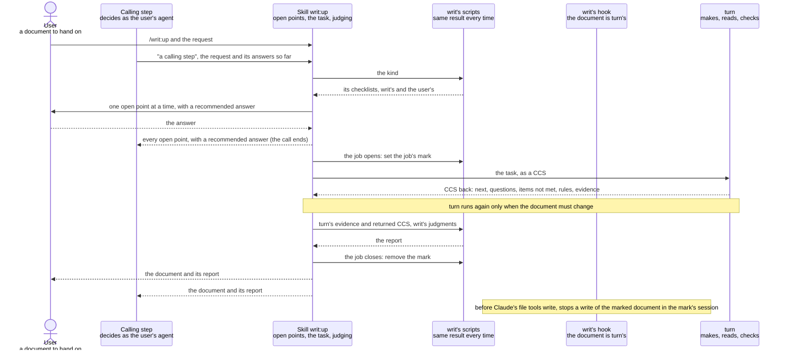

# writ design

This document is for whoever builds or changes writ: what writ must achieve, how each quality is
checked, and how writ is built to achieve it, for the benefits [writ's README](../../writ/README.md)
promises. Its point: writ is a thin wrapper of turn. turn makes the document, has it read in its
reader's place and checks it; writ adds only what turn cannot know: which checklists measure the
document, what the user decides, and which of what turn returns the document's purpose needs, by
the one test given with the words below; and it hands its caller every decision it made or left. A
change fits when it keeps writ to that and costs the user no question, time or tokens that test
does not call for.

Left out, though a builder might look for it here: how to use writ, which is the README's; how turn
makes, reads and checks a work, which is [turn's design](../turn/design.md); what each checklist
asks, which the checklists say; and the wording of writ's prompt, its file names and the forms it
writes, which are the code's and change with each build. A statement no trial has checked yet is
marked "(assumption)".

The words used throughout:

- A checklist says what a document of one kind must give its reader, as items, each one question. An
  item is met when turn, below, has shown it in lines of the document.
- turn: the plugin writ is built on. Handed one task, it writes the work, has an AI that did not
  write it read the work as its reader, checks each item against that reading, and returns. It asks
  nothing while it works: what only the user can decide it leaves out of the work and returns as a
  question at the end, beside each item not met. Besides these it may return rules: a rule is a
  change in how such work is made, returned when turn finds that it would meet an item, for later
  work of the kind to follow. It keeps, as its evidence, the lines that meet each item or what the
  work would take to meet it, and each checklist's name and version.
- The request: what writ is asked for, a kind of document or the path of one already there, with
  whatever is said of it, such as the sources to make it from.
- A call: writ at work once, from being started until it stops, started by the user typing
  `/writ:up` or by a calling step: a step of another plugin, such as rn's, that has the skill
  `writ:up` make a document, saying as it starts writ that it is one. The caller is whoever started
  the call: the user or the calling step.
- An open point: a decision that an item of the checklists asks for and that the request does not
  state outright. writ settles one itself only from the request, the repository or the sources,
  never by a guess; one these do not settle goes to the user, and is answered by the user or by a
  calling step in the user's place.
- The task: what writ hands turn: where the document goes, its reader, their use of it and what they
  must be able to do with it, the checklists, the sources and every answer. It is written as a CCS,
  the JSON file turn takes and writes back, in the form
  [turn's page for plugins' steps](../../turn/calling-from-a-plugin.md) gives.
- A run: turn at work once, from the task it is handed to the CCS it writes back.
- The report: what writ hands back with the document: first what the caller decides, then each
  item met with its lines.
- What the purpose needs: the one test writ applies wherever it weighs whether to ask, meet or leave
  something. The purpose is the document's reader, their use of it and what they must be able to do
  with it, as the task states them. An open point, an item or a question is needed when the
  reader's use or a decision of theirs rests on it: without it, or with another answer to it, the
  reader would decide or act otherwise. Otherwise it is not needed, as the finer questions turn
  raised on a CSV tool's README, such as tabs, encodings and line endings, were not: neither the
  developer's deciding on the tool nor their starting with it changes with the answers (seen in
  three runs, 2026-10-14). When writ cannot tell from the task, the repository and the sources
  whether the reader's use rests on it, the test leaves the case undecided, and writ puts it to the
  user as a question with a recommended answer, since a point that may change what the reader does
  is the user's to decide. The cost: one more question for each such case, counted in questions
  answered, and, for a case that shows up only in what turn returns, the run of turn that puts its
  answer in.
- What turn hands back: the document, written where the task says, and the CCS the run writes back,
  in the form [turn's page for plugins' steps](../../turn/calling-from-a-plugin.md) gives for it. In
  that CCS, `next` always names one of four outcomes, each telling writ one thing:
  - `done`: nothing is left for the user.
  - `ask the user`: the CCS holds each question only the user can decide, which the document leaves
    out until it is answered, and each item not met that the document can meet as writ asked for
    it, with how it would be met.
  - `to the caller`: the CCS cannot be run, or an item would be met only by a change in what writ
    wrote in the task, which turn never rewrites; such an item comes back here, never with `ask the
    user`.
  - `stopped`: the user pressed Esc during the run and said what they want instead, and the
    document is as it was before the run.

  With it come the rules turn adds after writ's own entries, and where turn keeps its evidence.
  What writ does on each outcome is in Judging what turn returns.
- The job: the stretch of one call from just before writ first starts turn until writ stops, by
  handing the document back or by putting points to the caller.
- The job's mark: what tells writ's hook that a job is open, and on which document. It holds the
  document's full path and the session the job was opened in.

## Goals

### Attractive quality

- **Asked only what the user alone can decide**: before turn runs, writ settles every open point the
  request, the repository and the sources settle, looking facts up rather than asking, and asks the
  user, one question at a time, each with a recommended answer, those of the rest the purpose needs
  or the test leaves undecided. Once writ says it is writing, the user can leave it at work.
- **Handed on without reading it over**: the document comes back with every item the purpose needs
  met, as turn last read it in its reader's place and checked it, whether written anew or made again
  from one the user already has; an item left not met is one the purpose does not need, or one the
  user, asked, chose to leave.
- **Judged from the report**: the caller reads first what is theirs to decide, each with its ground,
  and judges each item met at the lines the report gives for it, instead of reading the document
  over.
- **A checklist for each kind**: writ keeps checklists for documents, READMEs, design documents,
  prompts, code and its tests, and checklists. For a kind it has none for, the user chooses between
  the checklist for every document alone and having one made with them first, and a checklist made
  is used for that kind from then on.

### One-dimensional quality

Each must be no worse than in the version in use.

- **Questions answered**: how many questions the user answers for one document. Each one beyond what
  only they could decide is time they spend on what writ could have settled.
- **Time and tokens**: what one document takes, from the request to the document handed back.

### Must-be quality

- **The report holds**: every item the report shows met is one turn showed met, at the lines turn
  named, and every item turn left not met, every question it left open and every rule it returned is
  in what the report puts first; writ holds no check of its own.
- **The document is turn's**: the document handed back is the version turn last read, since during a
  job nothing but turn writes it.
- **Nothing of the user's lost**: a document already there is written over only when git holds it as
  it stands.
- **Missing tools**: without python3 or jq, writ stops before its first question and says what to
  install; outside a call, a missing tool breaks nothing.
- **Installs with turn**: installing writ installs turn, and writ's manifest passes validation.

### Backward compatibility

- **`/writ:up`**: relied on by users, who type it. Must keep holding: a request naming a kind of
  document, or the path of one, gets the document and its report. May change: the questions' wording
  and order, and the report's layout.
- **`writ:up` from a calling step**: relied on by plugins whose steps make documents through writ,
  rn first. Must keep holding: a calling step that starts writ with a request and the answers it has
  settled gets back either the document with its report, or every open point writ would ask the
  user, with a recommended answer; started again with the same request and its answers to those
  points, writ goes on as if they had been settled in the first call. The form the calling step
  reads to tell which of the two it got, and what the report puts first, are kept as released. May
  change: the wording of each point and its recommendation. rn 0.9.0 started the earlier writ with
  instructions in words and read a report file; rn is rebuilt on this writ and released with it,
  so that earlier way of starting writ is replaced, not kept.
- **writ's checklists**: relied on by turn, which reads each by the name and version it opens with;
  by turn's README, which points users to them to copy; and by users who copied them. Must keep
  holding: each opens with its name and version in the form turn's README gives; an item's ID always
  means the same item; a checklist's version goes up once for each release that changes it, so the
  version a report names is the text the document was judged by. May change: where they sit inside
  writ, with turn's README changed in the same change, and an item's wording in a new version.
- **A checklist writ made**: relied on by the user and their team, who commit it and write to it,
  and by writ, which finds it again. It is at `.writ/checklists/<kind>.md` in the user's repository,
  as the README names it. Must keep holding: a checklist at that path is used for its kind. May
  change: nothing of it is writ's once written; the user may edit it.

### Non-goals

- Checking the document: it is turn's alone. writ adds no AI check of its own, and its builder
  judges turn's result rather than a second checker's (decided by the user, since a fresh agent set
  to check a README judged beyond the README's scope and disagreed with turn, seen once, on one
  README, 2026-10-14). The cost: a slip turn's check lets through reaches the caller with nothing
  from writ to flag it.
- Keeping anything between calls: each call brings everything settled so far, and a call that ends
  leaves no job behind. The cost: the conversation or the calling step holds every answer and brings
  it again, and a call cut off is started again from them.
- Telling turn what the document may leave out, or shaping turn's check in any other way: what turn
  returns is judged afterwards, by writ. The cost: turn may return questions and items not met that
  the purpose does not need, finer ones with each run; writ weighs each by the test of what the
  purpose needs, asks no question and runs turn no further for one the reader's use does not rest
  on, and puts each such one first in the report with the use or decision it does not touch, so the
  caller still sees it.
- Adding to a checklist: writ hands each rule, question and item left to its caller, who decides
  whether a checklist or their later work takes it in. The cost: what one document taught reaches a
  checklist only when the caller adds it.
- Lint tools, and Claude Code choosing writ on its own: the README leaves both out. The cost: a user
  who wants either runs it apart, and starts writ by name.

### Constraints

- writ runs in Claude Code and holds only skills, hooks and scripts. Installing copies only its
  folder, so its checklists travel in it and a checklist made for the user lives in their
  repository; its hooks run in every session where it is installed.
- writ uses turn only as turn's page for plugins' steps,
  [Calling turn from a plugin's step](../../turn/calling-from-a-plugin.md), gives it: the skill
  `turn:up` started with a CCS, and the CCS turn writes back, since turn may change everything
  inside.
- A subagent cannot ask the user, and a calling step may run in one (Claude Code's documentation on
  subagents, as read on 2026-10-14: a subagent has no AskUserQuestion and no way to reach the
  conversation that started it while it works).
- Users' machines run Python 3.9 or later with the standard library only, and jq; the document is in
  a git repository. turn runs on all three, and writ's own scripts require no more.
- writ is used by Claude on a person's behalf, from a conversation or from a calling step.

## Verification

Each attractive quality is tried on its own and judged from the records: the JSONL of every
conversation and agent the call started, on the model the user's conversation runs and the models
turn's agents name, never a smaller one. Each passes on what happens to the user, not on the shape
of what writ writes.

The flow, from the request through the open points, the task and turn's return to the handing back,
is tried apart from what turn makes, on the smallest task that shows it: a note of a few lines
against a checklist of two items, one of which the note's sources leave to the user. The flow passes
when writ asks that one point, runs turn once, and hands back the note with its report, the answer
in it. The note asks turn only for something to hand on, so the trial spends no real document's cost
and does not fail where only turn's work falls short.

### Attractive quality

- **Asked only what the user alone can decide**: tried on the README of a small tool that tidies CSV
  files, from notes that say what it does and how to run it but not its license, in a repository
  with no license file. The notes settle every other point, so any other question shows writ asking
  what it should have looked up; the license is the one point only the user can decide. Passes on
  the questions alone: writ asks that one question, with a recommended answer, before turn runs,
  and asks nothing else.
- **Handed on without reading it over**: tried twice: on the same README from nothing with every
  answer given, and on the same request where the tool already has a committed README, which is what
  makes turn write over a file. Passes when every item the purpose needs is met in turn's evidence,
  and each item left not met is one the purpose does not need, or one the user, asked, chose to
  leave. The builder judges need from the records by the same test writ applies: an item is needed
  when the developer's deciding on the tool or their starting with it rests on it.
- **Judged from the report**: tried in a call of its own on the flow trial's note and checklist,
  with the point the user decides there given in the request, so the report has two items to show
  and the answer writ took from the request to put first. Passes when the report puts first that
  answer, with its ground, and each rule, question left open and item not met that turn's evidence
  and returned CCS hold, and nothing else; when turn returned none of these, that answer alone is
  put first. And the lines it gives for each item met give that item when opened.
- **A checklist for each kind**: tried on "the release notes for 1.4" in a repository with no
  checklist for release notes. Passes when writ puts the choice before any other question; choosing
  the checklist for every document alone, the notes are written to it; choosing to have one made, a
  checklist is made with the user against the checklist for checklists, put at
  `.writ/checklists/release-notes.md`, and the notes are written to it; and a second request for
  release notes uses it without putting the choice again.

### One-dimensional quality

Both are measured from the records of the same requests, the CSV tool's README and the release
notes, answered the same way, on this version and on the version in use: the questions the user
answered, the minutes, and the tokens from the request to the document handed back.

### Must-be quality

Each is a test on the script or hook that holds it, in the case that would break it:

- **The report holds**: given turn's evidence and returned CCS with items met and not met, a
  question left open and a rule, the report shows met only the items the evidence shows met, with
  their lines, and puts first every item not met, the question and the rule.
- **The document is turn's**: the hook stops a write and an edit of the document in the session
  whose job is open, and lets through a write of another file, the same document in another session,
  and anything once no job is open; a job left open by a call cut off stops nothing once writ is
  started again in that session.
- **Nothing of the user's lost**: turn's own test, on a file where the work goes with changes git
  does not hold; writ adds none, since turn's check stops the case.
- **Missing tools**: with python3 or jq missing, writ's first check says what to install; the hook,
  run where python3 is missing, stops nothing.
- **Installs with turn**: `claude plugin validate --strict` passes for writ and for the marketplace
  on every push, and writ's manifest names turn among its dependencies.

### Backward compatibility

- **`/writ:up`**: a trial of its own on the flow trial's note, typed as users type it: once naming
  the kind, and once naming the path of the note, committed. Passes when each gets the document and
  its report.
- **`writ:up` from a calling step**: a trial: the CSV tool's README requested by a calling step
  inside a subagent. Passes when writ asks nothing and returns the license point with a recommended
  answer, and, started again with the same request and the answer, hands back the README naming it,
  with its report.
- **writ's checklists**: a test has turn's own script read every checklist writ keeps into its list,
  and finds each one's name, version and items.
- **A checklist writ made**: a test on the script that finds the checklists for a kind: in a
  repository holding `.writ/checklists/<kind>.md`, that checklist is found for its kind.

## Architecture

### Principles

- writ adds to turn only what turn cannot know: which checklists measure the document, what was
  decided, and which of what turn returns the purpose needs. Making, reading and checking
  stay turn's; writ neither repeats a check turn makes nor shapes it. Protects: the report holds,
  the document is turn's, time and tokens, and the constraint that writ uses turn only as turn's
  page for plugins' steps gives it.
- Only what the user alone can decide reaches the user: writ settles a point from the request, the
  repository or the sources alone, puts to the user what these do not settle, and does not ask at
  all a point the purpose does not need. Protects: asked only what the user alone can decide,
  questions answered.
- Each call brings everything settled so far, and writ keeps nothing between calls: what was decided
  lives in the conversation or in the calling step, as the request and its answers, and what writ
  decided or left goes back to the caller in the report. So a call from a calling step and one from
  the user go the same way, and a call that ends leaves nothing behind. Protects: `writ:up` from a
  calling step, judged from the report, the document is turn's.

### Structure

writ's skill stands between its caller and turn: it hears the caller, hands turn the task, and
judges what turn returns, with scripts and one hook doing what must come out the same every time.
The figure shows who takes part and what each is for, what passes between them and in what order;
the list after it, what each cannot work without.

- The skill runs in its caller's conversation: the user's, or the calling step's, a subagent
  included. It cannot work without turn, the checklists, and Claude Code, which runs it and the
  hook.
- The scripts run on python3 and jq; the hook runs on python3, and without it does nothing.
- turn cannot work without the task as a CCS, git, python3 and jq, as its README says. It writes
  the document by its own script when a run returns, not with Claude's file tools (checked in
  turn's scripts as this repository holds them at commit `8062147`; turn's hooks and agents were
  not read for it), so writ's hook never stops turn.

### Picking the checklists

Achieves: a checklist for each kind, writ's checklists, a checklist writ made.

Every checklist found for the kind goes to turn, and for a kind with none, the user first chooses
whether to have one made.

- writ tells the kind from the request: from its words, or from the path and the document there.
- A script, given the kind, finds writ's checklist for it and a checklist at
  `.writ/checklists/<kind>.md` in the user's repository. writ also takes each checklist that a found
  one's opening says applies with it, as the README checklist's says of the checklist for every
  document.
- For a kind with no checklist, writ puts the choice to the user before any other point, since every
  other point rests on the checklists. To have one made, writ makes it first as a document of the
  kind "checklist", against the checklist for checklists, heard from the user like any other, and
  writes it to `.writ/checklists/<kind>.md`; the request then goes on with it. The two are made one
  after the other, never one inside the other.
- Must hold: every checklist found for the kind is handed to turn.
- Weighed: writ's own checklists changed in a user's repository, as a checklist made is. Not chosen,
  since on a user's machine they sit in writ's installed folder, outside git, and an update replaces
  them. The cost: a checklist the user made is not improved by writ's updates.
- Weighed: the checklist for every document alone, without asking, for a kind with none. Not chosen,
  since a kind the user writes again is better served by its own checklist, and only they know
  whether they will. The cost: one more question, on the first document of each such kind.
- Weighed: making the checklist inside the document's job, as a job started inside another. Not
  chosen, since the document's open points rest on the checklist, so it is made first. The cost: the
  user hears two rounds of questions, one for the checklist and one for the document.

### Hearing the user

Achieves: asked only what the user alone can decide, questions answered, missing tools,
`/writ:up`, `writ:up` from a calling step.

writ settles every open point it can look up, and of the rest asks only those the purpose needs or
the test leaves undecided, one point at a time, each with a recommended answer.

- This is the way of a careful interviewer working down a tree of decisions, as in mattpocock's
  `grilling` skill: each branch is walked, settling a decision before those that rest on it.
- First, a check written for sh, since python3 itself may be missing, looks for python3 and jq, and
  writ stops saying what to install if either is missing, before any question.
- writ goes through every item of the checklists against the request, the repository and the
  sources, and lists the open points. A point is taken up only once those it rests on are settled,
  such as the reader before what the document must give them.
- Each open point is weighed by the test of what the purpose needs: one the purpose does not need
  is not asked, and if turn finds it still open and returns it as a question, it is judged as in
  Judging what turn returns; one the test leaves undecided is asked like one the purpose needs.
- What the repository, the sources or the documentation of what they use can settle, writ looks up
  instead of asking. Each point it puts carries a recommended answer, and the ground for it.
- writ tells its caller from the call itself: a calling step says, as it starts writ, that it is
  one, and brings the request with every decision it has made as answers; any other call is the
  user's, typed as `/writ:up` with a request. Whether writ runs in a subagent is not looked at: a
  calling step may run in the main conversation, so where writ runs does not tell who started it.
  The cost: a calling step that does not say it is one is taken for the user, so writ puts its
  points one at a time where, inside a subagent, no one can answer them (Constraints), and the
  step gets one question back instead of every open point.
- Started by the user, writ asks one point per question, since with several the user answers the
  one they follow and the rest go half-decided. Started by a calling step, it asks nothing and
  returns at once every open point it would have asked, each with its recommended answer, and the
  call ends; the calling step decides them and starts writ again with the same request and its
  answers.
- When no open point is left, writ writes the task with every answer, the user's, the calling step's
  and its own.
- Must hold: no question reaches the user whose answer the request, the repository or the sources
  hold, or that the purpose does not need.
- Weighed: depending on `grilling` instead of taking its way into writ's prompt. Not chosen, since
  installing it brings 27 skills, it starts on any mention of "grill", and its tags cannot pin a
  version (found on 2026-10-14, when it was tagged `v1.3.1`; how many skills come with it and
  what starts it may differ in other versions). The cost: what improves in `grilling` reaches writ
  only when writ's prompt takes it in.
- Weighed: every ready question at once, as `grilling` asks in its versions after 2026-07-13. Not
  chosen, for the reason above, and since up to that version it asked one at a time ("Asking
  multiple questions at once is bewildering"), which the user has used and found right. The cost:
  more turns of the conversation.
- Weighed: a form with a decision for every item, which a script refuses to turn into a task until
  each is filled. Not chosen, as more than a thin wrapper of turn calls for: whether each item is
  met is turn's to decide, and a decision written per item repeats it. The cost: whether writ went
  through every item shows only in the records, not in a refusal.
- Weighed: a place in the repository for the questions being asked. Not chosen, since the answers
  live in the conversation or the calling step. The cost is that of keeping nothing between calls
  (Non-goals).

### Handing the job to turn

Achieves: handed on without reading it over, the document is turn's, nothing of the user's lost.

During the job, the document is written by turn alone, held so by one hook.

- writ writes the task as a CCS and starts `turn:up` with it. A document the user already has is
  named both as where the document goes and as a source, so turn makes it again from it.
- The job opens just before writ starts `turn:up`: a script, run by the skill, sets the job's mark.
  The skill hands the script its session as Claude Code writes it into a skill's text.
- The mark is kept in writ's own data directory, which Claude Code keeps for each plugin outside
  every repository, so the hook in any session can read it, and once the job closes nothing of it
  is left there or in the user's repository; its file name is the code's. Weighed: keeping it in
  the user's repository. Not chosen, since it would show among the user's changes, and one left by
  a call cut off would stay in their work. The cost of the data directory: a mark left by a call
  cut off, in a session where writ is never started again, stays there as a small file that stops
  nothing.
- The hook acts before Claude's file tools write or edit a file. It takes its own session from the
  input Claude Code hands every hook, looks for a mark of that session, and compares the file's
  path with the mark's; it stops the write when they are the same, saying that during writ's job
  the document is turn's to write, and a change to it goes to turn in the task. With no mark of its
  session, or another file, it does nothing, so the hook of every other session never acts on the
  mark. How the skill and the hook each get the session is as Claude Code's skills and hooks
  documentation gives it, as read on 2026-10-14; that the two name the same session when writ runs
  inside a subagent is an assumption until the calling-step trial shows it.
- The job closes whenever writ stops, by handing back or by putting points to the caller: the
  script removes the mark. When writ is started, the script also removes a mark of that same
  session, so one left by a call cut off lasts only until then. The cost: until then, Claude's file
  tools cannot write the document in that session, even when the user asks for a change to it
  outside writ; starting writ again or opening a new session frees it.
- A file where the document goes with changes git does not hold is turn's to stop; writ adds no
  check of its own.
- Must hold: during a job, the document changes only by turn; no job outlives the call that opened
  it, except one cut off, which lasts until writ is next started in its session.
- Weighed, and dropped as more than a thin wrapper of turn calls for, each for its own reason:
  - a Stop hook keeping writ at work until it hands back, since turn keeps its own run to its end
    and writ's skill ends when it hands back; the cost: writ stopping early shows only in the
    records;
  - a check after the job that the document was not written outside turn, since the hook stops such
    a write as it is made; the cost: a shell command that writes the document is seen by neither;
  - a check that turn is started with the CCS as a script wrote it, since turn checks the CCS
    itself; the cost: a task with a wrong answer in it shows only in the records.
- Weighed: checking for changes git does not hold before the first question, so the user is not
  heard and then refused. Not chosen, since turn's check already stops the case and this
  repository's plugin rules add no special path for it. The cost: such a user commits and asks
  again, with the answers still in the conversation.

### Judging what turn returns

Achieves: handed on without reading it over, asked only what the user alone can decide, questions
answered, time and tokens.

writ makes one of three moves on what turn returns, each decided by the test of what the purpose
needs: hand the document back, ask the user, or run turn again.

- writ weighs each question and item not met that `ask the user` holds as an editor sorts a
  reviewer's notes into those the author must settle and those the piece does without; the test,
  not the editor's feel, decides where the line falls.
- Hand the document back: on `done`, and on `ask the user` when all it holds is what the purpose
  does not need; each such question and item goes into the report with the use or decision of the
  reader that does not rest on it.
- Ask the user: a question the purpose needs and only the user can decide, and a question or an
  item the test leaves undecided, one at a time with a recommended answer, at the end, since the
  README promises that a question only the user can answer which shows up only in the writing comes
  at the end; and, on `to the caller`, the point itself, when the request, the repository and the
  sources do not settle how to correct what writ wrote. Started by a calling step, writ returns
  these to the calling step instead. The cost of asking at the end, after turn has run, rather than
  before: a further run of turn on the document with the answer.
- Run turn again, with the CCS turn returned, from the document as it stands, only when the document
  must change: an answer to put in; a point writ settles from the request, the repository or the
  sources; an item not met that the purpose needs, taken only from those `ask the user` holds; on
  `stopped`, the request rewritten from the user's words; or, on `to the caller`, what writ wrote
  corrected where the request, the repository or the sources settle the correction, which goes
  into the report as a change to what the request asked.
- A rule turn returns is carried into turn's next run within the call, since turn adds it to the
  CCS it returns, and goes into the report; whether it reaches a checklist or the caller's later
  work is the caller's to decide.
- Must hold: turn is never run again with nothing new to change the document; writ never changes the
  document itself.
- Weighed: running turn until every item is met. Not chosen, since each run raised finer questions,
  such as tabs, encodings and line endings, that the purpose does not need (seen in three runs on
  the CSV tool's README, 2026-10-14), so time and tokens grew with nothing gained. The cost: a
  document can come back with an item not met, which the report puts first with why and how it
  would be met.
- Weighed: putting every question turn returns to the user. Not chosen, since the user would answer
  questions the purpose does not need. The cost: writ may judge a point not needed that the user
  would have wanted settled (assumption: not yet seen in a trial), which the report puts first for
  them to see; a point writ cannot judge either way goes to the user, at the cost of one more
  question and a further run of turn for each, so the risk lies only in a point the test seemed to
  decide.

### The report

Achieves: judged from the report, the report holds.

The report puts first what the caller decides, and gives each item met only its lines, so reading it
never costs what reading the document over would.

- First, each with its ground: each rule turn returned; each question turn left open that writ
  judged the purpose does not need, with the use or decision of the reader that does not rest on
  it; each item left not met, with why writ left it, by the same test or by the user's choice, and
  how it would be met; each change writ made to what the request asked, when turn returned `to the
  caller`; and each point writ settled itself, with the request, the repository or the source it
  settled it from. The caller decides what follows from each.
- Then each checklist with its name and version, and each item met with the lines turn named.
- When writ hands back, a script writes the report from turn's evidence and returned CCS, with
  writ's judgments beside what they concern.
- Must hold: each item's state in the report is turn's decision, as turn's evidence holds it, and
  nothing turn returned not met, open or as a rule is missing from what the report puts first.
- Weighed: Claude writing the report from the evidence. Not chosen, since a script gives the same
  report every time and cannot show met an item turn did not. The cost: the script rests on the form
  of turn's evidence, which turn's design leaves free to change beyond the places a returned CCS
  points to, so writ's dependency on turn names the versions its report is tested on.
- Weighed: no report, the user opening turn's evidence. Not chosen, since the evidence keeps each
  item in turn's own files, where the user would have to learn turn's forms to judge the document.
  The cost of the report in its place is the script's, above.
- Weighed: writ adding what turn returned to a checklist itself. Not chosen, since only the caller
  knows whether a finding holds beyond this document. The cost is that under Non-goals: the caller
  does the adding.

### Installing with turn

Achieves: installs with turn.

Installing writ installs turn, since writ's manifest names turn among its dependencies.

- Must hold: the manifest passes `claude plugin validate --strict`, alone and in the marketplace.
- Weighed: telling the user to install turn as well. Not chosen, since a user who misses it gets a
  writ that cannot work. The cost: none beyond turn's own requirements.
