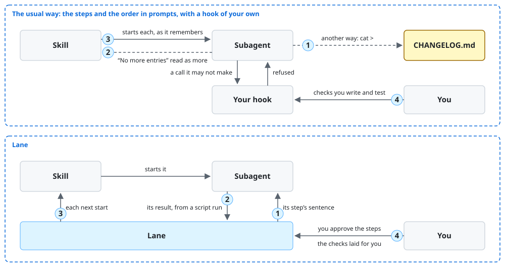
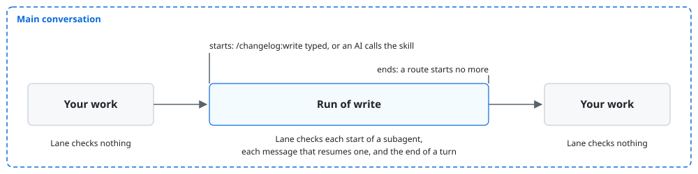
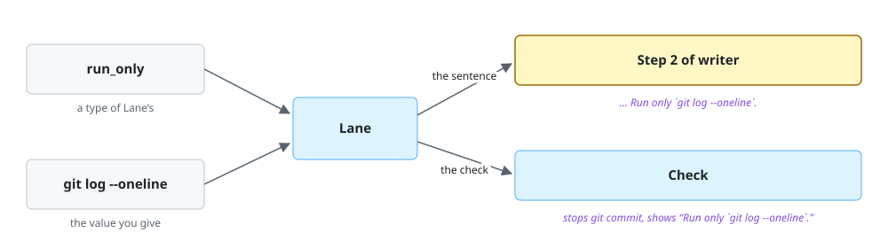
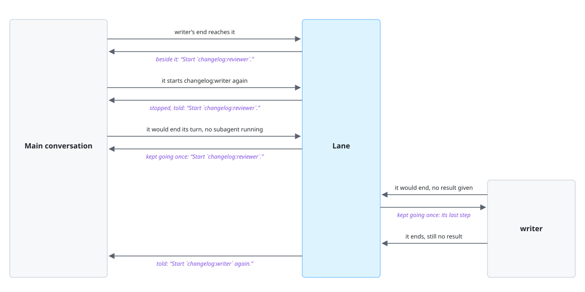
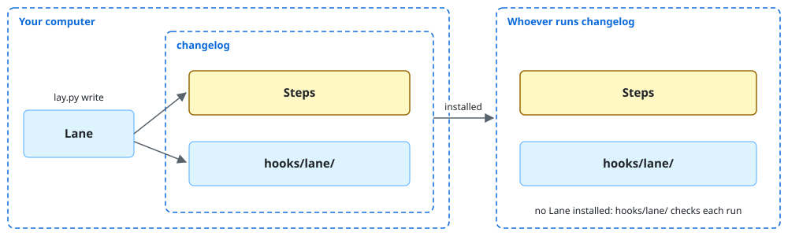

# Lane

Lane is a Claude Code plugin that has the skill and subagents of the plugin you build keep the
steps you wrote and go in the order you set, on every run.

Lane 0.1.0 is still in development and not yet released. The walkthrough below shows what Lane is
built to show, not yet a recorded run, as Lane is being rebuilt to hold the main conversation. A
real run's output takes its place once Lane is built.

Lane is for you when you build a Claude Code plugin whose skill and subagents work in numbered
steps, and some step must hold on every run. With it, your plugin runs as you designed it, and you
write no check and no code for the order.

**Non-goals**

- Lane checks only the skill that your routes name, while its run lasts, and the subagents that
  have rules. A route names the subagent the skill starts next after another one ends with a given
  result, a word such as `more`. A rule is a sentence of a step that Lane checks. So Lane never
  checks the work you do yourself in the same conversation.
- Lane is not a security boundary. Hold what must never happen, such as a merge, with GitHub's
  branch protection or Claude Code's permission rules.
- Lane sees tool calls and the end of work, not thoughts. "Compare each option" cannot be a rule.
- Lane does not read a shell command. A subagent with rules runs only the commands you name, each
  matched whole.
- Lane does not judge the work. The next start comes from the result a subagent gives.
- Lane approves no command for anyone. A command you hold for approval goes to the person through
  Claude Code's own permission prompt.
- Lane reads the texts your plugin writes, such as a list of items to answer, in one format. For
  another format, you write an adapter, as [The lanes](docs/lanes.md#the-ports) says.

## Requirements

- Claude Code 2.1.319 or later, where you build your plugin and where it runs: `claude --version`
  shows it.
- Python 3.9 or later, run as `python3`, on the same computers: `python3 --version` shows it.
- A plugin whose skill and subagents have their steps as a numbered list under `## Steps`:
  `claude plugin validate <your plugin's folder>` passes.
- Each subagent with rules, and each that your routes name, sets `background: true` in its
  frontmatter: `lay.py print` refuses your rules where one does not.

## Installation

```console
claude plugin marketplace add lovaizu/ccpm
claude plugin install lane@ccpm
```

`claude plugin list --json` then shows `lane@ccpm` with its `installPath`. Each version installs
in a new folder, so read `installPath` again after an update. Lane is ready when `lay.py` shows its
usage:

```console
$ python3 <installPath>/scripts/lay.py
usage: lay.py print <proposal>
       lay.py write <proposal>
       lay.py up <plugin>
```

## Walkthrough

At the end, your plugin `changelog` has run once with its subagent held to two rules and its
subagents started in the order you set, with no check or code of yours.

`changelog` writes a project's `CHANGELOG.md`, and lives in the folder `changelog/` of a git
repository. Its skill `write`, in `changelog/skills/write/SKILL.md`, starts the subagents:

```markdown
---
name: write
description: Has the CHANGELOG.md entries written and reviewed.
---

## Steps

1. Have the entries written and reviewed.
```

Its subagent `writer`, in `changelog/agents/writer.md`, writes the entries:

```markdown
---
name: writer
description: Writes the CHANGELOG.md entries for the commits since its last version.
background: true
---

## Steps

1. Read `CHANGELOG.md` to learn its last version and its form.
2. Read the commits since then with `git log --oneline`.
3. Write the new entries into `CHANGELOG.md`.
4. Reply with the entries you wrote.
```

Its subagent `reviewer`, in `changelog/agents/reviewer.md`, also sets `background: true`. Its last
step says ``Give `more` when an entry needs the writer again, and `good` when every entry is
right.``

`writer` must run no command but `git log --oneline`, so it cannot commit, and must write no file
but `CHANGELOG.md`. You write these two rules and the routes in a proposal, the JSON file
`.lane/20261106-changelog/changelog.json` at the root of the repository:

```json
{"plugin": "changelog",
 "subagents": [{"name": "writer", "steps": [
  {"step": 2, "lanes": [{"lane": "run_only", "takes": ["git log --oneline"]}]},
  {"step": 3, "lanes": [{"lane": "write_only", "takes": ["CHANGELOG.md"]}]}]}],
 "routes": {"orchestrator": "write", "step": 1, "routes": [
  {"from": "write", "to": "writer"},
  {"from": "writer", "on": "written", "to": "reviewer"},
  {"from": "reviewer", "on": "more", "to": "writer"},
  {"from": "reviewer", "on": "good"}]}}
```

`lane` names the type of each rule, and `takes` its values. `orchestrator` names the skill that
starts the subagents, and `step` the step of it the routes are laid on. Lane's output and documents
call a rule a lane, and its check a hook. At the root of the repository, `lay.py print` shows the
routes and the steps as they will read:

```console
$ python3 <installPath>/scripts/lay.py print .lane/20261106-changelog/changelog.json
Routes of write, laid on its step 1:
  first             start writer
  writer `written`  start reviewer
  reviewer `more`   start writer
  reviewer `good`   start no more

Lanes of writer, each hook acting in writer alone:
  step 2  run:   Run only `git log --oneline`.  hook run_only
  step 3  write: Write only `CHANGELOG.md`.     hook write_only
  step 4  end:   End by running `python3 ${CLAUDE_PLUGIN_ROOT}/hooks/lane/result.py writer written`. ...

2. Read the commits since then with `git log --oneline`. Run only `git log --oneline`.
3. Write the new entries into `CHANGELOG.md`. Write only `CHANGELOG.md`.
4. Reply with the entries you wrote. End by running `python3 ${CLAUDE_PLUGIN_ROOT}/hooks/lane/result.py writer written`. ...

Lanes of write, each hook acting in the main conversation while write runs:
  step 1  follow: Start each subagent you are told to start, until you are told to start no more.  hook follow_routes

1. Have the entries written and reviewed. Start each subagent you are told to start, until you are told to start no more.
...
```

Once you approve it, `lay.py write` writes it into the plugin:

```console
$ python3 <installPath>/scripts/lay.py write .lane/20261106-changelog/changelog.json
Wrote steps 2, 3 and 4 of writer into agents/writer.md.
Wrote step 1 of write into skills/write/SKILL.md.
Wrote step 2 of reviewer into agents/reviewer.md.
Wrote the hooks of writer, write and reviewer into hooks/hooks.json.
Wrote the lanes laid and the routes into hooks/lanes.json.
Put lane's code in hooks/lane/.
claude plugin validate passed.
Removed the proposal .lane/20261106-changelog/changelog.json.
Removed its folder <the repository>/.lane/20261106-changelog.
```

You start Claude Code at the root of the repository with `claude --plugin-dir changelog`, and
type:

```text
/changelog:write
```

The run of `write` starts, and Lane tells the main conversation:

```text
changelog: Start `changelog:writer`.
```

The main conversation starts `writer` in the background. `writer` runs `git log --oneline` and
writes `CHANGELOG.md`, and Lane lets both through. `writer` then tries to run `git commit`. Lane
stops that call and shows `writer` the sentence of its step 2, and on the next line the commands
it may run:

```text
changelog: Run only `git log --oneline`.
The commands you may run, each word for word: `git log --oneline`, `python3 <changelog's folder>/hooks/lane/result.py writer written`.
```

`writer` goes back to its steps and makes no commit. It ends by running the command its step 4
now names, which gives the result `written`. As its end reaches the main conversation, Lane adds
beside it:

```text
changelog: writer gave `written`. Start `changelog:reviewer`.
```

`reviewer` finds an entry to write again and gives `more`. Lane tells the main conversation:

```text
changelog: reviewer gave `more`. Start `changelog:writer`.
```

`writer` writes the entry again, and `reviewer` then gives `good`. Lane tells the main
conversation:

```text
changelog: reviewer gave `good`. Start no more subagents.
```

The run ends there, with `CHANGELOG.md` written and reviewed. What you ask next in the same
conversation is your own work, and Lane checks none of it.

## How it works



1. **A hook that only refuses leaves the subagent to find another way,** such as writing with
   `cat >` what it may not Edit. With Lane, the subagent is shown the sentence of its own step, so
   it goes back to the step.
2. **The next move is read from what a subagent wrote,** so "No more entries" can be taken as
   `more`. With Lane, a result counts only from a run of the result script, a command that Lane
   lays on the subagent's last step.
3. **The skill forgets a start, or starts the wrong subagent,** most of all after its conversation
   is compacted. With Lane, the main conversation is told each next start, and any other start is
   stopped.
4. **Each check is code you write and test.** With Lane, you see your steps as they will read and
   approve them, and the checks are laid into your plugin.



**How does Lane tell my plugin's run from my own work in the same conversation?** A run starts when
your skill is called, as you type `/changelog:write` or as an AI calls it. It ends once a route
starts no more. Outside a run, Lane checks nothing. Within it, Lane checks only two things in the
main conversation: each start of a subagent, and the end of a turn.



**How can a sentence in plain words get a check?** Each rule is one of Lane's types, such as
run_only, which lets a subagent run only the commands it names. Lane makes the sentence in your
step and the check from the same type and the values you give it.



**How does the main conversation learn the next start?** As a subagent's end reaches the main
conversation, Lane adds the next start beside it. Lane stops any other start, and tells the one
due. Where the main conversation would end its turn while a start is due and no subagent runs,
Lane keeps it going once with the start due.



**Does whoever runs my plugin need Lane?** No. `lay.py write` puts the checks into your plugin's
`hooks/lane/`, and they run from there.

## Documentation

- [The lanes](docs/lanes.md): for you as you write rules: each type of rule, its sentence and what
  it stops, and the proposal.
- [The routes](docs/routes.md): for you as you write routes: how to write them, and what the skill
  is told.
- [Changelog](CHANGELOG.md): the changes in each version.
- [Issues](https://github.com/lovaizu/ccpm/issues): where you ask for help or report a fault.

## License

[MIT License](../../LICENSE)
