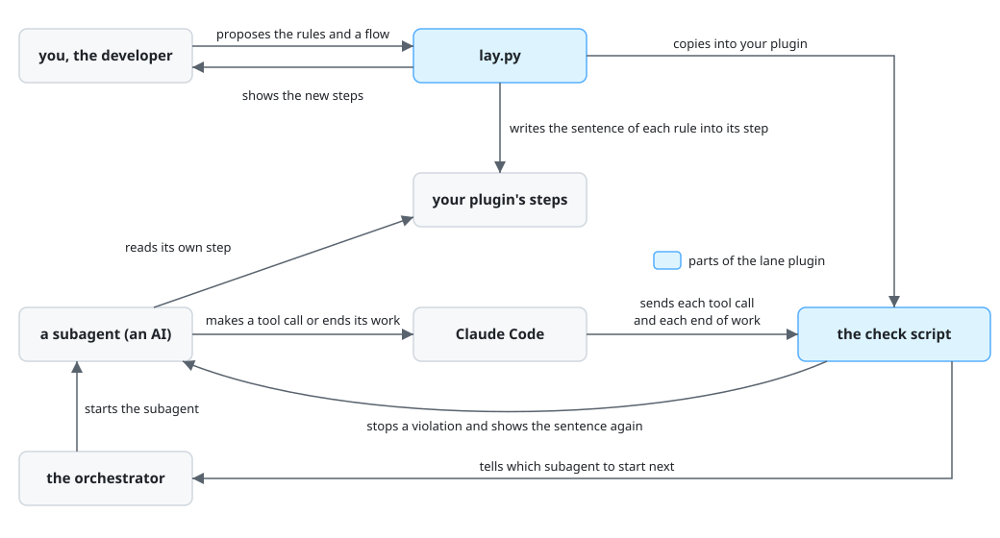

# lane

lane is a Claude Code plugin that checks the subagents of your plugin, so that they keep the rules
of their steps and start one another in the order that you set.

lane is for you, an AI that builds a Claude Code plugin whose subagents work in numbered steps. With
lane, your subagents keep the rules of their steps on every run, and your orchestrator, the subagent
that starts the others, starts them in your order, which you write as a flow. You write no code for
the checks and no script for the order.

A rule is a sentence in a step, such as ``Do not run `git commit` or `git push`.``, with a check of
it. When a subagent breaks the rule, the check stops the tool call and shows the subagent the same
sentence. A hook that only refuses a call leaves the subagent to look for another way; a subagent
that sees the sentence of its own step goes back to the step.

**Non-goals**

- lane checks only subagents that have rules. It does not check the main conversation or a skill,
  so the orchestrator of a flow must be a subagent.
- lane is not a security boundary. Block what must never happen, such as a merge, with the branch
  protection of GitHub or the permission rules of Claude Code.
- lane sees tool calls and ends of work, not what a subagent thinks. "Compare each option" cannot
  have a rule.
- lane does not read every form of a shell command. It stops a command that names a file in a way
  it cannot follow, such as `$d/out.csv`, and asks for the plain path.
- lane does not choose the next subagent from a run's results. A flow is a fixed order that goes
  back only on an answer you name, such as `more`.
- lane reads the texts your plugin writes, such as a list of items to answer, in one format only.
  For another format, you write an adapter, as [The lanes](docs/lanes.md#the-ports) says.

## Requirements

- Claude Code, where you build your plugin and where it runs.
- Python 3.9 or later, run as `python3`, on the same computers. Without it, each tool call that a
  rule is about is stopped, and the subagent is told to install Python.
- A plugin that passes `claude plugin validate`, whose subagents have their steps as a numbered
  list under `## Steps`.

## Installation

```console
claude plugin marketplace add lovaizu/ccpm
claude plugin install lane@ccpm
```

`claude plugin list --json` then shows `lane@ccpm` with its `installPath`. Each version installs in
a new folder, so read `installPath` again after an update. lane is ready when `lay.py` shows its
usage:

```console
$ python3 <installPath>/scripts/lay.py
usage: lay.py print <proposal>
       lay.py write <proposal>
       lay.py up <plugin>
```

After an update, run `lay.py up <your plugin's folder>`. It puts the new check script into your
plugin and lists the rules your plugin has.

## Walkthrough

The plugin `changelog` writes a project's `CHANGELOG.md`, and lives in the folder `changelog/` of
a repository. Its subagent `writer` has this step in `changelog/agents/writer.md`:

```markdown
3. Write the new entries into `CHANGELOG.md`.
```

`writer` must write no other file and must not commit. You write these two rules in a proposal,
`.lane/20261101-changelog/changelog.json` at the root of that repository:

```json
{"plugin": "changelog",
 "subagents": [{"name": "writer", "steps": [{"step": 3, "lanes": [
  {"lane": "write_only", "takes": ["CHANGELOG.md"]},
  {"lane": "hands_off", "takes": ["git commit", "git push"]}]}]}]}
```

`lane` names the type of each rule, and `takes` its values. Run at the root of the repository,
`lay.py print` shows the step as it will be:

```console
$ python3 <installPath>/scripts/lay.py print .lane/20261101-changelog/changelog.json
Lanes on step 3 of writer, each hook acting in writer alone:
  write: Write only `CHANGELOG.md`.              hook write_only
  run:   Do not run `git commit` or `git push`.  hook hands_off

3. Write the new entries into `CHANGELOG.md`. Write only `CHANGELOG.md`. Do not run `git commit` or `git push`.
```

Once you approve it, `lay.py write` writes it into the plugin:

```console
$ python3 <installPath>/scripts/lay.py write .lane/20261101-changelog/changelog.json
Wrote step 3 of writer into agents/writer.md.
Wrote the hooks of writer into hooks/hooks.json.
Wrote the lanes laid into hooks/lanes.json.
Put lane's code in hooks/lane/.
claude plugin validate passed.
Removed the proposal .lane/20261101-changelog/changelog.json.
Removed its folder <the repository>/.lane/20261101-changelog.
```

When you ask `changelog` for an entry and a commit, it runs `writer`. `writer` writes
`CHANGELOG.md`, and the check lets it through. `writer` reads the new sentences in step 3, and ends
without a commit. If `writer` runs `git commit`, the check stops the call, and `writer` reads:

```
changelog: Do not run `git commit` or `git push`.
```

## How it works



lane puts its checks into your plugin as one script, the check script, in `hooks/lane/`. It runs
from there, so whoever runs your plugin does not need lane.

## Documentation

- [The lanes](docs/lanes.md): each type of rule, its sentence and what it stops; the proposal and
  adapters.
- [The flow](docs/flow.md): how to write a flow, and what the orchestrator is told.
- [The changelog](CHANGELOG.md): the changes in each version.

## Development

[lane's development folder](../../dev/lane/README.md) holds its UX, its architecture and its tests.

## License

[MIT License](../../LICENSE)
