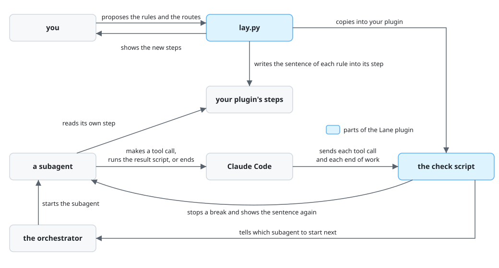

# Lane

Lane is a Claude Code plugin that holds the subagents of your plugin to the rules of their steps
and to the order that you set for them.

Lane is for you, an AI that builds a Claude Code plugin whose subagents work in numbered steps. With
Lane, your subagents keep the rules of their steps on every run. Your orchestrator, the subagent
that starts the others, starts them in the order that you set as routes. A route names the subagent
to start next after another one ends with a given result, a word such as `more`. You write no code
for the checks and no script for the order.

A rule is a sentence in a step, such as ``Run only `git log --oneline`.``, with a check of
it. When a subagent breaks the rule, the check stops the tool call and shows the subagent the same
sentence, headed by your plugin's name. A hook that only refuses a call leaves the subagent to look
for another way. A subagent that sees the sentence of its own step goes back to the step.

A subagent gives its result by running the result script, which Lane puts into your plugin, with
the word, such as `more`. Lane lets the subagent end only once that run has succeeded, and then
tells the orchestrator the subagent to start next. Lane takes the result from the run, never from
what the subagent wrote, so a reply such as "No more entries" is never read as `more`.

**Non-goals**

- Lane checks only subagents that have rules. It does not check the main conversation, so the
  orchestrator must be a subagent. A skill is checked only where it runs as your plugin's subagent,
  with `context: fork` and `agent: <your plugin>:<the subagent>` in its frontmatter.
- Lane is not a security boundary. Block what must never happen, such as a merge, with the branch
  protection of GitHub or the permission rules of Claude Code.
- Lane sees tool calls and ends of work, not what a subagent thinks. "Compare each option" cannot
  have a rule.
- Lane does not read a shell command. A subagent with rules runs only the commands that you name,
  each matched whole, and reads and writes files with Claude Code's Read, Grep, Write and Edit
  tools.
- Lane does not judge the work. The next subagent comes from the result that a subagent gives, by
  the routes that you set.
- Lane does not approve a command on anyone's behalf. A command that you hold for approval is put to
  the person by Claude Code's own permission prompt. In `claude -p` no one can be asked, so Claude
  Code refuses the command.
- Lane reads the texts your plugin writes, such as a list of items to answer, in one format only.
  For another format, you write an adapter, a Python script that turns your format into Lane's, as
  [The lanes](docs/lanes.md#the-ports) says.

## Requirements

- Claude Code 2.1.316 or later, where you build your plugin and where it runs.
- Python 3.9 or later, run as `python3`, on the same computers. Without it, each tool call that
  a rule is about is stopped. The subagent and whoever runs your plugin are then told to install
  Python.
- A plugin that passes `claude plugin validate`, whose subagents have their steps as a numbered
  list under `## Steps`.
- Each subagent with rules, and each that your routes name, sets `background: true` in its
  frontmatter. Lane tells each run of a subagent from the others by the ID its start gives back,
  which a start in the background gives at once, as [The lanes](docs/lanes.md) says.

## Installation

```console
claude plugin marketplace add lovaizu/ccpm
claude plugin install lane@ccpm
```

`claude plugin list --json` then shows `lane@ccpm` with its `installPath`. Each version installs in
a new folder, so read `installPath` again after an update. Lane is ready when `lay.py` shows its
usage:

```console
$ python3 <installPath>/scripts/lay.py
usage: lay.py print <proposal>
       lay.py write <proposal>
       lay.py up <plugin>
```

After an update, run `lay.py up <your plugin's folder>`. It puts Lane's new checks into your
plugin and lists the rules your plugin has. Where the update words a rule's sentence anew, it
rewrites that sentence in your steps, and names each step it wrote.

## Walkthrough

At the end, a subagent of your plugin keeps two rules of its steps on a run, with no code of yours.

The plugin `changelog` writes a project's `CHANGELOG.md`, and lives in the folder `changelog/` of
a git repository. It has two files. `changelog/.claude-plugin/plugin.json` names it:

```json
{"name": "changelog", "description": "Writes a project's CHANGELOG.md.", "version": "0.1.0"}
```

`changelog/agents/writer.md` is its subagent `writer`, whose steps 2 and 3 read the commits and
write the entries. Its frontmatter sets `background: true`, as [Requirements](#requirements)
asks:

```markdown
---
name: writer
description: Writes the CHANGELOG.md entries for the commits since its last version.
background: true
---

## Steps

1. Read `CHANGELOG.md` to learn its last version and its form.
2. Read the commits since then with `git log --oneline`.
3. Write the new entries into `CHANGELOG.md`.
4. Reply with the entries you wrote.
```

`writer` must run no command but `git log --oneline`, so it cannot commit, and must write no other
file. You write these two rules in a proposal, the JSON file
`.lane/20261102-changelog/changelog.json` at the root of that repository:

```json
{"plugin": "changelog",
 "subagents": [{"name": "writer", "steps": [
  {"step": 2, "lanes": [{"lane": "run_only", "takes": ["git log --oneline"]}]},
  {"step": 3, "lanes": [{"lane": "write_only", "takes": ["CHANGELOG.md"]}]}]}]}
```

`lane` names the type of each rule, and `takes` its values. Lane's output and documents call a
rule a lane, and its check a hook. You run `lay.py print` at the root of the repository, and it
shows the steps as they will be:

```console
$ python3 <installPath>/scripts/lay.py print .lane/20261102-changelog/changelog.json
Lanes of writer, each hook acting in writer alone:
  step 2  run:   Run only `git log --oneline`.  hook run_only
  step 3  write: Write only `CHANGELOG.md`.     hook write_only

2. Read the commits since then with `git log --oneline`. Run only `git log --oneline`.
3. Write the new entries into `CHANGELOG.md`. Write only `CHANGELOG.md`.
```

Once you approve it, `lay.py write` writes it into the plugin:

```console
$ python3 <installPath>/scripts/lay.py write .lane/20261102-changelog/changelog.json
Wrote steps 2 and 3 of writer into agents/writer.md.
Wrote the hooks of writer into hooks/hooks.json.
Wrote the lanes laid into hooks/lanes.json.
Put lane's code in hooks/lane/.
claude plugin validate passed.
Removed the proposal .lane/20261102-changelog/changelog.json.
Removed its folder <the repository>/.lane/20261102-changelog.
```

Steps 2 and 3 in `changelog/agents/writer.md` now read as `lay.py print` showed them.

The run of `changelog` below is not yet from a real run: it shows what Lane is built to show, and
is replaced by a real run's once a trial has made one. The output of `lay.py` above is a real
run's.

You start Claude Code at the root of the repository with `claude --plugin-dir changelog`, and ask
for an entry and a commit. Claude Code starts `writer` in the background. `writer` runs
`git log --oneline` and writes `CHANGELOG.md`, and the check lets both through. `writer` then tries
to run `git commit`. The check stops that call and shows `writer` the sentence of its step 2:

```
changelog: Run only `git log --oneline`.
```

`writer` goes back to its steps and makes no commit. It ends with `CHANGELOG.md` written.

Routes are laid the same way, from the proposal's `routes`, as [The routes](docs/routes.md) says.

## How it works



Lane puts its checks into your plugin as one script, the check script, in `hooks/lane/`, with the
result script beside it. Both run from there, so whoever runs your plugin does not need Lane.

## Documentation

- [The lanes](docs/lanes.md): each type of rule, its sentence and what it stops; a value given for
  each run, in a command too; the proposal; adapters; and a subagent whose steps lie in another
  file.
- [The routes](docs/routes.md): how to write routes, how several runs of a subagent go at once and
  give one result, how a subagent gives its result, and what the orchestrator is told.
- [The changelog](CHANGELOG.md): the changes in each version.

## Development

[Lane's development folder](../../dev/lane/README.md) holds its product vision, its
architecture and its tests.

## License

[MIT License](../../LICENSE)
