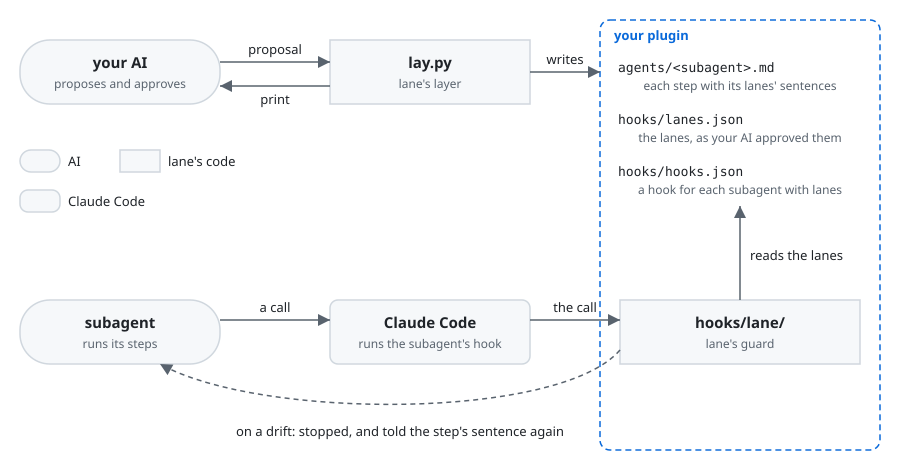

# lane

lane is a Claude Code plugin that holds the subagents of your plugin to their steps: when one drifts
from a step, a hook stops it and tells it the step's own sentence again.

An AI that runs your plugin's steps drifts from some of them now and then, such as committing where
a step says not to. A hook that only refuses leaves the AI to look for another way to what it was
doing: one AI refused a commit split the word `git` to get past the check. And each check you write
yourself is one more piece of code to write, test and keep right in your plugin.

If you have an AI build a plugin whose work an AI does in several steps, lane lets your plugin's
subagents run at full speed with no one watching each move, each finding its own way back to its
steps. Your AI, the one building your plugin, lays the checks without writing one, and lane asks you
nothing.

A lane is laid on one step of a subagent, a step being one numbered item of what the subagent is
told to do. A lane is a sentence written into the step, together with a hook that notices a drift
from it and tells the subagent that sentence again. Told the step's own sentence, the subagent goes
back to the step rather than around the refusal. Your AI writes the lanes it proposes in a
proposal, a JSON file. lane's layer, the script `lay.py`, prints them as they would be laid. Once
your AI approves them, `lay.py` writes them into your plugin with lane's guard, the code that runs
the hooks. lane writes and tests each kind of check once, so your plugin takes in no misreading of
a command of its own. Your AI lays lanes only where a step alone is not sure to hold, so the hooks
stay few and small.

**Non-goals**

- lane is no security boundary. What must hold whatever the AI writes is held by GitHub's branch
  protection, Claude Code's sandbox or its permission rules, as Claude Code's own docs say a check
  on the command text is not a security boundary.
- lane reads a command in the forms the steps tell and the AI writes, not in every way the shell
  has. Where lane cannot settle which file a command names, it stops the call and tells the
  subagent to name the file by its path.
- lane lays lanes on subagents alone, not on skills. A hook written into a skill goes on running for
  the rest of the session once the skill has started, and is not told which skill runs, so it would
  act on work outside the skill. A step to keep goes into a subagent the skill starts.
- lane sees only what shows in a tool call or in how the subagent ends, not what the subagent only
  weighs.

## Requirements

- Claude Code, where your plugin runs and lane is installed.
- Python 3.9 or later, run as `python3`, on the machines the plugin runs on.

  Without it, the hooks stop the tool calls they watch, each asking for Python to be installed,
  and at a subagent's end tell you so and let it end.

## Installation

lane comes from ccpm, a marketplace of Claude Code plugins on GitHub. Add the marketplace, then
install lane:

```console
claude plugin marketplace add lovaizu/ccpm
claude plugin install lane@ccpm
```

`claude plugin list --json` then lists `lane@ccpm`, and its `installPath` is lane's folder. Claude
Code installs each version of lane in a new folder, so your AI reads the folder there each time.
lane is ready when `lay.py` in that folder prints its usage:

```console
$ python3 <lane's folder>/scripts/lay.py
usage: lay.py print <proposal>
       lay.py write <proposal>
       lay.py up <plugin>
```

## Walkthrough

In your plugin `notes`, the skill `/notes:changelog` starts a subagent, `changelog-writer`, that
writes a project's changelog. The skill shows you the new entries and commits `CHANGELOG.md` once
you have said OK. One of the subagent's steps, in `agents/changelog-writer.md`, says:

```markdown
3. Write the new entries into `CHANGELOG.md`.
```

While building `notes`, your AI knows that `CHANGELOG.md` is the only file step 3 writes, and that
the skill, not the subagent, commits it. It proposes two lanes on step 3, write_only and hands_off,
in `.lane/20261030-notes/notes.json` at the root of the repository:

```json
{"plugin": "notes", "subagents": [{"name": "changelog-writer", "steps": [{"step": 3, "lanes": [
 {"lane": "write_only", "takes": ["CHANGELOG.md"]},
 {"lane": "hands_off", "takes": ["git commit", "git push"]}]}]}]}
```

Your AI has `lay.py print` show the lanes, each under the action it watches with its hook, and the
step as it would read:

```console
$ python3 <lane's folder>/scripts/lay.py print .lane/20261030-notes/notes.json
Lanes on step 3 of changelog-writer, each hook acting in changelog-writer alone:
  write: Write only `CHANGELOG.md`.              hook write_only
  run:   Do not run `git commit` or `git push`.  hook hands_off

3. Write the new entries into `CHANGELOG.md`. Write only `CHANGELOG.md`. Do not run `git commit` or `git push`.
```

Your AI approves them, and has `lay.py write` lay them from the same file:

```console
$ python3 <lane's folder>/scripts/lay.py write .lane/20261030-notes/notes.json
Wrote step 3 of changelog-writer into agents/changelog-writer.md.
Wrote the hook of changelog-writer into hooks/hooks.json.
Wrote the lanes laid into hooks/lanes.json.
Put lane's code in hooks/lane/.
claude plugin validate passed.
Removed the proposal .lane/20261030-notes/notes.json.
Removed its folder <the repository>/.lane/20261030-notes.
```

Then you run `/notes:changelog`. When `changelog-writer` runs `git commit -m notes`, Claude Code
does not run it, and the subagent reads:

```
notes: Do not run `git commit` or `git push`.
```

The subagent goes back to step 3, and the run ends with the changelog committed once you have said
OK.

When lane is updated, your AI first runs `lay.py up <your plugin's folder>` on a plugin with lanes
laid before. It brings lane's code in your plugin to lane's version with the same lanes, and says
each lane laid before, for your AI to keep in its next proposal.

Who does what in which order, here and when lane cannot check a call, is in
[the scenes of lane's UX](../../dev/lane/ux.md#scenes).

## How it works



lane is made of two parts. The layer, `lay.py`, runs while your AI builds your plugin: it prints
the proposal and writes the approved lanes into your plugin. The guard, lane's code in your
plugin's `hooks/lane/`, runs on every call of a subagent with lanes: Claude Code hands it the call,
and the guard reads the lanes your AI approved from `hooks/lanes.json`. Both make each lane's
sentence from the same lanes, so what the subagent is told on a drift is the sentence its step
says. Who does what in which order is in [the scenes of lane's UX](../../dev/lane/ux.md#scenes).

## Documentation

- [The lanes](docs/lanes.md) lists each lane lane can lay, the sentence it writes into a step and
  when its hook tells it, and gives the proposal your AI writes them in.
- [The changelog](CHANGELOG.md) says what changed in each version.

## Development

[lane's development folder](../../dev/lane/README.md) leads to its UX, its design and how it is
checked.

## License

[MIT License](../../LICENSE)
