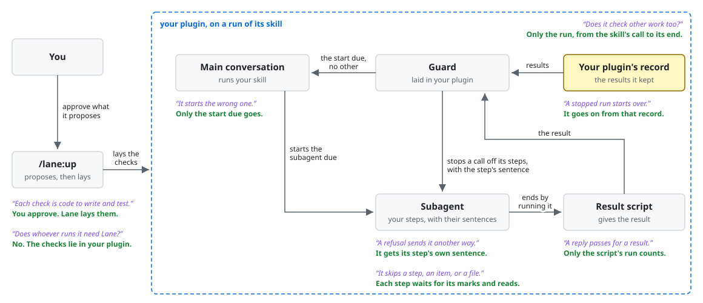

# Lane

Lane is a plugin for your Claude Code plugin that gives its AI each step it leaves, as it leaves.

In development: Lane's rebuild as a plugin that others depend on isn't released.

Lane is for you when your plugin's skill and subagents must keep the steps you give them. With it,
you get an AI that notices each step it leaves, at once.

## Non-goals

- Lane doesn't check work outside your plugin: only runs of a plugin that gives it rules.
- Lane doesn't write your rules: you write them, from your steps, in your plugin's
  `lane/rules.json`.
- Lane doesn't guard security: hold what must never happen with branch protection or Claude Code's
  permission rules.
- Lane doesn't judge how well a step was done beyond your own check: add a review subagent for
  that.
- Lane doesn't make the AI go back to its step: that rests on your steps and the model.

## Requirements

- macOS or Linux: `uname` shows it.
- Claude Code 2.1.328 or later, where your plugin runs: `claude --version` shows it.
- Python 3.9 or later, run as `python3`: `python3 --version` shows it.
- A plugin that Claude Code takes as valid: `claude plugin validate <your plugin's folder>` shows
  `✔ Validation passed`.

## Installation

```console
claude plugin marketplace add lovaizu/ccpm
claude plugin install <your plugin>@<your marketplace>
```

The install then lists `lane` among the dependencies it installed.

## Walkthrough

At the end, you have a writer kept to its step, and a run moved on by its reviewer's result.

`log`, your plugin, writes a version's `CHANGELOG.md` entry: its skill `/log:up` starts a writer,
and then a reviewer. Its `.claude-plugin/plugin.json` names Lane among its dependencies:

```json
"dependencies": [{ "name": "lane", "marketplace": "ccpm" }]
```

Its marketplace's `.claude-plugin/marketplace.json` allows the marketplace `ccpm`, from which Claude
Code installs Lane:

```json
"allowCrossMarketplaceDependenciesOn": ["ccpm"]
```

Its `lane/rules.json` holds the writer's step and the routes:

```json
{
  "roles": {
    "log:writer": {
      "steps": [{ "name": "write", "rules": [
        { "type": "writes", "paths": ["CHANGELOG.md"] },
        { "type": "result", "results": ["written"] }
      ] }]
    },
    "log:reviewer": {
      "steps": [{ "name": "review", "rules": [
        { "type": "result", "results": ["good", "more"] }
      ] }]
    }
  },
  "routes": [
    { "after": { "command": "log:up" }, "start": ["log:writer"] },
    { "after": { "role": "log:writer", "result": "written" }, "start": ["log:reviewer"] },
    { "after": { "role": "log:reviewer", "result": "more" }, "start": ["log:writer"] }
  ]
}
```

Your plugin's user, who installed it as Installation shows, types:

```text
/log:up 1.2.0
```

The writer starts, and writes its notes to `notes.md`. Lane stops the write, and the writer
reads:

```text
You're at the step `write` of log:writer, which writes only CHANGELOG.md.
Write there instead of notes.md.
```

The writer writes the entry in `CHANGELOG.md`, runs `lane-result written`, and ends. The reviewer
starts, as the route after `written` says, runs `lane-result more`, and ends. The main conversation
then reads:

```text
log:reviewer gave more. Due: log:writer.
```

## How it works

Lane gives an AI that leaves your plugin's step the step's own sentence, so that it notices at once.



### "A hook that only refuses leaves the AI to find another way."

When Lane stops a call, the AI gets the sentence of the step it left and what to do instead.

### "The AI says it did the step, but did it?"

A step, an item, a read, or a result counts only from the AI's own call, never from its reply. Such
a call is a Read itself, or a run of a Lane command that your step names.

### "Each check is code to write and test."

You give each rule a type of Lane's and its values, such as the files a step may write. The type
makes both the check and the sentence the AI reads.

### "The main conversation starts the wrong subagent, or stops while one is due."

Your routes say which subagent starts after each result. Lane gives the main conversation each
start due, and stops any other start, or its end while one is due.

### "A run that stops starts over."

Lane keeps a record of the run's starts and results, so the run goes on after `/compact`. In a new
conversation, it goes on from the results your plugin keeps, through an adapter of yours.

### "Does it check other work in the same conversation?"

No. Lane checks only your skill's run, from its call until its routes start no more.

## Documentation

- [Rules and adapters](docs/rules-and-adapters.md): for you when you write your plugin's rules,
  what Lane takes in and gives out.
- [Changelog](CHANGELOG.md): for you when you update Lane, the changes in each version.
- [Issues](https://github.com/lovaizu/ccpm/issues): where you ask for help or report a fault.

## License

[MIT](LICENSE)
