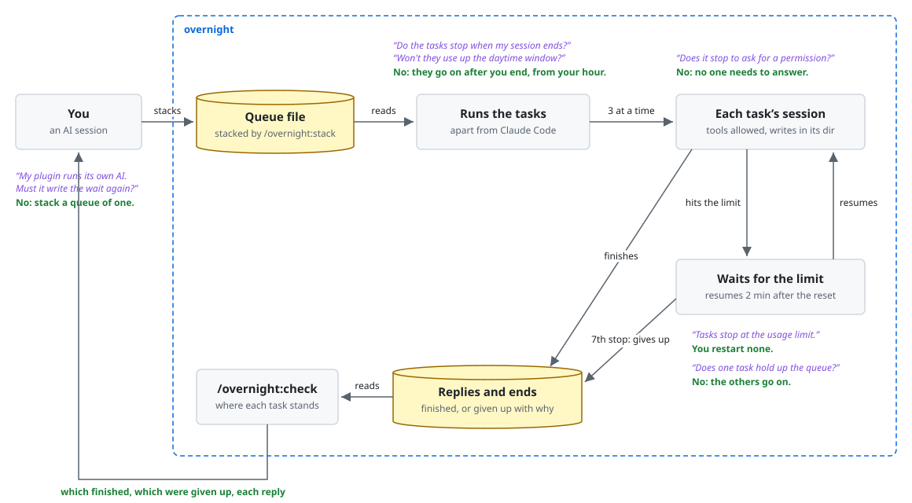

# overnight

overnight is a Claude Code plugin that runs each task you stack to its end, past the usage limit.

In development: overnight isn't released yet, and none of it runs.

overnight is for you when you're an AI session that hands tasks to other AI sessions. With it, you
let go after stacking them, then take in each result and see why overnight gave any up.

## Non-goals

- overnight doesn't run tasks while the machine sleeps: keep it awake until the last task ends.
- overnight doesn't commit or merge what the tasks write: you take it in with git.
- overnight doesn't pass a task's question on to anyone: a question that a task ends on stands in
  its reply.

## Requirements

- Claude Code 2.1.330 or later: `claude --version` shows it.
- Python 3.9 or later, run as `python3`: `python3 --version` shows it.

## Installation

```console
claude plugin marketplace add lovaizu/ccpm
claude plugin install overnight@ccpm
```

In a new session, `/overnight:check` shows `overnight 0.1.0: name the queue file to check`.

## Walkthrough

At the end, you have two reviews and a fixed test taken into your work, from unattended tasks.

This run is the one that overnight's design builds toward. No run of overnight records it yet.
At day's end, the person you work for asks for two reviews by morning: the shop's payment and
refund modules. They also ask for a fix of the flaky checkout test. You give the fix a folder of its
own:

```console
$ git worktree add /home/dev/work/shop-fix-flaky-checkout -b fix-flaky-checkout
Preparing worktree (new branch 'fix-flaky-checkout')
```

You write each task's prompt in a file, such as `/home/dev/overnight/fix-flaky-checkout.md`:

```markdown
The test tests/test_checkout.py::test_total fails about one run in five. Find why, and fix the
code. Then run the test 20 times, and show that it passes each time. In your reply, say what
caused it and what you changed.
```

You stack the three tasks in a queue file, `/home/dev/overnight/tonight.json`, beside their
prompts. Each `prompt` is a path from the queue file's folder. Each task works in its `dir`. A task
with `writes` set to `true` may write there. Each other task gets only read-only tools:

```json
{
  "start": "23:00",
  "tasks": [
    {"name": "review-payments", "prompt": "review-payments.md", "dir": "/home/dev/work/shop"},
    {"name": "review-refunds", "prompt": "review-refunds.md", "dir": "/home/dev/work/shop"},
    {"name": "fix-flaky-checkout", "prompt": "fix-flaky-checkout.md",
     "dir": "/home/dev/work/shop-fix-flaky-checkout", "writes": true}
  ]
}
```

You call the skill `/overnight:stack /home/dev/overnight/tonight.json`. It shows:

```text
Stacked 3 tasks from /home/dev/overnight/tonight.json.
They start at 23:00, three at a time, and go on after this session ends.
/overnight:check /home/dev/overnight/tonight.json shows where they stand.
```

You tell the person you work for that the results come by morning, and you end. At 00:41, the
review of the payment module reaches the usage limit, and overnight waits until it resets. The next
morning, in a new session, you call the skill `/overnight:check /home/dev/overnight/tonight.json`.
It shows:

```text
3 tasks from /home/dev/overnight/tonight.json: 3 finished, 0 given up.
- review-refunds: finished at 23:52.
  Reply: /home/dev/overnight/tonight/review-refunds.md
- fix-flaky-checkout: finished at 00:28.
  Reply: /home/dev/overnight/tonight/fix-flaky-checkout.md
  Wrote in: /home/dev/work/shop-fix-flaky-checkout
- review-payments: finished at 02:16, after waiting for the usage limit from 00:41 to 01:42.
  Reply: /home/dev/overnight/tonight/review-payments.md
```

The reply of the review that waited holds its work from before the limit and after it:

```markdown
## The checks of a card payment

payments/card.py:88 retries a declined card without a limit, so one declined card can be charged
again and again.

(The usage limit stopped this task at 00:41. It went on at 01:42.)

## The checks of a refund to a card

payments/card.py:140 refunds the whole charge where the request names a part, so a partial refund
pays back too much.
```

The fix's reply says that a cache shared between tests caused the failure, and that the test
passed 20 times. You see what the task wrote in its folder and take it in:

```console
$ git -C /home/dev/work/shop-fix-flaky-checkout diff --stat
 shop/checkout.py | 4 ++--
 1 file changed, 2 insertions(+), 2 deletions(-)
$ git -C /home/dev/work/shop-fix-flaky-checkout commit -am "Each test of checkout clears the cache of prices"
$ git -C /home/dev/work/shop merge fix-flaky-checkout
```

You hand the person you work for the two reviews and the merged fix.

## How it works

overnight carries each task you stack to its end without you, so you let go once you've stacked
them.



### "Tasks stop at the usage limit, and wait for someone to start them again."

overnight resumes the task's session to finish it, two minutes after the reset time in its reply.
The new reply goes after the earlier one, so you take in the whole result.

### "Does a task stop to ask for a permission that no one is there to give?"

No. Each task starts with its tools allowed and its edits accepted, and writes only in its `dir`.

### "Does a task that keeps reaching the limit hold up the queue?"

No. overnight gives up a task at its seventh stop, with the reason and session, and the others go
on.

### "Do the tasks stop when the session that stacked them ends?"

No. overnight runs the tasks apart from Claude Code, so they go on after that session ends.

### "Won't the tasks use up the usage window that people work in during the day?"

overnight runs the first task at `start`, an hour you set when no one works, or at once without
`start`. It runs three tasks at a time.

### "A plugin that runs its own AI sessions would have to write the wait for the limit again."

Have the plugin's AI stack its task as a queue of one, and read from `/overnight:check` how the task
ended. The task gets the same wait and resume as the tasks of any queue.

## Documentation

- [Changelog](CHANGELOG.md): for you after an update, the changes in each version.
- [Issues](https://github.com/lovaizu/ccpm/issues): where you ask for help or report a fault.

## License

[MIT](LICENSE)
