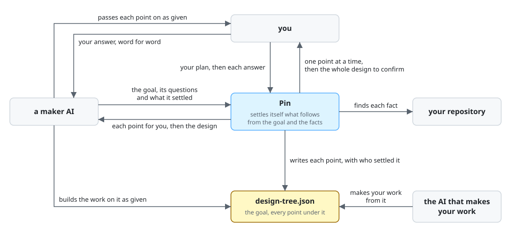

# Pin

Pin is a Claude Code plugin that settles every point of your plan before an AI starts to make it,
finding each fact itself and asking you only the decisions that are yours, one at a time.

Pin is for you when you are about to have an AI in Claude Code make something larger than a quick
change, such as a feature or a document, and you want it to make what you mean. A point is one
thing the plan must settle: a fact, such as what reads a file today, or a decision, such as the
form an output takes. Before the work starts, Pin settles every point of the plan as you mean it.
You decide only the points that are yours, and you confirm each fact that Pin finds. The AI that
makes the work then has nothing left to guess, and you do not explain a point again while it
works. For a quick change that you would simply ask for and check, Pin adds a step you do not need.

Pin is also for you if you are an AI that is to make something for a person, such as a skill or a
subagent of a plugin, and you want its design settled with that person before you build. This README
calls such an AI a maker AI. You hand Pin the goal of the work, the questions that the work must
answer, and what you have settled. Pin keeps what you settled, the goal among it, and does not ask
the person about it again. You pass each point that Pin gives you to the person as given, and you
pass the answer back word for word. You get back a design settled with the person, and you build the
work on it as given. Pin needs a person to answer: a point that is theirs waits for them.

Without Pin, an AI starts to make the work from your request and asks as questions occur to it, or
it writes a plan up front and fills each gap with an assumption. Either way, the AI guesses each
point that no one raised, and you meet the guess in the finished work as rework. Pin instead
settles the whole plan from its goal down before any work starts. Its result is the design: the
plan's goal, with every point settled under it, each with who settled it.

- **From the goal down.** Pin works out what must hold for the goal, and for each of those, the
  decisions that make it hold. So the design holds each point that the work needs, and no point that
  serves nothing.
- **Facts found, decisions asked.** Pin finds each fact itself and shows it to you to confirm. It
  settles itself each decision that follows from the goal and the facts. It asks you a decision only
  where two ways serve the goal equally well, or where the decision is hard to undo, and it gives a
  recommendation with it.
- **One point at a time, in order.** Each message from Pin holds one point. Pin asks a decision only
  once the decisions it builds on are settled, so your answer to one can still change the next.
- **The whole design confirmed.** At the end, Pin shows you every point in one short line, with who
  settled it. You see each point that Pin settled before the work starts, and you confirm that you
  and Pin mean the same.
- **Kept in a file.** Pin writes each answer into the design file, `design-tree.json`, before its
  next message. After each answer, it checks that every point in the file serves the goal. A stopped
  run goes on from the file in a new conversation. The AI that makes the work reads the design from
  it.

**Non-goals**

- Pin does not make the work. It ends once you confirm the design.
- Pin does not judge whether a decision is good. Its check sees only that the design holds
  together. You judge each decision as you answer it.
- Pin does not decide what is yours. A point that you leave unanswered stays open, and Pin does not
  go on as if you had answered.
- Pin does not put several questions in one message, and it sets no limit on the number of
  questions. To end sooner, tell it to wrap up. The points still open then stay marked as open.

## Requirements

- Claude Code 2.1.317 or later: `claude --version` shows its version.
- Python 3.9 or later, run as `python3`, which Pin checks the design file with:
  `python3 --version` shows its version.

## Installation

```console
claude plugin marketplace add lovaizu/ccpm
claude plugin install pin@ccpm
```

`claude plugin list` then lists `pin@ccpm`. In a new Claude Code session, `/pin:down` is then one
of its commands.

A plugin whose skill or subagent is a maker AI lists Pin in the `dependencies` of its
`.claude-plugin/plugin.json`, as `"dependencies": ["pin"]`. Installing that plugin installs Pin
with it.

## Walkthrough

At the end, you have the design of your plan in a file. Every point in it is settled, each decision
that is yours is decided by you, and Pin asked you nothing that was not yours.

This walkthrough is not yet from a real run: it shows what Pin is being rebuilt to show, and its
output is replaced by a real run's once Pin is built.

Your notes app `notes` prints your notes as text with `notes list`. You want it to give JSON as
well. In Claude Code, at the root of the app's repository, you type:

```text
/pin:down notes list should give JSON as well
```

Pin first puts to you the goal as it reads your words:

```text
Purpose: the goal is what every decision of the plan is weighed by.
To-be: one sentence that says who gains from the change, and how.
As-is: your words are "notes list should give JSON as well".
Gap: they do not say who reads the JSON, or what it spares them.
Proposal: scripts that read `notes list` get its notes as JSON, so they stop parsing text; yes?
```

You answer `yes`. Meanwhile Pin has looked in the repository for what reads `notes list` today,
and it shows you one fact it found, in a message of its own:

```text
Found: scripts/sync.py:14 reads `updated` with `datetime.fromisoformat(fields[3])`, so it
expects ISO 8601. Is that right?
```

You answer `right`. Pin shows you each other fact it found the same way. It then asks you the one
decision that the goal and the facts do not settle:

```text
Purpose: each script reads the JSON in the form it expects.
To-be: the JSON comes in the one form that suits how you read it.
As-is: notes list gives text only, so no JSON form is set yet.
Gap: one JSON array and one object a line serve equally well, and nothing found favors either.
Proposal: one JSON array of all notes, which `jq` and `json.load` read whole; yes?
```

You answer `yes, jq reads it whole`. Pin settles the other points itself, such as keeping the text
output the default, and does not ask you them. When no point is left open, it shows you the
design:

```text
Goal: scripts that read `notes list` get its notes as JSON.                 (you)
- The output is one JSON array, one object for each note.                   (you)
- The text output stays the default; JSON comes only with --json.           (follows from the goal)
- `updated` stays in ISO 8601, as the text gives it.                        (found, you confirmed)

Do we understand the plan the same way?
```

You answer `yes`, and Pin ends. The design file is `.pin/20261103-notes-json/design-tree.json`:

```json
{"goal": {
  "what": "Scripts that read `notes list` get its notes as JSON, so they stop parsing text.",
  "grounds": ["the person, 2026-11-03"]},
 "questions": [
  {"id": "Q1", "what": "Can each script that reads notes list read the JSON as it is?"},
  {"id": "Q2", "what": "Do people who read notes list by eye see the same as before?"}],
 "decisions": [
  {"id": "D1", "what": "The form of the JSON", "contributes_to": ["Q1"], "builds_on": [],
   "decided": "one JSON array, one object for each note", "settled_by": "user",
   "grounds": ["the person, 2026-11-03"]},
  {"id": "D2", "what": "Whether text stays the default", "contributes_to": ["Q2"],
   "builds_on": [], "decided": "it stays; JSON only with --json", "settled_by": "reasoning",
   "grounds": ["the goal, and Q2"]},
  {"id": "D3", "what": "The form of updated", "contributes_to": ["D1"], "builds_on": ["D1"],
   "decided": "ISO 8601, as the text gives it", "settled_by": "research",
   "grounds": ["scripts/sync.py:14 \"datetime.fromisoformat(fields[3])\"",
               "the person confirmed, 2026-11-03"]}]}
```

`settled_by` says who settled each decision: you (`user`), a fact found and confirmed (`research`),
or what follows from the goal and the decisions before it (`reasoning`). You hand the file to the AI
that makes the work. Every point that the work needs is in it, with who settled it and on what
grounds, so the AI has nothing to guess.

## How it works



The figure shows how you and a maker AI use Pin. A maker AI also needs to know three things
that the figure cannot show:

- A maker AI starts `pin:down` with the goal of the work, its questions, what it has settled and
  the path where the design file is to lie. Without a path, the file lies in
  `.pin/<yyyymmdd>-<name>/design-tree.json` at the top of the repository.
- Where Pin runs as a subagent, it cannot ask the person itself. It then ends each run with its
  message headed `For the person:`. The maker AI puts that message to the person as given, and
  resumes Pin with the person's answer under the line `The person's answer, word for word:`.
- Where the work finds a point that the design does not settle, or that must change, the maker AI
  starts Pin again with that point and does not change the design itself. Pin opens the point and
  each point built on it, and settles them again with the person.

## Documentation

- [The design tree](core/roles/pinner.md#the-design-tree): each key of the design file, for an AI
  that reads it or builds on it.

## Development

[Pin's development folder](../../dev/pin/README.md) holds its UX, its architecture and its tests.

## License

[MIT License](../../LICENSE)

`pin:down` is made from Matt Pocock's skill
[grilling](https://github.com/mattpocock/skills/blob/4ae2317ddb22b046e26455e4f9c9b3aaaf62212d/skills/productivity/grilling/SKILL.md),
under the MIT License, Copyright (c) 2026 Matt Pocock, as [LICENSE-grilling](LICENSE-grilling)
gives in full. Pin asks one question at a time, where grilling asks a round of questions.
