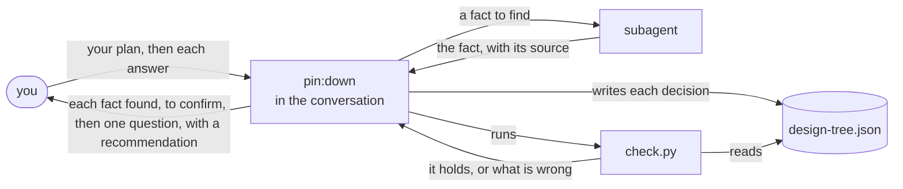

# pin

pin is a Claude Code plugin that settles every decision your plan needs before any work on it
starts, and asks you only the decisions that are yours, one at a time.

pin is for you when you are about to have an AI make something that takes more than one sitting,
such as a feature or a document, and you want it to make what you meant. With pin, every decision
the plan needs is settled before the work starts. You decide each one that is yours, the AI finds
each fact itself, and nothing is left for the AI to guess along the way. A point settled before the
work does not come back later as rework. pin is also for a plugin that makes something for a
person, such as Turn or rn: the plugin hands pin the goal of what it makes, and gets back a design
it can build on.

A plan talked over in a chat lives only in the chat: questions come as they occur to the AI, and
a point no one raised is guessed later. pin keeps the plan as a design tree, a file that holds the
goal at its root and, under it, each decision joined to what it serves and to the decisions it
builds on.

- **From the goal down.** pin asks of the goal what must hold for it, and of each of those the
  decisions that make it hold, until a fact or you settle each one. A decision that serves nothing
  is cut, so you are not asked it.
- **Facts are found, decisions are asked.** A subagent looks up each fact, such as what reads a
  file today, while pin goes on with the questions that do not wait for it. pin shows you each fact
  as it is found, for you to confirm, and asks you only the decisions that are yours, each with a
  recommendation.
- **One point at a time, in order.** Each message from pin holds one fact to confirm or one
  decision to make. pin asks a decision only once the decisions it builds on are settled, so your
  answer to one question can still change the next.
- **Checked by a script.** The script `check.py` checks the file after each answer: every question
  is served by a decision, every decision reaches the goal, and each decision comes after the ones
  it builds on.
- **Kept in a file.** Each decision and answer is written to the file before the next question,
  so a stopped run goes on from there in a new conversation.

**Non-goals**

- pin does not make the work. It ends once you confirm that you and the AI understand the plan the
  same way.
- pin does not judge whether a decision is right. Its script checks only that the decisions hold
  together; you judge each one as you answer it.
- pin does not decide what is yours. A decision you leave unanswered stays open, and pin does not
  go on as if you had answered.
- pin does not ask several questions in one message, and it sets no limit on the number of
  questions. To end sooner, tell it to wrap up; the decisions still open stay marked as open.

## Requirements

- Claude Code 2.1.317 or later: `claude --version` shows its version.
- Python 3.9 or later, run as `python3`, which pin's check script `check.py` runs on:
  `python3 --version` shows its version.

## Installation

```console
claude plugin marketplace add lovaizu/ccpm
claude plugin install pin@ccpm
```

`claude plugin list` then lists `pin@ccpm`. In a new Claude Code session, `/pin:down` is then one of
its commands.

A plugin that uses pin lists it in the `dependencies` of its `.claude-plugin/plugin.json`, as
`"dependencies": ["pin"]`, and installing that plugin installs pin with it.

## Walkthrough

At the end, you have your plan's design tree in a file, every decision in it settled, and each one
that is yours decided by you.

This walkthrough is not yet from a real run: it shows what pin is being built to show, and its
output is replaced by a real run's once pin is built.

Your notes app `notes` prints your notes as text with `notes list`. You want it to give JSON too.
In Claude Code, at the root of the app's repository, you type:

```text
/pin:down notes list should give JSON as well
```

While a subagent looks for what reads the output of `notes list` today, pin asks its first
question:

```text
The goal: scripts that read `notes list` get its notes as JSON, so they stop parsing text.
Is that the goal?

Recommendation: yes. JSON is for a program to read, so the scripts that read the list gain.
```

You answer `yes`. Meanwhile the subagent has found a fact, and pin shows it to you alone:

```text
Found: scripts/sync.py:14 reads `updated` with `datetime.fromisoformat(fields[3])`, so it
expects ISO 8601. Is that right?
```

You answer `right`. pin asks the next decision, one that builds on the goal:

```text
Which fields does each note have in the JSON?

Recommendation: id, title, tags and updated, the fields the text output shows today. Yes?
```

Questions and facts go on like this, one at a time. pin decides itself what follows from the
goal, such as keeping the text output the default, and does not ask you it. When no decision is left open, it
shows you the design:

```text
Goal: scripts that read `notes list` get its notes as JSON.        (you)
D1  Each note has id, title, tags and updated.                     (you)
D2  The text output stays the default; JSON only with --json.      (follows from the goal)
D3  `updated` is in ISO 8601, in UTC.                              (found, you confirmed)

Do we understand the plan the same way?
```

You answer `yes`, and pin ends. The design tree is in
`.pin/20261103-notes-json/design-tree.json`:

```json
{"goal": {"what": "Scripts that read `notes list` get its notes as JSON, so they stop parsing text.",
          "grounds": ["the person, 2026-11-03"]},
 "questions": [{"id": "Q1", "what": "Can each script that reads notes list read the JSON as it is?"},
               {"id": "Q2", "what": "Do people who read notes list by eye see the same as before?"}],
 "decisions": [
  {"id": "D1", "what": "Which fields each note has", "contributes_to": ["Q1"], "builds_on": [],
   "decided": "id, title, tags and updated", "settled_by": "user", "grounds": ["the person, 2026-11-03"]},
  {"id": "D2", "what": "Whether text stays the default", "contributes_to": ["Q2"], "builds_on": [],
   "decided": "it stays; JSON only with --json", "settled_by": "reasoning",
   "grounds": ["the goal, and Q2"]},
  {"id": "D3", "what": "The form of updated", "contributes_to": ["D1"], "builds_on": ["D1"],
   "decided": "ISO 8601, in UTC", "settled_by": "research",
   "grounds": ["scripts/sync.py:14 \"datetime.fromisoformat(fields[3])\"",
               "the person confirmed, 2026-11-03"]}]}
```

`settled_by` says who settled each decision: you (`user`), a fact found (`research`), or what
follows from the goal and the decisions before it (`reasoning`). Hand the file to the AI that makes
the work.

## How it works



- `pin:down` writes each answer into the design tree before it asks the next question, and runs
  `check.py` on it each time.
- A plugin that uses pin gives its role `pin:down`, with the goal of what it makes, the questions
  that must hold for it and where to keep the tree. The role then works as the conversation does
  above, and puts each fact and each question to you through the conversation you talk in.

## Documentation

- [pin's development folder](../../dev/pin/) holds its UX and its architecture.

## License

[MIT License](../../LICENSE).

`pin:down` is made from Matt Pocock's skill
[grilling](https://github.com/mattpocock/skills/blob/4ae2317ddb22b046e26455e4f9c9b3aaaf62212d/skills/productivity/grilling/SKILL.md),
under the MIT License, Copyright (c) 2026 Matt Pocock, as [LICENSE-grilling](LICENSE-grilling)
gives in full. pin asks one question at a time, where grilling asks a round of questions.
