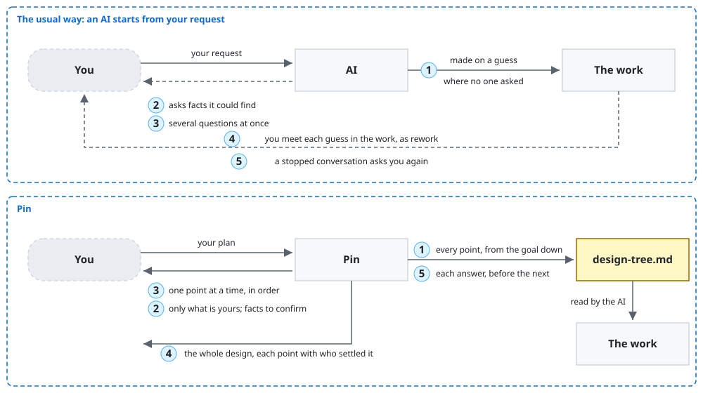
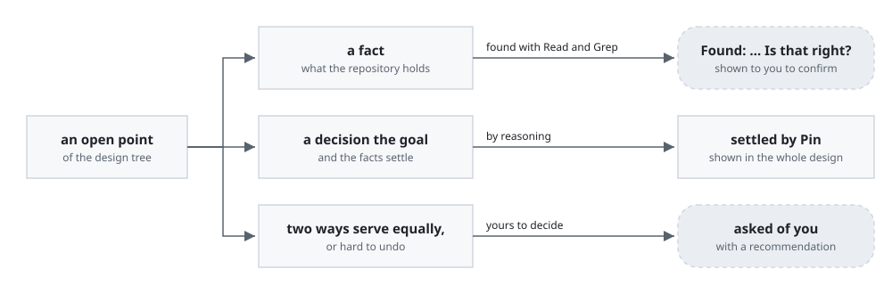
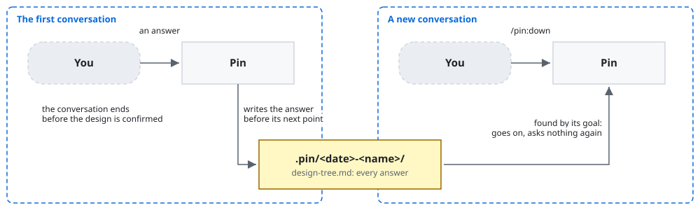
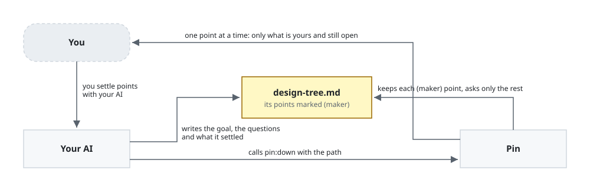

# Pin

Pin is a Claude Code plugin that settles every point of your plan before an AI makes it, asking
you only what is yours.

Pin 0.1.0 is still in development and not yet released.

Pin is for you when you are about to have an AI in Claude Code make something larger than a quick
change, such as a feature or a document, and you want it to make what you mean. It is also for you
when you are that AI, settling a plan for a person before you build. With Pin, the work made from
your plan is what you mean, with no point of it left for the AI to guess.

A point is one thing the plan must settle: a fact, such as what reads a file today, or a decision,
such as the form an output takes.

**Non-goals**

- Pin does not make the work. It ends once you confirm the design.
- Pin does not judge whether a decision is good. Its check sees only that the design holds
  together, and you judge each decision as you answer it.
- Pin does not decide what is yours. A point you leave unanswered stays open, and Pin does not go
  on as if you had answered.

## Requirements

- Claude Code 2.1.319 or later: `claude --version` shows it.
- Python 3.9 or later, run as `python3`, which Pin checks the design with: `python3 --version`
  shows it.

## Installation

```console
claude plugin marketplace add lovaizu/ccpm
claude plugin install pin@ccpm
```

`claude plugin list` then lists `pin@ccpm`. In a new Claude Code session, `/pin:down` is then one
of its commands.

## Walkthrough

At the end, you have the design of your plan in a file. Every point in it is settled, each
decision that is yours is decided by you, and Pin asked you nothing that was not yours.

Your notes app `notes` prints your notes as text with `notes list`, and four scripts read that
text. You want it to give JSON as well. In Claude Code, at the root of the app's repository, you
type:

```text
/pin:down notes list should give JSON as well
```

Pin first puts to you the goal as it reads your words:

```text
This is how I read the goal: `python3 notes.py list` can print the notes as JSON, and it still prints its current tab-separated lines too.

Is that the goal?
```

You answer `Yes. The text stays the default, since I read it by eye. JSON only when asked for.`
Pin has looked in the repository meanwhile. It shows you each fact it found, one to a message,
such as this one:

```text
Found: the top of `notes.py` says "updated is the time in UTC", but one note's time is not in UTC. The Dentist note is stored as `2026-11-03T08:15:00+09:00` (`notes.py` line 9), and `list` prints that as it is.

Is that right?
```

You answer that the docstring is out of date: since last month, the notes from your phone come in
its local time with its offset, so `updated` keeps each note's own offset. Pin then asks you each
decision that the goal and the facts leave open, one to a message:

```text
You need a way to ask `notes.py list` for JSON, and it should be easy to type and leave the plain `list` alone. Today the only command is `list`: `notes.py` line 14 checks for that word and nothing else. A `--json` flag (`notes.py list --json`) and a `--format json` option would both work. `--json` is shorter. `--format` leaves room for more formats later, which nothing in the plan needs yet.

Shall it be `notes.py list --json`?
```

You answer `Yes, notes.py list --json is fine.` Pin asks the form of the JSON the same way, and
you take one array, adding that every script in `scripts/` should move to the JSON in the same
change. Pin settles the other points itself, such as tags as a list, and does not ask you them.
When no point is left open, it shows you the whole design:

```text
Goal: `python3 notes.py list` can print the notes as JSON as well as its tab-separated lines, and the scripts in `scripts/` read that JSON.

- You ask for JSON with a flag: `notes.py list --json` (you)
- The JSON is one array, with an object for each note (you)
- Each note has the four fields the text prints: id, title, tags, updated (found, you confirmed)
- Tags are a JSON list of strings, not one string joined by commas (follows from the goal)
- Updated is printed as stored, with each note's own offset, not converted to UTC (you)
- Plain `notes.py list` keeps printing the tab-separated lines exactly as now (you)
- All four scripts move to the JSON: `export.py`, `report.py`, `stale.py`, `sync.py` (you)
- Each script runs `notes.py list --json`, loads the array, and reads each field by name (follows from the goal)
- What each script prints or writes stays the same; only how it reads the list changes (follows from the goal)

Do we understand the plan the same way?
```

Seeing it whole, you ask for two changes: `--format json` in place of `--json`, as you want to add
CSV next, and the path of each note's file in each object. Pin confirms with you where the path
comes from, settles again each point that the changes reach, and shows you the design again. You
answer `Yes, that's the plan`, adding that with no notes the JSON is `[]`, and that whether it is
indented is its call. Pin ends:

```text
The design is pinned: `…/notes/.pin/20261106-notes-list-json/design-tree.md`

The check's last output: "holds: every question is served, every decision reaches the goal, and each decision comes after the ones it builds on. No decision is open."
```

The design tree holds every point, each with who settled it and on what grounds:

```markdown
# Design tree

Goal: `python3 notes.py list` can print the notes as JSON, besides its tab-separated lines, and the scripts in `scripts/` read that JSON.
- Grounds: the person, 2026-11-06: "Yes."
- Grounds: the person, 2026-11-06: "And in the same change, move every script in scripts/ to read the JSON instead of splitting the text."
- Grounds: the person, 2026-11-06, confirming the whole design: "Yes, that's the plan."

- **Q1** Can a caller ask `notes.py list` for JSON?
  - **D1 How JSON is asked for**: a `--format` option: `notes.py list --format json` (user)
    - Grounds: the person, 2026-11-06: "Yes, `notes.py list --json` is fine."
    - Grounds: the person, 2026-11-06: "make it `--format json` instead of `--json`, since I want to add CSV next."
    - **D12 What `--format` takes with any value but `json`**: refuses it with the usage message and a non-zero exit, never falls back to the text (reasoning)
      - Grounds: D1; a later format such as CSV must not silently print the text
- **Q2** Does the JSON hold each note's fields in a form a program reads directly?
  - **D2 The JSON's shape**: one JSON array, an object for each note (user)
    - Grounds: the person, 2026-11-06: "Yes, one array with an object per note, so jq and json.load read it whole."
    - **D13 What it prints with no notes**: an empty array, `[]` (user)
      - Grounds: the person, 2026-11-06: "with no notes, `--format json` prints an empty array, `[]`."
    - **D14 How the array is laid out**: indented by two spaces, an object's fields one to a line (reasoning)
      - Grounds: left to Pin by the person, 2026-11-06: "Indented or on one line is your call."; jq and json.load read either, and indented reads by eye
  - **D3 Which fields each note holds**: id, title, tags, updated and path (user)
    - Grounds: notes.py:18 "print("\t".join([number, title, ",".join(tags), updated]))"
    - Grounds: the person, 2026-11-06: "Yes, that's right: id, title, tags joined by commas, updated."
    - Grounds: the person, 2026-11-06: "add the path of the note's file to each object, so each has id, title, tags, updated and path."
    - **D10 How the id is written**: a JSON string (user)
      - Grounds: the person, 2026-11-06: "id stays a string"
    - **D4 How tags are written**: a JSON array of strings, not one comma-joined string (reasoning)
      - Grounds: Q2
    - **D5 How the updated time is written**: as stored, an ISO 8601 string keeping each note's own offset, not converted to UTC (user)
      - Grounds: notes.py:9 "2026-11-03T08:15:00+09:00"
      - Grounds: the person, 2026-11-06: "Yes, that's right, but the docstring is what's wrong, not the note. It's out of date: since last month notes from my phone come in its local time with its offset, like +09:00. So updated keeps each note's own offset; don't convert it to UTC."
      - Grounds: the person, 2026-11-06: "updated keeps its own offset as ISO 8601 so sync.py's fromisoformat still works."
    - **D11 How the path is written**: as stored, relative to the repository, such as `notes/groceries.md` (user)
      - Grounds: notes.py:7 "notes/groceries.md"
      - Grounds: the person, 2026-11-06: "Yes, that's right. Put it in the JSON as it's stored, relative to the repo."
- **Q3** Does `notes.py list` with no flag still print what the person reads by eye?
  - **D6 What `notes.py list` prints with no JSON asked**: the tab-separated lines, unchanged; JSON only when asked for (user)
    - Grounds: the person, 2026-11-06: "The text stays the default, since I read it by eye. JSON only when asked for."
- **Q4** Do the scripts in `scripts/` read the JSON instead of splitting the text?
  - **D7 Which scripts move**: all four: export.py, report.py, stale.py, sync.py (user)
    - Grounds: scripts/export.py:12 "_, title, tags, _ = line.split("\t")", scripts/report.py:13, scripts/stale.py:12, scripts/sync.py:15 "fields = line.split("\t")"
    - Grounds: the person, 2026-11-06: "Yes, that's right: those four, and they all split on tabs. Move all four to the JSON."
  - **D8 How each script reads the list**: runs `notes.py list --format json`, loads the array, and takes each field by name (reasoning)
    - Grounds: D1, D2, D3
    - Also builds on: D1, D2, D3
  - **D9 What each script prints or writes**: the same as now; only how it reads the list changes (reasoning)
    - Grounds: the person, 2026-11-06: "move every script in scripts/ to read the JSON instead of splitting the text."
```

Each question stands under the goal, and each decision under what it serves. The end of a
decision's line says who settled it: you (`user`), a fact found (`research`), or what follows from
the goal and the decisions before it (`reasoning`). You hand the file to the AI that makes the
work, and it has nothing to guess.

## How it works



1. **A point no one raised is guessed, and you meet the guess in the work as rework.** Pin works
   out what must hold for your goal, and under each, what makes it hold. So every point the work
   needs is found before the work starts.
2. **You are asked what the AI could find itself.** Pin finds each fact with the repository's
   files and shows it to you to confirm. It asks you only the decisions that are yours, each with
   a recommendation, so a yes takes it.
3. **Several questions come at once, and one answer changes another unseen.** Each message from
   Pin holds one point, and a decision comes only once those it builds on are settled.
4. **You and the AI mean different things, and it shows only in the work.** At the end, Pin shows
   you every point in one short line with who settled it, and asks whether you mean the same.
5. **A stopped conversation loses your answers, and you are asked again.** Pin writes each answer
   into the design tree before its next message.



**What does Pin ask me, and what does it settle itself?** Pin finds each fact itself, and shows it
to you to confirm. It settles each decision that the goal and the facts favor. It asks you a
decision only where two ways serve your goal equally well, or where the decision is hard to undo.



**What if the conversation stops before the design is done?** Every answer is in the design tree,
`.pin/<yyyymmdd>-<name>/design-tree.md`, before the next point goes out. Type `/pin:down` on the
same plan in a new conversation, and Pin finds the file by its goal and goes on from it, asking
nothing again.



**My AI has already settled some points with me. Will Pin ask them again?** No. Your AI writes the
goal, the questions and what it settled into a design tree, each settled point marked `(maker)`,
and calls the skill `pin:down` with the file's path. Pin keeps those points as given, and asks you
only the rest.

## Documentation

- [The design tree](core/roles/pinner.md#the-design-tree): each line of the design tree, for you
  or your AI to read it, or to write one before calling Pin.
- [Changelog](CHANGELOG.md): the changes in each version.
- [Issues](https://github.com/lovaizu/ccpm/issues): where you ask for help or report a fault.

## License

[MIT License](../../LICENSE)

`pin:down` is made from Matt Pocock's skill
[grilling](https://github.com/mattpocock/skills/blob/4ae2317ddb22b046e26455e4f9c9b3aaaf62212d/skills/productivity/grilling/SKILL.md),
under the MIT License, Copyright (c) 2026 Matt Pocock, as [LICENSE-grilling](LICENSE-grilling)
gives in full.
