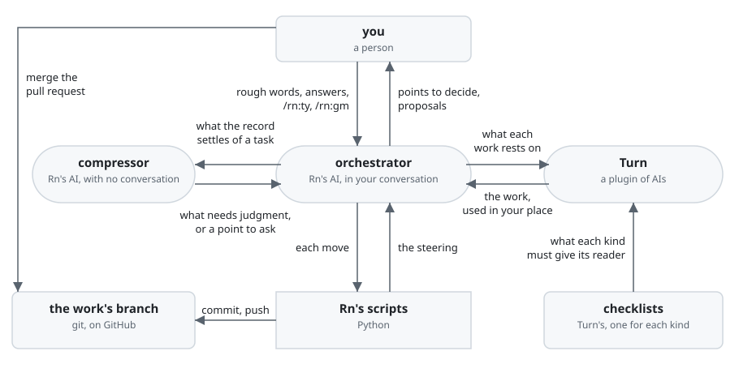

# `rn`

rn is a Claude Code plugin that builds what you ask for, such as a document, code, or a plugin, so
that the people who use it can do what they need with it.

rn is being rebuilt. This README describes the rebuilt rn, which isn't released yet. Until its release,
the installation below installs the earlier rn 0.9.0, which works differently, and the walkthrough
shows the run that the design of the rebuilt rn lays out, not a recorded run.

rn is for you when you want an AI to build work made of several pieces, such as a feature with its
README and its code, and you'd rather answer a few questions than review what an AI made and ask for
fixes. With it, you hand over work that its users can use without fixes, and rn asks you only what
it can't decide itself.

## Non-goals

- rn doesn't decide your purpose or what you want. When rn leaves a question to you, the work that
  depends on it waits for your answer.
- rn isn't for a quick first version that you'll fix yourself. It plans, builds, and tests each
  piece, so it takes longer than a single prompt to Claude Code.
- rn doesn't merge your work. It commits each piece to a branch and leaves one draft pull request
  for you to merge.

## Requirements

- macOS or Linux: `uname` shows it. No one has tried rn on Windows yet.
- Claude Code 2.1.319 or later: `claude --version` shows it.
- Python 3.9 or later, run as `python3`: `python3 --version` shows it.
- git, and the GitHub command-line tool `gh` signed in to the repository's host: `gh auth status`
  shows it. rn keeps your work in a draft pull request.

## Installation

```console
claude plugin marketplace add lovaizu/ccpm
claude plugin install rn@ccpm
```

`claude plugin list` then lists `rn@ccpm`, and `lane@ccpm`, which comes with it.

## Walkthrough

At the end, your tool `tidy` has a dry-run option, and its README shows how to use it. You've
answered two questions and typed `/rn:up` twice.

`tidy` sorts a Downloads folder into subfolders by file type. You want it to show what it would
move before it moves anything. In Claude Code, at the root of its repository, you type:

```text
/rn:up tidy should show what it would move, without moving it
```

rn shows:

```text
Goal: before sorting their Downloads folder with tidy, a user sees what it would move, so that
nothing moves that they didn't intend. Is that what you want?
```

You answer `yes`. rn shows:

```text
Plan, working back from the goal:
1. README.md: describe the dry run in the Walkthrough, so that the code is built to match what
   the reader is told.
2. tidy/cli.py: add the --dry-run option, with tests.

Question 1 of 1 for README.md: should the dry run list each file with its target folder, or only
a count for each folder? Either would work. I recommend listing each file, because users check
file names before they move anything.
```

You answer `each file`. rn updates README.md, and you close Claude Code before it continues. The
next day, in a new conversation, you type:

```text
/rn:up
```

rn shows:

```text
Picking up "tidy shows what it would move" at step 2, tidy/cli.py. README.md is done.
```

Later, rn shows:

```text
Done: README.md and tidy/cli.py are updated, with tests/test_dry_run.py. Each piece was read and
tried as its users would use it, and gives them what they need from it.

Decided without asking you:
- The README shows tidy --dry-run before tidy, because users check first.   (README best practice)
- --dry-run prints each move as "<file> -> <folder>", as the README shows.   (README.md)
```

## How it works



In everything, rn builds up only the few points that matter to your goal, and never a pile of
small fixes. It keeps those points in a design tree: your goal, with every decision under it.

### 1. Does it build what you mean, without a careful prompt?

Along the design tree, rn asks you one point at a time. It asks only what your goal and the best
practices leave open. You get the work you mean, and you answer only the points that are yours.

### 2. Do small fixes pile up in your work?

No. When a check finds a problem, rn changes the decision in the design tree that the problem comes
from, and builds the piece again from it. Your work holds only the points that matter.

### 3. Does it hold on your own work, every time?

rn plans, builds, and asks you by the best practice for each kind of work, and
[Lane](../lane/README.md), which comes with rn, holds each step of it on every run. Every run takes
the same steps, whatever the work.

### 4. Can you trust its own check?

The check reads each piece as its users would, with only what they have, and never the design tree.
It passes a piece only when its users can do what they need with it.

### 5. What if the plan turns out wrong?

rn revises the design tree with what each run finds, and the next pieces follow the revised tree.

## Documentation

- [Lane](../lane/README.md): how Lane enforces each step.
- [Changelog](CHANGELOG.md): the changes in each version.
- [Issues](https://github.com/lovaizu/ccpm/issues): where to ask for help or report a bug.

## License

[The `MIT` License](../../LICENSE)

rn's way of asking one question at a time with a recommendation comes from
[grilling](https://github.com/mattpocock/skills/blob/4ae2317ddb22b046e26455e4f9c9b3aaaf62212d/skills/productivity/grilling/SKILL.md),
by Matt Pocock, under the `MIT` License in [LICENSE-grilling](LICENSE-grilling).
