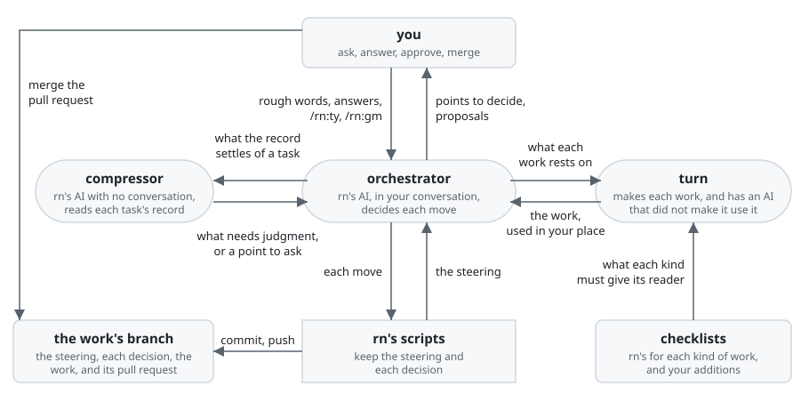

# rn

rn is a Claude Code plugin that takes a piece of work you ask for in rough words to a pull request
that meets your purpose, asking you only what is yours to decide.

Asking Claude Code alone for a piece of work also gets it done, but only as far as your words go.
Claude Code builds on your words as they stand, so you write out what you want before you ask, and
a finished work that misses your purpose is made again. Over work that takes days, one conversation
swells and drifts, and a fresh one starts from nothing, so you watch the work and steer it.

With rn you hand over a piece of work in your GitHub repository, even work of days, in your own
rough words, and you get a pull request that meets your purpose while you only answer what rn
asks. You decide at each stop from what rn shows you there, without reading all of the work
again. What was decided, and why, stays in your repository for your next piece of work and your
teammates, and what each piece of work taught makes the next one better.

rn does this by keeping both the work and its own course tied to your purpose:

- A point to decide is a choice that changes what is made. rn finds the points behind your rough
  words and asks you each one, one per message, with what it looked up and the answer it
  recommends, before it builds on it.
- From your answers rn writes the goal, your purpose as rn wrote it down, and the acceptance
  criteria, each one thing the finished work must do for that purpose. Every task rn carries out
  names the goal or the criteria it serves.
- The steering is a short record of the plan and of where the work stands, kept on the work's own
  branch. rn carries only the steering from move to move and remakes the plan from the facts each
  move brings, so a long piece of work neither swells nor drifts, and `/rn:up` goes on from it in
  any conversation.
- turn, a plugin installed with rn, makes each document and the finished work with rn's checklist
  for its kind, and an AI that did not make it uses it in your place before you see it.
- A sign-off is a stop where rn shows you a proposal and waits for your answer: `/rn:ty` to approve
  or `/rn:gm <feedback>` to ask for a change. There are up to four, on the goal, on the documents of
  what you get, on the documents of how it is built, and on the finished work.

**Non-goals**

- rn does not merge: it marks the pull request ready, and the merge is yours.
- rn does not push to your default branch: it works on a branch of its own.
- rn sends nothing to its makers without your yes: you read each issue whole before it is sent.
- rn does not change its own checklists: what you add for your repository goes into
  `.rn/checklists/` in it.

## Requirements

- Claude Code.

  rn runs inside it.

- A git repository whose remote is on GitHub.

  rn puts the plan and the work on a pull request.

- The GitHub command-line tool `gh`, logged in to an account that can push to the repository.

  rn opens and updates the pull request with it.

- The default branch protected on GitHub, so that it takes a change only through a reviewed pull
  request.

  rn works on a branch of its own and never needs to push to the default branch, and the protection
  keeps any command, whatever form it takes, from changing it before you merge.

- Python 3.9 or later, run as `python3`.

  The scripts of rn run on it, and so do those of turn.

- `jq`, the command-line JSON processor.

  rn's AI reads the steering, kept as JSON, with it.

- Recommended: Claude Code run in a [Docker Sandbox](https://docs.docker.com/ai/sandboxes/), with
  the permission mode `bypassPermissions`.

  rn hands whole pieces of work to agents that run many commands; in this mode they are not stopped
  to ask at each one, and the sandbox keeps what they do inside it. rn is tried in the same setting.

## Installation

In Claude Code, add the marketplace once, then install rn:

```console
/plugin marketplace add lovaizu/ccpm
/plugin install rn@ccpm
```

Claude Code installs turn with rn. To see that both are installed, run `claude plugin list` in a
shell; it lists `rn@ccpm` and `turn@ccpm`, each with `Status: ✔ enabled`.

## Walkthrough

This walkthrough follows the UX's scene
[From asking to the merge](../../dev/rn/ux.md#from-asking-to-the-merge), which tells who does what
in which order.

Your app is written in JavaScript, and you want it moved to TypeScript, work that takes days. In
your repository, you type what you want:

```console
> /rn:up move this app to TypeScript
```

rn does not start building on those words. It first finds the points to decide and asks you one per
message, even those it could look up, with what it looked up and the answer it recommends. Its
first point is the two languages: the one it talks to you in and the one it writes into your
repository in. Here you choose English for both, and the next points are about the work:

```console
● Points to decide
  ▶ 1. What the move is for
    2. What shows the move is done

  1. What the move is for
  I take it the move is to stop type mistakes before they ship: three of last quarter's
  production bugs (#81, #87, #93) were a value of the wrong type, undefined where a number
  was expected.
  a. Stop such mistakes before they ship (recommended). Costs more than renaming files, since
     the types must be strict enough to catch them. Can be changed later.
  b. Have the code in TypeScript, however loose its types. Quicker, but the three bugs could
     come back. Can be changed later.
  What is the move for? Answer with a letter or in your own words.

> a

● Points to decide
  ✓ 1. What the move is for: stop type mistakes before they ship
  ▶ 2. What shows the move is done

  2. What shows the move is done
  I propose that such a mistake fails the build. Every file ending in .ts is not enough: a
  file moved with loose types would still let the three bugs through.
  a. A value of the wrong type fails the build (recommended). Each file must be typed
     strictly. Can be changed later.
  b. Every file ends in .ts. Done sooner, but does not stop the bugs. Can be changed
     later.
  What shows the move is done? Answer with a letter or in your own words.

> a
```

From your answers rn writes the plan, which holds the goal and the acceptance criteria, each with an
ID that later messages refer to. rn writes the plan with its checklist for plans open and checks it
against the same checklist. Then rn stops at the goal sign-off:

```console
● Goal sign-off
  The goal is on the draft pull request: https://github.com/you/app/pull/42
  G1: A value of the wrong type fails the build. So mistakes like last quarter's three bugs
      do not ship.
  AC1: Code that repeats each of the three bugs fails the build.
  AC2: The app builds and runs as before.
  AC3: Every file of the app is TypeScript.
  /rn:ty to approve, /rn:gm <feedback> to ask for a change.
```

Moving every file at once is more than you want now, so you ask for a change. rn keeps your
feedback and stops, so you can clear the conversation, or come back tomorrow:

```console
> /rn:gm moving every file at once is too much for now

● Your feedback is kept. Clear the conversation if you like, then type /rn:up to go on.
```

In a fresh conversation, `/rn:up` goes on from where you stopped, with the point behind your
feedback, one rn did not ask:

```console
> /rn:up

● Points to decide
  ✓ 1. What the move is for: stop type mistakes before they ship
  ✓ 2. What shows the move is done: a value of the wrong type fails the build
  ▶ 3. Which parts move now

  3. Which parts move now
  I propose moving the cart and the checkout now: all three bugs were there (#81, #87, #93
  touch only src/cart and src/checkout).
  a. The cart and the checkout now, the account pages later (recommended). The account
     pages can still let a wrong type through. Can be changed later.
  b. Only the cart now, the rest later. The move is smaller still, but the checkout can
     still let a wrong type through. Can be changed later.
  Which parts move now? Answer with a letter or in your own words.

> a

● Goal sign-off
  The goal is on the draft pull request: https://github.com/you/app/pull/42
  Changed: AC3: Every file of src/cart and src/checkout is TypeScript.
  (G1, AC1 and AC2 as before)
  /rn:ty to approve, /rn:gm <feedback> to ask for a change.

> /rn:ty
```

The same goes for the documents the purpose needs: first those that say what you get and how you
use it, such as a UX or a README, at the ux sign-off; then those that say how it is built and
checked, such as an architecture, at the architecture sign-off. rn asks which documents the work
needs, and for each whether it is kept in your repository, the one already there changed, kept in
rn's folder for the work alone, or not made. Here the move changes nothing you use, so there is no
ux sign-off, and the one document is an architecture for the move, kept in the repository. rn asks
its points one at a time, such as how the types are made strict file by file, has an AI that did
not write it use it, and stops at the architecture sign-off. It shows the link to each document and
each choice made in it without asking you, with why; what you answered is in the document already,
and that AI has checked it there:

```console
● Architecture sign-off
  The architecture is on the draft pull request: https://github.com/you/app/pull/42
  architecture: https://github.com/you/app/blob/typescript/docs/architecture.md
  - Values from the account pages are checked where they enter the cart and the checkout:
    the JavaScript left there could otherwise pass a wrong type in, and those are the only
    places it meets the moved code.
  /rn:ty to approve, /rn:gm <feedback> to ask for a change.

> /rn:ty
```

A small change that needs no document, such as a line in a README, goes on without these stops.
Then rn divides the work into tasks, such as moving the cart, each checked against the acceptance
criteria it serves, and carries them out in the conversation without you watching. Before each step,
rn tells you in a line what it will do, how far and how, and after it, what is done and what comes
next, so you can stop a step going a way you do not want. If a point to decide comes up, rn asks it
there and waits for your answer; if you close Claude Code meanwhile, `/rn:up` in a fresh
conversation goes on from where it stopped. When the work is finished, an AI that did not make it
uses it for each acceptance criterion, and rn stops at the deliverable sign-off, showing the links
to the finished work and each choice made without asking you in building and using it:

```console
● Deliverable sign-off
  The finished work is on the pull request: https://github.com/you/app/pull/42
  deliverable: https://github.com/you/app/blob/typescript/docs/architecture.md,
    https://github.com/you/app/blob/typescript/src/cart/bugs.test.ts,
    https://github.com/you/app/blob/typescript/src/cart/cart.ts,
    https://github.com/you/app/blob/typescript/src/checkout/checkout.ts
  - The three bugs are kept as tests in src/cart/bugs.test.ts that must fail to type-check:
    the build already runs the tests, so AC1 is checked on every build.
  /rn:ty to approve, /rn:gm <feedback> to ask for a change.

> /rn:ty
```

Once you approve the finished work, rn looks back over the piece of work for each change you sent
back, each work made again and each point asked again. It offers you what they taught as
learnings, one per message, each with what happened and where it would make later work better:
your own checklists, which rn makes your later work with, for your repository alone, or rn itself,
as an issue to rn's makers, for everyone's work. You decide each:

```console
● Learnings to decide
  ▶ 1. How much moves at once

  1. How much moves at once
  The plan was sent back at its sign-off for moving every file at once, and only then did rn
  ask which parts move now. rn's checklist for plans does not ask how much of the work is done
  at once, so anyone handing rn a large piece of work could meet the same send-back.
  a. Add "Is it settled how much of the work is done at once?" to .rn/checklists/plan.md, and
     send rn's makers an issue (recommended). Your later plans ask it first, and rn can ask it
     of everyone's.
  b. Add it to .rn/checklists/plan.md alone. Your later plans ask it first.
  c. Add nothing. A later plan may be sent back the same way.
  Where does it go? Answer with a letter or in your own words.

> a

● The issue to rn's makers, in full:
  # rn: the plan checklist asks how much of the work is done at once
  ## What it should be
  rn's plan checklist asks whether it is settled how much of the work is done at once.
  ...
  Send it to lovaizu/ccpm? Answer yes, or say what to change.

> yes

● Issue sent: https://github.com/lovaizu/ccpm/issues/120
● The pull request is ready to merge: https://github.com/you/app/pull/42
```

What you add to your checklists sits in `.rn/checklists/` in your repository and goes into the same
pull request. The merge is yours.

## How it works



rn is made of four parts of its own, and it uses turn for the making:

- The orchestrator is rn's AI. It runs in your Claude Code conversation, is the only part that talks
  with you, and decides each move from the steering. It writes the plan and the learnings itself.
- The compressor is a second AI of rn's, with no conversation of its own. For each task, it reads
  where the result goes and what checks it from your repository and your decisions, and hands back
  any point that neither settles, which the orchestrator asks you.
- rn's scripts keep the steering and each decision on the work's branch, and commit and push them
  as each step ends. They keep the steering as JSON for rn's AI and write `steering.md` beside it
  for you, which the pull request links. They make each proposal from what they kept, and take an
  approval or feedback only where Claude Code's record of the conversation shows you typed it.
- rn's checklists say what each kind of work, such as a plan, a README or code, must give its
  reader. Your additions in `.rn/checklists/` go beside them.
- turn makes every other work from what was decided, with those checklists, and has an AI that did
  not make it use it in your place.

Who does what in which order is in [rn's UX scenes](../../dev/rn/ux.md#scenes).

## Documentation

- The three commands in the walkthrough, `/rn:up`, `/rn:ty` and `/rn:gm`, are all there is to use.
- [The changelog](CHANGELOG.md) says what changed in each version.

## Development

- [rn's development](../../dev/rn/README.md) is the entrance for those who build rn.

## License

[MIT License](../../LICENSE)
