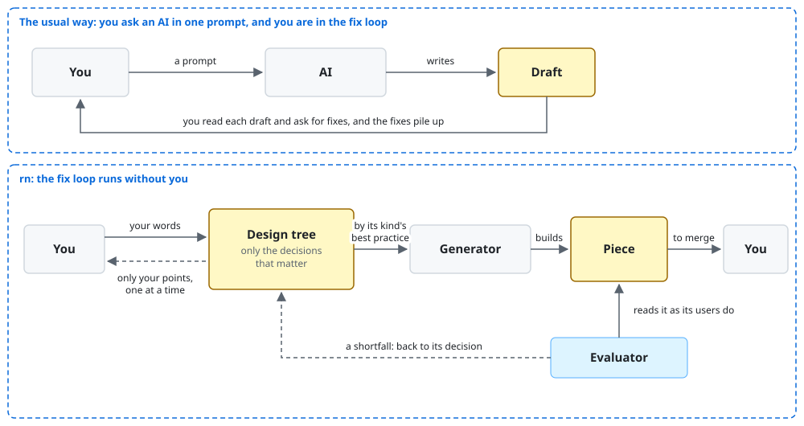
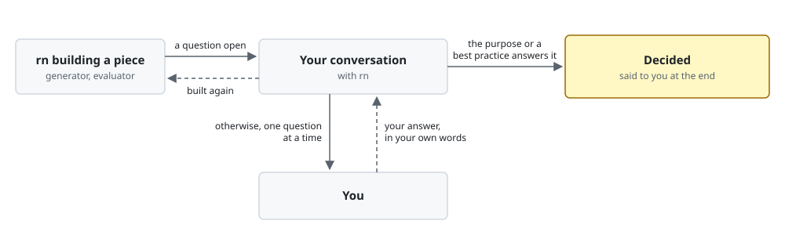
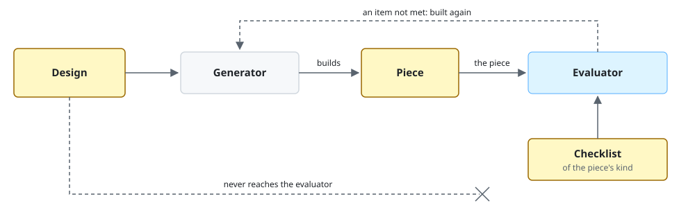
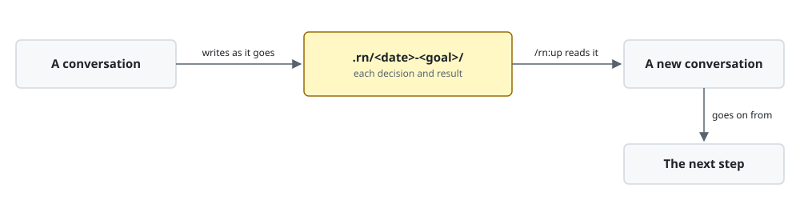
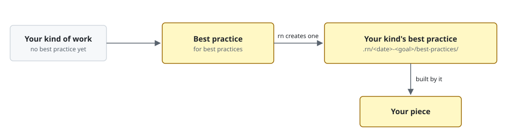

# `rn`

rn is a Claude Code plugin that makes what you ask for, such as a document, code, or a plugin, so
that the people it's for can use it for what they're after.

rn is being rebuilt, and this README describes the rebuilt rn, which isn't released yet. Until
then, the installation below gives the earlier rn 0.9.0, which works another way, and the
walkthrough shows the run the rebuilt rn makes, not a recorded one.

rn is for you when you want an AI to make work that takes several pieces, such as a feature with
its README and its code, and you'd rather answer a few points than read and fix drafts. With it,
you hand the work's people what they can use without fixing it, and you answer only the points
that are yours.

**Non-goals**

- rn doesn't settle your purpose or your intent. A point it leaves to you holds the work it touches
  until you answer.
- rn isn't for a quick draft you'll fix yourself. It plans, makes, and tries each piece, so it takes
  longer than asking Claude Code once.
- rn doesn't merge your work. It commits each piece on a branch and leaves one draft pull request
  for you to merge.

## Requirements

- macOS or Linux: `uname` shows it. No one has tried rn on Windows yet.
- Claude Code 2.1.319 or later: `claude --version` shows it.
- Python 3.9 or later, run as `python3`: `python3 --version` shows it.

## Installation

```console
claude plugin marketplace add lovaizu/ccpm
claude plugin install rn@ccpm
```

`claude plugin list` then lists `rn@ccpm`, and `lane@ccpm`, which comes with it.

## Walkthrough

At the end, your tool `tidy` has a dry run, and its README shows how to use it. You've answered
two points and typed `/rn:up` twice.

`tidy` sorts a Downloads folder into folders by type. You want it to show what it would move before
it moves anything. At the root of its repository, in Claude Code, you type:

```text
/rn:up tidy should show what it would move, without moving it
```

rn shows:

```text
Goal: someone about to sort their Downloads folder with tidy sees what it would move, and moves
nothing they didn't mean to. Is that what you're after?
```

You answer `yes, that's it`. rn shows:

```text
Plan, back from the goal:
1. README.md: the dry run in Walkthrough, so the code is built to what the reader is told.
2. tidy/cli.py: the option --dry-run, with its tests.

Point 1 of 1 for README.md: should the dry run list each file with the folder it would go to, or
only a count for each folder? Each would serve. I'd list each file, as the reader checks names
before moving anything.
```

You answer `each file`. rn makes README.md, and you close Claude Code before it goes on. The next
day, in a new conversation, you type:

```text
/rn:up
```

rn shows:

```text
Picking up "tidy shows what it would move" at 2. tidy/cli.py, the README done.
```

Some time later, rn shows:

```text
Done: README.md and tidy/cli.py are changed, with tests/test_dry_run.py. Each was tried as its
people would use it, and meets every question of its kind's best practice.

Decided without asking you:
- The README shows tidy --dry-run before tidy, as its reader checks first.   (README best practice)
- --dry-run prints each move as "<file> -> <folder>", as the README shows.   (from README.md)
```

## How it works



1. **The AI makes the one piece you asked for, and misses the others it needs, or makes them out of
   order.** rn lays out every piece the goal needs, and the order it needs them in, before it makes
   any.
2. **The AI starts from scratch, and writes what similar texts say, not what its people need.** rn
   makes each piece by the best practice of its kind, which holds the goal its people reach, a
   template of what it holds, and the questions they ask of it.
3. **Its review gives many findings, few about whether the work serves its people.** A second AI,
   the evaluator, tries each piece as its people would, and asks only those questions. rn makes the
   piece again until it meets every question.
4. **It asks you what it could find out, and guesses what only you know.** rn asks you one point at
   a time, only what the purpose and the best practices leave to you. It decides the rest, and says
   what it decided at the end.
5. **It skips a step it kept the time before, and a new conversation starts the work over.** Lane,
   a plugin that comes with rn, holds each step on every run. rn keeps the work in your repository,
   so `/rn:up` picks it up where it stopped.



**How does rn tell what to ask you?** A point that comes up while rn makes a piece goes to your
conversation with rn. rn settles it there when the purpose or a best practice settles it. Otherwise
it asks you, one point at a time, and you answer in your own words. rn then makes the piece
again with your answer.



**How can an AI judge an AI's work?** The evaluator is a fresh AI that gets only the piece and the
questions of its kind. It never gets the design. It judges by what the piece's
people get, not by what its maker meant. The generator, which made the piece, makes it again until
the evaluator finds every question met.


**How does rn keep every step, every time?** Lane watches what each part of rn does. Lane stops
a part that breaks a step, such as by running a command the step doesn't name, and shows it the
step's own sentence. The part then goes back to the step.



**What if the conversation ends partway?** rn writes each decision and each result into the folder
`.rn/<date>-<goal>/` of your repository as it goes. `/rn:up` alone reads that folder and goes on
from the next step, so you never answer a point twice.



**What if rn has no best practice for your kind of work?** rn first makes one, by its best practice
for best practices, and keeps it in `.rn/<date>-<goal>/best-practices/`. It then makes your piece
by it.

## Documentation

- [Lane](../lane/README.md): for one who wants to know how Lane holds each step.
- [Changelog](CHANGELOG.md): the changes in each version.
- [Issues](https://github.com/lovaizu/ccpm/issues): where you ask for help or report a fault.

## License

[The `MIT` License](../../LICENSE)
