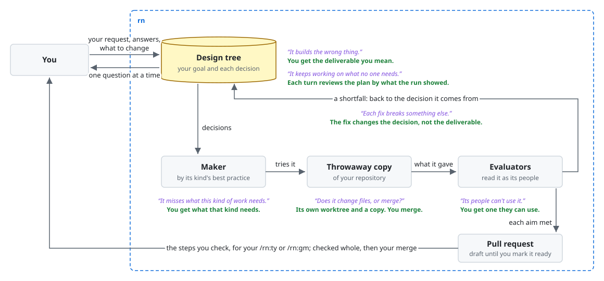

# rn

rn is a Claude Code plugin that makes what you ask for so the people it's for can use it.

In development: this README describes the rebuilt rn, which isn't built yet, so don't install rn
for your work.

rn is for you when you have Claude Code make something in a GitHub repository for other people to
use. With it, you get each deliverable you mean, one its people can use, and answer only what's
yours.

## Non-goals

- rn doesn't put the deliverable in front of real people: its AI subagents read it as they would.
- rn doesn't finish alone where your goal leaves a question open: it asks you, and other work goes
  on.
- rn doesn't make a small change faster than Claude Code alone: for a one-line fix, ask Claude Code.
- rn doesn't merge: it leaves one pull request, ready once you sign off the last deliverable.

## Requirements

- macOS or Linux: `uname` shows it.
- Claude Code 2.1.319 or later: `claude --version` shows it.
- Python 3.9 or later, run as `python3`: `python3 --version` shows it.
- Git: `git --version` shows it.
- The GitHub command-line tool `gh`, logged in: `gh auth status` shows `Logged in to github.com`.
- A GitHub repository you can push to: at its root, `gh repo view --json viewerPermission` shows
  `WRITE`, `MAINTAIN`, or `ADMIN`.

## Installation

```console
claude plugin marketplace add lovaizu/ccpm
claude plugin install rn@ccpm
```

At your repository's root in Claude Code, `/rn:up` alone says that rn has no run to pick up.

## Walkthrough

At the end, you have a pull request, ready to merge, that adds type hints to your whole library.

`invoicer`, a Python library that other teams call, has no type hints, so wrong arguments fail only
at run time. You type:

```text
/rn:up type hints for invoicer, so that the people who call it see what each function takes
```

rn shows:

```text
The goal, as I'd put it:
  The people who call invoicer learn from their editor and their type checker what each
  function takes and returns, before their code runs.
Is that what you're after?
```

You type:

```text
yes
```

rn shows:

```text
A question that's yours:
  Should the hints cover each file, or only the functions that callers import?
  I recommend only those functions, as they're all that callers see.
```

You type:

```text
each file
```

rn shows:

```text
The plan, for your sign-off:
  1. Type hints in each file of invoicer, checked by mypy --strict
  2. invoicer marked as typed, so that the callers' type checkers read its hints
/rn:ty to approve, or /rn:gm with what to change.
```

You type:

```text
/rn:ty
```

rn makes both deliverables. That evening, before rn finishes, you type:

```text
/rn:dn
```

rn shows:

```text
Paused "type hints for invoicer" while making "Type hints in each file of invoicer".
Its work so far is pushed. Type /rn:up in any conversation to go on.
```

The next day, in a new conversation, you type:

```text
/rn:up
```

rn shows:

```text
Picking up "type hints for invoicer", making "Type hints in each file of invoicer",
where it stopped.
```

Later, rn shows:

```text
"Type hints in each file of invoicer", for your sign-off:
  What its people can do with it: a caller's type checker names a wrong argument before
  the code runs.
  Decisions I took without asking:
  - Typed amounts and rates as Decimal, as the code already computes with Decimal.
  Changes: https://github.com/<owner>/invoicer/pull/12/files
/rn:ty to approve, or /rn:gm with what to change.
```

You type:

```text
/rn:ty
```

rn puts up "invoicer marked as typed" in the same form, and you type `/rn:ty` again.

rn shows:

```text
Done. The pull request is ready for your merge: https://github.com/<owner>/invoicer/pull/12
```

A caller on the pull request's branch passes the tax rate as text in `app.py`:

```python
from decimal import Decimal
from invoicer import Line, total

lines = [Line("Hosting", Decimal("40.00"))]
print(total(lines, "0.19"))
```

mypy shows, before the code runs:

```console
$ mypy app.py
app.py:5: error: Argument 2 to "total" has incompatible type "str"; expected "Decimal"  [arg-type]
Found 1 error in 1 file (checked 1 source file)
```

You then merge the pull request.

## How it works

rn works only on the few things that decide whether a deliverable's people can use it.



### "I can't spell out every detail up front, so it builds the wrong thing."

rn asks only the decisions that change what the people get, one at a time, each with a
recommendation. You sign off the plan and each deliverable, so you get what you mean without a
specification.

### "Its output misses what this kind of work needs."

rn plans and makes each deliverable by the best practice of its kind, such as one for a README.
Where it has none for a kind, it makes one first, and lists what each settled without asking.

### "It looks done, but the people it's for can't use it."

AI evaluators read each deliverable with only what its people have, never what rn meant. rn makes
it again until they find each aim met, so you get one they can use.

### "Each fix breaks something else."

rn takes each shortfall back to the decision it comes from, and makes the deliverable again from
the decisions. A shortfall the people would never meet changes nothing, so the deliverable doesn't
grow with each round.

### "Does it skip a step when no one watches?"

No. Lane, installed with rn, stops any part of rn that leaves its steps, and shows it its step.

### "Does it change the repository's files, or merge on its own?"

No. rn works in its own worktree and branch, runs commands in a throwaway copy, and leaves the
merge to you.

## Documentation

- [Changelog](CHANGELOG.md): for you after an update, the changes in each version.
- [Lane](https://github.com/lovaizu/ccpm/blob/main/plugins/lane/README.md): for you if you want to
  know what Lane does, or use it in a plugin of your own.
- [Issues](https://github.com/lovaizu/ccpm/issues): where you ask for help or report a fault.

## License

[MIT](LICENSE)
