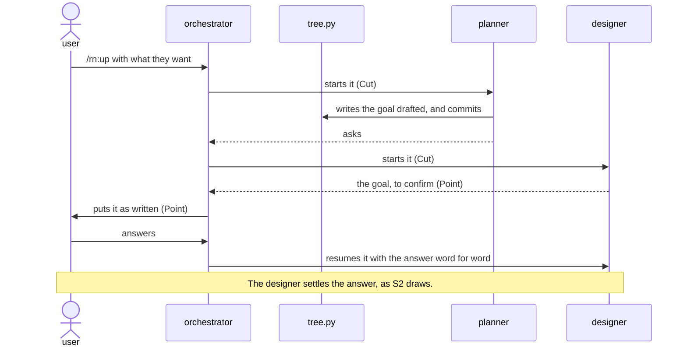
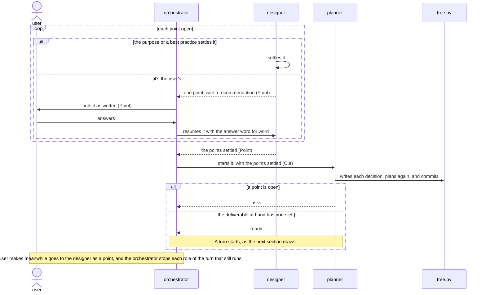
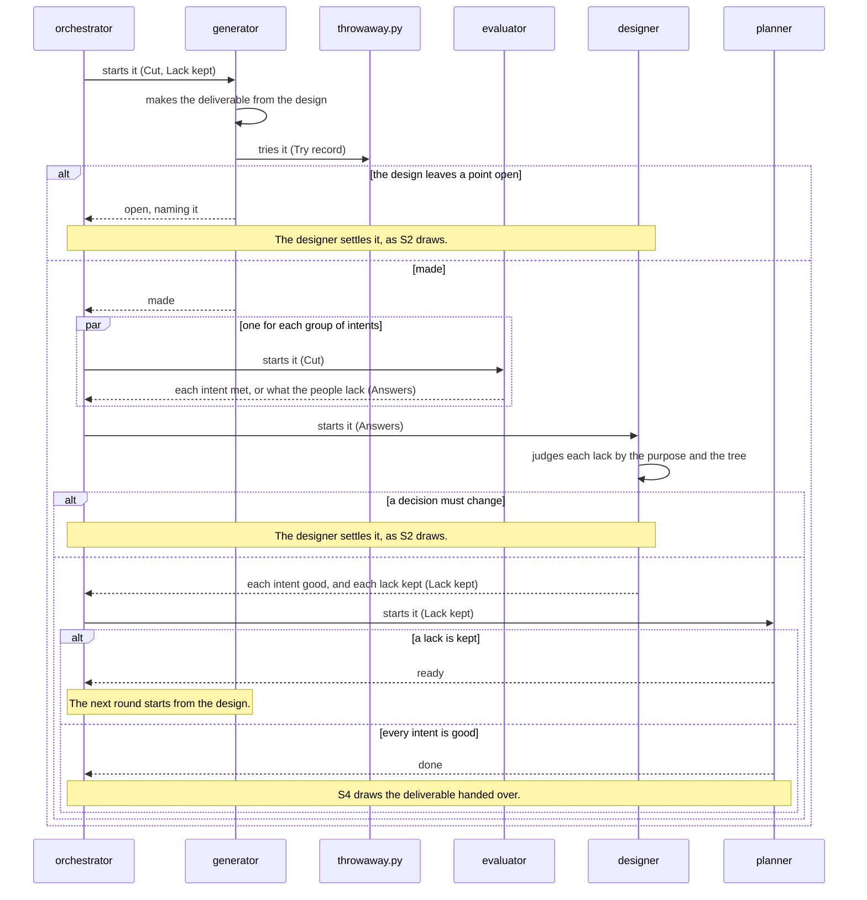
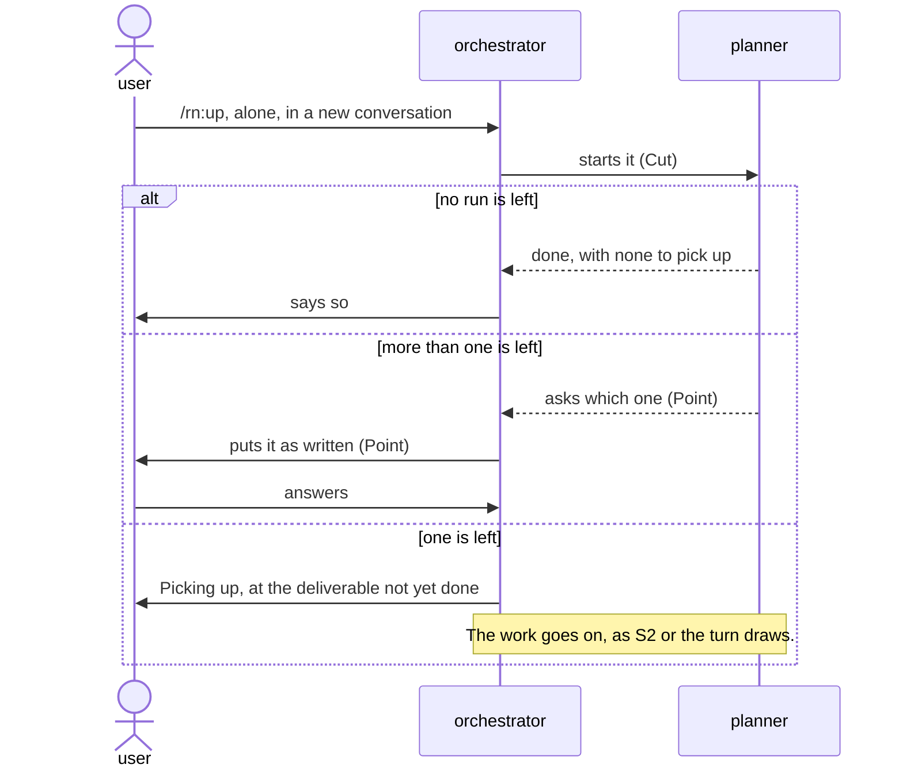
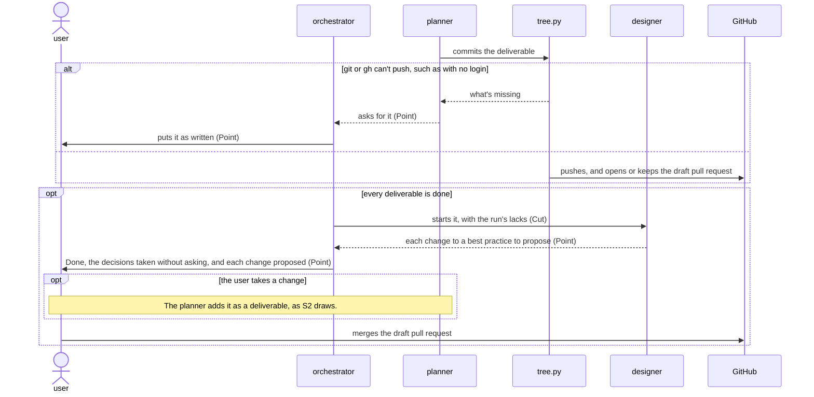

# `rn` architecture

This document says how the parts of rn give [its product vision](../../../../../dev/rn/product-vision.md). rn builds up
only the vital few of each deliverable: what its people can't do without. A designer settles the
user's goal and the decisions that serve it in a design tree, asking the user only the points that
are theirs. A turn makes each deliverable from its decisions, and evaluators that have only what its
people have judge it. A shortfall changes the decision it comes from, not the deliverable.

## Principles

rn builds on [the plugin best
practice](../plugin/best-practice.md), and adds these.

### Drawn out along the design tree

The designer settles each point of the design: itself where the purpose or a best practice settles
it, and with the user, one point at a time with a recommendation, where neither does. Only the
planner writes the design tree, which holds what each deliverable is for and the decisions that
serve it, never how it works inside. Each role starts with its own cut of the tree alone.

*Why*: a point settled by a role that reads decisions not its own makes what the user didn't mean,
as KR1.1 counts, and asking the user what the purpose settles costs their time, as KR1.2 counts.

### Every step by best practice

Each role works by the best practice of its work. Where a kind of deliverable has none, the planner
plans one as a deliverable of its own, made by the meta best practice before the first deliverable
of that kind. Lane holds each role to the steps of its best practice.

*Why*: an AI that skipped a step once skips it again on another run, and the deliverable misses what
the step makes sound, as KR1.1 counts.

### Judged by the people it's for

An evaluator gets only what the deliverable's people have. It confirms where each intent gives them
what they're after, and for one not yet good, says what would make it good. A turn makes the
deliverable round after round until every intent is good.

*Why*: the people never see what the maker meant, so an evaluator that does judges the making, and a
deliverable handed over with an intent not met fails its people, as KR1.1 counts.

### Back to the design tree on a problem

The designer judges each lack an evaluator names by the purpose and the tree, and keeps only one
that the people would fall short by. A kept lack goes back to the decision it comes from, and the
next round makes the deliverable from the design, never with a fix beside it.

*Why*: no decision holds a fix beside the design, so the next round loses it or it breaks what
another intent met, and a deliverable answered by addition grows each round, as KR1.1 and KR1.2
count.

### The design tree revised on each run

The planner plans again after each settled point and each finished deliverable. Before the user
merges, the designer proposes each change to a best practice that the run's lacks call for, and a
change the user takes becomes a deliverable of the run.

*Why*: a plan kept as first laid out goes on making what an answer has changed, and a gap left in a
best practice comes back on the next run of its kind, as KR1.1 and KR1.2 count.

### Tried in a throwaway copy

The commands that try a deliverable run only in a throwaway copy of the repository, with a throwaway
home.

*Why*: a command run as the people run it would otherwise change the user's own files.

### The repository holds the work

`tree.py` commits every change to the tree and each finished deliverable on the work's own branch,
with one draft pull request that the user merges.

*Why*: a conversation can end at any point, and work kept only in it makes the user answer again, as
KR1.2 counts.

## User stories

- S1\
  The user wants to type `/rn:up` with what they want, in their own words. It carries the
  walkthrough's first `/rn:up` and the goal put to the user.
- S2\
  The user wants to answer each point rn puts to them, one at a time. It carries the plan shown with
  its first point, the answer `each file`, and each remark the user makes meanwhile.
- S3\
  The user wants to type `/rn:up` alone in a new conversation and have rn go on where it stopped. It
  carries the walkthrough's second `/rn:up` and `Picking up`.
- S4\
  The user wants each deliverable committed, one draft pull request to merge, and the decisions rn
  took without asking. It carries the walkthrough's `Done` and the merge.

## Components


What each decides alone:

- user\
  The goal, each point the purpose and the best practices leave open, each change to a best
  practice, and whether to merge.
- orchestrator\
  Nothing of the work. It starts the role that the routes name, and passes each question and answer
  word for word.
- designer\
  Whether a point is the user's, each point the purpose or a best practice settles, which lacks an
  evaluator names go on, and which changes to a best practice to propose.
- planner\
  The goal drafted from the request, the deliverables and their order, each one's kind, and the
  commands that try it.
- generator\
  The deliverable, and each small point that the purpose and the best practice settle one way.
- evaluator\
  Where the deliverable meets each intent of its group for its people, or what they lack.
- tree.py\
  The tree's form, each role's cut, each commit, and the draft pull request.
- throwaway.py\
  Where a deliverable's commands run.
- guard\
  Whether a role's call keeps its steps, as [Lane's architecture](../../../../../dev/lane/architecture.md) says.

- One generator for each deliverable over several side by side\
  Three generators would take about three times as long for a gain in KR1.1 that no trial has shown,
  as KR1.2 counts. The cost: a lack in a best practice shows only when its developers run several
  generators to check it.

## Data model


- Cut\
  The part of the design tree that a role starts with.
- Point\
  A decision that the designer settles, or puts to the user.
- Lack kept\
  A lack an evaluator named that the designer kept, which the next round's generator gets.
- Accepted shortfall\
  A decision of the user's that says what the people lack by it.

## Sequences

Each start of a role goes through the guard, which lets it through only with the cut `tree.py` gave
for that role.

### S1: a request



### S2: a point settled



### S2 and S3: a deliverable made in its turn



### S3: picking up



### S4: the work handed over



## Deployment


The user installs rn as [the README](../../../README.md#installation) says, which installs
Lane with it, and types `/rn:up` in Claude Code at the root of their repository.

- A run's files in `.rn/<yyyymmdd>-<goal>/`, committed on the work's branch, over the system's
  temporary folder\
  A run picks up from them in any conversation, as KR1.2 counts. The cost: a folder in the user's
  repository.
- A best practice made on a run in `.rn/best-practices/` over the run's folder\
  Every later run in the repository finds it, and takes it over rn's own of the same kind, as KR1.1
  counts. The cost: a later run misses what rn's own gains after it.

## Directory structure

rn's folder holds what Claude Code installs for the user. `dev/rn/` holds what only rn's developers
use. `.rn/` is what rn writes in the user's repository.

```text
plugins/rn/
├── .claude-plugin/
│   └── plugin.json                rn's manifest, naming Lane in its dependencies
├── skills/
│   └── up/
│       └── SKILL.md               /rn:up, which makes the main conversation the orchestrator
├── agents/
│   ├── designer.md                starts the designer
│   ├── planner.md                 starts the planner
│   ├── generator.md               starts the generator
│   └── evaluator.md               starts the evaluator
├── domain/
│   ├── up.md                      what the orchestrator does
│   ├── designer.md                what the designer does
│   ├── planner.md                 what the planner does
│   ├── generator.md               what the generator does
│   ├── evaluator.md               what the evaluator does
│   ├── tree.py                    the code of tree.py
│   ├── throwaway.py               the code of throwaway.py
│   └── best-practices/            rn's own best practice of each kind
├── scripts/
│   ├── tree.py                    runs the code of tree.py
│   └── throwaway.py               runs the code of throwaway.py
├── hooks/
│   ├── hooks.json                 starts the guard on each call
│   ├── lanes.json                 the steps the guard holds each role to
│   ├── lane/                      the guard: Lane's code, copied in by Lane
│   └── adapters/                  give the guard rn's best practices and design tree
├── README.md                      for rn's users
└── CHANGELOG.md                   the changes in each version

dev/rn/
├── product-vision.md              rn's product vision
├── architecture.md                this document
├── README.md                      for rn's developers
└── tests/                         the unit, architecture, and product vision tests

.rn/
├── <yyyymmdd>-<goal>/             one run
│   ├── design-tree.json           the design tree
│   └── rounds/                    each round's Try record, Answers, and Lack kept
└── best-practices/                each best practice made on a run
```

Each role's part in `domain/` has its forms beside it, as the plugin best practice names them. Each
folder that holds a document keeps its figures in `images/` beside it.

## Tests

rn tests by the test rules of [the architecture best
practice](best-practice.md) and [the plugin best
practice](../plugin/best-practice.md), and differs from them
where this section says.


- `tree.py` tried `FULL` at architecture over `HAPPY`\
  A fault there writes the tree wrong or hands a role another's cut, and no higher level checks each
  case, as KR1.1 counts. The cost: the most tests to keep up as the tree's form changes.
