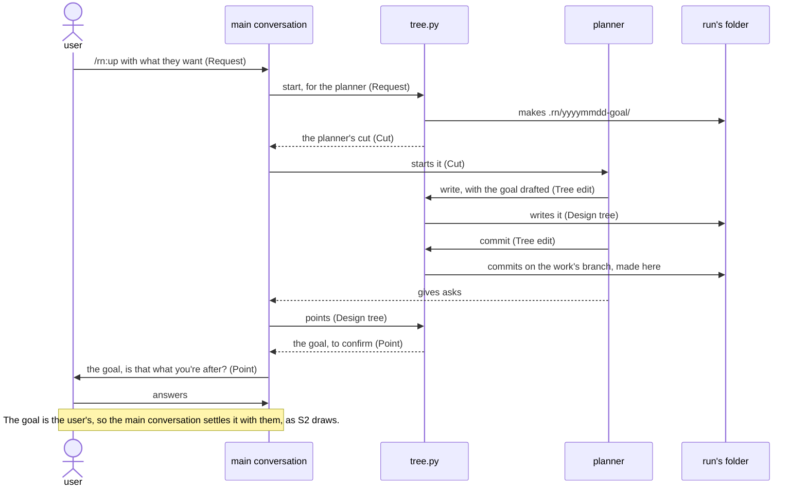
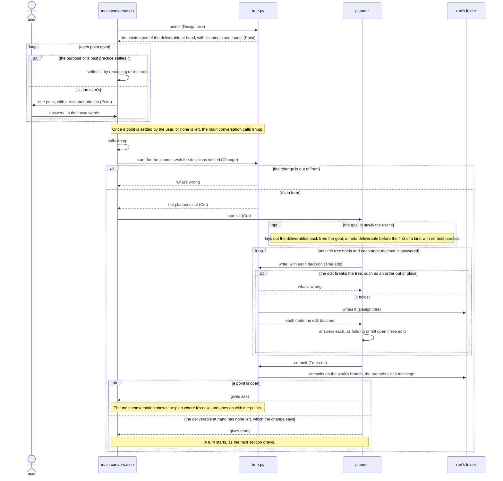
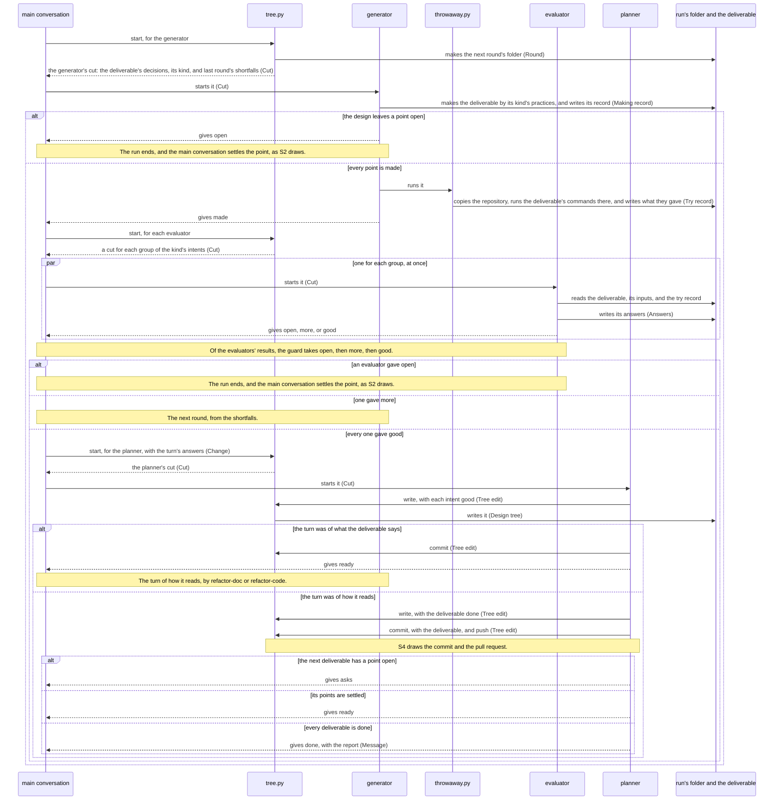
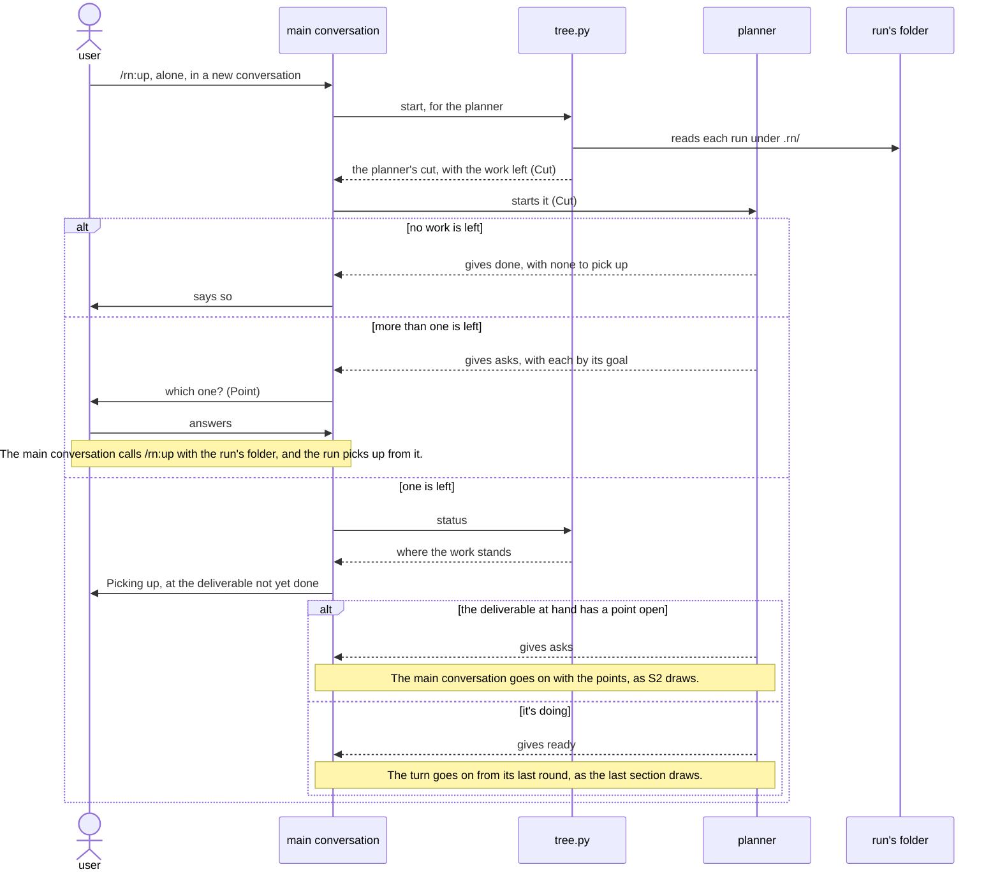
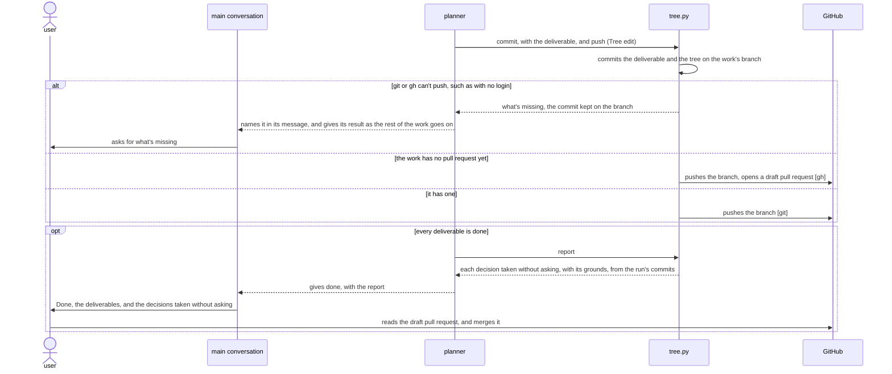

# `rn` architecture

This document says how the parts of rn give [its product vision](../../../../../dev/rn/product-vision.md). rn keeps the
work as a design tree in the user's repository, which only the code of `tree.py` reads and writes.
The main conversation settles each point of the design with the user, one at a time, and starts the
planner with it. The planner has `tree.py` write the point into the tree, and lays out the plan back
from the goal. Once the main conversation has settled a deliverable's points, a turn makes it: the
generator makes it by its kind's best practice, and fresh evaluators judge each intent as the
deliverable's people would. An evaluator gets the deliverable and its intents alone. A point that a
turn finds open goes back to the main conversation. Lane, the plugin that holds a plugin's roles to
their steps, holds each role to the steps of the practices it carries out and the main conversation
to the routes, and lets a role start only with the text that `tree.py` cut for it. `tree.py` commits
each change on the work's branch and keeps one draft pull request for the user to merge.

## Principles

rn builds on [the plugin best practice](../plugin/best-practice.md).
It takes as they stand the practices from
[Q1](../plugin/best-practice.md#q1) to
[Q4](../plugin/best-practice.md#q4),
[Q6](../plugin/best-practice.md#q6) to
[Q16](../plugin/best-practice.md#q16),
[Q18](../plugin/best-practice.md#q18) to
[Q20](../plugin/best-practice.md#q20), and
[Q22](../plugin/best-practice.md#q22) to
[Q25](../plugin/best-practice.md#q25). Lane is its guard, as
[Q9](../plugin/best-practice.md#q9) says, and rn names Lane in
its dependencies, as
[Q15](../plugin/best-practice.md#q15) says, since the
generator runs Lane's `lay.py` when a deliverable is a plugin.

rn differs from three of them:

- **[Q5](../plugin/best-practice.md#q5) and
  [Q17](../plugin/best-practice.md#q17)**: the main conversation
  settles the points of the design, which the practice leaves to a role, and puts each point to the
  user itself, which [Q17](../plugin/best-practice.md#q17) leaves
  to a role. *Why*: the design is the user's intent, so rn settles it where the user talks. No role
  stands between a point and the user, and nothing carries a point back and forth. The main
  conversation still makes and judges nothing of a deliverable, and the planner writes each point,
  so Lane holds every change to the tree.
- **[Q21](../plugin/best-practice.md#q21)**: rn takes in no lesson
  once a run ends. *Why*: no step of the product vision follows the work once the user has the
  draft pull request, and a step there would ask the user more, which KR1.2 counts. The cost: a
  lesson that one run meets can come back in a later run.

rn adds these. Each why says how a run goes wrong for the user without the rule.

### Planned back from the goal

The planner lays out every deliverable the goal needs, with the order they need one another in,
before any turn makes one, by [the plan best practice](../plan/best-practice.md).
`tree.py` orders the deliverables from each one's inputs and preconditions. A kind with no best
practice gets a meta deliverable before its first deliverable, made by the meta best practice.

*Why*: a deliverable left out shows only when the work reaches it, and one made before what it
takes needs making again. The people it's for then can't use it as handed over, as KR1.1 counts,
and the user waits longer, which KR1.3 measures.

### The main conversation settles, the planner writes

The main conversation settles each point of the design, in the user's conversation, one at a time.
It settles a point itself where the purpose or a best practice settles it, and puts the rest to
the user with a recommendation. A point the user answers by leaving it to rn counts as theirs.
Only the planner changes the tree, by handing `tree.py` a tree edit. After each edit it answers
each node that `tree.py` lists as touched, and where a node no longer holds, it leaves that point
open for the main conversation. A role never settles a point of the design.

*Why*: a point settled outside the user's conversation comes back as rework, or asks the user what
the purpose settles, which KR1.2 counts. Lane holds a role's calls and never the main
conversation's own, so a change written by the main conversation would go unheld, and the nodes
around it would go on saying what held before. A deliverable built on them then fails its people, as KR1.1 counts.

### Each role gets only its cut

`tree.py` cuts each role's part of the tree, and the main conversation starts the role with that
text alone. No role, and not the main conversation, reads the design tree itself.

*Why*: a role that reads the whole tree takes up decisions that aren't its own, and an evaluator
that reads it judges whether the deliverable follows the design, not what its people get. A
deliverable its people can't use then passes, as KR1.1 counts.

### The evaluator has only what the deliverable's people have

An evaluator gets the intents of its group, the deliverable, the deliverables it takes its
content from, and the record of the deliverable tried. It never gets the design, the practices,
or the generator's record. Where the user kept a decision knowing what it costs an intent, the
evaluator gets that lack too, in the people's terms, as an accepted shortfall.

*Why*: the people a deliverable is for never see what its maker meant. An evaluator that has the
design or the practices checks how its maker made the deliverable, not what it gives them, as
KR1.1 counts. An evaluator that isn't told of an accepted shortfall sends it back every round,
and the turn never ends, which KR1.3 measures.

### A turn makes until every intent is good

A turn's generator makes the deliverable, and its evaluators judge it, round after round, until
every intent of the kind is good. A deliverable then gets a turn of its own for how it reads, by
`refactor-doc` for a document or `refactor-code` for code, which changes nothing it says.

*Why*: a deliverable handed over with an intent not met fails its people, as KR1.1 counts. A
sentence that a turn polishes before what it says holds needs polishing again, which KR1.3
measures.

### A point found open goes back to the main conversation

Where the generator finds a point the design leaves open, or an evaluator a point only the user can
settle, the run stops there. The main conversation settles the point, and the turn starts again
from the design. Where only a change to a decision the user settled would meet a shortfall, rn takes
it to the user only with a fact their answer didn't weigh. Otherwise it stays an accepted shortfall.

*Why*: a fix made beside the design is a part that no decision holds. The next round loses it, or
keeps it though no one settled it, as KR1.1 counts. Asking the user again what they settled
spends their time and gives them nothing to weigh, as KR1.2 counts.

### Tried in a throwaway copy

The commands that try a deliverable, its install steps among them, run only in a throwaway copy of
the repository, with a throwaway home.

*Why*: a command run as the people run it, such as `tidy` on a Downloads folder, would otherwise
change the user's own files, which can't be undone.

### Every step on every run

Lane holds each role to the steps of the practices it carries out, read from the best practice
itself at the steps port, a best practice made on the run among them. It holds the main
conversation to the routes, and each start to the text that `tree.py` gave.

*Why*: an AI that skipped a step once skips it again on another run, and the deliverable misses
what the step was there to make sound, as KR1.1 counts.

### The repository holds the work

`tree.py` commits every change to the tree on the work's own branch as the planner writes it, with
its grounds in the commit message. It commits a deliverable once its last turn is good, and keeps
one draft pull request for the work. The user merges it, and rn never does. A run's files lie in
`.rn/<yyyymmdd>-<goal>/`, and `/rn:up` alone goes on from them.

*Why*: a conversation can end at any point, and work kept only in it goes with it, so the
user answers again, as KR1.2 counts. The merge is the user's, as
[Q16](../plugin/best-practice.md#q16) says.

## User stories

- **S1**: the user wants to type `/rn:up` with what they want, in their own words, and confirm the
  goal rn reads in it. It carries the walkthrough's first `/rn:up` and the goal put to the user.
- **S2**: the user wants to answer each point rn puts to them, one at a time, in their own words.
  It carries the plan shown with its first point, the answer `each file`, and each point that comes
  up while rn makes a deliverable.
- **S3**: the user wants to type `/rn:up` alone in a new conversation, and have rn go on where it
  stopped, asked nothing again. It carries the walkthrough's second `/rn:up` and `Picking up`.
- **S4**: the user wants each deliverable committed on a branch, one draft pull request to merge,
  and the decisions rn took without asking them. It carries the walkthrough's `Done`, and the
  user's merge.

## Components


What each decides alone:

- **user**: what's theirs: the goal, each point the purpose and the best practices leave open, and
  whether to merge.
- **main conversation**: whether a point is the user's or settled by the purpose or a best
  practice, how it's settled, the words it's put in, and when a deliverable has no point left.
- **planner**: the goal as drafted from the request, the plan, each deliverable's kind, inputs and
  preconditions, whether each node a change touches still holds, and each status and intent made
  good from a turn's answers.
- **generator**: the deliverable, each small point of making it, such as a phrase, and the points
  the design leaves open.
- **evaluator**: whether the deliverable meets each intent of its group, and the points only the
  user can settle.
- **tree.py**: the form of the design tree and of a change, the order of the deliverables, each
  role's cut, the nodes an edit touches, each turn's round and groups, the points open for the
  main conversation, each commit, the branch, and the draft pull request, and the report of each
  decision taken without asking, read from the run's commits.
- **throwaway.py**: where a deliverable's commands run, and what of them the try record keeps.
- **steps adapter**, **items adapter**: how rn's best practices and design tree read in the forms
  of Lane's steps and items ports.
- **guard**: whether a role's call keeps its lanes, which start is due, and whether a start's text
  is the one `tree.py` gave, as [Lane's architecture](../../../../../dev/lane/architecture.md) says.

These choices in the components are ones a developer would question:

- **The main conversation calling `/rn:up` again once it settles a point** over resuming the role
  that stopped: the point comes from the main conversation, not from the user's words alone, and
  Lane lets a resume carry the user's words and nothing else. A new call of the skill begins a run,
  whose first start is the planner with the text `tree.py` cut from the change. The cost: the main
  conversation reads the skill's part again on each call.
- **One point a user settles in each change** over the points of a deliverable written at once: each
  answer is in the tree before the next point goes out, so a conversation that ends loses none,
  as KR1.2 counts. The cost: a run of the planner for each such point.
- **The planner started fresh for each change** over one planner kept for the run: each start
  keeps to its own cut, and a fresh planner carries no decision of an earlier change into this
  one, as KR1.1 counts. The cost: the planner reads its cut again on each start.
- **The generator running `throwaway.py` once it has made the deliverable** over each evaluator
  running it: the evaluators of a round run at once, and one try record for the round lets them
  judge the same run of the commands. The cost: an evaluator can't try a command that the try
  record doesn't hold, and names it as a lack instead.
- **`tree.py` committing and keeping the draft pull request** over a script of its own: each commit
  holds a tree edit, and the edit's grounds make its message, which only `tree.py` reads in the
  form the planner writes. The cost: `tree.py` needs git, and `gh` for the pull request.

## Data model


- **Request**: the user's words after `/rn:up`, as they typed them.
- **Change**: what one start of the planner writes: the request, the decisions the main
  conversation settled, or a turn's answers.
- **Tree edit**: what the planner hands `tree.py` to write: each node it changes, the grounds, and
  its answer to each node touched: it holds, or the planner leaves it open.
- **Cut**: the text `tree.py` gives a role to start with: its run values and its part of the tree.
- **Point**: a decision the main conversation settles, whether the tree holds it open or a turn
  found it.
- **Making record**: the generator's record of a round, `generator.json`: what it made, each small
  point it decided, and each point it found open.
- **Answers**: an evaluator's record of a round, `evaluator-<group>.json`: each intent met with the
  lines that meet it, or not met with what the people still lack.
- **Try record**: the commands that try a deliverable and what each gave, `throwaway.txt`.
- **Accepted shortfall**: a decision of the user's, under the intent it costs, that says what the
  people lack by it.
- **Port JSON**: a best practice's steps or a tree's items in the forms of Lane's ports.

## Sequences

Each story's steps follow in order. The participants carry their names in
[Components](#components), and the data in brackets those in [Data model](#data-model). Each start
of a role goes through the guard, which lets it through only with the cut `tree.py` last gave for
that role, as [Lane's architecture](../../../../../dev/lane/architecture.md) draws.

### S1: a request



- **The planner drafting the goal** over the main conversation asking for it outright: the user
  confirms a goal written to the plan best practice faster than they write one, which shortens
  what KR1.3 measures. The cost: a run of the planner before the user's first point.

### S2: a point settled



- **The run ending at `asks`, a route with neither a next start nor a wait,** over a route that
  waits for the user: such a route has the main conversation resume the planner with the user's
  words alone, while the main conversation settles points by reasoning too. The cost: the start of
  a role started by mistake between two runs goes unheld, though Lane still holds its calls.

### S2 and S3: a deliverable made in turns



- **The rounds without a limit** over a turn that stops after a set number: a shortfall the design
  can't meet goes back as a point open, so a turn goes on only while the generator can meet what
  the evaluators find. The cost: a turn runs long while its evaluators keep finding new shortfalls.
- **One evaluator for each group of intents, all at once,** over one for every intent: each is fresh
  on fewer intents, as KR1.1 asks, and they run side by side, as KR1.3 asks. The cost: each evaluator
  reads the whole deliverable.

### S3: picking up



### S4: the work handed over



## Deployment


The user installs rn as [the README](../../../README.md#installation) says, which installs
Lane with it, and types `/rn:up` in Claude Code at the root of their repository.

- **macOS and Linux** over Windows as well: `python3` and the symbolic link of `hooks/lane/` work
  there as rn needs them, and the README names Windows as not yet tried. The cost: a user on
  Windows has no tried way.
- **Python 3.9 and its standard library only, for `tree.py`, `throwaway.py`, and the adapters,**
  over a later Python or packages, as
  [Q13](../plugin/best-practice.md#q13) says: the user installs
  nothing for rn. The cost: the code goes without what later versions give.
- **A run's files in `.rn/<yyyymmdd>-<goal>/` of the repository, committed on the work's branch,**
  over the system's temporary folder, as
  [Q12](../plugin/best-practice.md#q12) says for what the user
  may keep: a run picks up from them in any conversation, and each round's records stay for the
  user to read. A user who keeps `.rn/` out by `.gitignore` still gets each commit, with its
  grounds in the message. The cost: a folder in the user's repository, which the draft pull request
  shows.
- **A best practice made on a run in the run's `best-practices/`** over rn's own folder: rn's folder
  changes with each update, and a later run of the repository finds it there. `tree.py` looks for a
  kind in the run's folder, then in rn's own, then in the repository's earlier runs. The cost: a
  later run may take a best practice made for an earlier run's work.
- **The throwaway copy and home in the system's temporary folder** over a folder in the repository:
  the copy means nothing once the round ends, and a command run there can't reach the user's own
  files. The cost: a command that needs a file outside the repository, such as one in the
  user's Downloads folder, gets a made-up one in the throwaway home.

## Directory structure

```text
plugins/rn/
├── .claude-plugin/plugin.json       rn's manifest, naming Lane in its dependencies
├── skills/up/SKILL.md               the main conversation's entry, /rn:up
├── agents/<role>.md                 the entries of the planner, the generator, and the evaluator
├── domain/up.md                     the main conversation's part
├── domain/<role>.md                 the parts of the planner, the generator, and the evaluator
├── domain/forms/                    the JSON Schemas of each role's in and out, Change, Tree
│                                    edit, Making record, and Answers
├── domain/best-practices/<kind>/    every kind's best practice: plan, plugin, and those of each
│                                    deliverable, meta among them
├── domain/                          the code of tree.py and throwaway.py
├── scripts/tree.py, throwaway.py    tree.py and throwaway.py
├── hooks/hooks.json, lanes.json     the guard's hook entries, and rn's lanes and routes as laid
├── hooks/lane/                      the guard, a link to Lane's code
├── hooks/adapters/                  the steps adapter and the items adapter, with their cases
└── README.md, CHANGELOG.md, images/   for rn's users

dev/rn/
├── product-vision.md, architecture.md, images/   rn's product vision and architecture
├── README.md                        for rn's developers
├── cosmic-ray.toml                  the mutation testing
└── tests/
    ├── unit/                        unit tests, at the path of what each tests
    ├── architecture/                a test for each path of each sequence
    └── product-vision/              the trials of O1, and the repository tidy that they work in

.rn/<yyyymmdd>-<goal>/               Design tree, as design-tree.json
.rn/<yyyymmdd>-<goal>/best-practices/<kind>/   a best practice made on the run
.rn/<yyyymmdd>-<goal>/turns/<nn>-<deliverable>/<round>/   Making record, Answers, and Try record
<the paths the plan gives>           each deliverable
<temporary folder>/rn/<yyyymmdd>-<goal>/   the throwaway copy and home, and each Tree edit until
                                     tree.py commits it
```

- **The parts in `domain/`, with the best practices and the code beside them,** as
  [Q1](../plugin/best-practice.md#q1) says, over Turn's
  `core/roles/` and `core/domain/`: rn now holds Turn, so it keeps one folder of its own
  knowledge, where Lane finds each part. The cost: moving every file of Turn's.
- **No progress file** over a file that says where the run stands: the design tree's statuses and
  the rounds' records already hold it, and a second record of it drifts from them. The cost:
  `tree.py` reads the rounds' folders to tell which round is due.

## Tests

rn tests by [the architecture best practice](best-practice.md#q12)
and [the plugin best practice](../plugin/best-practice.md#q22),
and differs from them where this section says.


- **The `tree.py` process tried `FULL` at unit and at architecture** over `HAPPY`: a fault there
  writes the tree wrong, hands a role another's cut, or hands the evaluator the design, and no
  higher level checks every case. The cost: the most tests to keep up as the tree's form changes.
- **Lane's double of Claude Code and its trial driver, taken from `dev/lane/`,** over a double of
  rn's own, as [Q14](../plugin/best-practice.md#q14) says: one
  double sends the events that a recorded Claude Code sent, for both plugins. The cost: a change to
  Lane's double reaches rn's tests.
- **`claude plugin eval` left out of the trials** over a suite of eval cases: an eval case runs one
  prompt in an empty workspace and never stops for an answer, while the walkthrough types `/rn:up`
  twice, answers two points, and goes on in a new conversation. An eval run leaves `gh` real, so it
  would open a real pull request, and a case run on one prompt tries a skill alone, which
  [Q22](../plugin/best-practice.md#q22) rules out. The cost: the
  trials need their own driver, which Lane's already is.
- **The trials `HAPPY` for the Claude Code process, and `SMOKE` for the rest,** over every row
  alike: only the trials run the prompts, while the other rows only confirm what lower levels
  checked. The cost: a fault in a prompt shows only once every lower level passes.
- **The trial's `tidy` holding each fact a deliverable needs, such as where it's hosted,** over a
  placeholder: no way of making a README can give a real clone command from a placeholder, so a
  trial would fail on the fixture and not on rn. The cost: keeping the fixture's facts true.
