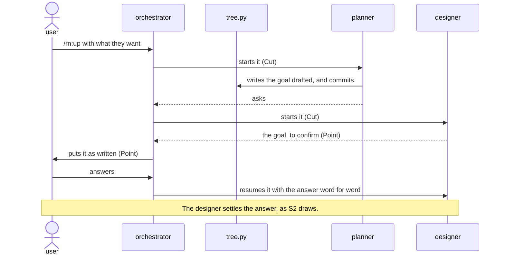
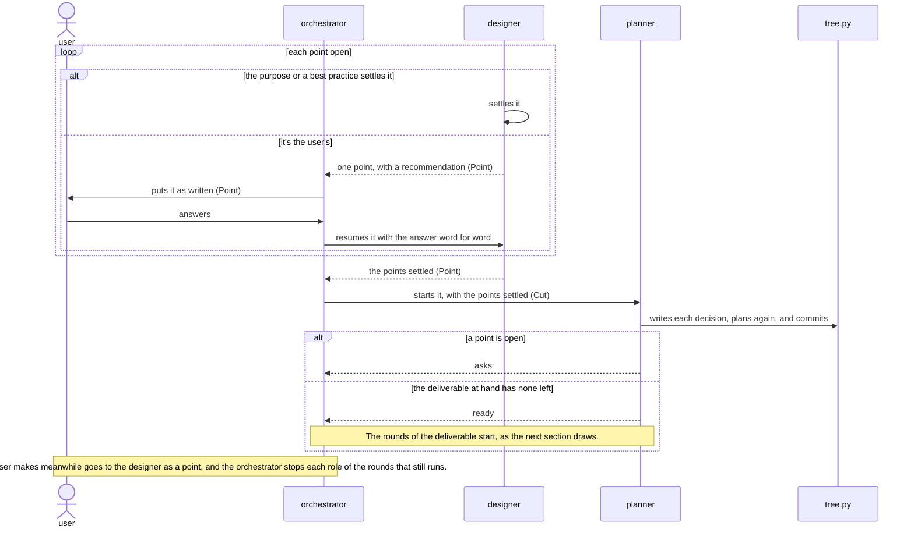
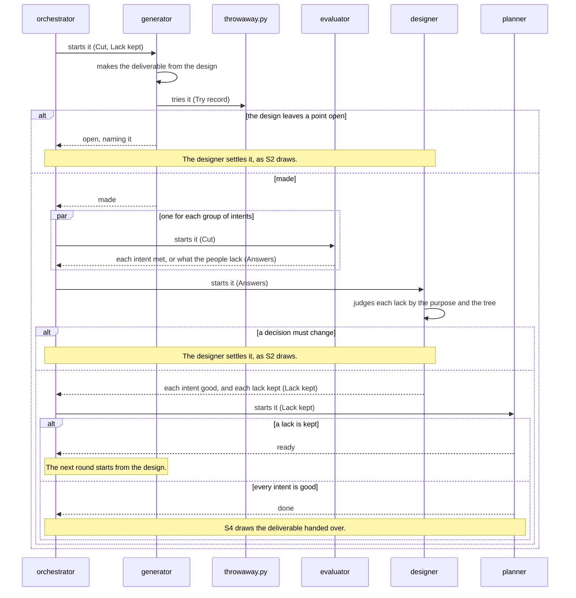
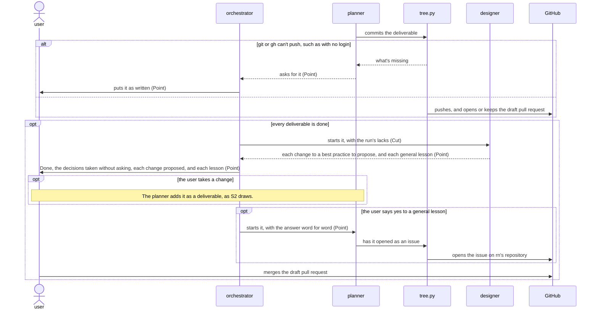

# `rn` architecture

This document says how the parts of rn give [its product vision](../../../../../dev/rn/product-vision.md). rn builds up
only the vital few of each deliverable: what its people can't do without. A designer settles the
user's goal and the decisions that serve it in a design tree, asking the user only the points that
are theirs. A generator makes each deliverable from its decisions, round after round, until
evaluators that have only what its people have find every intent met. A shortfall changes the
decision it comes from, not the deliverable.

## User stories

- S1: the user wants to type `/rn:up` with what they want, in their own words, so that they get the
  deliverable they mean without writing a specification. It carries the walkthrough's first `/rn:up`
  and the goal put to the user.
- S2: the user wants to answer each point rn puts to them, one at a time, so that they spend their
  time only on what's theirs to decide. It carries the plan shown with its first point, the answer
  `each file`, and each remark the user makes meanwhile.
- S3: the user wants to type `/rn:up` alone in a new conversation and have rn go on where it
  stopped, so that they never answer a point twice. It carries the walkthrough's second `/rn:up` and
  `Picking up`.
- S4: the user wants each deliverable committed, one draft pull request, and the decisions rn took
  without asking, so that they check the work and merge it themselves. It carries the walkthrough's
  `Done` and the merge.

## Components


What each decides alone:

- user\
  The goal, each point the purpose and the best practices leave open, each change to a best
  practice, and whether to merge.
- orchestrator\
  Nothing of the work. It starts the role that the routes name, and passes each question and answer
  word for word.
- designer\
  Whether a point is the user's, each point the purpose or a best practice settles, which lacks an
  evaluator names go on, which changes to a best practice to propose, and which lessons are general.
- planner\
  The goal drafted from the request, the deliverables and their order, each one's kind, the
  commands that try it, and the plan again after each settled point and finished deliverable. A
  kind with no best practice gets one first, as a deliverable of its own.
- generator\
  The deliverable, and each small point that the purpose and the best practice settle one way.
- evaluator\
  Where the deliverable meets each intent of its group for its people, or what would make it good.
- tree.py\
  The tree's form, each role's cut, each commit, the draft pull request, and each issue that the
  user says yes to.
- throwaway.py\
  Where a deliverable's commands run.
- guard\
  Whether a role's call keeps its steps, and that a deliverable's command runs only through
  throwaway.py, as [Lane's architecture](../../../../../dev/lane/architecture.md) says.

The choices made, and why:

- One generator for each deliverable over several side by side\
  Three generators would take about three times as long for a gain in KR1.1 that no trial has shown,
  as KR1.2 counts. The cost: a lack in a best practice shows only when its developers run several
  generators to check it.

## Data model


- Cut\
  The part of the design tree that a role starts with.
- Point\
  A decision that the designer settles, or puts to the user.
- Lack kept\
  A lack an evaluator named that the designer kept, which the next round's generator gets.

## Principles

rn builds on [the plugin best
practice](../plugin/best-practice.md), and adds these rules,
which every part keeps. It differs from [N17 of the plugin best
practice](../plugin/best-practice.md#n17) in who finds the
lessons and when: the designer finds them in the run's lacks before the merge, since the
orchestrator decides nothing of the work, and the user merges after rn ends.

### Drawn out along the design tree

Each role starts with its own cut of the design tree alone.

*Why*: a role that reads decisions not its own makes what the user didn't mean, as KR1.1 counts.

### Every step by best practice

Each role works by the best practice of its kind of work, and Lane holds it to the steps.

*Why*: an AI that skipped a step once skips it again, and the deliverable misses what the step makes
sound, as KR1.1 counts.

### Judged by the people it's for

An evaluator gets only what the deliverable's people have.

*Why*: an evaluator that knows what the maker meant judges the making, not what the people get, as
KR1.1 counts.

### Back to the design tree on a problem

A shortfall changes the decision it comes from, and the next round makes the deliverable from the
design, never with a fix beside it.

*Why*: no decision holds a fix beside the design, so the next round loses it or it breaks what
another intent met, as KR1.1 counts.

### The design tree revised on each run

What a run finds changes the plan before the next deliverable, and the best practice before the next
run, once the user takes the change.

*Why*: a plan or a best practice kept as first laid out makes the same miss again, as KR1.1 and
KR1.2 count.

### Tried in a throwaway copy

A deliverable's commands run only in a throwaway copy of the repository, with a throwaway home,
and a lane of Lane holds each role to it.

*Why*: a command run as the people run it would otherwise change the user's own files.

### The repository holds the work

`tree.py` commits every change to the tree and each finished deliverable on the work's own branch as
it's made.

*Why*: work kept only in a conversation that ends makes the user answer again, as KR1.2 counts.

## Sequences

Each start of a role goes through the guard, which lets it through only with the cut `tree.py` gave
for that role.

### S1: a request



### S2: a point settled



### S2 and S3: a deliverable made in rounds



### S3: picking up


### S4: the work handed over



## Deployment


The user installs rn as [the README](../../../README.md#installation) says, which installs
Lane with it, and types `/rn:up` in Claude Code at the root of their repository.

- A run's files in `.rn/<yyyymmdd>-<goal>/`, committed on the work's branch, over the system's
  temporary folder\
  A run picks up from them in any conversation, as KR1.2 counts. The cost: a folder in the user's
  repository.
- A best practice made on a run in `.rn/best-practices/` over the run's folder\
  Every later run in the repository finds it, and takes it over rn's own of the same kind, as KR1.1
  counts. The cost: a later run misses what rn's own gains after it.

## Directory structure

rn's folder holds what Claude Code installs for the user. `dev/rn/` holds what only rn's developers
use. `.rn/` is what rn writes in the user's repository.

```text
plugins/rn/
├── .claude-plugin/
│   └── plugin.json                rn's manifest, naming Lane in its dependencies
├── skills/
│   └── up/
│       └── SKILL.md               /rn:up, which makes the main conversation the orchestrator
├── agents/
│   ├── designer.md                starts the designer
│   ├── planner.md                 starts the planner
│   ├── generator.md               starts the generator
│   └── evaluator.md               starts the evaluator
├── domain/
│   ├── orchestrator.md            what the orchestrator does
│   ├── designer.md                what the designer does
│   ├── planner.md                 what the planner does
│   ├── generator.md               what the generator does
│   ├── evaluator.md               what the evaluator does
│   ├── tree.py                    the code of tree.py
│   ├── throwaway.py               the code of throwaway.py
│   └── best-practices/            rn's own best practice of each kind
├── scripts/
│   ├── tree.py                    runs the code of tree.py
│   └── throwaway.py               runs the code of throwaway.py
├── hooks/
│   ├── hooks.json                 starts the guard on each call
│   ├── lanes.json                 the steps the guard holds each role to
│   ├── lane/                      the guard: Lane's code, copied in by Lane
│   └── adapters/                  give the guard rn's best practices and design tree
└── README.md                      for rn's users

dev/rn/
├── product-vision.md              rn's product vision
├── architecture.md                this document
├── README.md                      for rn's developers
└── tests/                         the unit, architecture, and product vision tests

.rn/
├── <yyyymmdd>-<goal>/             one run
│   ├── design-tree.json           the design tree
│   └── rounds/                    each round's Try record, Answers, and Lack kept
└── best-practices/                each best practice made on a run
```

## Tests

rn tests by the test rules of [the architecture best
practice](best-practice.md) and [the plugin best
practice](../plugin/best-practice.md), and differs from them
where this section says. Whether a point is the user's, and whether an intent is good, only the
roles judge, so only the product vision tests show them.


- `tree.py` tried `FULL` at architecture over `HAPPY`\
  A fault there writes the tree wrong or hands a role another's cut, and no higher level checks each
  case, as KR1.1 counts. The cost: the most tests to keep up as the tree's form changes.
