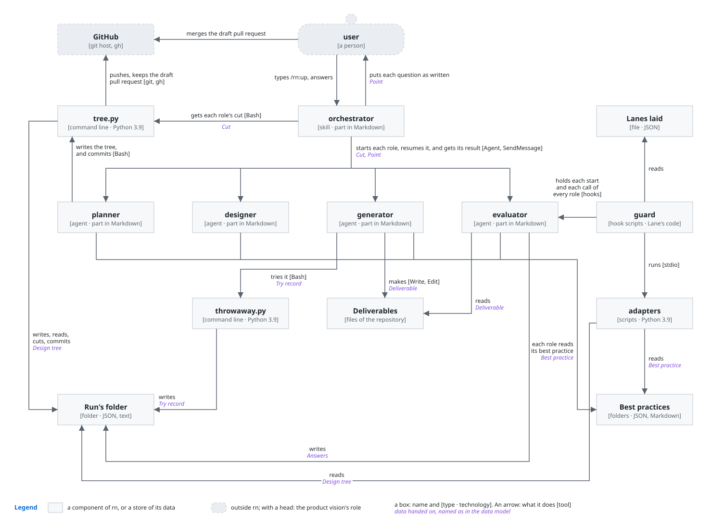
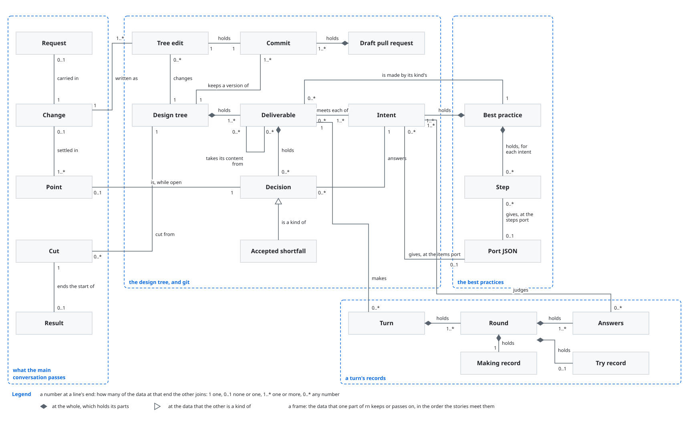
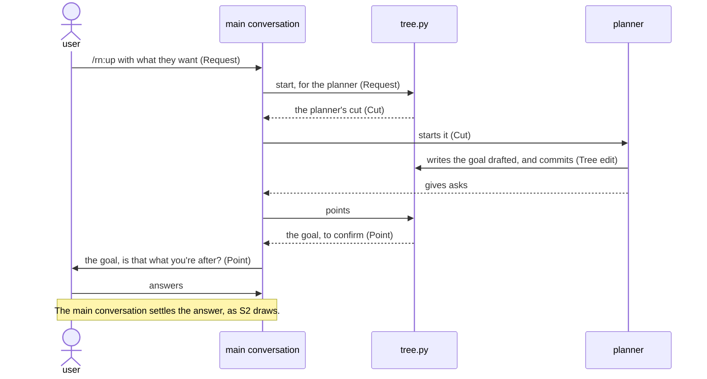
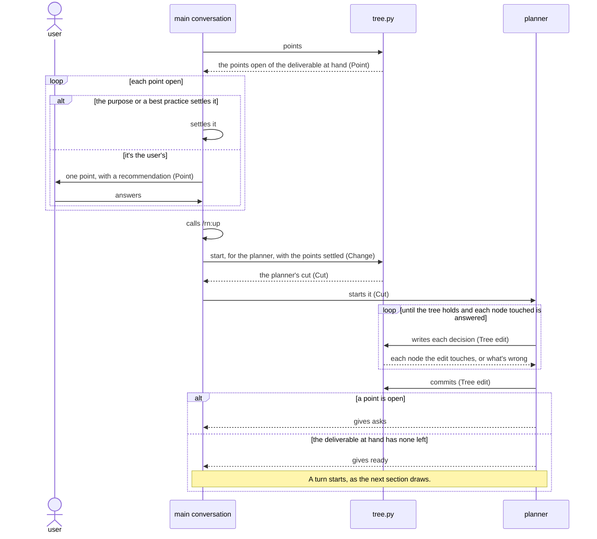
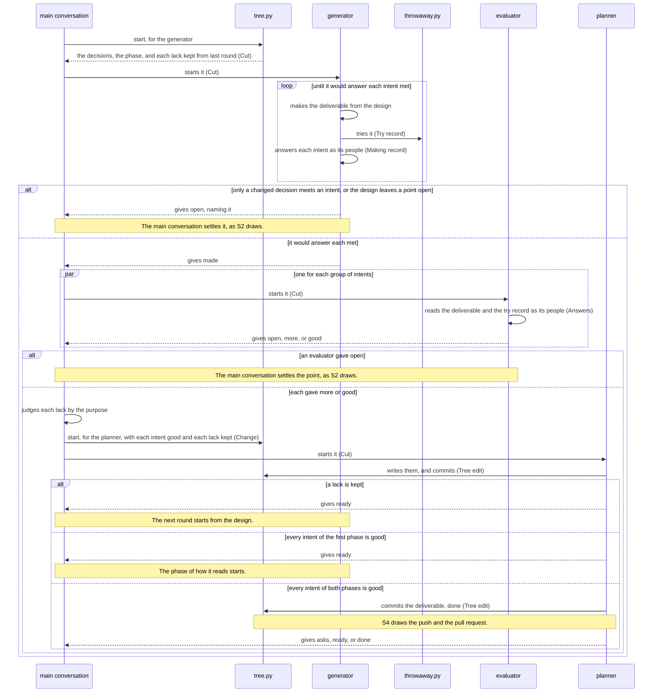
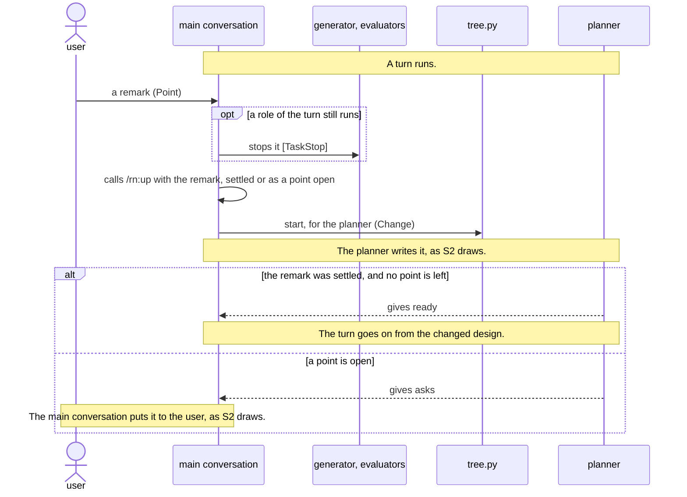
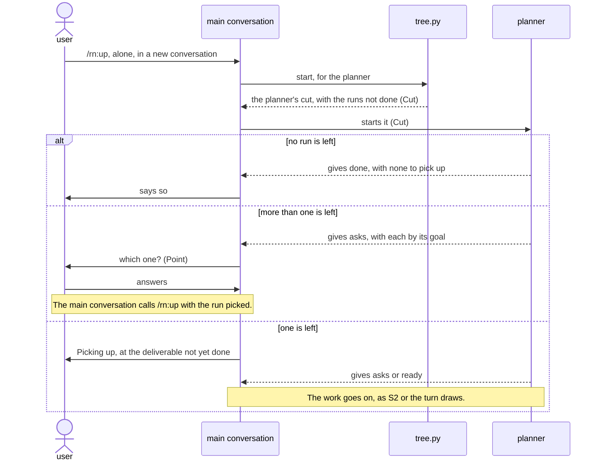
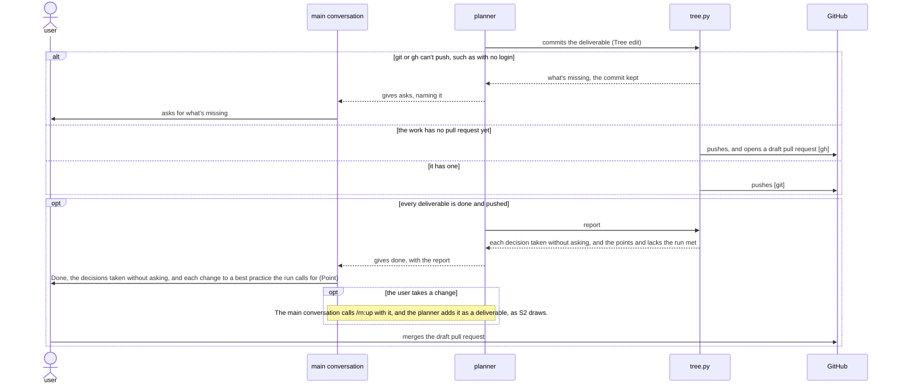
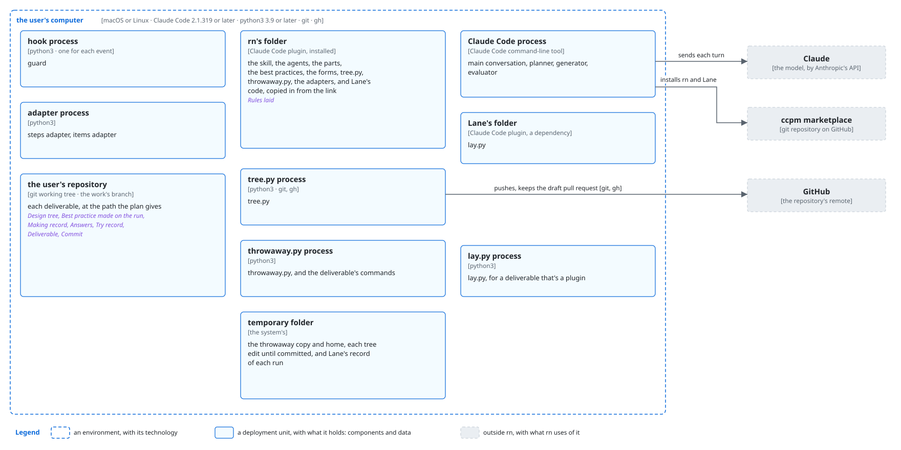
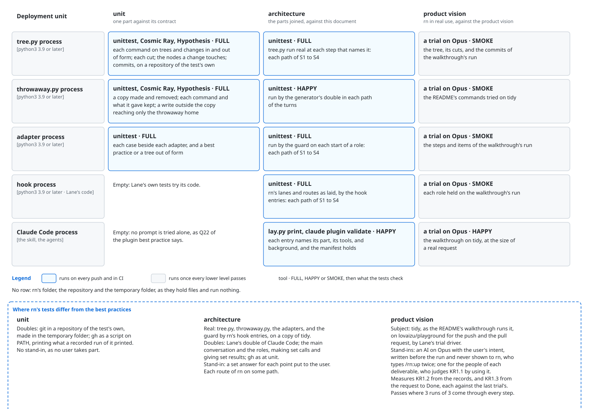

# `rn` architecture

This document says how the parts of rn give [its product vision](../../../../../dev/rn/product-vision.md). rn keeps the
work's decisions in a design tree, apart from the deliverables made from them. The user's
conversation alone settles the design, and every other part makes a deliverable from the decisions
or reads it as its people do. A shortfall goes back to the decision that serves it, and the
repository keeps every decision, so a conversation that ends loses nothing.

## Principles

rn builds on [the plugin best
practice](../plugin/best-practice.md), and adds these.

### Planned back from the goal

The planner lays out every deliverable the goal needs, each after what it takes, before any turn
makes one, by [the plan best
practice](../plan/best-practice.md). A kind with no best
practice gets one made before its first deliverable.

*Why*: a deliverable left out shows only when the work reaches it, and one made before what it takes
needs making again, as KR1.1 and KR1.3 count.

### Intent, not spec

The design tree and this document hold intent only. The developer of a part settles how it works
inside, where they build it.

*Why*: a spec written into the design grows with each finding and goes untrue at the next change, so
the maker builds to lines that no longer hold, as KR1.1 counts.

### The main conversation settles, the planner writes

The main conversation settles each point of the design, one at a time. It settles a point itself
where the purpose or a best practice settles it, and puts the rest to the user with a
recommendation. Only the planner writes the tree.

*Why*: a point settled outside the user's conversation comes back as rework, or asks the user what
the purpose settles, and a change that Lane doesn't hold leaves the nodes around it stale, as KR1.1
and KR1.2 count.

### Each role gets only its cut

Each role starts with its own part of the tree and nothing else. No one adds a fix, a hint, or a
remark to a role's start or to a role that runs.

*Why*: a role that reads the whole tree takes up decisions not its own, and a fix added on the way
reaches the deliverable beside the design, as KR1.1 counts.

### The evaluator has only what the deliverable's people have

An evaluator gets the intents of its group, the deliverable, what the deliverable takes, and the
record of it tried. It never gets the design or the practices. It gets each shortfall the user
accepted, in the people's terms.

*Why*: the people never see what the maker meant, so an evaluator that does judges the making, not
what the people get, as KR1.1 counts. One not told of an accepted shortfall sends it back every
round, as KR1.3 counts.

### A turn makes a deliverable until every intent is good

Once the main conversation settles a deliverable's decisions, a turn makes it from them and its
kind's best practice, round after round. The first phase makes what it says, and the second how it
reads. The turn ends once every intent of both phases is good, or stops at a point only the user can
settle.

*Why*: a deliverable handed over with an intent not met fails its people, as KR1.1 counts, and a
sentence polished before what it says holds needs polishing again, as KR1.3 counts.

### Good from the root

A shortfall goes back to the decision that serves it, and the next round makes the deliverable from
the design, keeping each part that already rests on a decision. Where only a changed decision meets
the shortfall, the point goes to the main conversation.

*Why*: a fix beside the design is a part no decision holds, so the next round loses it or keeps it
unsettled, and it can break what another intent met, as KR1.1 counts.

### The maker checks first

The generator reads the deliverable as its people before it hands it on. Only the evaluators and the
main conversation's judgment of their answers make an intent good.

*Why*: a lack the maker could see costs a round of evaluators, as KR1.3 counts, while the maker
reads what it meant, not what it wrote, as KR1.1 counts.

### The evaluator seeks the good

An evaluator reads as the deliverable's people and confirms where each intent gives them what
they're after. It names a lack only where they'd fall short of their aim.

*Why*: a finding the people never meet sends the deliverable back for a change that gives them
nothing, and its fix can break what they do meet, as KR1.1 and KR1.3 count.

### The designer judges the evaluators

The main conversation judges each lack an evaluator names by the purpose before anything changes. A
lack goes on to the next round only where the people fall short of their aim without it and it asks
for intent, not for how a part works inside. Anything else changes neither the deliverable nor the
tree.

*Why*: an evaluator answered by addition alone makes the deliverable and the tree grow each round,
until the people can't find what they need in it, as KR1.1 and KR1.3 count.

### A point found open goes back to the main conversation

The run stops at a point that the design leaves open, a decision that must change, or a remark the
user makes during a turn, and the main conversation takes it. Once the planner writes it, the turn
goes on from the changed design. rn asks the user again about their own decision only with a fact
their answer didn't weigh.

*Why*: a role that settles such a point makes a part the design doesn't hold, as KR1.1 counts, and
asking the user again what they settled gives them nothing to weigh, as KR1.2 counts.

### Lessons go to the best practices before the merge

Before the user merges, rn proposes each change to a best practice that the run's points and lacks
call for. A change the user takes becomes a deliverable of the run. A turn makes it, the user merges
it with the rest, and later runs of the repository work by it.

*Why*: a lesson left out comes back in every later run, where it costs a round or a deliverable that
misses it, as KR1.1 and KR1.3 count.

### Tried in a throwaway copy

The commands that try a deliverable run only in a throwaway copy of the repository, with a throwaway
home.

*Why*: a command run as the people run it would otherwise change the user's own files, which can't
be undone, as KR1.1 counts.

### Every step on every run

Lane holds each role to the steps of the practices it carries out, the main conversation to the
routes, and each start to its cut.

*Why*: an AI that skipped a step once skips it again on another run, and the deliverable misses what
the step makes sound, as KR1.1 counts.

### The repository holds the work

`tree.py` commits every change to the tree and each finished deliverable on the work's own branch,
with one draft pull request that the user merges.

*Why*: a conversation can end at any point, and work kept only in it makes the user answer again, as
KR1.2 counts. The merge is the user's.

## User stories

- **S1**: the user wants to type `/rn:up` with what they want, in their own words. It carries the
  walkthrough's first `/rn:up` and the goal put to the user.
- **S2**: the user wants to answer each point rn puts to them, one at a time. It carries the plan
  shown with its first point, the answer `each file`, each point a turn finds, and each remark the
  user makes meanwhile.
- **S3**: the user wants to type `/rn:up` alone in a new conversation and have rn go on where it
  stopped. It carries the walkthrough's second `/rn:up` and `Picking up`.
- **S4**: the user wants each deliverable committed, one draft pull request to merge, and the
  decisions rn took without asking. It carries the walkthrough's `Done` and the merge.

## Components



What each decides alone:

- **user**: the goal, each point the purpose and the best practices leave open, whether to merge.
- **main conversation**: whether a point is the user's, how it's settled, the words it's put in,
  whether each lack an evaluator names goes on, which changes to a best practice the run calls
  for.
- **planner**: the goal drafted from the request, the plan, each deliverable's kind, inputs,
  preconditions, size, and the commands that try it, whether each node a change touches still holds.
- **generator**: the deliverable, each small point that the purpose and the best practice settle one
  way, its own answer to each intent, whether the decisions meet a shortfall.
- **evaluator**: where the deliverable meets each intent of its group for its people, or what they
  lack.
- **tree.py**: the tree's form, the order of the deliverables, each role's cut, the nodes an edit
  touches, each turn's rounds, the points open, each commit, the draft pull request, the report.
- **throwaway.py**: where a deliverable's commands run, and what the try record keeps.
- **steps adapter**, **items adapter**: how rn's best practices and design tree read in Lane's
  ports.
- **guard**: whether a role's call keeps its lanes, which start is due, whether a start's text is
  its cut, as [Lane's architecture](../../../../../dev/lane/architecture.md) says.

These choices in the components are ones a developer would question:

- **The main conversation calling `/rn:up` again with each settled point** over resuming the role
  that stopped, as Lane lets a resume carry only the user's words, and a new run starts the planner
  from a cut it holds, as KR1.1 counts. The cost: the main conversation reads the skill's part on
  each call.
- **One point a user settles in each change** over a deliverable's points written at once: each
  answer is in the tree before the next goes out, so a conversation that ends loses none, as KR1.2
  counts. The cost: a run of the planner for each point.
- **The planner started fresh for each change** over one kept for the run: a fresh planner carries
  no decision of an earlier change into this one, as KR1.1 counts. The cost: it reads its cut on
  each start.
- **`tree.py` alone reading the tree and committing it** over a script for each: one reader of the
  tree's form can't drift from another, as KR1.2 counts. The cost: `tree.py` needs git and `gh`.

## Data model



- **Request**: the user's words after `/rn:up`, as they typed them.
- **Change**: what one start of the planner writes, such as settled points or a turn's answers.
- **Tree edit**: what the planner hands `tree.py` to write, with its answer to each node touched.
- **Cut**: the text a role starts with, its part of the tree.
- **Point**: a decision the main conversation settles, whether the tree holds it open, a turn found
  it, or the user remarked it.
- **Making record**: the generator's record of a round.
- **Answers**: an evaluator's record of a round, each intent met with the lines that meet it, or
  with what the people lack.
- **Try record**: the commands that try a deliverable and what each gave.
- **Accepted shortfall**: a decision of the user's that says what the people lack by it.
- **Port JSON**: a best practice's steps or a tree's items in the forms of Lane's ports.

## Sequences

Each start of a role goes through the guard, which lets it through only with the cut `tree.py` last
gave for that role, as [Lane's architecture](../../../../../dev/lane/architecture.md) draws.

### S1: a request



- **The planner drafting the goal** over asking the user for it: the user confirms a goal written to
  the plan best practice faster than they write one, as KR1.3 counts. The cost: a planner run first.

### S2: a point settled



- **The run ending at `asks`** over a route that waits for the user: the main conversation also
  settles points with no words of the user's, which a resume can't carry, as KR1.2 counts. The cost:
  a role started by mistake between runs starts unheld, though Lane still holds its calls.

### S2 and S3: a deliverable made in its turn



- **A turn inside `/rn:up`, with no skill of its own,** over a skill for a turn: the user types only
  `/rn:up`, and one skill's routes carry the work through the rounds, as KR1.3 counts. The cost:
  `/rn:up`'s routes carry every role's results.
- **The main conversation judging the lacks before the planner writes them** over each lack going
  straight to the next round: only a lack of intent changes the deliverable, so it doesn't grow
  round by round, as KR1.1 counts. The cost: the main conversation reads the answers of each round.
- **The rounds without a limit** over a set number: a turn that stops early hands over an intent not
  met, as KR1.1 counts. The cost: a turn runs long while the evaluators find lacks of intent.
- **One evaluator for each group of intents, all at once,** over one for every intent: each is fresh
  on fewer intents, as KR1.1 counts, and they run side by side, as KR1.3 counts. The cost: each
  reads the whole deliverable.

### S2: a remark during a turn



- **Each role that still runs stopped** over letting it end: a role that runs on works by a design
  about to change, and costs the user a round, as KR1.3 counts. The cost: the stopped round's work
  goes unused.

### S3: picking up



### S4: the work handed over



## Deployment



The user installs rn as [the README](../../../README.md#installation) says, which installs
Lane with it, and types `/rn:up` in Claude Code at the root of their repository.

- **macOS and Linux** over Windows as well: `python3` and the link of `hooks/lane/` work there as rn
  needs them, as KR1.1 counts. The cost: a user on Windows has no tried way.
- **Python 3.9 and its standard library only** over a later Python or packages: the user installs
  nothing for rn, as KR1.3 counts. The cost: the code goes without what later versions give.
- **A run's files in `.rn/<yyyymmdd>-<goal>/`, committed on the work's branch,** over the system's
  temporary folder: a run picks up from them in any conversation, as KR1.2 counts. The cost: a
  folder in the user's repository.
- **A best practice made on a run kept in the run's folder** over rn's own folder, which changes
  with each update, as KR1.1 counts. The cost: a later run may take one made for other work.
- **The throwaway copy in the system's temporary folder** over a folder in the repository: a command
  run there can't reach the user's files, as KR1.1 counts. The cost: a command that needs a file
  outside the repository gets a made-up one.

## Directory structure

```text
plugins/rn/
├── .claude-plugin/plugin.json       rn's manifest, naming Lane in its dependencies
├── skills/up/SKILL.md               the main conversation's entry, /rn:up
├── agents/                          the entries of the planner, the generator, and the evaluator
├── domain/                          each role's part, the forms, the best practices, and the code
│                                    of tree.py and throwaway.py
├── scripts/                         tree.py and throwaway.py
├── hooks/                           the guard's entries, the lanes and routes as laid, the guard as
│                                    a link to Lane's code, and the adapters
└── README.md, CHANGELOG.md, images/   for rn's users

dev/rn/
├── product-vision.md, architecture.md, images/   rn's product vision and architecture
├── README.md                        for rn's developers
└── tests/                           the unit, architecture, and product vision tests

.rn/<yyyymmdd>-<goal>/               Design tree, a best practice made on the run, and the records
                                     of each round
<the paths the plan gives>           each deliverable
```

- **The parts in `domain/`, with the best practices and the code beside them,** over folders by
  type: one folder of rn's own knowledge, where Lane finds each part, as KR1.1 counts. The cost:
  moving every file of Turn's.
- **No progress file** over a file that says where the run stands: the tree's statuses and the
  rounds' records already hold it, and a second record drifts, as KR1.2 counts. The cost: `tree.py`
  reads the rounds' folders.

## Tests

rn tests by the test rules of [the architecture best
practice](best-practice.md) and [the plugin best
practice](../plugin/best-practice.md), and differs from them
where this section says.



- **The `tree.py` process tried `FULL` at unit and at architecture** over `HAPPY`: a fault there
  writes the tree wrong or hands a role another's cut, and no higher level checks every case, as
  KR1.1 counts. The cost: the most tests to keep up as the tree's form changes.
- **Lane's double of Claude Code and its trial driver** over rn's own: one double serves both
  plugins, as KR1.1 counts. The cost: a change to Lane's double reaches rn's tests.
- **`claude plugin eval` left out of the trials** over eval cases: a case runs one prompt and never
  stops for an answer, while the walkthrough answers points and goes on in a new conversation, as
  KR1.2 counts. The cost: the trials need their own driver, which Lane's already is.
- **The trials `HAPPY` for the Claude Code process, and `SMOKE` for the rest,** over every row
  alike: only the trials run the prompts, as KR1.1 counts. The cost: a fault in a prompt shows only
  once every lower level passes.
- **The main conversation's judgment of points and lacks checked first by the trial** over a test at
  a lower level: no guard can hold a judgment by the purpose, as KR1.2 counts. The cost: a wrong
  judgment shows only in a trial.
