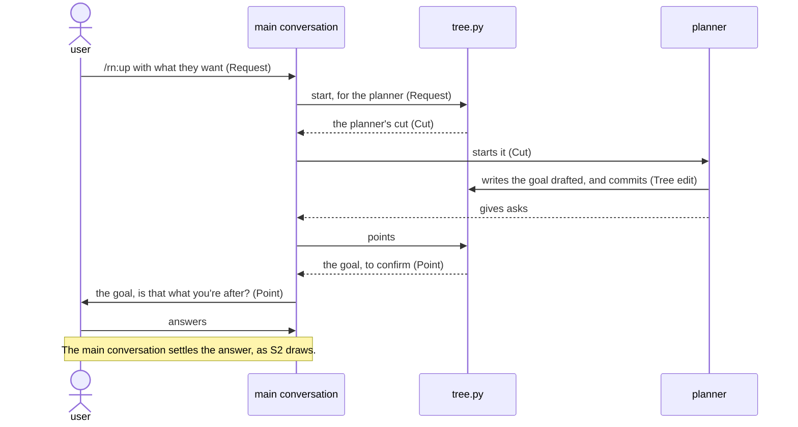
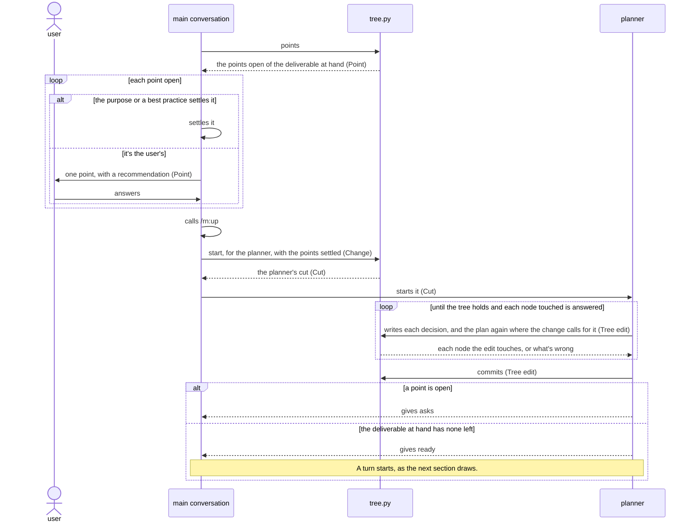
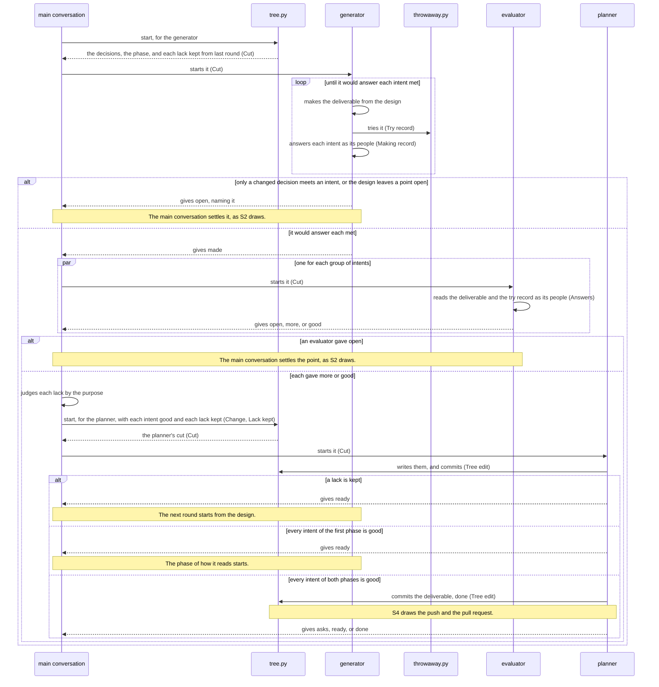
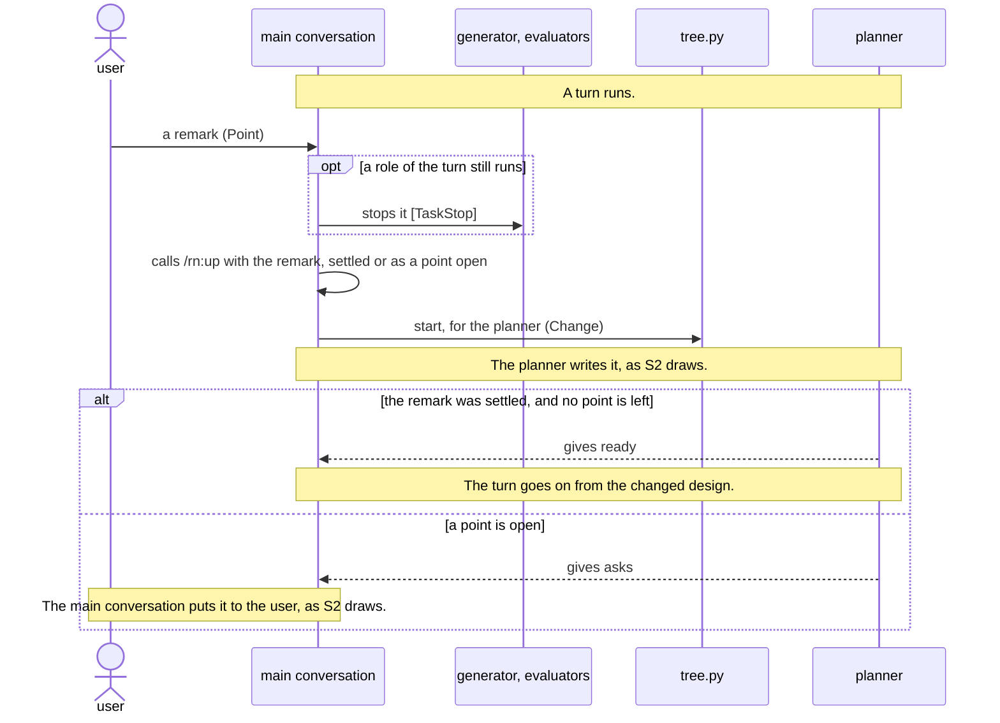
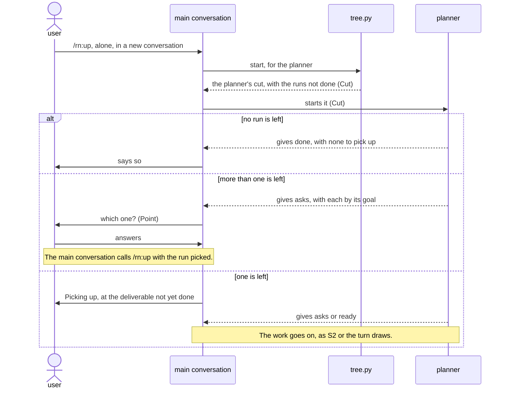
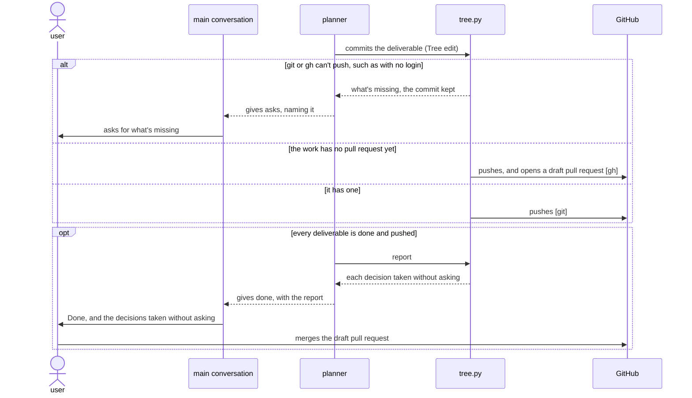

# `rn` architecture

This document says how the parts of rn give [its product vision](../../../../../dev/rn/product-vision.md). rn builds up
only the vital few of each deliverable: what its people can't do without. The design tree holds the
user's goal and the decisions that serve it, and the user settles only the points that are theirs.
rn makes each deliverable from its decisions, and evaluators that have only what its people have
judge it. A shortfall changes the decision it comes from, not the deliverable, so the deliverable holds
only what its people need.

## Principles

rn builds on [the plugin best
practice](../plugin/best-practice.md), and adds these.

### Drawn out along the design tree

The design tree holds the goal and, for each deliverable, what it's for and the decisions that serve
it, never how it works inside, and only the planner writes it. The main conversation settles one
point at a time: itself where the purpose or a best practice settles it, and with the user, with a
recommendation, where neither does. Each role starts with its own part of the tree alone.

*Why*: a point settled outside the user's conversation, or by a role that reads decisions not its
own, makes what the user didn't mean, as KR1.1 counts. Asking the user what the purpose settles
costs their time, as KR1.2 counts.

### Every step by best practice

Each role works by the best practice of its work: the planner by the plan best practice, and the
generator and the evaluators by the deliverable's kind, one made by the meta best practice before
the first deliverable of a kind that has none. Lane holds each role to the steps of its practices,
the main conversation to the routes, and each start to its cut.

*Why*: an AI that skipped a step once skips it again on another run, and the deliverable misses what
the step makes sound, as KR1.1 counts.

### Judged by the people it's for

An evaluator gets only what the deliverable's people have: the intents of its group, the
deliverable, what it takes, and the record of it tried. It confirms where each intent gives the
people what they're after, and for one not yet good, says what would make it good. A turn makes the
deliverable until every intent is good, or until a point that only the user can settle stops it.

*Why*: the people never see what the maker meant, so an evaluator that does judges the making, and a
deliverable handed over with an intent not met fails its people, as KR1.1 counts.

### Back to the design tree on a problem

The main conversation judges each lack an evaluator names by the purpose and the tree, and keeps
only one that the people would fall short by. A kept lack, a point the design leaves open, and a
remark the user makes go back to the decision they come from, and the next round makes the
deliverable from the design, never with a fix beside it.

*Why*: no decision holds a fix beside the design, so the next round loses it or it breaks what
another intent met, and a deliverable answered by addition grows each round until its people can't
find what they need, as KR1.1 and KR1.2 count.

### The design tree revised on each run

The planner lays out every deliverable the goal needs, each after what it takes, by the plan best
practice. It plans again after each settled point and each finished deliverable.

*Why*: a plan kept as first laid out goes on making what an answer or a finished deliverable has
changed, as KR1.1 and KR1.2 count.

### Tried in a throwaway copy

The commands that try a deliverable run only in a throwaway copy of the repository, with a throwaway
home.

*Why*: a command run as the people run it would otherwise change the user's own files, which can't
be undone.

### The repository holds the work

`tree.py` commits every change to the tree and each finished deliverable on the work's own branch,
with one draft pull request that the user merges.

*Why*: a conversation can end at any point, and work kept only in it makes the user answer again, as
KR1.2 counts. The merge is the user's.

## User stories

- S1\
  The user wants to type `/rn:up` with what they want, in their own words. It carries the
  walkthrough's first `/rn:up` and the goal put to the user.
- S2\
  The user wants to answer each point rn puts to them, one at a time. It carries the plan shown with
  its first point, the answer `each file`, each point a turn finds, and each remark the user makes
  meanwhile.
- S3\
  The user wants to type `/rn:up` alone in a new conversation and have rn go on where it stopped. It
  carries the walkthrough's second `/rn:up` and `Picking up`.
- S4\
  The user wants each deliverable committed, one draft pull request to merge, and the decisions rn
  took without asking. It carries the walkthrough's `Done` and the merge.

## Components


What each decides alone:

- user\
  The goal, each point the purpose and the best practices leave open, whether to merge.
- main conversation\
  Whether a point is the user's, how it's settled, the words it's put in, whether each lack an
  evaluator names goes on.
- planner\
  The goal drafted from the request, the plan, each deliverable's kind, inputs, preconditions, size,
  and the commands that try it, whether each node a change touches still holds.
- generator\
  The deliverable, each small point that the purpose and the best practice settle one way, its own
  answer to each intent, whether the decisions meet a shortfall.
- evaluator\
  Where the deliverable meets each intent of its group for its people, or what they lack.
- tree.py\
  The tree's form, the order of the deliverables, each role's cut, the nodes an edit touches, each
  turn's rounds, the points open, each commit, the draft pull request, the report.
- throwaway.py\
  Where a deliverable's commands run, and what the try record keeps.
- steps adapter, items adapter\
  How rn's best practices and design tree read in Lane's ports.
- guard\
  Whether a role's call keeps its lanes, which start is due, whether a start's text is its cut, as
  [Lane's architecture](../../../../../dev/lane/architecture.md) says.

These choices in the components are ones a developer would question:

- The main conversation calling `/rn:up` again with each settled point over resuming the role that
  stopped\
  Lane lets a resume carry only the user's words, and a new run starts the planner from a cut it
  holds. The cost: the main conversation reads the skill's part on each call.
- One point a user settles in each change over a deliverable's points written at once\
  Each answer is in the tree before the next goes out, so a conversation that ends loses none, as
  KR1.2 counts. The cost: a run of the planner for each point.
- The planner started fresh for each change over one kept for the run\
  A fresh planner carries no decision of an earlier change into this one, as KR1.1 counts. The cost:
  it reads its cut on each start.
- `tree.py` alone reading the tree and committing it over a script for each\
  One reader of the tree's form leaves its developer no second reader to keep in step. The cost:
  `tree.py` needs git and `gh`.

## Data model


- Request\
  The user's words after `/rn:up`, as they typed them.
- Change\
  What one start of the planner writes, such as settled points or a turn's answers.
- Tree edit\
  What the planner hands `tree.py` to write, with its answer to each node touched.
- Cut\
  The text a role starts with, its part of the tree.
- Point\
  A decision the main conversation settles, whether the tree holds it open, a turn found it, or the
  user remarked it.
- Lack kept\
  A lack an evaluator named that the main conversation judged one of intent, which the next round's
  generator gets beside its intent.
- Making record\
  The generator's record of a round.
- Answers\
  An evaluator's record of a round, each intent met with the lines that meet it, or with what the
  people lack.
- Try record\
  The commands that try a deliverable and what each gave.
- Accepted shortfall\
  A decision of the user's that says what the people lack by it.
- Port JSON\
  A best practice's steps or a tree's items in the forms of Lane's ports.

## Sequences

Each start of a role goes through the guard, which lets it through only with the cut `tree.py` last
gave for that role, as [Lane's architecture](../../../../../dev/lane/architecture.md) draws.

### S1: a request



- The planner drafting the goal over asking the user for it\
  The user confirms a goal written to the plan best practice faster than they write one, as KR1.2
  counts. The cost: a planner run first.

### S2: a point settled



- The run ending at `asks` over a route that waits for the user\
  The main conversation also settles points with no words of the user's, which a resume can't carry,
  as KR1.2 counts. The cost: a role started by mistake between runs starts unheld, though Lane still
  holds its calls.

### S2 and S3: a deliverable made in its turn



- A turn inside `/rn:up`, with no skill of its own, over a skill for a turn\
  The user types only `/rn:up`, and one skill's routes carry the work through the rounds, as KR1.2
  counts. The cost: `/rn:up`'s routes carry every role's results.
- The main conversation judging the lacks before the planner writes them over each lack going
  straight to the next round\
  Only a lack of intent changes the deliverable, so it doesn't grow round by round, as KR1.1 counts.
  The cost: the main conversation reads the answers of each round.
- The rounds without a limit over a set number\
  A turn that stops early hands over an intent not met, as KR1.1 counts. The cost: a turn runs long
  while the evaluators find lacks of intent.
- One evaluator for each group of intents, all at once, over one for every intent\
  Each is fresh on fewer intents, as KR1.1 counts, and they run side by side, as KR1.2 counts. The
  cost: each reads the whole deliverable.
- One generator for each deliverable over several side by side\
  Judging by the people and remaking from the design tree finish a deliverable, while three
  generators would take about three times as long for a gain in KR1.1 that no trial has shown, as
  KR1.2 counts. The cost: a lack of the best practice shows only when its developers run several
  generators side by side to check it.

### S2: a remark during a turn



- Each role that still runs stopped over letting it end\
  A role that runs on works by a design about to change, and costs the user a round, as KR1.2
  counts. The cost: the stopped round's work goes unused.

### S3: picking up



### S4: the work handed over



## Deployment


The user installs rn as [the README](../../../README.md#installation) says, which installs
Lane with it, and types `/rn:up` in Claude Code at the root of their repository.

- macOS and Linux over Windows as well\
  `python3` and the link of `hooks/lane/` work there as rn needs them. The cost: a user on Windows
  has no tried way.
- Python 3.9 and its standard library only over a later Python or packages\
  The user installs nothing for rn. The cost: the code goes without what later versions give.
- A run's files in `.rn/<yyyymmdd>-<goal>/`, committed on the work's branch, over the system's
  temporary folder\
  A run picks up from them in any conversation, as KR1.2 counts. The cost: a folder in the user's
  repository.
- A best practice made on a run kept in the run's folder over rn's own folder\
  rn's own folder changes with each update, and the run's folder keeps the best practice the run
  worked by, as KR1.1 counts. The cost: a later run may take one made for other
  work.
- The throwaway copy in the system's temporary folder over a folder in the repository\
  A command run there can't reach the user's files, as KR1.1 counts. The cost: a command that needs
  a file outside the repository gets a made-up one.

## Directory structure

```text
plugins/rn/
├── .claude-plugin/
│   └── plugin.json                    rn's manifest, naming Lane in its dependencies
├── skills/
│   └── up/
│       └── SKILL.md                   the main conversation's entry, /rn:up
├── agents/
│   ├── planner.md                     the planner's entry
│   ├── generator.md                   the generator's entry
│   └── evaluator.md                   the evaluator's entry
├── domain/
│   ├── up.md                          the main conversation's part
│   ├── planner.md                     the planner's part
│   ├── generator.md                   the generator's part
│   ├── evaluator.md                   the evaluator's part
│   ├── <role>-in.schema.json          the form of each role's Cut
│   ├── <role>-out.schema.json         the form of what each role gives, such as a Tree edit
│   ├── tree.py                        tree.py's code
│   ├── throwaway.py                   throwaway.py's code
│   └── best-practices/
│       ├── <kind>/                    each kind's Best practice, with its Steps
│       └── plan/
│           └── design-tree.schema.json   the form of the Design tree
├── scripts/
│   ├── tree.py                        tree.py's entry
│   └── throwaway.py                   throwaway.py's entry
├── hooks/
│   ├── hooks.json                     the guard's entries
│   ├── lanes.json                     the lanes and routes as laid
│   ├── lane/                          the guard, a link to Lane's code
│   └── adapters/
│       ├── steps.py                   the steps adapter, giving Port JSON
│       └── items.py                   the items adapter, giving Port JSON
├── README.md                          for rn's users
├── CHANGELOG.md                       the changes in each version
└── images/                            the README's figures

dev/rn/
├── product-vision.md                  rn's product vision
├── architecture.md                    this document
├── images/                            the figures of both
├── README.md                          for rn's developers
└── tests/
    ├── unit/                          the unit tests
    ├── architecture/                  the architecture tests
    └── product-vision/                the product vision tests

.rn/<yyyymmdd>-<goal>/                 a run's files, on the work's branch
├── design-tree.json                   the Design tree, with each Accepted shortfall and Lack kept
├── best-practices/<kind>/             a Best practice made on the run
└── rounds/<deliverable>/<round>/      each Round's Making record, Answers, and Try record

<each deliverable's path>              each Deliverable, where the plan puts it
```

- The parts in `domain/`, with the best practices and the code beside them, over folders by type\
  One folder of rn's own knowledge, where Lane finds each part. The cost: a role's part and its forms
  sit among the other roles' files, told apart by their names.
- No progress file over a file that says where the run stands\
  The tree's statuses and the rounds' records already hold it, and a second record would drift from
  them. The cost: `tree.py` reads the rounds' folders.

## Tests

rn tests by the test rules of [the architecture best
practice](best-practice.md) and [the plugin best
practice](../plugin/best-practice.md), and differs from them
where this section says.


- The `tree.py` process tried `FULL` at unit and at architecture over `HAPPY`\
  A fault there writes the tree wrong or hands a role another's cut, and no higher level checks
  every case, as KR1.1 counts. The cost: the most tests to keep up as the tree's form changes.
- Lane's double of Claude Code and its trial driver over rn's own\
  Its developer keeps one double for both plugins. The cost: a change to Lane's double reaches rn's
  tests.
- `claude plugin eval` left out of the trials over eval cases\
  A case runs one prompt and never stops for an answer, while the walkthrough answers points and
  goes on in a new conversation, as KR1.2 counts. The cost: the trials need their own driver, which
  Lane's already is.
- The trials `HAPPY` for the Claude Code process, and `SMOKE` for the rest, over every row alike\
  Only the trials run the prompts, as KR1.1 counts. The cost: a fault in a prompt shows only once
  every lower level passes.
- The judgments no guard can hold checked first by the trial over a test at a lower level\
  These are the main conversation's judgment of each point and lack, the generator's of whether the
  decisions meet a shortfall, and the evaluator's of whether the deliverable meets an intent. A
  double stands in for each at the lower levels. The cost: a wrong judgment shows only in a trial.
