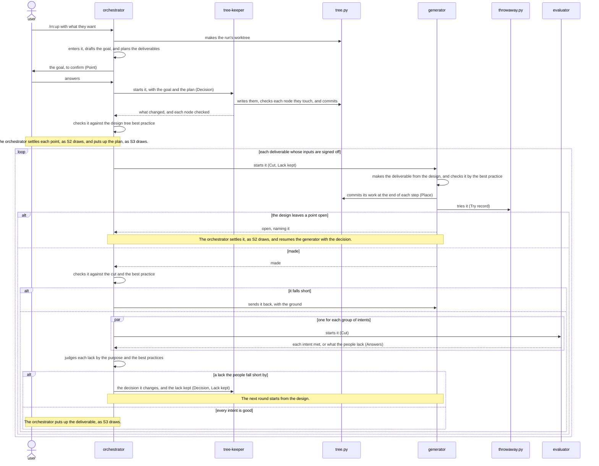
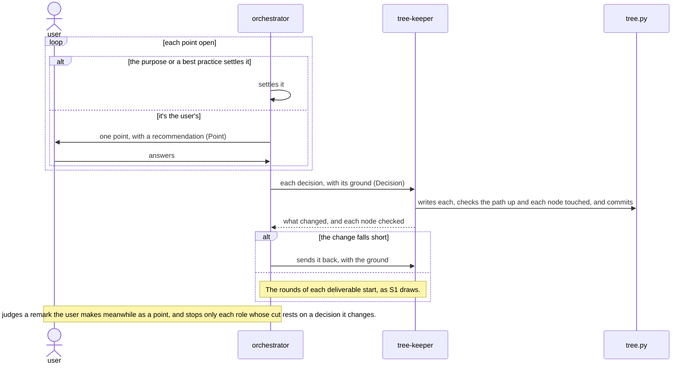
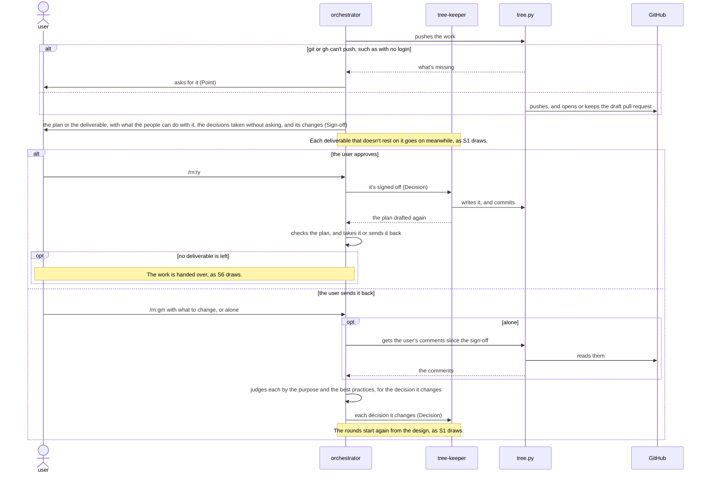
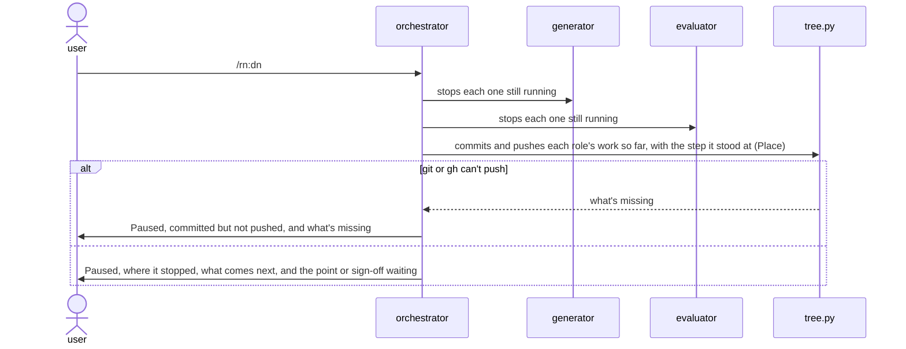
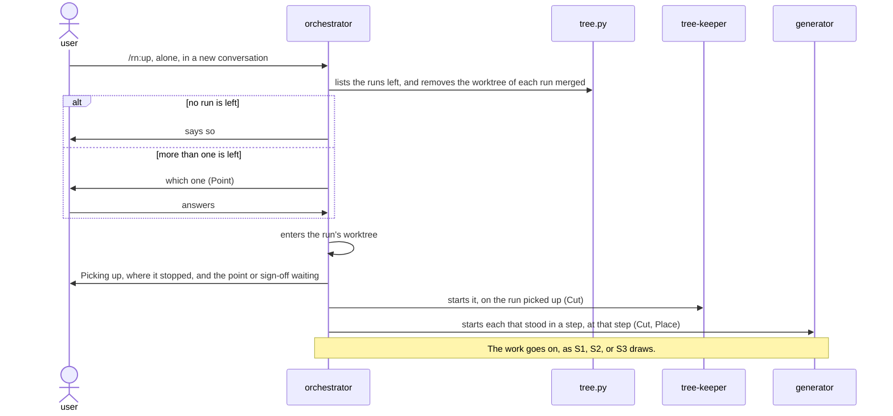
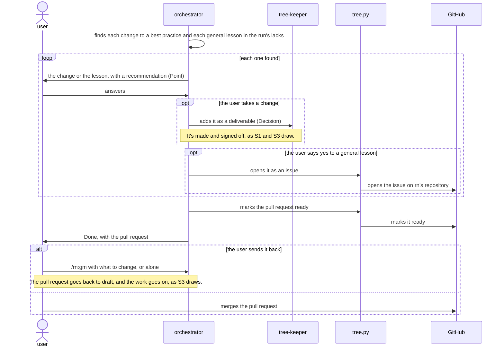

# `rn` architecture

This document says how the parts of rn give what [its README](../../../README.md)
promises. rn builds up only the vital few of each deliverable, what its people can't do without, as
decisions in a design tree: the orchestrator, the main conversation, settles them, asking the user
only the points that are theirs, and a tree-keeper keeps them. A generator makes each deliverable
from its decisions, round after round, until evaluators that have only what its people have find
every intent met, and the user signs it off before anything rests on it. The orchestrator checks
every result before it takes it, and a lack changes the decision it comes from, not the deliverable.

## User stories

- S1: the user wants to type `/rn:up` with what they want, in their own words, so that they get the
  deliverable they mean without writing a specification. It carries the walkthrough's first
  `/rn:up`, the goal put to the user, and each deliverable made in rounds.
- S2: the user wants to answer each point rn puts to them, one at a time, so that they spend their
  time only on what's theirs to decide. It carries the answer `each file`, and each remark the user
  makes meanwhile.
- S3: the user wants to sign off the plan and each deliverable with `/rn:ty`, or send it back with
  `/rn:gm`, so that nothing rests on what they didn't mean. It carries the plan and each deliverable
  put up for sign-off, each `/rn:ty`, and `/rn:gm` with what to change or with their comments on the
  pull request.
- S4: the user wants to type `/rn:dn` and stop the run at any moment, so that they lose neither
  their time nor the work so far. It carries the walkthrough's `/rn:dn` and `Paused`.
- S5: the user wants to type `/rn:up` alone in a new conversation and have rn go on where it
  stopped, so that they never answer a point twice or wait for work made again. It carries the
  walkthrough's second `/rn:up` and `Picking up`.
- S6: the user wants one pull request, the decisions rn took without asking, and the lessons of the
  run, so that they check the work and merge it themselves. It carries the walkthrough's `Done`,
  each change to a best practice and each lesson that rn proposes there, and the merge.

## Components


What each decides alone:

- user\
  The goal, each point the purpose and the best practices leave open, each sign-off, each change to
  a best practice, each lesson sent to rn's repository, when to pause, and whether to merge.
- orchestrator\
  Whether a point is the user's, each other point by the purpose and the best practices, the
  deliverables with their order, kind, and size, which go on while a sign-off waits, whether to take
  each role's result or send it back, which roles a remark of the user's stops, which lacks the
  people fall short by and the decision each changes, when a deliverable is ready for its sign-off,
  the plan at each turn's end, which changes to a best practice and lessons to propose, and which
  run to pick up.
- tree-keeper\
  How each decision of the orchestrator's goes into the design tree, which nodes a change touches,
  and the plan drafted again at each turn's end.
- generator\
  The deliverable, and each small point that the purpose and the best practice settle one way.
- evaluator\
  Where the deliverable meets each intent of its group for its people, or what would make it good.
- tree.py\
  The tree's form, each role's cut, the run's worktree, the runs left and where each stopped, each
  commit, the pull request and the user's comments on it, and each issue that the user says yes to.
- throwaway.py\
  Where a deliverable's commands run.
- guard\
  Whether a role's call keeps its steps, whether a deliverable's command runs only through
  throwaway.py, and whether the run passes a sign-off only after the user's `/rn:ty`, by the lanes
  that rn lays in [Lane](../../../../../dev/lane/architecture.md).
- adapters\
  How rn's best practices and design tree reach the guard in the form Lane reads.

The choices made, and why:

- One generator for each deliverable over several side by side\
  Three generators would take about three times as long for a gain in KR1.1 that no trial has shown,
  as KR1.2 counts. The cost: a lack in a best practice shows only when its developers run several
  generators to check it.
- The orchestrator judging every point over a role of its own that settles them\
  The user talks with the one that decides, and no answer passes through a role that rewords it, as
  KR1.2 counts. The cost: the main conversation holds every judgment of the run.

## Data model


- Cut\
  The part of the design tree that a role starts with.
- Point\
  A question put to the user, with its recommendation, while its decision is open.
- Sign-off\
  The plan or a deliverable put to the user for `/rn:ty` or `/rn:gm`, with what the people can do
  with it, the decisions taken without asking, and its changes.
- Place\
  The step that each role of a round stands at, with the work it has made, kept at the end of each
  step and at a pause.
- Lack kept\
  A lack an evaluator named that the orchestrator judged the people fall short by, which the next
  round's generator gets.

## Principles

rn builds on [the plugin best
practice](../plugin/best-practice.md), and adds these rules,
which every part keeps.

### Drawn out along the design tree

Each role starts with its own cut of the design tree alone, and the guard lets it start only with
the cut that `tree.py` gave for that role.

*Why*: a role that reads decisions not its own makes what the user didn't mean, as KR1.1 counts.

### Every step by best practice

Each role works by the best practice of its kind of work, and Lane holds it to the steps.

*Why*: an AI that skipped a step once skips it again, and the deliverable misses what the step makes
sound, as KR1.1 counts.

### Judged by the people it's for

An evaluator gets only what the deliverable's people have.

*Why*: an evaluator that knows what the maker meant judges the making, not what the people get, as
KR1.1 counts.

### Signed off before it's built on

The plan and each deliverable reach the work that rests on them, and the pull request becomes ready,
only after the user's `/rn:ty`, and the guard holds the run to it.

*Why*: a wrong reading of what the user means, found only at the end, makes everything that rests
on it made again, as KR1.1 and KR1.2 count.

### Back to the design tree on a problem

A lack, or what the user sends back with `/rn:gm`, changes the decision it comes from, and the next
round makes the deliverable from the design, never with a fix beside it.

*Why*: a fix beside the design rests on no decision, so the next round, made from the design, loses
it or breaks another intent with it, as KR1.1 counts.

### The design tree revised on each run

What a run finds changes the design tree before the next deliverable, and the best practice before
the next run, once the user takes the change, which the orchestrator proposes before the merge.

*Why*: a design tree or a best practice kept as first laid out makes the same miss again, as KR1.1
and KR1.2 count.

### Tried in a throwaway copy

A deliverable's commands run only in a throwaway copy of the repository, with a throwaway home,
and a lane of Lane holds each role to it.

*Why*: a command run as the people run it would otherwise change the user's own files, and the
user would spend their time setting them right, as KR1.2 counts.

### The repository holds the work

Every part keeps the run's state only in the run's folder and the deliverables on the work's own
branch, in rn's own worktree, and `tree.py` commits them at the end of each step and at a pause.

*Why*: work kept only in a conversation that ends, or left uncommitted at a pause, makes the user
answer or wait for it again, as KR1.2 counts.

## Sequences

### S1: a request, and a deliverable made in rounds



### S2: a point settled



### S3: a sign-off



### S4: a pause



### S5: picking up



### S6: the work handed over



## Deployment


The user installs rn as [the README](../../../README.md#installation) says, which installs
Lane with it, and types `/rn:up` in Claude Code at the root of their repository.

- rn's own git worktree for each run, over the user's checkout\
  The user goes on with their own work while rn runs, and a pause leaves nothing of theirs to set
  right, as KR1.2 counts. The cost: a worktree on disk for each run until its merge.
- A best practice made on a run in `.rn/best-practices/` over the run's folder\
  Every later run in the repository finds it, and takes it over rn's own of the same kind, as KR1.1
  counts. The cost: a later run misses what rn's own gains after it.

## Directory structure

rn's folder holds what Claude Code installs for the user. `dev/rn/` holds what only rn's developers
use. `.claude/worktrees/` holds rn's worktree of each run, and `.rn/` is what rn writes on the work's
branch.

```text
plugins/rn/
├── .claude-plugin/
│   └── plugin.json                rn's manifest, naming Lane in its dependencies
├── skills/
│   ├── up/
│   │   └── SKILL.md               /rn:up, which makes the main conversation the orchestrator
│   ├── dn/
│   │   └── SKILL.md               /rn:dn, which pauses the run
│   ├── ty/
│   │   └── SKILL.md               /rn:ty, which approves the sign-off waiting
│   └── gm/
│       └── SKILL.md               /rn:gm, which sends the sign-off waiting back
├── agents/
│   ├── tree-keeper.md             starts the tree-keeper
│   ├── generator.md               starts the generator
│   └── evaluator.md               starts the evaluator
├── domain/
│   ├── orchestrator.md            what the orchestrator does
│   ├── tree-keeper.md             what the tree-keeper does
│   ├── generator.md               what the generator does
│   ├── evaluator.md               what the evaluator does
│   ├── tree.py                    the code of tree.py
│   ├── throwaway.py               the code of throwaway.py
│   └── best-practices/            rn's own best practice of each kind
├── scripts/
│   ├── tree.py                    runs the code of tree.py
│   └── throwaway.py               runs the code of throwaway.py
├── hooks/
│   ├── hooks.json                 starts the guard on each call
│   ├── lanes.json                 the steps the guard holds each role to
│   ├── lane/                      the guard: Lane's code, copied in by Lane
│   └── adapters/                  give the guard rn's best practices and design tree
└── README.md                      for rn's users

dev/rn/
├── product-vision.md              rn's product vision
├── architecture.md                this document
├── README.md                      for rn's developers
└── tests/                         the unit, architecture, and product vision tests

.claude/worktrees/
└── rn-<yyyymmdd>-<goal>/          rn's worktree of one run, on the work's branch

.rn/
├── <yyyymmdd>-<goal>/             one run
│   ├── design-tree.json           the design tree
│   └── rounds/                    each round's Try record, Answers, Lack kept, and Place
└── best-practices/                each best practice made on a run
```

## Tests

rn tests by the test rules of [the architecture best
practice](best-practice.md) and [the plugin best
practice](../plugin/best-practice.md), and differs from them
where this section says.


- `tree.py` tried `FULL` at architecture over `HAPPY`\
  A fault there writes the tree wrong or hands a role another's cut, and no higher level checks each
  case, as KR1.1 counts. The cost: the most tests to keep up as the tree's form changes.
