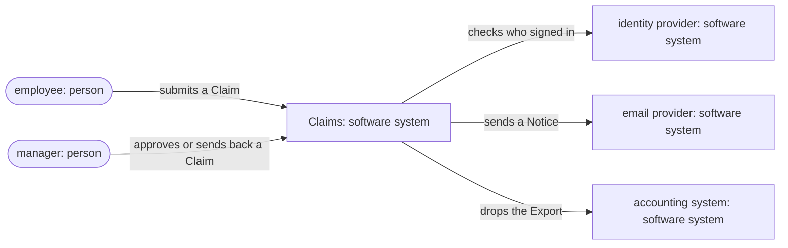
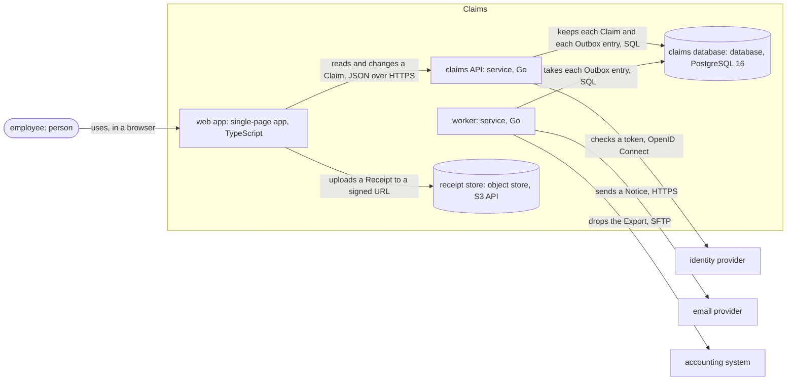
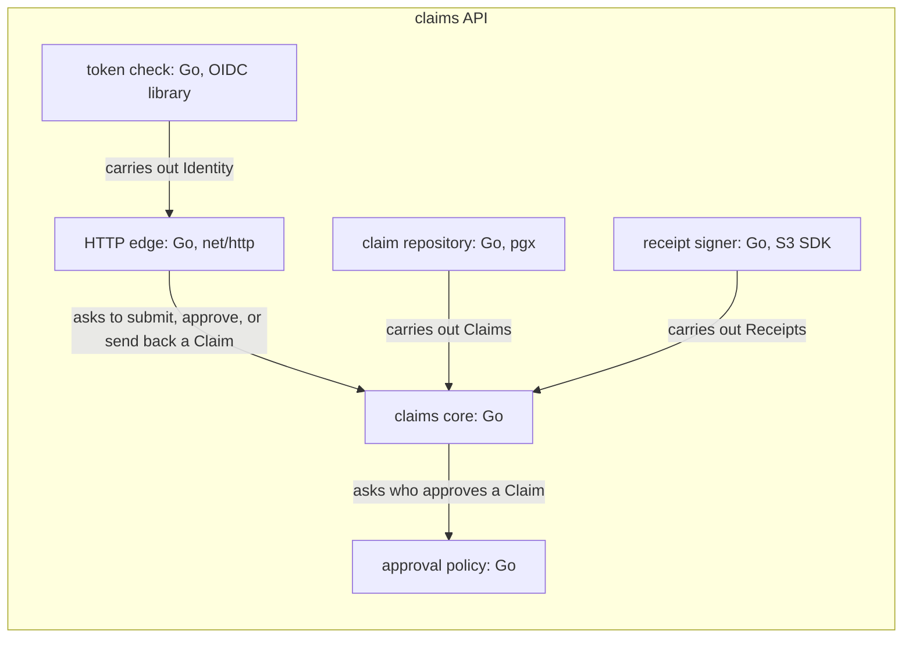
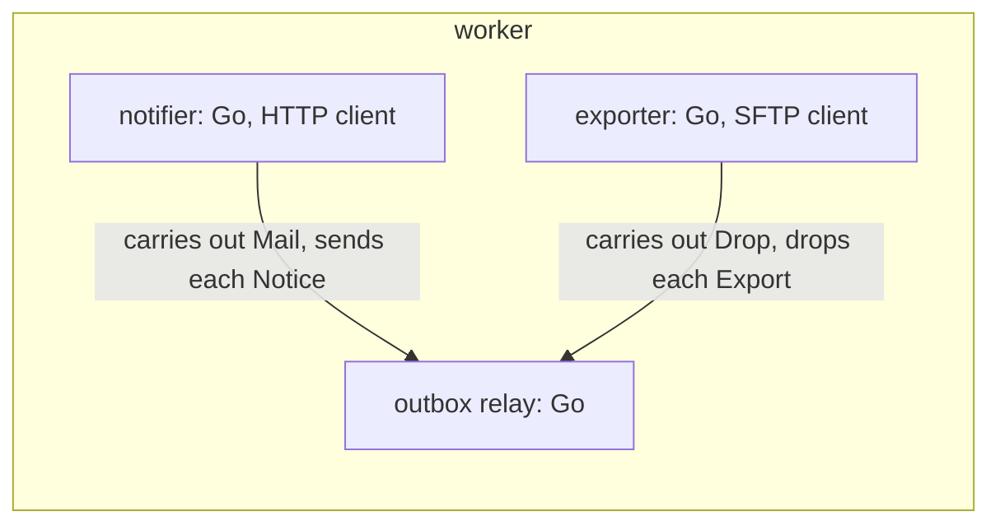
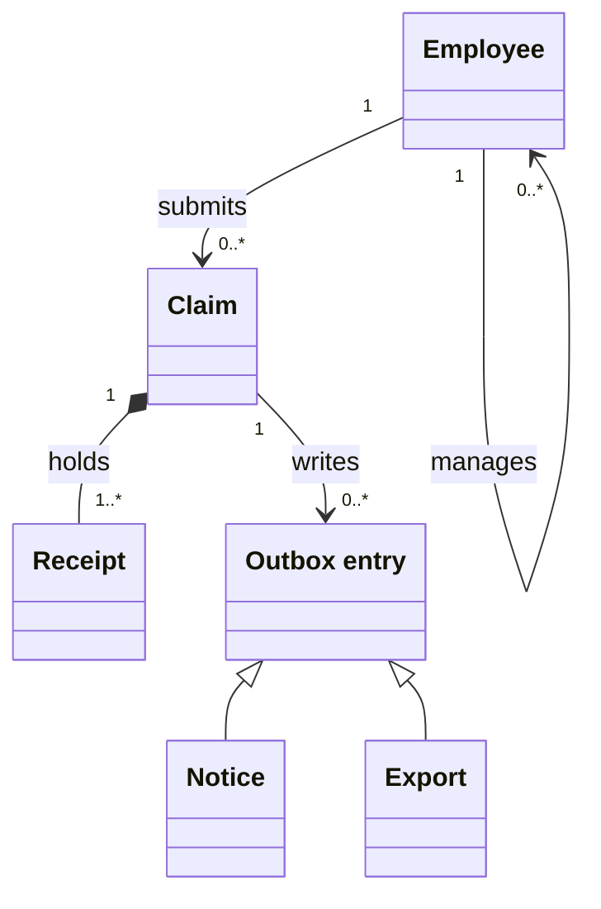
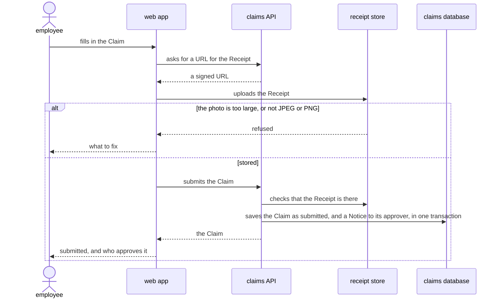
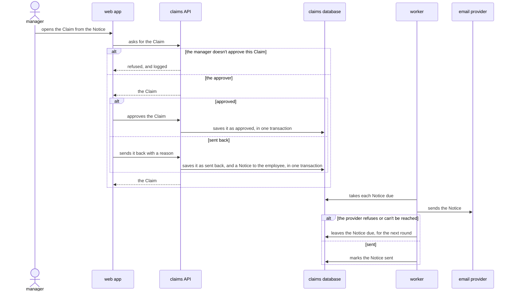
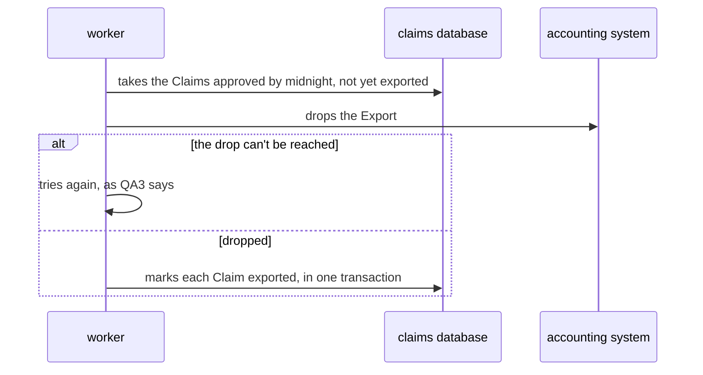
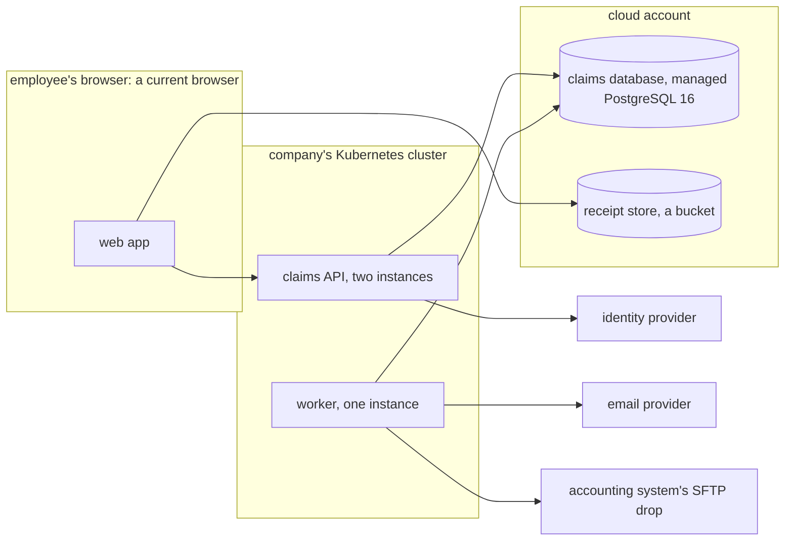

# `Claims` architecture

This document says how the parts of `Claims` give [its product vision](product-vision.md). An
employee claims an expense with a photo of its receipt, their manager approves it, and each night
Claims hands the approved claims to the accounting system. One service holds every rule of a
claim, and every change of a claim's state goes through it. What must reach the outside, a notice
or an export, the service writes beside the change in the same transaction, and a worker sends it
later, so a failure outside never loses a claim or a notice.

## Drivers

### Use cases

- **`U1`**: the employee wants to fill in a claim on the web, add the receipt's photo, and submit
  it. It carries the README's first step.
- **`U2`**: the manager wants to open a claim from the notice they got, and approve it or send it
  back with a reason. It carries the README's second step.
- **`U3`**: the finance team wants every claim approved by midnight in the next morning's import
  of the accounting system, with no claim twice. It carries the README's third step.

### Quality scenarios

In order of rank:

| ID | Quality | Source and stimulus | Environment | Artifact | Response | Measure |
| --- | --- | --- | --- | --- | --- | --- |
| `QA1` | Security | An employee asks for a claim that isn't theirs and that they don't approve | Normal use | The claims API | The API refuses and logs it | Every such request, with no data of the claim in the reply |
| `QA2` | Availability | An instance of the claims API stops | Working hours | The claims API | The other instance takes its requests | Claims loses no claim submitted, and requests fail for 30 seconds at most |
| `QA3` | Reliability | The accounting system's drop is down at midnight | The nightly export | The worker | The worker tries again each hour until 6 AM | Each approved claim lands in the export once, never twice |
| `QA4` | Modifiability | Finance changes who approves which amount | Development | The approval policy | The change stays in one component | One component and its tests change, released within a day |
| `QA5` | Performance | 300 employees submit at once on the last day of the month | Peak use | The claims API | The API answers | 95% of requests within one second |
| `QA6` | Testability | A developer runs the tests of the claim's rules | A computer with no database | The claims core | Every test runs | No test of the core needs the database, the network, or the clock |

## Structure

### Context

### Containers

### Components of claims API

### Components of worker

- **web app**, a single-page app in TypeScript: the forms and the pages a person works in. Its files
  lie in `web/`.
- **claims API**, a service in Go: every rule of a claim, and every change of its state. Its files
  lie in `api/`.
- **worker**, a service in Go: what Claims sends outside, after the change that calls for it. Its
  files lie in `worker/`.
- **claims database**, a database in PostgreSQL 16: each Claim and each Outbox entry.
- **receipt store**, an object store with the S3 API: each Receipt's photo.
- **HTTP edge**, a component in Go: how a request reads and a reply writes, and whose token it
  carries. Its files lie in `api/http/`.
- **claims core**, a component in Go: the states of a Claim and the moves between them, and which
  Outbox entry each move writes. Its files lie in `core/claims/`.
- **approval policy**, a component in Go: who approves a Claim of which amount. Its files lie in
  `core/policy/`.
- **claim repository**, a component in Go: how a Claim and an Outbox entry lie in the database.
  Its files lie in `api/postgres/`.
- **receipt signer**, a component in Go: how the receipt store's signed URLs read. Its files lie in
  `api/receipts/`.
- **token check**, a component in Go: how a token from the identity provider proves who signed in.
  Its files lie in `api/identity/`.
- **outbox relay**, a component in Go: which Outbox entries are due, and that each goes out once.
  Its files lie in `worker/relay/`.
- **notifier**, a component in Go: how a Notice reads as an email to the provider. Its files lie
  in `worker/mail/`.
- **exporter**, a component in Go: how the Export lies in the accounting system's file. Its files
  lie in `worker/export/`.

Legend: a rounded box is a person, a cylinder keeps data, a box runs code, a frame holds the
elements of one container, and each arrow points from the element that acts.

## Dependencies

claims core and approval policy depend on nothing outside Go's standard library, and claims core
on approval policy. Every other component of the API and the worker depends on them and on no
component of another container. The edges and the adapters depend on no other adapter.
`go-arch-lint`, run by CI on each push, fails on a dependency the rule doesn't allow.

| Port | Owned by | What the core needs | Adapters |
| --- | --- | --- | --- |
| Claims | claims core | to load a Claim, and to save it with its Outbox entries in one transaction | claim repository, on PostgreSQL, and the tests' store, in memory |
| Receipts | claims core | a URL to upload one Receipt to, and whether it's there | receipt signer, on the S3 API, and the tests' store, in memory |
| Identity | HTTP edge | who signed in, from a token | token check, on OpenID Connect, and the tests' tokens, signed by a test key |
| Clock | claims core | the time now | the system clock, and the tests' fixed clock |
| Mail | outbox relay | to send one Notice | notifier, on the email provider, and the tests' outbox of sent mail |
| Drop | outbox relay | to drop one night's Export | exporter, on the SSH File Transfer Protocol (SFTP), and the tests' folder |

## Interfaces

| Relation | What crosses | Form | Owned by | Contract |
| --- | --- | --- | --- | --- |
| web app to claims API | a Claim, and its moves | JSON over HTTPS | claims API | `api/openapi.yaml` |
| web app to receipt store | a Receipt's photo | a photo of up to 10 megabytes, sent to a signed URL | claims API | `api/openapi.yaml`, under the upload |
| claims API and worker to claims database | each Claim and each Outbox entry | SQL tables | claims API | `api/postgres/migrations/` |
| claims API to identity provider | a token | OpenID Connect | identity provider | its discovery document |
| worker to email provider | a Notice | the provider's send API, JSON over HTTPS | email provider | its API reference |
| worker to accounting system | the Export | a CSV file over SFTP | accounting system | its import format, `docs/accounting-import.pdf` |

## Runtime

### `U1`: a claim submitted

### `U2`: a claim approved or sent back

### `U3`: the nightly export

## Deployment

CI builds a container image each of the API and the worker, and the static files of the web app,
and deploys them to the cluster and its content network on each merge to `main`. A developer runs
the whole product on their computer by `docker compose up`, with a database, a bucket, and stand-ins
for the three outside systems. [The README](README.md#development) gives the steps.

## Decisions

### Principles

- **A claim changes state only in the claims core**: every move of a Claim goes through it, from
  any container. *Why*: a move made elsewhere skips the policy and the Outbox entry, so a claim
  gets approved by the wrong person, as `QA1` forbids, or its notice never goes, as `QA2` and
  `QA3` forbid.
- **What leaves Claims goes through the outbox**: no request sends anything outside while it runs.
  *Why*: a send that fails after the change, or a change that fails after the send, leaves the
  outside and the database telling different stories.

### Records

- **`D1`: an outbox table and a worker** over sending each notice in the request. *Context*: `QA2`
  and `QA3`, and an email provider that's down a few times a year. *Consequences*: the outbox
  keeps every notice, and no request waits on the provider. A notice goes out up to a minute late,
  and the worker is one more container to run.
- **`D2`: receipts uploaded to a signed URL** over uploads through the API. *Context*: `QA5`, and
  photos of several megabytes at the month's end. *Consequences*: the API carries no photo. The
  API must check that the Receipt is there before it takes the Claim.
- **`D3`: one API and one worker** over a service for each area, such as one for approvals.
  *Context*: a team of four, and `QA4`, which one component meets. *Consequences*: one deploy, one
  database, and no calls between services. A part that one day needs to scale alone must leave
  the API first.

## Tests

| Level | Checks against | Runs real | Doubles | Doubles kept true by | Passes when |
| --- | --- | --- | --- | --- | --- |
| Unit | each component's contract | the component | the tests' adapters, at each port | each port's contract, and the adapters' own unit tests against it | every test passes |
| Integration | this document's paths | the API and the worker, with PostgreSQL in a container, and a bucket in another | the tests' tokens at Identity, the tests' outbox at Mail, and the tests' folder at Drop | a contract test against the email provider's sandbox and the accounting system's test drop, each night | every test passes |
| Acceptance | the product vision | the deployed product in staging, in a browser | none | none | `U1`, `U2`, and `U3` run once from end to end before each release |

Only the unit tests take the states and moves of a Claim and each rule of the approval policy.
Each integration test runs one path once.

### Paths

- **`TestSubmitted`**: `U1`, a Claim submitted with its Receipt.
- **`TestReceiptRefused`**: `U1`, a photo that the receipt store refuses.
- **`TestApproved`**: `U2`, the approver approves, and no Notice goes.
- **`TestSentBack`**: `U2`, sent back, and its Notice sent.
- **`TestNotApprover`**: `U2`, a manager who doesn't approve the Claim.
- **`TestNoticeRetried`**: `U2`, the provider refuses once, and the next round sends the Notice.
- **`TestExported`**: `U3`, the Claims approved by midnight dropped once.
- **`TestExportRetried`**: `U3`, the drop down at midnight, and back at 1 AM.
