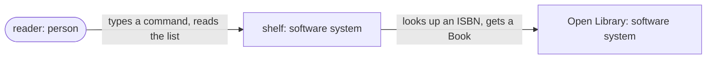
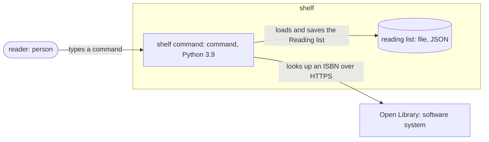
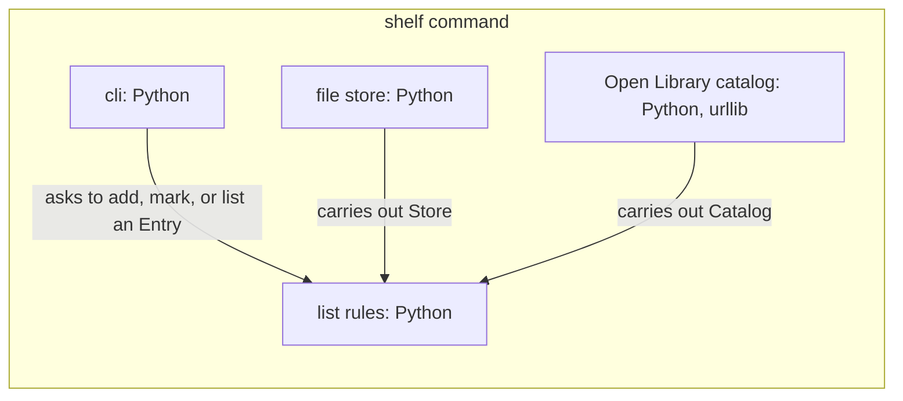
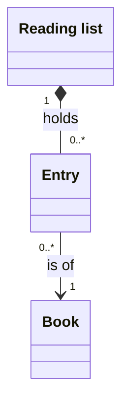
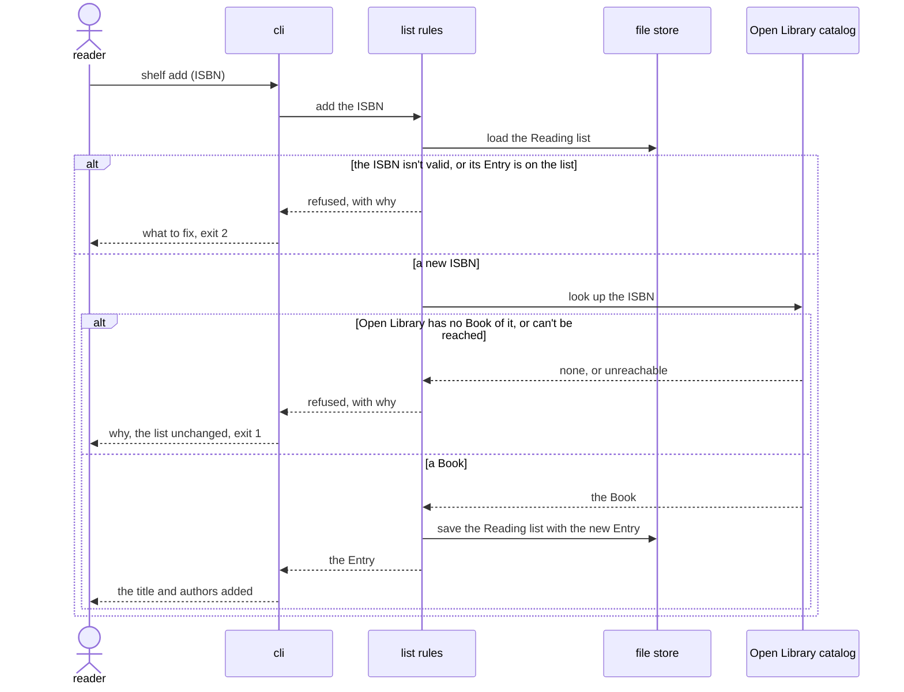
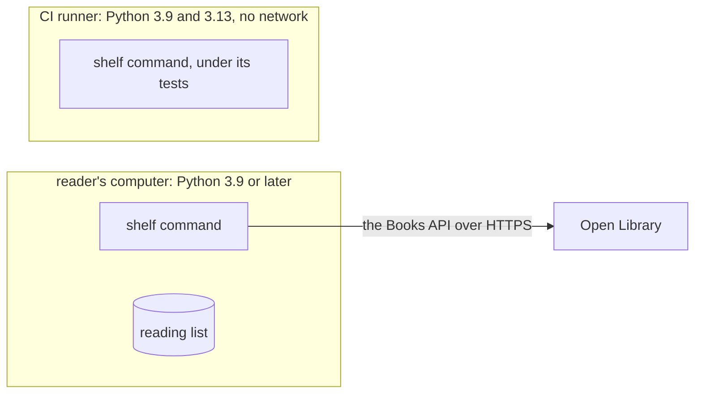

# `shelf` architecture

This document says how the parts of `shelf` give [its product vision](product-vision.md). shelf
keeps a reader's list of books in one JSON file. It asks Open Library for a book's title and
authors, by its International Standard Book Number (ISBN), only when the reader adds it. Its core holds the list's rules and knows neither the file
nor the network: the command reads the arguments, the core decides, and two adapters reach the
file and the catalog through ports the core owns.

## Drivers

### Use cases

- **`U1`**: the reader wants to type `shelf add <isbn>` and see the book's title and authors on
  their list. It carries the README's first step.
- **`U2`**: the reader wants to type `shelf done <isbn>` and `shelf list`, and see what they've
  yet to read. It carries the README's second and third steps.

### Quality scenarios

In order of rank:

| ID | Quality | Source and stimulus | Environment | Artifact | Response | Measure |
| --- | --- | --- | --- | --- | --- | --- |
| `QA1` | Data safety | The system stops shelf while it writes the list | Any write | The reading list | The list stays whole | The file holds the list from before or after the write, never part of one, on each of 1,000 runs stopped at random |
| `QA2` | Testability | A developer runs the tests | A computer with no network | The core and the command | Every test runs | No test reaches the network or a file outside its own folder, and the unit tests end within 2 seconds |
| `QA3` | Modifiability | A developer adds a second catalog, such as a library's own | Development | The catalog adapter | The change stays in one adapter | No file of the core or its tests changes |
| `QA4` | Availability | The reader adds a book while Open Library is down | Normal use | The command | shelf leaves the list as it was and says it can't reach the catalog | Within 5 seconds of the request |

## Structure

### Context

### Containers

### Components of shelf command

- **shelf command**, a command in Python 3.9: reads the reader's request and answers it. Its files
  lie in `shelf/`.
- **reading list**, a file in JSON: keeps the list between runs, in `~/.shelf/list.json`.
- **cli**, a component in Python: how the arguments read and how the answers print, and which
  adapters the core gets. Its files lie in `shelf/cli.py`.
- **list rules**, a component in Python: what makes an ISBN valid, a book already on the list, and
  a book done. Its files lie in `shelf/core.py`.
- **file store**, a component in Python: how the list lies in its file and how a write replaces it
  whole. Its files lie in `shelf/store.py`.
- **Open Library catalog**, a component in Python: how a request to Open Library reads and its
  reply becomes a Book. Its files lie in `shelf/openlibrary.py`.

Legend: a rounded box is a person, a cylinder keeps data, a box runs code, and each arrow points
from the element that acts.

## Dependencies

cli depends on list rules, file store, and Open Library catalog, to join them. file store and Open
Library catalog depend on list rules, whose ports they carry out. list rules depends on nothing
outside the standard library's data types. `tests/test_imports.py` reads each module's imports and
fails on one the rule doesn't allow.

| Port | Owned by | What the core needs | Adapters |
| --- | --- | --- | --- |
| Store | list rules | the Reading list as it stood after the last save, and to save it whole | file store, on a JSON file, and the tests' store, in memory |
| Catalog | list rules | the Book of an ISBN, or that none has it, or that it can't reach the catalog | Open Library catalog, on HTTPS, and the tests' catalog, from recorded replies |

## Interfaces

| Relation | What crosses | Form | Owned by | Contract |
| --- | --- | --- | --- | --- |
| reader to shelf command | a request, and the list or a refusal back | the command's arguments in, and text out | shelf command | the README's usage |
| shelf command to reading list | the Reading list | JSON | file store | `shelf/list.schema.json` |
| shelf command to Open Library | an ISBN, and a Book back | Open Library's Books API, JSON over HTTPS | Open Library | [the Books API](https://openlibrary.org/dev/docs/api/books) |

## Runtime

### `U1`: a book added

`U2` never reaches the catalog, and one sentence gives its path: cli asks list rules to mark or
list, and list rules loads the Reading list from the file store and, for `done`, saves it with the
Entry marked.

## Deployment

A developer clones the repository and runs `python3 -m unittest`, with nothing to install. A reader
installs shelf as [the README](README.md#installation) says, by `pipx install shelf`, and its first
`shelf add` makes `~/.shelf/list.json`.

## Decisions

### Principles

- **The core decides, the edge reads and writes**: list rules makes every decision about the list,
  and cli and the adapters only carry data in and out. *Why*: a rule written in an adapter goes
  untested by the core's tests, as `QA2` needs, and a second catalog would have to copy it, as
  `QA3` forbids.

### Records

- **`D1`: a JSON file** over SQLite. *Context*: one reader, a few hundred books, and `QA2`.
  *Consequences*: the reader can read and back up the list as text. Each write rewrites the whole
  file, which stays quick at this size.
- **`D2`: a write by a new file renamed over the old** over a write in place. *Context*: `QA1`.
  *Consequences*: a rename is atomic on the file systems shelf runs on, so no stop leaves part of
  a list. It costs room for a second copy during each write.
- **`D3`: the catalog asked only on add** over a lookup on each list. *Context*: `QA4`, and Open
  Library's limits on requests. *Consequences*: `shelf list` works offline. A title that Open
  Library corrects later stays as it was.

## Tests

| Level | Checks against | Runs real | Doubles | Doubles kept true by | Passes when |
| --- | --- | --- | --- | --- | --- |
| Unit | each component's contract | the component | the tests' store at Store, and the tests' catalog at Catalog | the catalog's replies, recorded from Open Library, and a contract test that runs the Open Library catalog against Open Library each week | every test passes |
| Integration | this document's paths | cli, list rules, and the file store on a file in the test's own folder | the tests' catalog, at Catalog | as at unit | every test passes |
| Acceptance | the product vision | shelf as installed, Open Library | none | none | the README's walkthrough gives what it shows, once before each release |

Only the unit tests take the classes of an ISBN and the list's rules. Each integration test runs one
path once.

### Paths

- **`test_added`**: `U1`, a new ISBN whose Book the catalog has.
- **`test_refused_isbn`**: `U1`, an ISBN that isn't valid.
- **`test_refused_twice`**: `U1`, an ISBN whose Entry is on the list.
- **`test_not_found`**: `U1`, an ISBN the catalog has no Book of.
- **`test_unreachable`**: `U1`, the catalog unreachable.
- **`test_done_and_list`**: `U2`, an Entry marked done, and the list without it.
