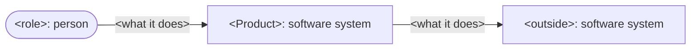
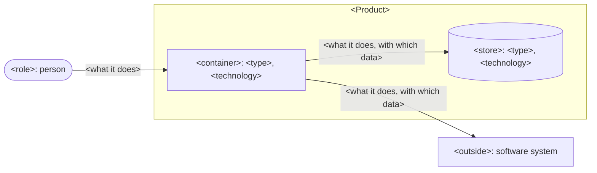
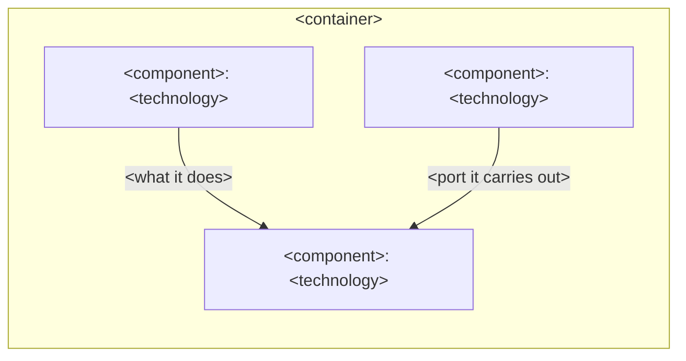
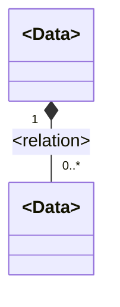
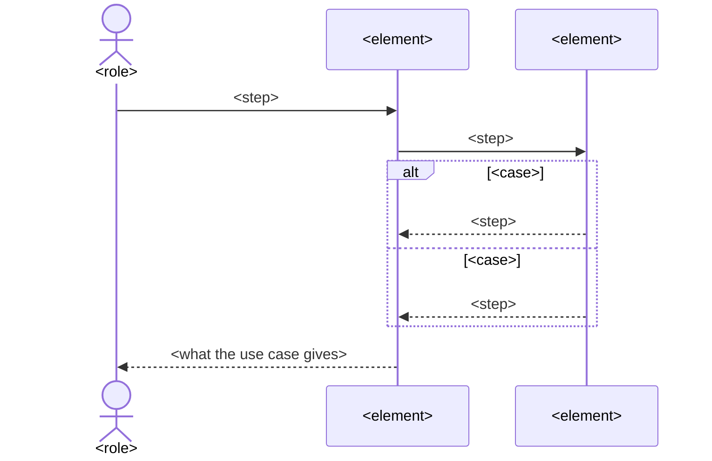
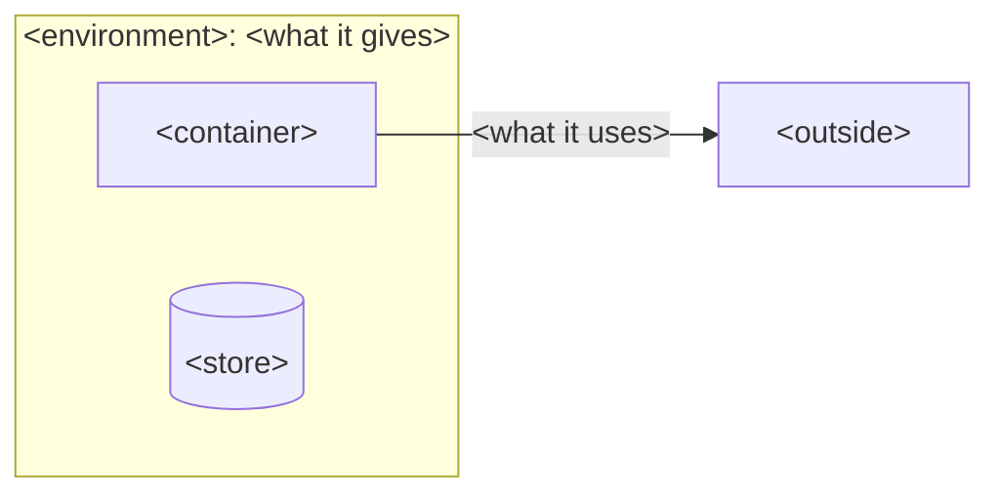

# `<Product>` architecture

This document says how the parts of `<Product>` give [its product vision](<vision>). `<strategy>`.

> [!NOTE]
> DELETE_TEMPLATE_COMMENT:
> - `<vision>`: the path to the product's product vision.
> - `<strategy>`: the idea by which the parts give the product vision, and the few decisions that
>   shape every part, in a few sentences.

## Drivers

### Use cases

- **`U<n>`**: `<role>` wants `<way>`. It carries `<steps>`.

### Quality scenarios

In order of rank:

| ID | Quality | Source and stimulus | Environment | Artifact | Response | Measure |
| --- | --- | --- | --- | --- | --- | --- |
| `QA<n>` | `<quality>` | `<stimulus>` | `<environment>` | `<artifact>` | `<response>` | `<measure>` |

> [!NOTE]
> DELETE_TEMPLATE_COMMENT:
> - `<role>`: a role of the product vision, as the product vision names it.
> - `<way>`: one way the role meets the product at its edge, such as a command they type.
> - `<steps>`: the steps of the README's walkthrough, or of an objective's main use it doesn't
>   run, that rest on the use case.
> - `<quality>`: the quality the scenario makes concrete, such as modifiability.
> - `<stimulus>`: who or what acts, and what reaches the product.
> - `<environment>`: the conditions it comes in, such as a failed network.
> - `<artifact>`: the part it reaches, or the whole product.
> - `<response>`: what the product, or its developer, does.
> - `<measure>`: how someone checks the response, in terms they can measure.

## Structure

### Context

### Containers

### Components of `<container>`

- **`<element>`**, `<type>` in `<technology>`: `<responsibility>`. Its files lie in `<path>`.

Legend: `<legend>`.

> [!NOTE]
> DELETE_TEMPLATE_COMMENT:
> - The figures: drawn in a format the developers see drawn, such as Mermaid. Context holds each
>   role of the use cases and each system outside the product that it meets. Containers holds each
>   thing that runs code or keeps data. A section of components follows for each container that
>   holds more than one decision likely to change, and none for one that holds a single decision.
>   Each arrow points one way and says what one element does to the other, with the data it hands
>   on, named as in Interfaces, never a bare word such as uses.
> - `<element>`: each container and each component, by its name in the figures.
> - `<type>`, `<technology>`: the kind of element, such as a command or a store, and what it's
>   made with.
> - `<responsibility>`: the one decision it holds or hides, in a few words.
> - `<path>`: the folder or file that holds it, from the repository's root.
> - `<legend>`: what each shape and line of the figures means.

## Dependencies

`<rule>`. `<check>`.

| Port | Owned by | What the core needs | Adapters |
| --- | --- | --- | --- |
| `<port>` | `<core element>` | `<need>` | `<adapter>` |

> [!NOTE]
> DELETE_TEMPLATE_COMMENT:
> - `<rule>`: which elements may depend on which, by their names in Structure, with every
>   dependency pointing to the core and none in a cycle.
> - `<check>`: what checks the rule on each change, such as a test that reads the imports.
> - `<port>`: each thing outside the core that the core needs, by the name of the core's interface.
> - `<core element>`: the core element that names the port.
> - `<need>`: what the core asks of it, in the core's terms.
> - `<adapter>`: each element that carries the port out, the tests' own among them, with the
>   technology each reaches.

## Interfaces

| Relation | What crosses | Form | Owned by | Contract |
| --- | --- | --- | --- | --- |
| `<from>` to `<to>` | `<data>` | `<form>` | `<owner>` | `<contract>` |

> [!NOTE]
> DELETE_TEMPLATE_COMMENT:
> - The figure: each data the containers pass or keep, by its name alone, with each relation
>   between two data named, and how many of each it joins at both ends. A filled diamond marks the
>   whole where one data holds the other's parts.
> - `<from>`, `<to>`: the two sides of each relation between containers, or with the outside, by
>   their names in Structure.
> - `<data>`: what crosses, by the names of the figure.
> - `<form>`: the form it crosses in, such as JSON or a command's arguments.
> - `<owner>`: the side that offers the interface and owns its form.
> - `<contract>`: where the form lies in writing, such as a schema's path or an API's reference.

## Runtime

### `U<n>`: `<path>`

> [!NOTE]
> DELETE_TEMPLATE_COMMENT:
> - One section for each use case that branches, or whose path crosses the elements in an order one
>   sentence can't give. Use cases that share their steps share a section. A use case one element
>   carries alone gets none.
> - `<path>`: what the use case does, in a few words.
> - `<role>`, `<element>`: the role of the use case, and each element it reaches, by its name in
>   Structure.
> - `<step>`: what one does to another and the data it hands on, by its name in Interfaces, each
>   along an arrow of Structure.
> - `<case>`: each branch, each step that sends work back, and each question put to a role.

## Deployment

`<start>`.

> [!NOTE]
> DELETE_TEMPLATE_COMMENT:
> - The figure: each environment the product runs in, such as the user's computer, a server, or
>   CI, with what it gives, such as an interpreter's version. In each, the containers it runs and
>   the stores it keeps, by their names in Structure. Beside them, each thing outside the product
>   that they depend on, with what they use of it.
> - `<start>`: how a developer sets the product up and starts it, in a few sentences, with a link to the
>   README's installation.

## Decisions

### Principles

- **`<principle>`**: `<rule>`. *Why*: `<why>`.

### Records

- **`D<n>`: `<decision>`** over `<option>`. *Context*: `<context>`. *Consequences*:
  `<consequences>`. `<status>`.

> [!NOTE]
> DELETE_TEMPLATE_COMMENT:
> - `<principle>`, `<rule>`: each rule that every part meeting the same case follows, by the few
>   words a reader finds it by.
> - `<why>`: what the rule is there for, and what goes wrong without it.
> - `<decision>`, `<option>`: each decision that shapes the structure, a quality, a dependency, an
>   interface, or how the developers build the product, and that a developer would question, with
>   each option it beat.
> - `<context>`: the forces at play, the drivers by their IDs among them.
> - `<consequences>`: what follows from it, its costs among them.
> - `<status>`: optional, "Replaced by `D<n>`." where a later decision replaces it.

## Tests

| Level | Checks against | Runs real | Doubles | Doubles kept true by | Passes when |
| --- | --- | --- | --- | --- | --- |
| `<level>` | `<ground>` | `<real>` | `<doubles>` | `<kept true>` | `<passes>` |

### Paths

- **`<test>`**: `U<n>`, `<path>`.

> [!NOTE]
> DELETE_TEMPLATE_COMMENT:
> - `<level>`: each test level from narrow to wide: unit, integration, and acceptance, or the names
>   the repository gives them.
> - `<ground>`: what the level checks against: a part's contract, this document's paths, or the
>   product vision in real use.
> - `<real>`: what runs real at the level.
> - `<doubles>`: what stands in for the rest, at which port of Dependencies.
> - `<kept true>`: where each double's answers come from, and the contract test that checks it
>   against the real thing.
> - `<passes>`: when the level passes, with how many runs of how many where a result varies.
> - `<test>`, `<path>`: each test of the integration level, and the path of Runtime it runs, one
>   for each path through each use case.
