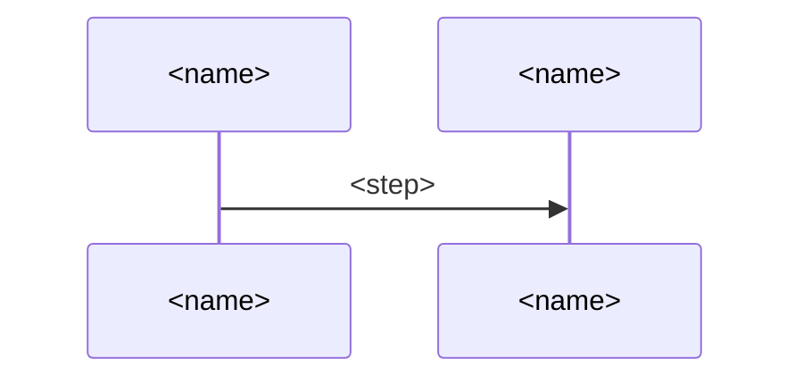

# `<Product>` architecture

This document says how the parts of `<Product>` give what [its README](<readme>) promises. `<idea>`.

> [!NOTE]
> DELETE_TEMPLATE_COMMENT:
> - `<readme>`: the path to the product's README.
> - `<idea>`: how the product turns what its roles bring into what the README promises, as one
>   idea seen as a whole that every part carries out. Two or three sentences.

## User stories

- `S<n>`: `<role>` wants `<way>`, so that `<benefit>`. It carries `<steps>`.

> [!NOTE]
> DELETE_TEMPLATE_COMMENT:
> - `<role>`: a role of the product vision, as the product vision names it.
> - `<way>`: one way the role meets the product at its edge, such as a command they type.
> - `<benefit>`: what the role gains by it, toward an objective of the product vision.
> - `<steps>`: the steps of the README's walkthrough, or of an objective's main use it doesn't
>   run, that rest on it, and each convenience the product vision's intent asks for that it
>   carries, such as resuming a run that stopped.

## Components


What each decides alone:

- `<component>`\
  `<what it alone decides>`.

The choices made, and why:

- `<choice>` over `<other way>`\
  `<why>`. The cost: `<cost>`.

> [!NOTE]
> DELETE_TEMPLATE_COMMENT:
> - The figure: the deliverable's own at images/components.svg, the product named in its alt text.
>   It holds each role the stories need and each store of data, a store drawn as a plain box like a
>   component's. Each box holds its name, its type, and its technology alone.
>   Each arrow says what one does to another, with the data it hands on, named as in the data
>   model. A legend explains every symbol.
> - `<component>`, `<what it alone decides>`: each role of the figure and each component, by its
>   name in the figure, and the decisions that are hard to make or likely to change that it alone
>   makes, each in a few words, joined by commas, in one sentence.
> - `<choice>`, `<other way>`: each choice whose other way would cost a key result, such as a
>   technology, or a tool, and the way it beat, in a few words each. Leave them out where no
>   choice is such.
> - `<why>`, `<cost>`: what the choice gives, ending with the key result as the `<why>` of a
>   principle does, and what it costs, in one sentence each.

## Data model


- `<Data>`\
  `<what it is>`.

> [!NOTE]
> DELETE_TEMPLATE_COMMENT:
> - The figure: the deliverable's own at images/data-model.svg, the product named in its alt text.
>   It draws the data as a concept model in a class diagram of the Unified Modeling Language. Each
>   data the components pass or keep is a class by its name alone. Each relation between two data
>   has its name, and how many of each it joins at both ends, with a filled diamond at the whole
>   where one holds the other's parts. A named frame for each component or store that keeps them
>   groups the data, the frames in the order the stories meet them, and the data most others join
>   in the middle.
> - `<Data>`, `<what it is>`: each data whose name a reader could take for another's, by its name,
>   and what it's in a few words, without its fields.

## Principles

`<Product>` builds on [`<other>`](<path>), and adds these rules, which every part keeps.

### `<name>`

`<rule>`.

*Why*: `<why>`.

> [!NOTE]
> DELETE_TEMPLATE_COMMENT:
> - `<other>`, `<path>`: the architecture whose principles this one builds on, with the sentence
>   that names it. Leave the sentence out where the architecture builds on no other.
> - `<name>`: the few words a reader finds the principle by.
> - `<rule>`: one sentence that every part meeting the same decision follows, naming the parts as
>   Components names them. It holds what no single component's line can say.
> - `<why>`: one sentence: what goes wrong without the rule for a role of the product vision,
>   naming the key result it guards, or for the product's developer or operator.

## Sequences

### `S<n>`: `<path>`



> [!NOTE]
> DELETE_TEMPLATE_COMMENT:
> - One section for each user story. Stories that share their steps share a section.
> - `<path>`: what the story does, in a few words.
> - `A`, `B`: a short ID for each one that takes part, used in the messages.
> - `<name>`: the role of the story, each component it reaches, as Components names it, and each
>   thing outside the product it reaches.
> - `<step>`: what one does to another and the data it hands on, as the data model names it, in a
>   few words. Each branch, each step that sends work back, and each question put to the role are
>   among them.

## Deployment


`<start>`.

- `<choice>` over `<other way>`\
  `<why>`. The cost: `<cost>`.

> [!NOTE]
> DELETE_TEMPLATE_COMMENT:
> - The figure: the deliverable's own at images/deployment.svg, the product named in its alt text.
>   It holds each environment the product runs in, such as the user's computer or CI, with its
>   technology. In each are its deployment units. Each unit names its technology, and the
>   components and the data it holds by their names in Components and the data model. Beside them
>   is each thing outside the product the components depend on, with what they use of it.
> - `<start>`: how the product starts, in one sentence.
> - `<choice>`, `<other way>`, `<why>`, `<cost>`: as in Components.

## Directory structure

`<places>`.

```text
<path>  <holds>
```

- `<choice>` over `<other way>`\
  `<why>`. The cost: `<cost>`.

> [!NOTE]
> DELETE_TEMPLATE_COMMENT:
> - `<places>`: one sentence for each top folder, saying whom its files are for, such as the users
>   who install the product or only its developers.
> - `<path>`: each folder and file that holds a component or a data, by its real name, nested as on
>   disk, without the files inside a component.
> - `<holds>`: what it does or holds, in the words a developer looks for when making a change,
>   naming the component or the data as Components and the data model name them.
> - `<choice>`, `<other way>`, `<why>`, `<cost>`: as in Components.

## Test strategy

`<Product>` tests by [`<shared rules>`](<path>), in unit tests, integration tests, and end-to-end
(E2E) tests. Its test cases lie in `<cases>`, and `<trace>` checks that each names an element or a
case one level up.

### Unit tests

- Tries: `<tries>`.
- Runs real: `<real>`.
- Tools: `<tools>`.
- Passes when: `<criteria>`.
- Runs: `<when>`.

### Integration tests

- Tries: `<tries>`.
- Runs real: `<real>`.
- Tools: `<tools>`.
- Passes when: `<criteria>`.
- Runs: `<when>`.

### E2E tests

- Tries: `<tries>`.
- Runs real: `<real>`.
- Tools: `<tools>`.
- Passes when: `<criteria>`.
- Runs: `<when>`.

- `<choice>` over `<other way>`\
  `<why>`. The cost: `<cost>`.

> [!NOTE]
> DELETE_TEMPLATE_COMMENT:
> - `<shared rules>`, `<path>`: the test rules of the architecture that the product builds on, such
>   as the form each case takes.
> - `<cases>`: the folders of the test cases, as Directory structure names them. The cases lie
>   there alone, each written as Given, When, and Then, and no document lists them.
> - `<trace>`: the script that checks the trace by the names of the elements.
> - `<tries>`: what the level tries, by the names that Components, the stories, the principles, the
>   data model, and the product vision give: at unit, each part, the prompts among them, against
>   its contract; at integration, each element of this document; at E2E, each key result, by the
>   main use that measures it.
> - `<real>`: what runs real, and the double that replaces each other thing, with the source of
>   what each double of a thing outside the product gives, such as a recorded run.
> - `<tools>`: the test runner and the tool of each quality check, by name.
> - `<criteria>`: each quality check with its criterion, as a number where it's one, joined by
>   semicolons: at unit, coverage, surviving mutants, the contracts that take property-based tests,
>   the limits on each function, static analysis and lint, and k for a prompt; at integration,
>   each check of the trace; at E2E, how each key result is measured and compared, how a judge is
>   trusted, and how many runs each main use takes.
> - `<when>`: when the level runs, such as before each push, in CI, or once every lower level
>   passes, in one sentence.
> - `<choice>`, `<other way>`, `<why>`, `<cost>`: as in Components.
