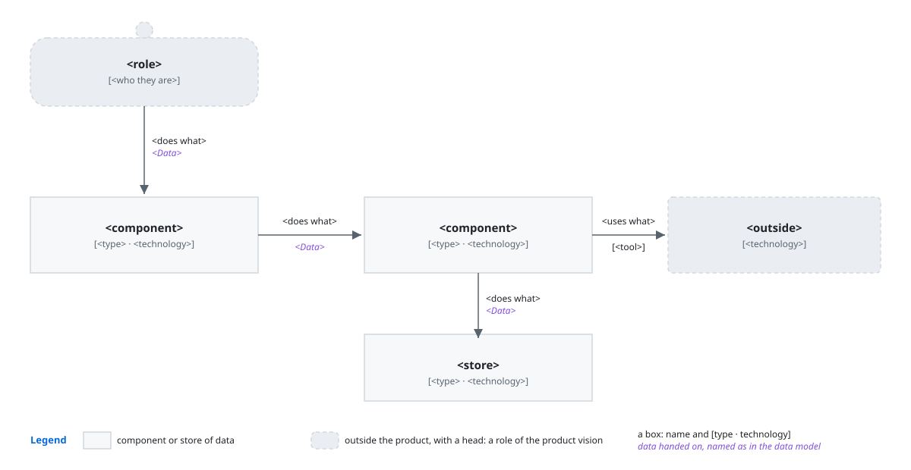
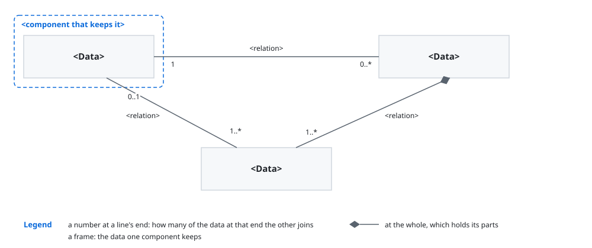
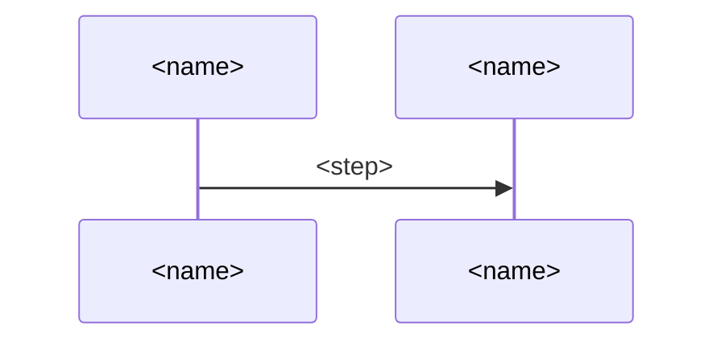
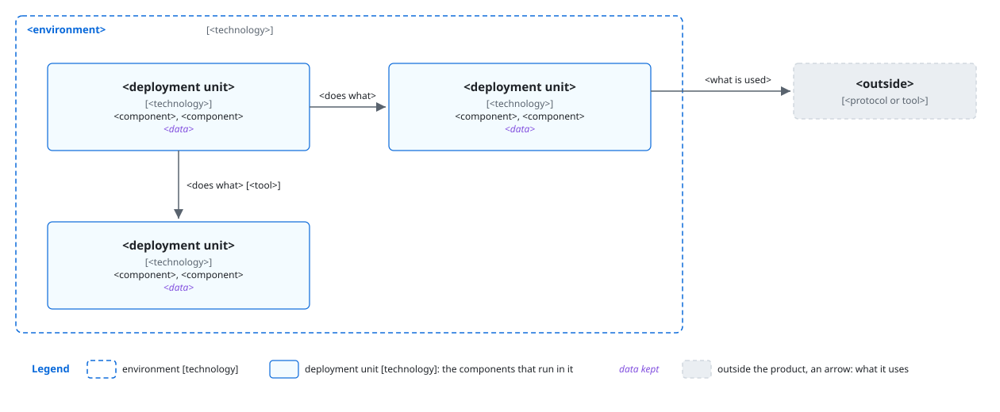
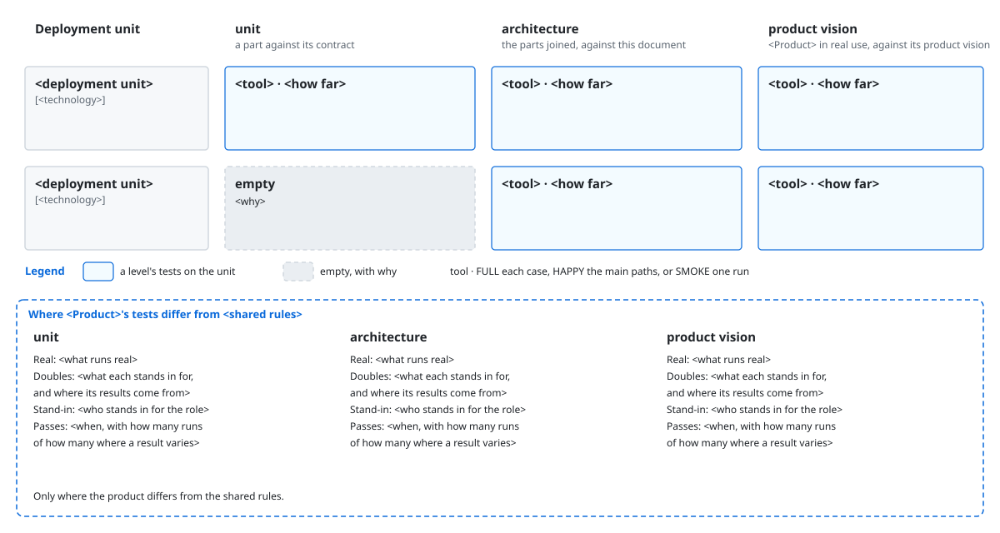

# `<Product>` architecture

This document says how the parts of `<Product>` give [its product vision](<board>). `<idea>`.

> [!NOTE]
> DELETE_TEMPLATE_COMMENT:
> - `<board>`: the path to the product's product vision.
> - `<idea>`: how the product turns what its roles bring into what the product vision
>   promises, as one idea seen as a whole that every part carries out. Two or three sentences.
> - Every slot below says what holds while a component changes inside. It names no command, file,
>   field, step, or count that one component alone uses, as the developer of that component settles
>   them where they build it.

## Principles

`<Product>` builds on [`<other>`](<path>), and adds these.

### `<name>`

`<rule>`.

*Why*: `<why>`.

> [!NOTE]
> DELETE_TEMPLATE_COMMENT:
> - `<other>`, `<path>`: the architecture whose principles this one builds on, with the sentence
>   that names it. Leave the sentence out where the architecture builds on no other.
> - A principle only where two developers of different parts would otherwise decide one case
>   apart.
> - `<name>`: the few words a reader finds the principle by.
> - `<rule>`: one to three short sentences that every part meeting the same decision follows, what
>   must be absent among them, with no way a component carries it out.
> - `<why>`: one or two sentences: what goes wrong for a role of the product vision without the
>   rule, ending with the key result it guards, such as `as KR1.1 counts`.

## User stories

- **`S<n>`**: `<role>` wants `<way>`. It carries `<steps>`.

> [!NOTE]
> DELETE_TEMPLATE_COMMENT:
> - `<role>`: a role of the product vision, as the product vision names it.
> - `<way>`: one way the role meets the product at its edge, such as a command they type.
> - `<steps>`: the steps of the README's walkthrough, or of an objective's main use it doesn't
>   run, that rest on it, and each convenience the product vision's intent asks for that it
>   carries, such as resuming a run that stopped.

## Components



What each decides alone:

- **`<component>`**: `<what it alone decides>`.

- **`<choice>`** over `<other way>`: `<why>`. The cost: `<cost>`.

> [!NOTE]
> DELETE_TEMPLATE_COMMENT:
> - The figure: the deliverable's own at images/components.svg, the product named in its alt text.
>   It holds each role the stories need and each store of data, a store a plain box like a
>   component's, as its type sets it apart and it needs no more weight. Each box holds its name,
>   its type, and its technology alone, so the figure shows the parts and their joins at a glance.
>   Each arrow says what one does to another, with the data it hands on, named as in the data
>   model. A legend explains every symbol.
> - `<component>`, `<what it alone decides>`: each role of the figure and each component, by its
>   name in the figure, and the decisions the stories need that it alone makes, each in a few
>   words, joined by commas, in one sentence.
> - `<choice>`, `<other way>`: each choice a developer would question, such as a technology, or a
>   tool, and the way it beat, in a few words each. Leave them out where no choice is in question.
> - `<why>`, `<cost>`: what the choice gives, ending with the key result as the `<why>` of a
>   principle does, and what it costs, in one sentence each.

## Data model



- **`<Data>`**: `<what it is>`.

> [!NOTE]
> DELETE_TEMPLATE_COMMENT:
> - The figure: the deliverable's own at images/data-model.svg, the product named in its alt text.
>   It draws the data as a concept model in a class diagram of the Unified Modeling Language. Each
>   data the components pass or keep is a class by its name alone. Each relation between two data
>   has its name, and how many of each it joins at both ends, with a filled diamond at the whole
>   where one holds the other's parts. A named frame for each component that keeps them groups the
>   data, the frames in the order the stories meet them, and the data most others join in the
>   middle.
> - `<Data>`, `<what it is>`: each data whose name a reader could take for another's, by its name,
>   and what it's in a few words, without its fields.

## Sequences

### `S<n>`: `<path>`



- **`<choice>`** over `<other way>`: `<why>`. The cost: `<cost>`.

> [!NOTE]
> DELETE_TEMPLATE_COMMENT:
> - One section for each user story. Stories that share their steps share a section.
> - `<path>`: what the story does, in a few words.
> - `A`, `B`: a short ID for each one that takes part, used in the messages.
> - `<name>`: the role of the story, each component it reaches, as Components names it, and each
>   thing outside the product it reaches.
> - `<step>`: what one does to another and the data it hands on, as the data model names it, in a
>   few words. Each branch, each step that sends work back, and each question put to the role are
>   among them. A component's own steps inside stay out, as one arrow stands for them.
> - `<choice>`, `<other way>`, `<why>`, `<cost>`: as in Components.

## Deployment



`<start>`.

- **`<choice>`** over `<other way>`: `<why>`. The cost: `<cost>`.

> [!NOTE]
> DELETE_TEMPLATE_COMMENT:
> - The figure: the deliverable's own at images/deployment.svg, the product named in its alt text.
>   It holds each environment the product runs in, such as the user's computer or CI, with its
>   technology. In each are its deployment units. Each unit names its technology, and the
>   components and the data it holds by their names in Components and the data model. Beside them
>   is each thing outside the product the components depend on, with what they use of it.
> - `<start>`: how the product starts, in one sentence.
> - `<choice>`, `<other way>`, `<why>`, `<cost>`: as in Components.

## Directory structure

```text
<path>  <holds>
```

- **`<choice>`** over `<other way>`: `<why>`. The cost: `<cost>`.

> [!NOTE]
> DELETE_TEMPLATE_COMMENT:
> - `<path>`: each folder and file that holds a component or a data, nested as on disk, without the
>   files inside a component.
> - `<holds>`: the component or the data it holds, as Components names it.
> - `<choice>`, `<other way>`, `<why>`, `<cost>`: as in Components.

## Tests

`<Product>` tests by [`<shared rules>`](<path>), and differs from them where this section says.



- **`<choice>`** over `<other way>`: `<why>`. The cost: `<cost>`.

> [!NOTE]
> DELETE_TEMPLATE_COMMENT:
> - `<shared rules>`, `<path>`: the project's shared test rules.
> - The figure: the deliverable's own at images/tests.svg, the product named in its alt text. It's
>   a table with a row for each deployment unit, by its name in Deployment, and a column for each
>   test level from narrow to wide, each named by what it checks against. Unit checks against a
>   part's contract, architecture against this document, and product vision against the product
>   vision, in real use. Each cell holds the tool, how far it tries the unit, and what it checks in
>   a few words. `FULL` tries each case and edge, `HAPPY` the main paths, and `SMOKE` a run that
>   confirms what lower levels checked. An empty cell says why. Under it, one sentence for each
>   level where the product differs from the shared rules says what runs real, what doubles stand
>   in for, who stands in for the role, or when it passes.
> - `<choice>`, `<other way>`, `<why>`, `<cost>`: as in Components.
