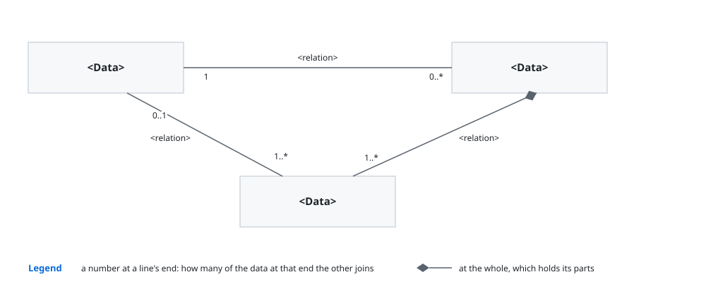
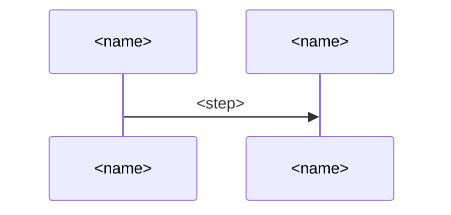

# `<Product>` architecture

## User stories

- `S<n>`: `<role>` wants `<want>`, so that `<benefit>`.

> [!NOTE]
> DELETE_TEMPLATE_COMMENT:
> - `<role>`: a role of the product vision, as the product vision names it, or the product's
>   developer or operator for a need of development or operation.
> - `<want>`: what the role wants, in the role's words, without the product's means, such as a
>   command or a screen, which Sequences shows.
> - `<benefit>`: what the role gains by it, toward an objective of the product vision.
> - The stories together cover each objective of the product vision and each promise of the README.
>   A story needn't match one step of the README's walkthrough.

## Solution strategy

`<idea>`.

### `<name>`

`<rule>`.

*Why*: `<why>`.

> [!NOTE]
> DELETE_TEMPLATE_COMMENT:
> - `<idea>`: how the product turns what its roles bring into what the README promises, as one
>   idea seen as a whole that every view carries out. Two or three sentences.
> - `<name>`: the few words a reader finds the rule by.
> - `<rule>`: one sentence that every part meeting the same decision follows, naming the parts as
>   Components names them. It holds what no single view can say.
> - `<why>`: one sentence: what goes wrong without the rule for a role of the product vision,
>   naming the key result it guards, or for the product's developer or operator.

## Components


- `<component>`\
  `<responsibility>`.

Strategies:

- `<strategy>`\
  `<intent>`.

> [!NOTE]
> DELETE_TEMPLATE_COMMENT:
> - The figure: the deliverable's own at images/components.svg, the product named in its alt text.
>   It holds each role the stories need and each store of data, a store drawn as a plain box like a
>   component's. Each box holds its name, its type, and its technology alone.
>   Each arrow says what one does to another, with the data it hands on, named as in the data
>   model. A legend explains every symbol.
> - `<component>`, `<responsibility>`: each role of the figure and each component, by its name in
>   the figure, and what it's expected to do, in one sentence.
> - `<strategy>`, `<intent>`: each decision of the view that a key result rests on, such as a
>   technology or a tool, in a few words, and why it's taken, ending with the key result it serves,
>   in one sentence. Leave out Strategies where the view takes no such decision.

## Data model



- `<Data>`\
  `<what it is>`.

Strategies:

- `<strategy>`\
  `<intent>`.

> [!NOTE]
> DELETE_TEMPLATE_COMMENT:
> - The figure: the deliverable's own at images/data-model.svg, the product named in its alt text.
>   It draws the data as a concept model in a class diagram of the Unified Modeling Language. Each
>   data the components pass or keep is a class by its name alone. Each relation between two data
>   has its name, and how many of each it joins at both ends, with a filled diamond at the whole
>   where one holds the other's parts. A named frame for each component or store that keeps them
>   groups the data, the frames in the order the stories meet them, and the data most others join
>   in the middle.
> - `<Data>`, `<what it is>`: each data whose name a reader could take for another's, by its name,
>   and what it's in a few words, without its fields.
> - `<strategy>`, `<intent>`: as in Components.

## Sequences

### `S<n>`: `<path>`



Strategies:

- `<strategy>`\
  `<intent>`.

> [!NOTE]
> DELETE_TEMPLATE_COMMENT:
> - One section for each user story. Stories that share their steps share a section.
> - `<path>`: what the story does, in a few words.
> - `A`, `B`: a short ID for each one that takes part, used in the messages.
> - `<name>`: the role of the story, each component it reaches, as Components names it, and each
>   thing outside the product it reaches.
> - `<step>`: what one does to another and the data it hands on, as the data model names it, in a
>   few words. Each branch, each step that sends work back, and each question put to the role are
>   among them.
> - `<strategy>`, `<intent>`: as in Components.

## Deployment


`<start>`.

Strategies:

- `<strategy>`\
  `<intent>`.

> [!NOTE]
> DELETE_TEMPLATE_COMMENT:
> - The figure: the deliverable's own at images/deployment.svg, the product named in its alt text.
>   It holds each environment the product runs in, such as the user's computer or CI, with its
>   technology. In each are its deployment units. Each unit names its technology, and the
>   components and the data it holds by their names in Components and the data model. Beside them
>   is each thing outside the product the components depend on, with what they use of it.
> - `<start>`: how the product starts, in one sentence.
> - `<strategy>`, `<intent>`: as in Components.

## Directory structure

`<places>`.

```text
<path>  <holds>
```

Strategies:

- `<strategy>`\
  `<intent>`.

> [!NOTE]
> DELETE_TEMPLATE_COMMENT:
> - `<places>`: one sentence for each top folder, saying whom its files are for, such as the users
>   who install the product or only its developers.
> - `<path>`: each folder and file that holds a component or a data, by its real name, nested as on
>   disk, without the files inside a component.
> - `<holds>`: what it does or holds, in the words a developer looks for when making a change,
>   naming the component or the data as Components and the data model name them.
> - `<strategy>`, `<intent>`: as in Components.

## Test strategy

Each test case lies in `<cases>`, written as Given, When, and Then before anyone builds a part.
`<trace>` checks that each names an element or a case one level up.

| Check | Test target | Kind | Exit criteria or measure |
|---|---|---|---|
| `<check>` | `<target>` | `<kind>` | `<tool>`: `<criterion or measure>` |

> [!NOTE]
> DELETE_TEMPLATE_COMMENT:
> - `<cases>`: the folders of the test cases, as Directory structure names them.
> - `<trace>`: the script that checks the trace by the names of the elements.
> - `<check>`, `<target>`: each check of [the test strategy guide](test-strategy-guide.md) to pick
>   always, and each other whose condition the product meets, in its order, with its test target as
>   the guide gives it. A check left out has no row.
> - `<kind>`: `Quality` or `Benchmark`, as the guide gives it, or `Benchmark` where the test runs a
>   prompt.
> - `<tool>`: the tool that runs the check, by its name.
> - `<criterion or measure>`: for a quality, what passes, as a number where it's one, as the guide
>   recommends unless the row says why not. For a benchmark, what it measures, with no
>   criterion.
