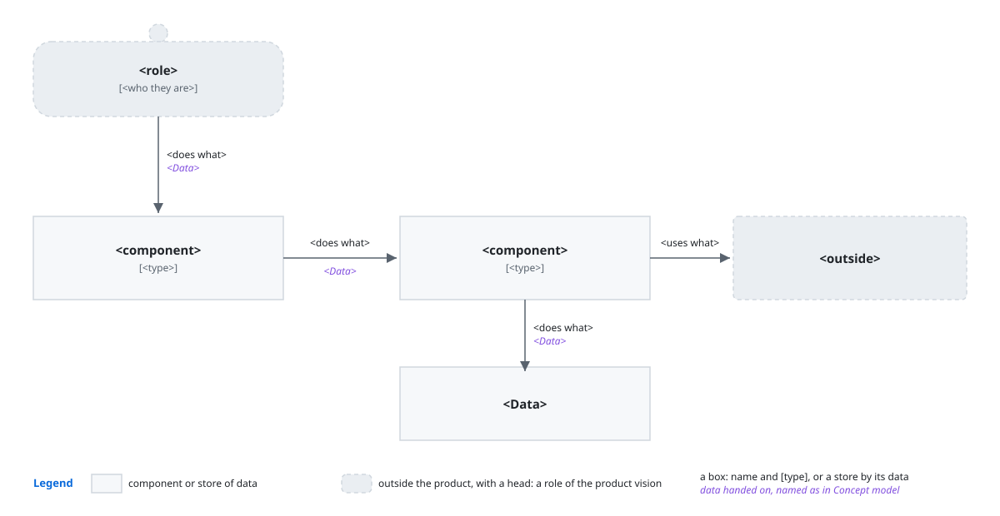
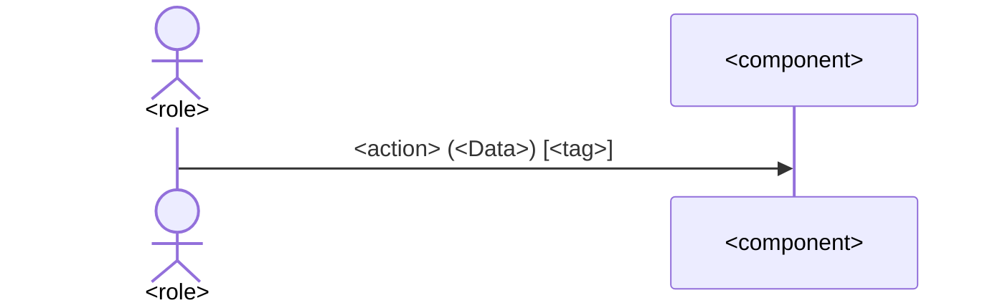
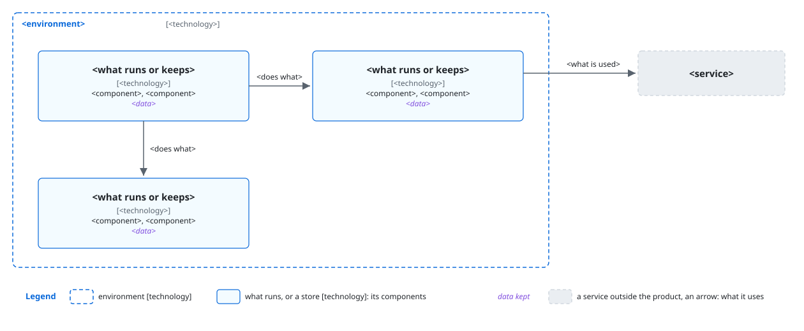

# `<Product>` architecture

## User stories

- `S<n>`: `<role>` wants `<want>`.

> [!NOTE]
> DELETE_TEMPLATE_COMMENT:
> - `<role>`: a role of the product vision, as the product vision names it, or the product's
>   developer or operator for a need of development or operation.
> - `<want>`: a value that the story brings its role on its own, such as the deliverable they're
>   after, or a pause and a pick-up, in the role's words and without the product's means.
> - The stories together cover each objective of the product vision and each promise of the README.

## Solution strategy

### Principles

`<idea>`.

- `P<n>`: `<value>`
  - `P<n>.<m>`: `<decision>`.

> [!NOTE]
> DELETE_TEMPLATE_COMMENT:
> - `<idea>`: the one idea by which the product delivers what the README promises, from the
>   sentence that opens the product vision's Concept, in one sentence.
> - `<value>`: what the principle values, in a few words.
> - `<decision>`: one decision that carries out the principle, in one sentence, with no name that a
>   later section decides, such as a component, a data, a tool, or a count.

### Data model


- `<Data>`\
  `<purpose>`.

Strategies:

- `<strategy>`. [`<tag>`]\
  Intent: `<intent>`.

> [!NOTE]
> DELETE_TEMPLATE_COMMENT:
> - The figure: the deliverable's own at images/data-model.svg, the product named in its alt text.
>   It draws the data as a concept model in a class diagram of the Unified Modeling Language. Each
>   data is a class by its name alone. Each relation between two data has its name, and how many of
>   each it joins at both ends.
> - `<Data>`, `<purpose>`: each data by its name, and what it's for, in one or two sentences, with
>   no role's name.
> - `<strategy>`, `<tag>`, `<intent>`: each decision of the view, in one sentence, a decision that
>   the implementation spells out item by item stated as its policy; the story or principle item
>   that it carries out, such as P1.1; and its purpose alone, in one sentence. An intent names no
>   means and no key result's ID. Leave out Strategies where the view takes no decision.

### Components



- `<component>` (`<type>`)\
  `<role>`.

Strategies:

- `<strategy>`. [`<tag>`]\
  Intent: `<intent>`.

> [!NOTE]
> DELETE_TEMPLATE_COMMENT:
> - The figure: the deliverable's own at images/components.svg, the product named in its alt text.
>   It draws the roles and how they act on one another and on the data, with no implementation's
>   name. Each box holds its name and its type. Each arrow says what one does to another, with the
>   data it hands on, named as in Data model. A legend explains every symbol.
> - `<component>`, `<type>`, `<role>`: each component, by its name in the figure; its type, such as
>   prompt or script; and its expected role, what it answers for, not its tasks, in one sentence.
> - `<strategy>`, `<tag>`, `<intent>`: as in Data model.

### Sequences

#### `S<n>`: `<path>`



Strategies:

- `<strategy>`. [`<tag>`]\
  Intent: `<intent>`.

> [!NOTE]
> DELETE_TEMPLATE_COMMENT:
> - One section for each user story.
> - `<path>`: what the story does, in a few words.
> - `U`, `A`: a short ID for each one that takes part, used in the messages.
> - `<role>`, `<component>`: the role of the story, and each component and data it reaches, as Data
>   model and Components name them.
> - `<action>`, `<Data>`, `<tag>`: one action on each arrow; the data it hands on, in parentheses;
>   and the story or principle item that it carries out, in brackets, on each arrow and each branch
>   condition.
> - `<strategy>`, `<tag>`, `<intent>`: as in Data model.

### Deployment



`<start>`.

Strategies:

- `<strategy>`. [`<tag>`]\
  Intent: `<intent>`.

> [!NOTE]
> DELETE_TEMPLATE_COMMENT:
> - The figure: the deliverable's own at images/deployment.svg, the product named in its alt text.
>   It holds each environment the product runs in, such as the user's computer or CI, what runs in
>   it, each store of data, and each service outside the product, with no process or other unit of
>   the implementation.
> - `<start>`: how the product starts, in one sentence.
> - `<strategy>`, `<tag>`, `<intent>`: as in Data model.

### Directory structure

```text
<path>  <holds>
```

Strategies:

- `<strategy>`. [`<tag>`]\
  Intent: `<intent>`.

> [!NOTE]
> DELETE_TEMPLATE_COMMENT:
> - `<path>`, `<holds>`: each folder, by its real name, nested as on disk, with only the vital few
>   files; and beside each top folder, its purpose, such as what Claude Code installs for the user.
> - `<strategy>`, `<tag>`, `<intent>`: as in Data model.

## Test strategy

| Check | Test target | Kind | Exit criteria or measure |
|---|---|---|---|
| `<check>` | `<target>` | `<kind>` | `<criterion or measure>` |

> [!NOTE]
> DELETE_TEMPLATE_COMMENT:
> - `<check>`, `<target>`: each check of [the test strategy guide](test-strategy-guide.md) to pick
>   always, and each other whose condition the product meets, in its order, with its test target as
>   the guide gives it. A check left out has no row.
> - `<kind>`: `Quality` or `Benchmark`, as the guide gives it, or `Benchmark` where the test runs a
>   prompt.
> - `<criterion or measure>`: for a quality, what passes, as a number where it's one, as the guide
>   recommends unless the row says why not; for a benchmark, what it measures. No tool and no
>   means.
