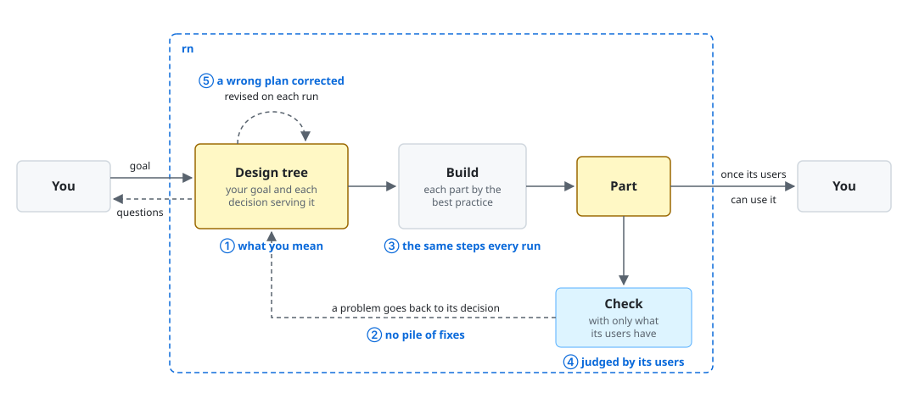

# rn

rn is a Claude Code plugin that makes what you ask for, such as a document, code, or a plugin, so
that the people it's for can use it for what they're after.

rn 0.9.0 is being rebuilt, and the rebuilt rn isn't released yet. Its code isn't built yet, so
don't install it for your work today. The walkthrough below shows what rn sets out to do. It isn't
the output of a recorded run.

rn is for you when you have Claude Code make something in a GitHub repository for other people to
use, such as readers, users, or teammates. Often, you get something that looks done, and then you
find that it isn't what you meant, or that its people can't use it. With rn, you get each
deliverable you mean, one its people can use, and you spend your own time only on the questions
that are yours to decide.

## Non-goals

- rn doesn't put the deliverable in front of real people. Its evaluators are AI subagents that read
  the deliverable as its people would.
- rn doesn't finish on its own where your goal leaves a question open. It stops, asks you, and
  waits for your answer.
- rn doesn't make a small change faster than Claude Code alone. It plans each deliverable, and its
  evaluators read it again after each round, with no set limit on rounds. For a one-line fix, ask
  Claude Code directly.
- rn doesn't merge. It leaves one draft pull request, and you merge it.

## Requirements

- macOS or Linux: `uname` shows `Darwin` or `Linux`.
- Claude Code 2.1.319 or later: `claude --version` shows it.
- Python 3.9 or later, run as `python3`: `python3 --version` shows it.
- Git: `git --version` shows it.
- The GitHub command-line tool `gh`, logged in to GitHub: `gh auth status` shows `Logged in to github.com`.
- Your work in a GitHub repository that you can push to: at the repository's root,
  `gh repo view --json viewerPermission` shows `WRITE`, `MAINTAIN`, or `ADMIN`.

## Installation

```console
claude plugin marketplace add lovaizu/ccpm
claude plugin install rn@ccpm
```

`claude plugin list` then shows `rn@ccpm` and `lane@ccpm`. Installing rn installs Lane with it.
To see that rn works, start Claude Code at the root of your repository and type `/rn:up` alone.
rn says that it has no run to pick up.

## Walkthrough

At the end, you have a draft pull request that adds type hints to every file of your library. The
code of the people who call the library is then checked against those hints. You typed `/rn:up`
twice and answered two questions.

`invoicer` is a Python library on GitHub that other teams call to total their invoices. It has no
type hints, so a caller learns of a wrong argument only when their code fails. In Claude Code, at
the root of the repository of `invoicer`, you type:

```text
/rn:up type hints for invoicer, so that the people who call it see what each function takes
```

rn shows:

```text
The goal, as I'd put it:
  The people who call invoicer learn from their editor and their type checker what each
  function takes and returns, before their code runs.
Is that what you're after?
```

You type:

```text
yes
```

rn shows:

```text
The plan:
  1. Type hints in the code of invoicer, checked by mypy --strict
  2. invoicer marked as typed, so that the callers' type checkers read its hints

A question that's yours:
  Should the hints cover each file, or only the functions that callers import?
  I recommend only those functions, as they're all that callers see.
```

You type:

```text
each file
```

rn makes the first deliverable and asks nothing more. You close Claude Code before rn finishes. The
next day, in a new conversation at the root of the repository, you type:

```text
/rn:up
```

rn shows:

```text
Picking up "type hints for invoicer", at "invoicer marked as typed".
```

Once rn finishes, it shows:

```text
Done. Draft pull request: https://github.com/<owner>/invoicer/pull/12

Decisions I took without asking:
- Added src/invoicer/py.typed, as type checkers skip a library's hints without it.
- Typed amounts and rates as Decimal, as the code already computes with Decimal.
```

A caller who installs the branch of the pull request and passes the tax rate as text in `app.py`:

```python
from decimal import Decimal
from invoicer import Line, total

lines = [Line("Hosting", Decimal("40.00"))]
print(total(lines, "0.19"))
```

gets this from mypy before the code runs:

```console
$ mypy app.py
app.py:5: error: Argument 2 to "total" has incompatible type "str"; expected "Decimal"  [arg-type]
Found 1 error in 1 file (checked 1 source file)
```

You then merge the draft pull request.

## How it works

In everything it does, rn works only on the few things that decide whether the people a deliverable
is for can use it, and leaves out the rest.



### "I can't spell out every detail up front, so it builds the wrong thing."

rn drafts your goal from your request, and you confirm it. It then asks you the decisions under
that goal, one at a time and each with its recommendation, and keeps them in a design tree. The
design tree is rn's record of your goal and every decision under it. rn asks only the decisions
that change what the people get, and plans again after each answer and each finished deliverable.
So you get the deliverable you mean without writing a specification.

### "Its output misses what this kind of work needs."

rn plans, makes, and asks by the best practice for each kind of deliverable: one for a README, one
for code, and so on. A best practice holds the few things that its kind of work needs. Where rn has none for a
kind, it makes one before the first deliverable of that kind. What a best practice settles, rn
settles without asking you, and lists in its report.

### "It looks done, but the people it's for can't use it."

Before rn hands a deliverable over, its evaluators, AI subagents, read it as its people would. They
get only what those people have, never what rn meant. rn makes the deliverable again, round after
round, until the evaluators find each of its aims met for those people. So rn improves only what the
people need, and you get a deliverable they can use.

### "Each fix breaks something else."

rn takes each shortfall back to the decision it comes from, changes that decision, and makes the
deliverable again from the design tree. It doesn't patch the deliverable. A shortfall that the
people would never meet changes nothing. So a fix holds, and the deliverable doesn't grow with each
round.

### "Does it skip a step when no one watches?"

No. Lane, a plugin installed with rn, holds each part of rn to the steps of its best practice on
every run. Lane stops a call that leaves those steps, and shows the part the step it's on. The
steps hold the few things that the work needs, so none of them goes missing.

### "Does it change the repository's files, or merge on its own?"

No. rn tries a deliverable as its people would, so it runs the deliverable's commands only in a
throwaway copy of your repository, with a throwaway home folder. It commits each answer and each
deliverable on its own branch, so you never answer a question twice, even after a closed
conversation. It leaves one draft pull request, and the merge is yours.

## Documentation

- [Changelog](../../../CHANGELOG.md): for you after an update, the changes in each version.
- [Lane](../../../../lane/README.md): for you if you want to know what Lane does, or use it in a plugin of
  your own.
- [Issues](https://github.com/lovaizu/ccpm/issues): where you ask for help or report a fault.

## License

[MIT](../../../../../LICENSE)
