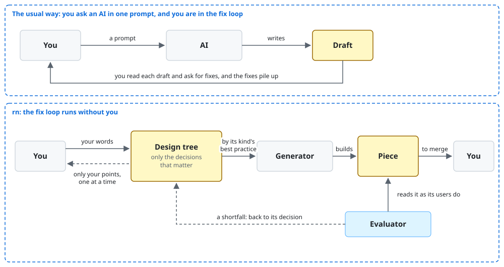
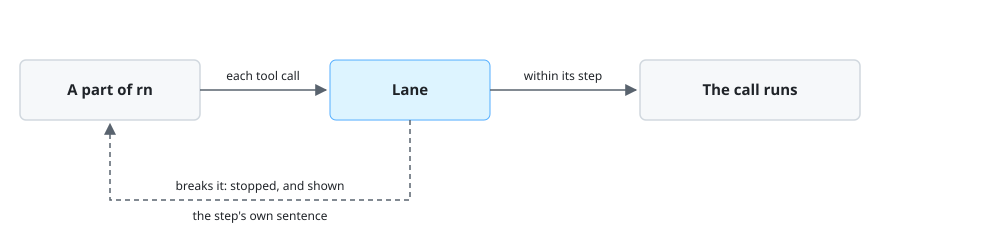

# `rn`

rn is a Claude Code plugin that builds what you ask for, such as a document, code, or a plugin, so
that the people who use it can do what they need with it.

rn is being rebuilt. This README describes the rebuilt rn, which isn't released yet. Until its release,
the installation below installs the earlier rn 0.9.0, which works differently, and the walkthrough
shows the run that the design of the rebuilt rn lays out, not a recorded run.

rn is for you when you want an AI to build work made of several pieces, such as a feature with its
README and its code, and you'd rather answer a few questions than read and fix drafts. With it, you
hand over work that its users can use without fixes, and rn asks you only what it can't decide
itself.

## Non-goals

- rn doesn't decide your purpose or what you want. When rn leaves a question to you, the work that
  depends on it waits for your answer.
- rn isn't for a quick draft that you'll fix yourself. It plans, builds, and tests each piece, so it
  takes longer than a single prompt to Claude Code.
- rn doesn't merge your work. It commits each piece to a branch and leaves one draft pull request
  for you to merge.

## Requirements

- macOS or Linux: `uname` shows it. No one has tried rn on Windows yet.
- Claude Code 2.1.319 or later: `claude --version` shows it.
- Python 3.9 or later, run as `python3`: `python3 --version` shows it.
- git, and the GitHub command-line tool `gh` signed in to the repository's host: `gh auth status`
  shows it. rn keeps your work in a draft pull request.

## Installation

```console
claude plugin marketplace add lovaizu/ccpm
claude plugin install rn@ccpm
```

`claude plugin list` then lists `rn@ccpm`, and `lane@ccpm`, which comes with it.

## Walkthrough

At the end, your tool `tidy` has a dry-run option, and its README shows how to use it. You've
answered two questions and typed `/rn:up` twice.

`tidy` sorts a Downloads folder into subfolders by file type. You want it to show what it would
move before it moves anything. In Claude Code, at the root of its repository, you type:

```text
/rn:up tidy should show what it would move, without moving it
```

rn shows:

```text
Goal: before sorting their Downloads folder with tidy, a user sees what it would move, so that
nothing moves that they didn't intend. Is that what you want?
```

You answer `yes`. rn shows:

```text
Plan, working back from the goal:
1. README.md: describe the dry run in the Walkthrough, so that the code is built to match what
   the reader is told.
2. tidy/cli.py: add the --dry-run option, with tests.

Question 1 of 1 for README.md: should the dry run list each file with its target folder, or only
a count for each folder? Either would work. I recommend listing each file, because users check
file names before they move anything.
```

You answer `each file`. rn updates README.md, and you close Claude Code before it continues. The
next day, in a new conversation, you type:

```text
/rn:up
```

rn shows:

```text
Picking up "tidy shows what it would move" at step 2, tidy/cli.py. README.md is done.
```

Later, rn shows:

```text
Done: README.md and tidy/cli.py are updated, with tests/test_dry_run.py. Each piece was read and
tried as its users would use it, and gives them what they need from it.

Decided without asking you:
- The README shows tidy --dry-run before tidy, because users check first.   (README best practice)
- --dry-run prints each move as "<file> -> <folder>", as the README shows.   (README.md)
```

## How it works



1. Each round of fixes adds to the draft, and the few points that matter get lost among the many
   that don't.

   rn keeps in a design tree only the decisions that matter to the goal, and builds each piece from
   them by the best practice for its kind. A shortfall changes the decision it comes from, not the
   piece.

2. You or an AI judge the draft by how it reads, not by whether its users can use it.

   A second AI, the evaluator, reads each piece as its users would. rn builds the piece again until
   its users get what they need from it.

3. The AI guesses what only you know, and asks you what it could find out itself.

   rn asks you one point at a time, and only what your purpose and the best practices leave open. It
   decides the rest, and reports those decisions at the end.

4. The AI builds the one piece you asked for, and misses the other pieces it needs, or builds them
   in the wrong order.

   rn lists every piece your goal needs, in the order to build them, and builds them from the first.
   It plans again after each answer and each piece.

5. The AI keeps a step one time and skips it the next, and a new conversation starts the work over.

   Lane, a plugin installed with rn, holds each part of rn to its steps on every run. Your
   repository keeps the work, so `/rn:up` goes on where it stopped.

### Which points does rn ask you?

| Point in the walkthrough | Settled by | Why |
| --- | --- | --- |
| Should the dry run list each file, or a count for each folder? | you | Either would work, and your purpose doesn't say which your users need. |
| The README shows `tidy --dry-run` before `tidy`. | rn | The README best practice puts first what the reader does first. |
| `--dry-run` prints each move as `<file> -> <folder>`. | rn | README.md, already done, shows that output. |

rn settles a point itself when your purpose, a best practice, or a piece already done answers it.
It asks you the rest, with the option it recommends.

### How can an AI judge another AI's work?

| | Generator, which builds the piece | Evaluator, which judges it |
| --- | --- | --- |
| What the piece's users need from it | yes | yes |
| The decisions in the design tree | yes | no |
| The best practice's steps | yes | no |
| The piece, and a record of it tried in a throwaway copy | builds them | yes |

The evaluator gets only what the piece's users have. It judges what they get, not what the
generator meant.

### Won't rn's fixes pile up too?

rn takes a shortfall that the evaluator names only where the users would fall short without it,
and then changes the decision the shortfall comes from. The next round builds the piece from the
design tree again, so every part of the piece rests on a decision.

### How does rn follow every step, every time?



Lane watches each tool call that each part of rn makes. When a part breaks a step, such as by
running a command that the step doesn't name, Lane stops the call and shows the part the text of
that step. The part then returns to the step.

### What if the conversation ends partway?

rn commits each decision and each finished piece to your work's branch as it goes, in the folder
`.rn/<date>-<goal>/` and at the piece's own path. `/rn:up` alone, in a new conversation, reads that
folder and goes on from the next step, so you never answer a point twice.

### What if rn has no best practice for your kind of work?

rn first makes one, by its best practice for best practices, and keeps it in the folder
`.rn/<date>-<goal>/`. It then builds your piece by it.

## Documentation

- [Lane](../../../../lane/README.md): how Lane enforces each step.
- [Changelog](../../../CHANGELOG.md): the changes in each version.
- [Issues](https://github.com/lovaizu/ccpm/issues): where to ask for help or report a bug.

## License

[The `MIT` License](../../../../../LICENSE)

rn's way of asking one question at a time with a recommendation comes from
[grilling](https://github.com/mattpocock/skills/blob/4ae2317ddb22b046e26455e4f9c9b3aaaf62212d/skills/productivity/grilling/SKILL.md),
by Matt Pocock, under the `MIT` License in [LICENSE-grilling](../../../LICENSE-grilling).
