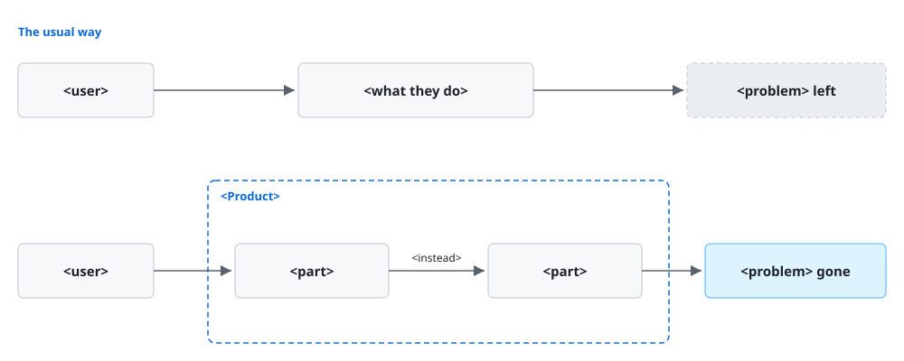
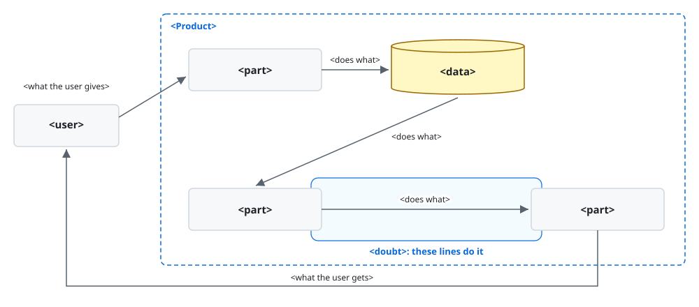

# `<Product>`

`<Product>` is `<kind>` that `<what it gives>`.

`<status>`.

`<Product>` is for you when `<your situation>`. With it, you `<benefit>`.

> [!NOTE]
> DELETE_TEMPLATE_COMMENT:
> - `<kind>`: the kind of thing the product is, such as a command-line tool.
> - `<what it gives>`: the one thing the product gives the reader, in words the reader already uses.
> - `<status>`: where the product isn't yet fit for use, such as a release still in development.
>   Leave it out where the product is ready for use.
> - `<your situation>`: the work the reader wants done.
> - `<benefit>`: what the reader achieves with the product.

## Non-goals

- `<Product>` doesn't `<expectation>`.

> [!NOTE]
> DELETE_TEMPLATE_COMMENT:
> - `<expectation>`: each thing a reader might expect of the product that it doesn't do. Leave out
>   Non-goals where there's none.

## Requirements

- `<requirement>`: `<check>` shows it.

> [!NOTE]
> DELETE_TEMPLATE_COMMENT:
> - `<requirement>`: each thing that must be in place before installing.
> - `<check>`: a command whose output shows the reader they have it.

## Installation

```console
<command>
```

`<sign>`.

> [!NOTE]
> DELETE_TEMPLATE_COMMENT:
> - `<command>`: each command that installs the product.
> - `<sign>`: what shows the reader that the installation worked.

## Walkthrough

At the end, you have `<result>`.

`<situation>`. You type:

```<language>
<input>
```

`<Product>` shows:

```<language>
<output>
```

> [!NOTE]
> DELETE_TEMPLATE_COMMENT:
> - `<result>`: what the reader has once the run ends.
> - `<situation>`: what the run starts from, in one sentence.
> - `<input>`, `<output>`: what the user gave and what the product showed in a real run, as they
>   were, in the form the reader meets them. One pair goes for each exchange up to the result.
> - `<language>`: the language of the text, such as console, python, or json. A screen goes in place
>   of its code block, as an image taken from the run and kept in images/.

## How it works



`<problem>`.

`<how it goes away>`.

### `<doubt>`



`<how it does it>`.

[`<title>`](<path>)

> [!NOTE]
> DELETE_TEMPLATE_COMMENT:
> - The first figure: the deliverable's own, at images/problem.svg, with the product named in its
>   alt text. The skeleton here is one such form: the way the reader would do the work without the
>   product on top, and the product below it, with the problem left in the one and gone in the other.
> - `<problem>`, `<how it goes away>`: the problem that brings the reader to the product, in their
>   words, and in a sentence or two what the product changes that makes it go away, each a
>   paragraph of its own.
> - The second figure: what shows how the product does the doubted thing, under the doubt's
>   heading, before its paragraph. It's a figure of the deliverable's own at images/how-<name>.svg
>   with the product named in its alt text, a table, or the real thing from the walkthrough's
>   example, such as a message. The skeleton here is one such form: the user, the product's parts
>   and what they pass, with the lines that do it marked. Leave it out where the paragraph is
>   enough.
> - `<doubt>`, `<how it does it>`: for each key result of the product, the newcomer's doubt that the
>   product achieves it, as they would ask it, as a heading of its own, and in a sentence or two
>   how the product does it.
> - `<title>`, `<path>`: the page that explains it further, where it needs a long sequence of
>   figures. Leave it out where the paragraph is enough.

## Documentation

- [`<title>`](<path>): `<what it gives>`.

> [!NOTE]
> DELETE_TEMPLATE_COMMENT:
> - `<title>`, `<path>`: each document a reader goes to next, by a path relative to the README, and
>   the place they get help, such as an issue tracker, by its URL. Leave out Documentation where
>   there's none.
> - `<what it gives>`: for whom the document or the place is and what it gives them.

## License

[`<license>`](<path>)

> [!NOTE]
> DELETE_TEMPLATE_COMMENT:
> - `<license>`: the name of the license.
> - `<path>`: the license's full text.
