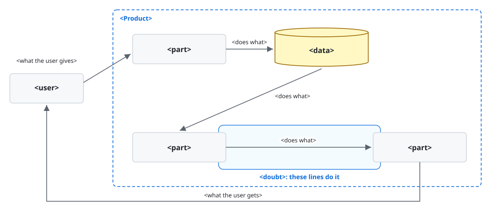

# `<Product>`

`<Product>` is `<kind>` that `<what it gives>`.

`<status>`.

`<Product>` is for you when `<your situation>`. With it, you `<benefit>`.

> [!NOTE]
> DELETE_TEMPLATE_COMMENT:
> - `<kind>`: the kind of thing the product is, such as a command-line tool.
> - `<what it gives>`: the one thing the product gives the reader, in words the reader already uses.
> - `<status>`: where the product isn't yet fit for use, such as a release still in development.
>   Leave it out where the product is ready for use.
> - `<your situation>`: the work the reader wants done.
> - `<benefit>`: what the reader achieves with the product.

## Non-goals

- `<Product>` doesn't `<expectation>`.

> [!NOTE]
> DELETE_TEMPLATE_COMMENT:
> - `<expectation>`: each thing a reader might expect of the product that it doesn't do. Leave out
>   Non-goals where there's none.

## Requirements

- `<requirement>`: `<check>` shows `<sign>`.

> [!NOTE]
> DELETE_TEMPLATE_COMMENT:
> - `<requirement>`: each thing that must be in place before installing.
> - `<check>`: a command whose output shows the reader they have it.
> - `<sign>`: what in that output shows they have it, or "it" where the output names the requirement itself,
>   such as a version.

## Installation

```console
<command>
```

`<sign>`.

> [!NOTE]
> DELETE_TEMPLATE_COMMENT:
> - `<command>`: each command that installs the product.
> - `<sign>`: what shows the reader that the installation worked.

## Walkthrough

At the end, you have `<result>`.

`<run>`

> [!NOTE]
> DELETE_TEMPLATE_COMMENT:
> - `<result>`: what the reader has once the run ends.
> - `<run>`: a real run on typical work, from what the reader gives to the result in use, in the
>   form the reader meets it, such as a terminal's text in code blocks for a command-line tool, or
>   screens taken from the run, kept in images/, for an app. Its form follows the product, so the
>   template sets none.

## How it works

`<the one way>`.



### `<problem or doubt>`

`<answer>`.

> [!NOTE]
> DELETE_TEMPLATE_COMMENT:
> - `<the one way>`: the one way that the product vision's concept puts first, in the reader's
>   words, as what they see the product do in their work, in one sentence.
> - The figure: the deliverable's own, at images/how-it-works.svg, with the product named in its alt
>   text. It shows the product's mechanism as one flow below the one way, with each problem and
>   doubt beside the part that answers it, and what the reader gets from that part. The skeleton
>   here is one such form.
> - `<problem or doubt>`, `<answer>`: each problem or doubt that would change whether the reader
>   tries the product, as they would say it, as a heading of its own, and in a sentence or two the
>   part of the mechanism that answers it, how it follows from the one way, and what the reader
>   gets from it.

## Documentation

- [`<title>`](<path>): `<what it gives>`.

> [!NOTE]
> DELETE_TEMPLATE_COMMENT:
> - `<title>`, `<path>`: each document a reader goes to next, by a path relative to the README, and
>   the place they get help, such as an issue tracker, by its URL. Leave out Documentation where
>   there's none.
> - `<what it gives>`: for whom the document or the place is and what it gives them.

## License

[`<license>`](<path>)

- `<work>`: [`<its license>`](<its path>)

> [!NOTE]
> DELETE_TEMPLATE_COMMENT:
> - `<license>`: the license's identifier in the SPDX License List, such as MIT.
> - `<path>`: the license's full text, by its path from the README's folder.
> - `<work>`, `<its license>`, `<its path>`: each work of others that the product holds, such as a
>   copied library, with its license's identifier and the path of its full text. Leave out the list
>   where there's none.
