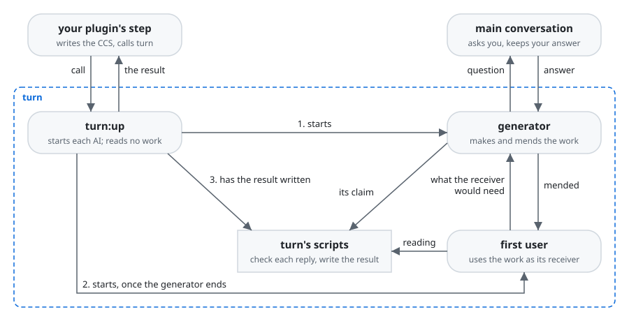

# turn

turn is a Claude Code plugin that has AI make the work a step of your plugin asks for, such as a
document or code, and returns it meeting the step's checklists, read first by an AI that did not
make it.

An AI that makes a work and checks it itself finds what it meant to give, not what the work's
reader gets from it. It decides points no one gave it where no one sees them. A point only the user
can decide reaches them, if at all, after the work is made on a guess.

With turn, your plugin's step gets back a work it can trust item by item: each item of its
checklists comes with the lines of the work that meet it, so the step checks the work by reading
those lines and goes on. Anyone who builds a plugin whose steps have AI make documents or code
gains this, for every step and every run.

turn does this by keeping apart the AI that makes the work and the AI that reads it:

- Your step writes its task in a CCS, a JSON file of what is decided, the work's paths, its
  checklists and its receiver, the one the work is for. A checklist lists what the receiver should
  get from the work, one item each, asked as a question. An item's Good is the judgment that the
  receiver gets what the item asks, with the lines of the work that give it.
- The generator, an AI, makes the work from the CCS and the files it names alone. It sends each
  point only the user can decide to the main conversation, the one you talk with, as soon as it
  meets it, and settles every other point itself, naming each choice with why.
- The first user, an AI that did not make the work, then uses it in the receiver's place, with
  what the receiver has. For each item it gives the lines that give its Good, or tells the
  generator in one sentence what the receiver would need. The generator mends the work, and the
  first user reads it again.
- turn's scripts check each reply of the two AIs, and write the result your step reads. Hooks
  from lane, a plugin whose code turn carries in `hooks/lane/`, hold each AI to its steps.

**Non-goals**

- turn judges each item by what the receiver gets with what they have, not by whether the work
  matches its sources.
- turn does not ask the user itself; the main conversation asks them, whether your step runs there
  or in an agent below it.
- turn does not make an item it leaves without its Good; it returns the item with what the receiver
  would need, and your step makes it.
- turn's AIs run no `git commit` or `git push`; the work is left at its paths for your step.
- turn has no command for a person to type; your plugin's step calls it.

## Requirements

- Claude Code, in which turn runs.
- Python 3.9 or later, run as `python3`.

  turn's scripts and hooks run on Python.
- A step that calls turn from the main conversation, or from an agent the main conversation
  started.

  turn's agents take the two layers of agents below the one that calls it, and Claude Code starts
  agents down to three layers below the main conversation.

## Installation

turn comes from ccpm, a marketplace of Claude Code plugins on GitHub. Add it, then install turn:

```console
claude plugin marketplace add lovaizu/ccpm
claude plugin install turn@ccpm
```

`claude plugin list` then shows turn:

```console
$ claude plugin list
Installed plugins:

  ❯ turn@ccpm
    Version: 0.1.0
    Scope: user
    Status: ✔ enabled
```

## Walkthrough

This is the UX's scene [From a step that needs a work to the step's end](../../dev/turn/ux.md#from-a-step-that-needs-a-work-to-the-steps-end),
with [A point only the user can decide](../../dev/turn/ux.md#a-point-only-the-user-can-decide), run
on a real task: the README of csvtidy, a one-file tool that tidies a CSV file. The output below is
what the run gave back.

Your plugin's step has the user's decisions in `notes/readme.decisions.md` and a checklist for
READMEs in `checklists/readme.md`. It writes its task in a CCS, `.tasks/ccs.json`, every kind in it
your plugin's own:

```json
{"focal_entities": [{"deliverable": "README.md"},
                    {"audience": "someone who cleans CSV exports by hand before their scripts read them, finding csvtidy on GitHub"}],
 "goal_orientation": [{"purpose": "to tidy their own CSV file with csvtidy"}],
 "retrieved_artifacts": [{"checklist": "checklists/readme.md"},
                         {"has": "csvtidy.py"},
                         {"decisions": "notes/readme.decisions.md"}]}
```

The step's text then starts turn with the call. The call names the CCS, where to write the result,
the kind in the CCS that holds each thing turn needs, and the one command that checks the work, or
`null` where the work has none, as here:

```
Start the `turn:up` agent in the background with
{"ccs": ".tasks/ccs.json", "result": ".tasks/result.json", "test": null,
 "kind": {"work": "deliverable", "checklist": "checklist", "receiver": "audience",
          "use": "purpose", "has": "has", "each": "each"}}
```

No decision says under which license csvtidy is, so the generator sends the main conversation that
question as a message, and makes the rest of the work meanwhile:

```json
{"question": "The README needs a License section, but the repository has no LICENSE file and neither the CCS nor notes/readme.decisions.md says which license csvtidy is under. Which license should csvtidy be under (and should a LICENSE file be added to the CCS as a file of the work)?",
 "recommended": "MIT, with a LICENSE file added to the CCS as a work entry, because it is the usual choice for a small single-file tool that people copy into their own projects, and a README link to a LICENSE file is what lets the reader tell the terms of use.",
 "items": [{"checklist": "checklists/readme.md", "item": "Q-6"}]}
```

The main conversation asks you, adds your answer to `notes/readme.decisions.md` and `LICENSE` to
the CCS, and sends the answer back to the generator with SendMessage. In this run the generator
asked three more questions the same way: the copyright line, a figure to add to the work as
`docs/how-it-works.svg`, and leave to write files outside the work, which was refused. You see each
of turn's agents in Claude Code's panel of agents while it runs.

When turn returns, `README.md` and `LICENSE` are in place, and `.tasks/result.json` holds the lines
of each item's Good, the items left without it, and each choice the generator made on its own:

```json
{"work": ["README.md", "LICENSE", "docs/how-it-works.svg"],
 "items": [{"checklist": "checklists/readme.md", "item": "Q-1", "lines": ["README.md:1-42"]},
           {"checklist": "checklists/readme.md", "item": "Q-2", "lines": ["README.md:10-12"]},
           ...],
 "left": [],
 "chosen": [{"chosen": "Installation is: copy csvtidy.py, via GitHub's \"Download raw file\"; the check is running it with no arguments to see the usage line.",
             "why": "The decisions note says installing is copying the file, and the repository has no remote URL to give a download command for."},
            ...]}
```

Your step reads lines 10 to 12 of `README.md` and the others it is pointed to, makes any item left
itself, shows the user each choice made without asking them, and ends.

## How it works



turn is three agents, `turn:up`, the generator and the first user, each with its steps; the Python
scripts they run; and lane's hooks. Each agent starts in a context of its own, so the first user
holds nothing of how the work was made and finds only the Good the work's lines give. The scripts
give each agent only its files, and check each reply before the agent ends, so a Good comes back
only at lines the work holds. The hooks hold each agent to its steps, such as reading only its
files and writing only the work or its reply, so the work rests on the CCS alone. Who does what in
which order is in the UX's [scenes](../../dev/turn/ux.md#scenes).

## Documentation

- [Calling turn](docs/calling.md) gives the checklist's form, the CCS, the call, the questions and
  the result in full.
- [The changelog](CHANGELOG.md) says what changed in each version.

## Development

[turn's development folder](../../dev/turn/README.md) leads to its UX, its architecture and how it
is checked.

## License

[MIT License](../../LICENSE)
