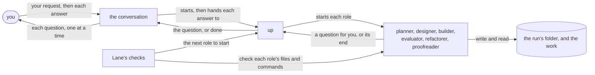

# Turn

Turn is a Claude Code plugin that makes a work you ask for, such as a README or a module of code,
and makes it again until it meets your purpose well.

Turn is for you when you want a work you can put to use as it is handed to you, and you would
rather answer a few questions than mend a draft. You answer only what is yours to decide, such as
whom your README is for. Turn finds the facts itself, such as what your tool prints. Turn is also
for a plugin that makes things for a person, such as rn: it hands Turn what it has already settled,
and gets back the work.

Asked alone, an AI writes from what it happens to know, and judges its own work. Turn starts from
how good works of the same kind are made, and has the work judged by an AI that did not make it.

- **A template for each kind.** A kind is what sort of work it is, such as a README or a man page.
  Its template holds the parts a good work of the kind has, and questions that a good work answers
  yes to, such as "After the walkthrough, can the reader tell that the product would give them the
  gain on work of their own?". Turn ships templates for READMEs, UX documents, architecture
  documents, code and prompts. For a kind it does not know, Turn first researches how good works of
  it are made, and has you approve the purpose and the questions before it uses them.
- **A design from your purpose.** Turn asks your purpose for this one work, then settles each
  decision the template's questions need, such as which use the walkthrough shows. It finds each
  fact itself and shows it to you to confirm. It asks you each decision that is yours, one at a
  time, with a recommendation. You approve the design before anything is made. Turn does this
  with [pin](../pin/README.md), a plugin installed with Turn.
- **Used by an AI that did not make it.** Once the work is made, another AI uses it as its user
  would. It is given the work and the template's questions, not the design, as the work's user
  never sees the design. It answers each question with the lines of the work that meet it, or with
  what the user would still need. A question not yet met goes back to the decision behind it, which
  is decided again, and the work is made again from there.
- **Then how it reads.** Once every question is met, Turn improves how the work says what it says,
  such as a sentence that must be read twice to be understood, and checks it again. What the work says stays.
- **At once where it can.** Parts of the work that stand apart, such as two modules that use
  nothing of each other, are made and checked at the same time, so you wait less. A part is not
  split where that would make it worse.

**Non-goals**

- Turn does not check whether the work gets you what you want it for in the world, such as whether
  a README brings its tool more users. Turn checks the work against your purpose and its kind's
  questions; the world's answer is yours to see.
- Turn is not for a quick draft. Asking, making and checking take longer than asking Claude Code
  alone. A kind new to Turn takes longer still, the first time.
- Turn does not commit, push or publish the work. It writes the files, and you choose what happens
  to them.
- Turn does not decide for you what is yours. A question left unanswered holds the run where it is.

## Requirements

- Claude Code 2.1.317 or later: `claude --version` shows its version.
- Python 3.9 or later, run as `python3`: `python3 --version` shows its version.
- Claude Code run as a conversation in a terminal or an app, not as `claude -p`. Turn's roles run
  in the background, and `claude -p` does not hand a role's end back to the role that started it.

## Installation

```console
claude plugin marketplace add lovaizu/ccpm
claude plugin install turn@ccpm
```

`claude plugin list` then lists `turn@ccpm`, and `pin@ccpm`, which Turn depends on and which is
installed with it. In a new Claude Code session, `/turn:up` is then one of its commands.

## Walkthrough

At the end, you have a README for your tool that its readers can use as it is, and you have
answered only what was yours.

This walkthrough is not yet from a real run: it shows what Turn is being rebuilt to show, and its
output is replaced by a real run's once Turn is built.

Your tool `tidy` sorts a Downloads folder into folders by type. Its repository has the code and no
README. In Claude Code, at the root of the repository, you type:

```text
/turn:up a README for tidy
```

Turn's first question settles the kind:

```text
Turn: A README for tidy, a document. Right?
```

You answer `right`. While Turn reads what `tidy` does, it asks the purpose of this README:

```text
Turn: The purpose: someone who keeps a cluttered Downloads folder learns what tidy does, installs
it, and sorts their folder with it. Is that the purpose?

Recommendation: yes. The repository has no other documents, so the README is where a newcomer
starts.
```

You answer `yes`. Turn shows each fact it found that a decision rests on, alone:

```text
Turn: Found: tidy/cli.py:22 "parser.add_argument('--dry-run', action='store_true')", so tidy can
show what it would move without moving anything. Right?
```

You answer `right`, and Turn asks the next decision that is yours:

```text
Turn: Which run does the walkthrough show?

Recommendation: tidy --dry-run on a folder of five files, then tidy itself, so the reader sees
what moves before anything moves. Yes?
```

Questions and facts go on like this, one at a time. Turn settles itself what follows from the
purpose and the facts, such as putting Python 3.9 under Requirements, as `setup.cfg` names it. Then
it shows you the design:

```text
Turn: The design of the README:
- Purpose: a newcomer learns what tidy does, installs it and sorts their folder.   (you)
- The walkthrough runs tidy --dry-run, then tidy, on five files.                    (you)
- Requirements: Python 3.9 or later.                                                 (found)
- Non-goals: tidy does not delete, and does not look inside archives.               (follows from the code)
...
Shall Turn make the README from this design?
```

You answer `yes`. Turn makes the README, and another AI uses it as a newcomer would. It finds one
question not yet met: the walkthrough does not show where `tidy` puts a file with no extension.
Turn decides that point again, makes the README again, and checks it again. Then it improves how the
README reads, and checks that once more. It ends:

```text
Turn: Done. README.md is written. Each question of the README template is met, with the lines
that meet it in .turn/20261103-tidy-readme/verification.json.
```

`README.md` is in the repository's root, not committed. The run's folder
`.turn/20261103-tidy-readme/` holds the design and each check.

A run that stopped, such as when the session ended, goes on from its folder:

```text
/turn:up .turn/20261103-tidy-readme
```

To change a work Turn made, name its folder and the change, and Turn takes the change in through
the design:

```text
/turn:up .turn/20261103-tidy-readme the walkthrough should use a folder of ten files
```

## How it works



- Each role is an AI with one job: planner settles the kind and its template, designer the
  design, builder makes the work, evaluator uses it as its user would, refactorer improves how it
  reads, and proofreader checks that.
- Each role runs in the background, as a subagent of `up`, Turn's orchestrator. A role cannot ask
  you itself, so one with a question ends with it. The conversation puts it to you, and your answer
  goes back to the same role, which goes on where it was.
- The next role comes from how the last one ended, as Turn's routes say: the design goes to
  builder, the work to evaluator, a question not yet met back to designer, and every question met
  on to refactorer. [Lane](../lane/README.md), a plugin whose checks are laid into Turn's own
  files, tells `up` each next role, and stops a role from ending before its files are in form.
- Each role starts fresh, and carries on from the run's folder. So the evaluator reads each round
  with fresh eyes, and a stopped run goes on from its folder.
- A template Turn makes for a new kind is kept in `.turn/best-practices/`, and later runs in the
  same repository use it.

## Documentation

- [Calling Turn](docs/calling.md): what a plugin gives Turn, how it hands on Turn's questions, and
  what it gets back.
- [The changelog](CHANGELOG.md): the changes in each version.

## Development

[Turn's development folder](../../dev/turn/README.md) holds its UX, its architecture and its tests.

## License

[MIT License](../../LICENSE)
