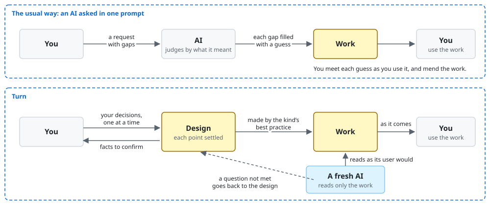

# Turn

Turn is a Claude Code plugin that makes a work you ask for, such as a README, and asks you only the
decisions that are yours.

Turn 0.1.0 is still in development and not yet released: a run may stop on a fault of Turn's own,
and the walkthrough below shows the run Turn is built for, not yet a recorded one.

Turn is for you when you want an AI to make a work you will put to use as it comes, not a draft
you read and mend. With it, you get that work, having decided only what is yours.

An AI asked in one prompt fills each gap in your request with a guess, and judges the work by what
it meant, so you meet the guesses when you use the work. Turn instead settles the work's design
with you before it makes anything, and has a fresh AI judge the work as its user would.



**Non-goals**

- Turn does not commit, push or publish the work.
- Turn does not settle a decision that is yours. One you leave unanswered holds the run.
- Turn is not for a quick draft you will mend yourself: it takes longer than asking Claude Code.

## Requirements

- Claude Code 2.1.317 or later: `claude --version` shows it.
- Python 3.9 or later, run as `python3`: `python3 --version` shows it.

## Installation

```console
claude plugin marketplace add lovaizu/ccpm
claude plugin install turn@ccpm
```

`claude plugin list` then lists `turn@ccpm`, and `pin@ccpm`, which comes with it.

## Walkthrough

At the end, you have a README for your tool `tidy` that you commit as it is.

`tidy` sorts a Downloads folder into folders by type, and its repository has no README. At its
root, in Claude Code, you type:

```text
/turn:up a README for tidy
```

Turn shows:

```text
Purpose: someone with a cluttered Downloads folder learns what tidy does, installs it and
sorts their folder with it. Yes?
```

You answer `yes`. Turn shows:

```text
Found: tidy/cli.py:22 adds --dry-run, so tidy can show what it would move without moving it.
Right?
```

You answer `right`. Turn shows:

```text
Decision: the walkthrough runs tidy --dry-run on five files, then tidy, so the reader sees
what moves before anything moves. Yes?
```

You answer `yes`. Turn shows:

```text
Design: ...
- The walkthrough runs tidy --dry-run, then tidy, on five files.   (you)
- Requirements: Python 3.9 or later.                               (found in setup.cfg)
Approve?
```

You answer `yes`. Turn shows:

```text
Done: README.md is written, not committed. It meets every question of a README.
```

## How it works


- A run that stopped goes on from its folder, such as `/turn:up .turn/20261105-tidy-readme`.

## Documentation

- [Calling Turn](docs/calling.md): for an AI that asks Turn for a work on a person's behalf.
- [Changelog](CHANGELOG.md): the changes in each version.
- [Issues](https://github.com/lovaizu/ccpm/issues): where you ask for help or report a fault.

## License

[MIT License](../../LICENSE)
