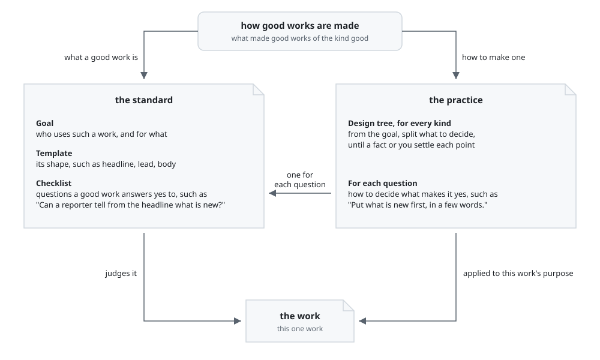
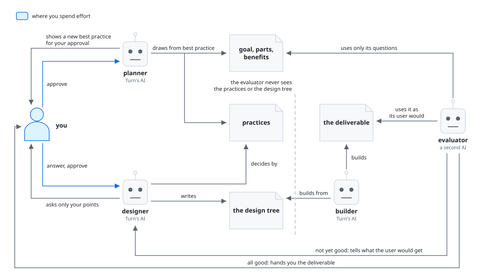

# Turn

Turn is a Claude Code plugin that makes a deliverable you ask for, such as a document or code, until
it meets your purpose well.

Turn is for you when you want a deliverable made well, such as a README, a press release or code.
With Turn, you get a deliverable that you can put to use as it is delivered, as soon as that
quality allows.

Asked alone, Claude Code writes from what it already knows and judges its own work. Turn instead
learns the best practice of each kind of deliverable from guides and examples of good ones. It ties
each decision about your deliverable to your purpose. Then a second AI, which did not make the
deliverable, uses it as its user would.



- Standard: what a good deliverable of the kind is. You approve the Standard of a new kind before
  Turn uses it.
  - Goal: what the deliverable's user achieves with it, so the deliverable is judged by whether
    they achieve it.
  - Parts: what the deliverable holds, in the order its user meets it, so each part is there because
    the goal needs it.
  - Checklist: questions that ask what each part, each tie between parts, and the whole bring the
    user. A deliverable that answers every question yes is done, and nothing more is added.
- Practice: for each question of the Checklist, a way of thinking and steps that have worked, with
  their sources, so each answer rests on what has worked, not on a guess.
- Design tree: your deliverable's purpose at the top, the Checklist's questions under it, and under
  each question the decisions that make its answer yes. Nothing is built that serves no question,
  and Turn asks you only the points that no fact settles.

The second AI judges the deliverable by the Standard alone, not by the Practice: the deliverable's
user gets only the deliverable, and a deliverable built by the Practice can still fall short.

**Non-goals**

- Turn does not check whether the deliverable gets you what you want it for, such as whether the
  RoomBook press release gets RoomBook into trade magazines. You check that once you have it.
- Turn is not for a quick draft. Researching the best practice of a new kind, and having a second AI
  use the deliverable, take longer than asking Claude Code alone. A kind Turn has done before skips
  the research.
- Turn does not commit, push, publish or send the deliverable. It gives you its files, and you
  choose what happens to them.

## Requirements

> **Turn does not run yet.** Turn is being rebuilt, and the Turn that this README describes is not
> built yet. Wait to install it until this note is gone.

- Claude Code.

  Turn runs inside it. `claude --version` prints its version when you have it.

- Python 3.9 or later, run as `python3`.

  Turn's scripts check its files with it. `python3 --version` prints 3.9 or later when you have it.

- Claude Code allowed to search and read the web, with its WebSearch and WebFetch tools.

  Turn reads guides and examples of a new kind on the web. Where it cannot reach the web, Turn
  asks you for it.

## Installation

Turn comes from ccpm, a marketplace of Claude Code plugins on GitHub. Add the marketplace, then
install Turn:

```console
claude plugin marketplace add lovaizu/ccpm
claude plugin install turn@ccpm
```

`claude plugin list` then shows Turn:

```console
$ claude plugin list
Installed plugins:

  ❯ turn@ccpm
    Version: 0.1.0
    Scope: user
    Status: ✔ enabled
```

## Walkthrough

> **Not from a real run yet.** Turn does not run yet, as [Requirements](#requirements) says. The
> lines below follow the run that [Turn's UX](../../dev/turn/ux.md) plans. They are not copied from
> Turn's output.

It is November 2026, and your company, Northwind, launches RoomBook, a meeting-room booking app.
You need a press release for it. RoomBook's README, in the repository you have open in Claude
Code, says what the app does, who Northwind is and how to reach its PR department. In the lines
below, `You:` is what you type, and `turn:` is what Turn shows you. At the end, you have the press
release.

1. Ask for the deliverable, and name Turn's agent, `turn:up`:

   ```text
   You:  Have turn:up write a press release for RoomBook, our new meeting-room booking app.
         Its README is in this repository.
   ```

2. Turn confirms the kind of deliverable:

   ```text
   turn: This is a press release, a document. Right?
   You:  Yes
   ```

3. Turn has no best practice for press releases yet, so it reads guides and examples of good ones
   on the web. It then shows you the Standard it drew from them:

   ```text
   turn: I have no Standard for press releases yet.
         Here is a new one, what a good press release is:
         Goal: a reporter decides from the release whether to write about it.
         Parts: headline, lead, body, boilerplate, contact.
         Checklist:
         - Can a reporter tell from the headline what is new?
         - Can a reporter tell from the lead who launches what, and when?
         - Can a reporter check each claim in the body?
         - Can a reporter tell from the boilerplate who the company is?
         - Can a reporter tell from the contact whom to ask, and how?
         Approve?
   You:  Approved
   ```

4. Turn asks what this release is for, and then the one point of it that only you can decide:

   ```text
   turn: What is this release for?
   You:  To get RoomBook into trade magazines.
   turn: When is the release date? I recommend 1 December: trade magazines plan their issues
         weeks ahead.
   You:  1 December
   ```

5. Turn shows the design it will write the release from:

   ```text
   turn: Design: a headline on RoomBook's launch, with three benefits and the PR contact from
         RoomBook's README. Approve?
   You:  Approved
   ```

6. Turn writes the release, and a second AI reads it as a reporter would, against each question of
   the Checklist. Turn goes on until every answer is yes, and then gives you the release:

   ```text
   turn: The press release, which meets every question of the Standard:

         Northwind's RoomBook offers only the meeting rooms that fit your meeting

         Northwind launches RoomBook, a meeting-room booking app, on 1 December 2026.
         RoomBook matches each room's seats and equipment to the meeting you describe.

         With RoomBook, an office worker:
         - books a room with the seats and equipment the meeting needs;
         - sees at once which of those rooms are free for the time they need;
         - books it without asking anyone.

         About Northwind: Northwind makes software that helps offices run.

         Contact: Northwind PR department, pr@northwind.example
   ```

Turn keeps the Standard you approved, with its Practice, in `.turn/` in the folder you run Claude
Code in, so your next press release skips step 3. Turn ships both for READMEs, UX documents,
architecture documents, code and prompts, so those kinds skip step 3 from the first time.

## How it works



Turn has separate AIs plan, design, build and evaluate the deliverable, as Anthropic's "Harness
design for long-running application development" (2026) has a planner, a generator and an evaluator.
The designer asks your points one at a time, each with the answer it recommends.

The evaluator is the second AI, and it did not build the deliverable. For each question not yet
answered yes, it says only what the user gets once the answer is yes, not a list of faults. The
designer then finds the decision behind that question and decides it again. The builder makes the
deliverable again from the design tree, so the deliverable is never patched. Once what the
deliverable says is good, the builder betters how it says it, and the evaluator checks that too.

## Documentation

- [Calling Turn](docs/calling.md) tells how a step of another plugin of ccpm, such as Rn, has Turn
  make its deliverable.
- [The changelog](CHANGELOG.md) says what changed in each version.

## Development

[Turn's development folder](../../dev/turn/README.md) leads to its UX, its architecture and how it
is checked.

## License

[MIT License](../../LICENSE)
