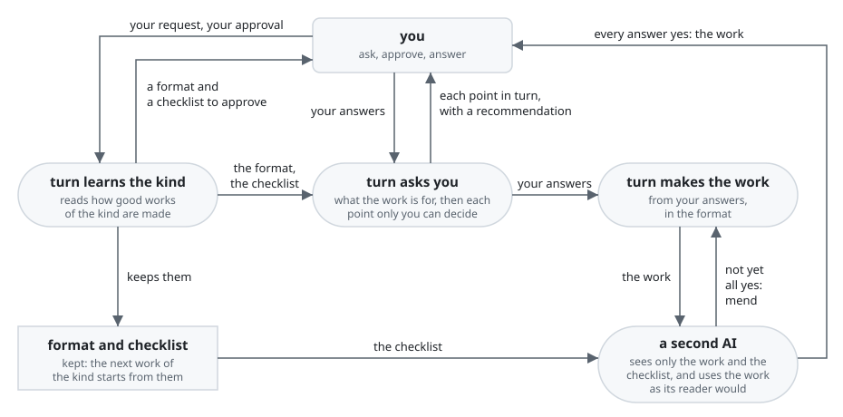

# turn

turn is a Claude Code plugin that makes a piece of work you ask for, such as a document or code,
until it meets your purpose.

With turn, anyone who wants a piece of work made gets one that fully meets their purpose. They
spend their own effort only on the points that only they can decide. turn decides every other
point itself.

For each kind of work, such as a press release, a README or a script, turn first works out what a
good one is. turn reads how good ones are made, and shows you two things to approve. The format is
the shape of the work, such as a headline, a lead and a body. The checklist is a set of questions
that a work answers yes to when it serves its readers, such as "Can a reporter tell from the
headline what is new?" turn then asks you what the work is for, and each point only you can
decide, one at a time, with the answer it recommends. A second AI then uses the finished work as
its reader would. This AI never sees how the work was planned, so it judges only what the reader
gets. Where an answer is not yet yes, turn mends the work and has it read again. You see the work
only once every answer is yes. When you ask Claude Code alone, the AI that wrote the work is the
only one that checks it, and you find what it missed yourself.

**Non-goals**

- turn does not choose what the work is for. It asks you, and builds every other decision on your
  answer.
- turn does not publish or send the work. It gives the work to you, and what happens to it next is
  yours.
- turn is not for a quick draft. Reading how good works of a new kind are made, and having a second
  AI read the work, take longer than asking Claude Code alone. A kind turn has made before skips
  that reading.

## Requirements

- Claude Code.

  turn runs inside it.

- Python 3.9 or later, run as `python3`.

  turn's scripts check its work with it.

- Claude Code allowed to search and read the web, with its WebSearch and WebFetch tools.

  turn reads on the internet how good works of a new kind are made.

## Installation

turn comes from ccpm, a marketplace of Claude Code plugins on GitHub. Add the marketplace, then
install turn:

```console
claude plugin marketplace add lovaizu/ccpm
claude plugin install turn@ccpm
```

`claude plugin list` then shows turn:

```console
$ claude plugin list
Installed plugins:

  ❯ turn@ccpm
    Version: 0.1.0
    Scope: user
    Status: ✔ enabled
```

## Walkthrough

It is November 2026, and your company, Northwind, launches RoomBook, a meeting-room booking app.
You need a press release for it. RoomBook's README, in the repository you have open in Claude
Code, says what the app does, who Northwind is and how to reach its PR department. In the lines
below, `You:` is what you type, and `turn:` is what turn shows you.

1. Ask for the work, and name turn's agent, `turn:up`:

   ```text
   You:  Have turn:up write a press release for RoomBook, our new meeting-room booking app.
   ```

2. turn confirms the kind of work:

   ```text
   turn: Is this a press release, written for reporters and editors?
   You:  Yes
   ```

3. turn reads guides and examples of good press releases on the internet. It then shows you the
   format and the checklist it drew from them:

   ```text
   turn: Format: headline, lead, body, boilerplate, contact.
         Checklist:
         - Can a reporter tell from the headline what is new?
         - Can a reporter tell from the lead who launches what, and when?
         - Can a reporter check each claim in the body?
         - Can a reporter tell from the boilerplate who the company is?
         - Can a reporter tell from the contact whom to ask, and how?
         Approve?
   You:  Approved
   ```

4. turn asks what this release is for, and then the one point of it that only you can decide:

   ```text
   turn: What is the release for?
   You:  To get RoomBook into trade magazines.
   turn: When is the release date? I recommend the 1st of next month: trade magazines plan
         their issues weeks ahead, and this gives their editors time to place it.
   You:  The 1st of next month.
   ```

5. turn shows the key points it will build the release on:

   ```text
   turn: Key points: a headline on RoomBook's launch; three benefits from RoomBook's README;
         Northwind's PR department as the contact. Approve?
   You:  Approved
   ```

6. turn writes the release. The second AI reads it as a reporter would and answers each question
   of the checklist. turn mends the release until every answer is yes, and only then gives it to
   you:

   ```text
   turn: Northwind's RoomBook offers only the meeting rooms that fit your meeting

         Northwind launches RoomBook, a meeting-room booking app, on 1 December 2026.
         RoomBook matches each room's seats and equipment to the meeting you describe.

         With RoomBook, an office worker:
         - books a room with the seats and equipment the meeting needs;
         - sees at once which of those rooms are free for the time they need;
         - books it without asking anyone.

         About Northwind: Northwind makes software that helps offices run.

         Contact: Northwind PR department, pr@northwind.example
   ```

turn keeps the format and the checklist you approved. Your next press release starts from them, so
turn skips step 3, the research and that approval.

## How it works



You spend effort only where an arrow meets you: you approve the format and the checklist once for
each kind, and you answer the points only you can decide. turn does the rest. The work comes back
to you only after the second AI answers yes to every question of the checklist.

## Documentation

- [Calling turn](docs/calling.md) tells how a step of another plugin, such as rn, has turn make its
  work.
- [The changelog](CHANGELOG.md) says what changed in each version.

## Development

[turn's development folder](../../dev/turn/README.md) leads to its UX, its architecture and how it
is checked.

## License

[MIT License](../../LICENSE)
