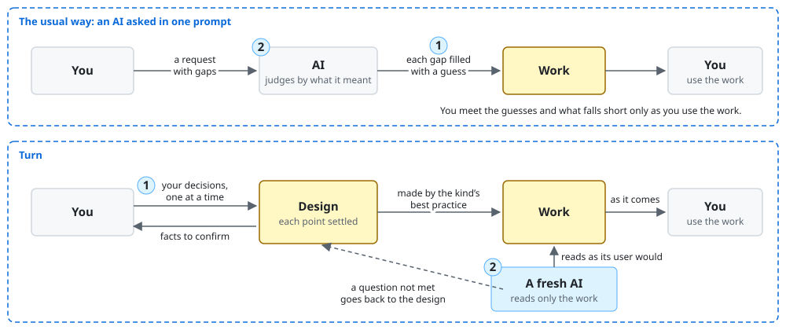

# Turn

Turn is a Claude Code plugin that makes a work you ask for, such as a README, to what its reader
needs, and asks you only the decisions that are yours.

Turn 0.1.0 is still in development and not yet released: a run may stop on a fault of Turn's own,
and the walkthrough below shows the run Turn is built for, not yet a recorded one.

Turn is for you when you want an AI to make a work you will put to use as it comes, not a draft
you read and mend. With it, you get that work, having decided only what is yours.

**Non-goals**

- Turn does not commit, push or publish the work.
- Turn does not settle a decision that is yours. One you leave unanswered holds the run.
- Turn is not for a quick draft you will mend yourself: it takes longer than asking Claude Code.

## Requirements

- Claude Code 2.1.317 or later: `claude --version` shows it.
- Python 3.9 or later, run as `python3`: `python3 --version` shows it.

## Installation

```console
claude plugin marketplace add lovaizu/ccpm
claude plugin install turn@ccpm
```

`claude plugin list` then lists `turn@ccpm`, and `pin@ccpm`, which comes with it.

## Walkthrough

At the end, you have a README for your tool `tidy` that you commit as it is.

`tidy` sorts a Downloads folder into folders by type, and its repository has no README. At its
root, in Claude Code, you type:

```text
/turn:up a README for tidy
```

Turn shows:

```text
Purpose: someone with a cluttered Downloads folder learns what tidy does, installs it and
sorts their folder with it. Yes?
```

You answer `yes`. Turn shows:

```text
Found: tidy/cli.py:22 adds --dry-run, so tidy can show what it would move without moving it.
Right?
```

You answer `right`. Turn shows:

```text
Decision: the walkthrough runs tidy --dry-run on five files, then tidy, so the reader sees
what moves before anything moves. Yes?
```

You answer `yes`. Turn shows:

```text
Design: ...
- The walkthrough runs tidy --dry-run, then tidy, on five files.   (you)
- Requirements: Python 3.9 or later.                               (found in setup.cfg)
Approve?
```

You answer `yes`. Turn shows:

```text
Done: README.md is written, not committed. It meets every question of a README.
```

## How it works



- 1, the AI starts from scratch and writes what similar texts say, not what your reader needs:
  Turn makes each kind of work by its best practice, which holds the goal the work's reader
  reaches, a template of what the work holds and the questions its reader asks of it.
- 2, its review gives many findings, few that matter: a fresh AI, the evaluator, asks only those
  questions, whether the work's reader gets what they need, so each shortfall it finds matters.
- 3, it fills what you did not say with guesses: Turn finds each fact in your repository and asks
  you to confirm it, and asks you each decision that is yours, one at a time, so nothing in the
  work is a guess you never saw.
- 4, you find what falls short only as you use the work: the evaluator runs the work's commands as
  its reader would, in a throwaway home, and asks each question at the moment of use, so the work
  reaches you only once it works in use.
- 5, each fix is added on, and the work gets noisier: a question not met goes back to its
  decision, and the work is made again from the design, so no fix sits beside it.


- A, how Turn tells which decisions are yours: Pin finds what your repository holds and shows it to
  you to confirm. It settles a decision that the goal, the facts and your answers favor, and asks
  you one where another way would serve as well, or that would be hard to undo. It writes each into
  the design with who settled it.


- B, how an AI can judge an AI's work: the evaluator is a fresh AI that gets only the work and the
  questions of its kind, never the design, so it judges by what the work's reader gets, not by what
  its maker meant.


- C, what if Turn has no best practice for your kind of work: Turn first makes one, the same way it
  makes any work, and you approve it. It is kept in .turn/best-practices/, so later runs in your
  repository use it.

## Documentation

- [Calling Turn](docs/calling.md): for an AI that asks Turn for a work on a person's behalf.
- [Changelog](CHANGELOG.md): the changes in each version.
- [Issues](https://github.com/lovaizu/ccpm/issues): where you ask for help or report a fault.

## License

[MIT License](../../LICENSE)
