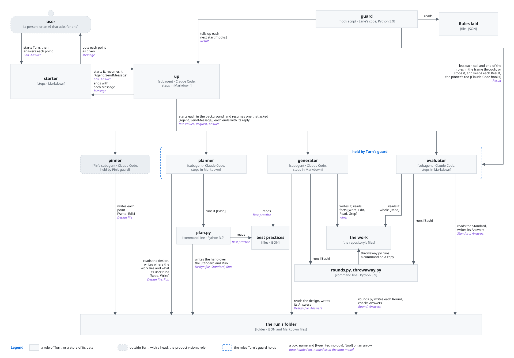
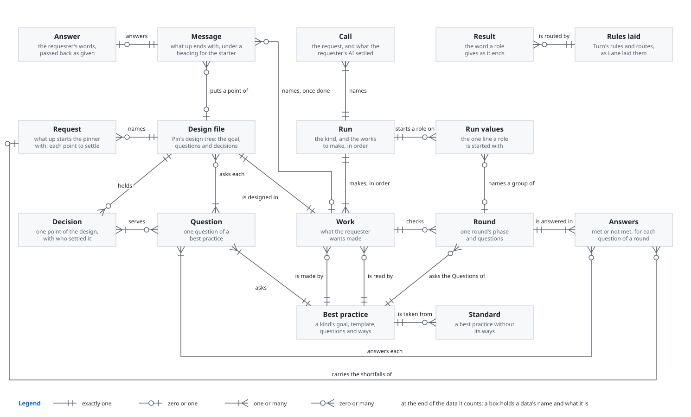
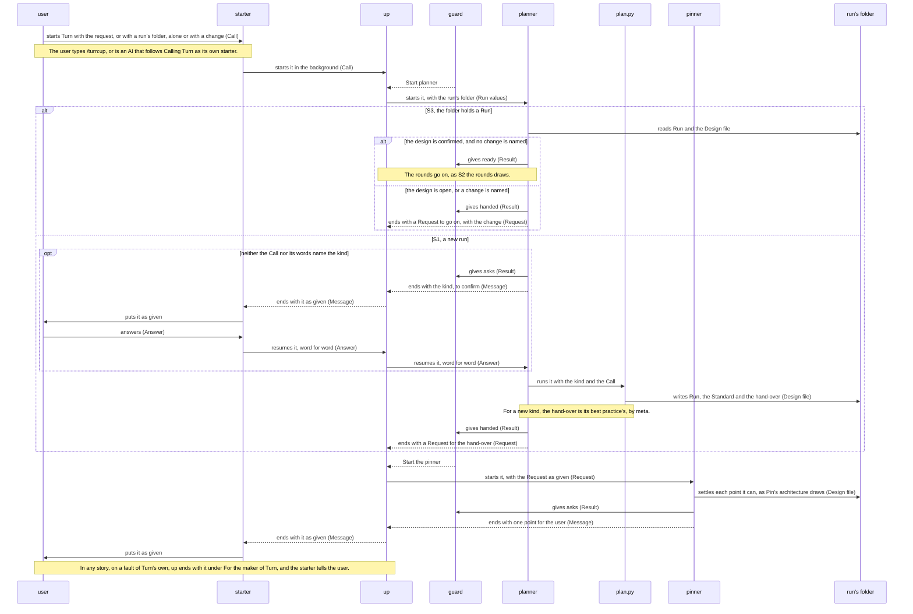
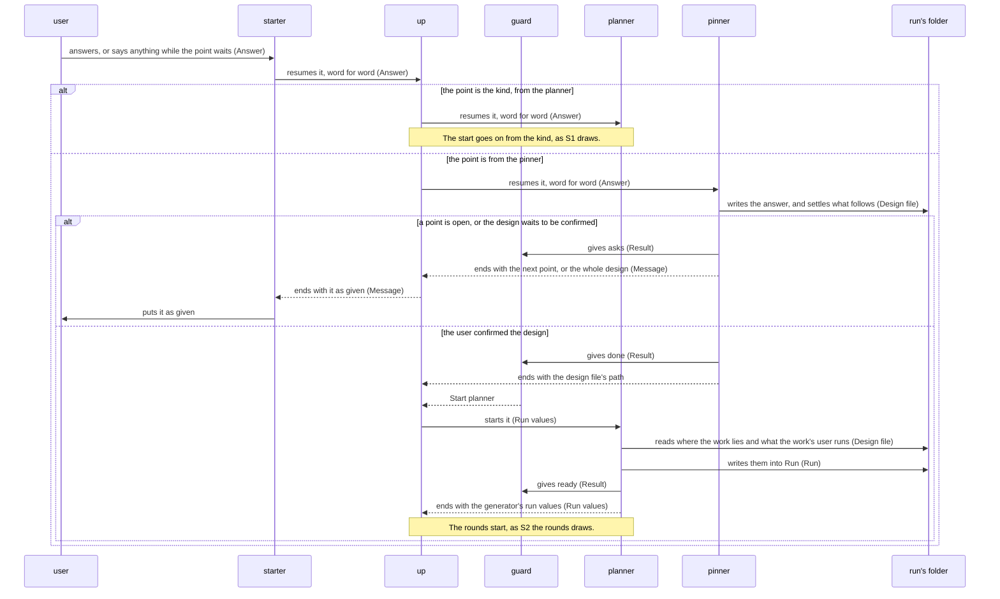
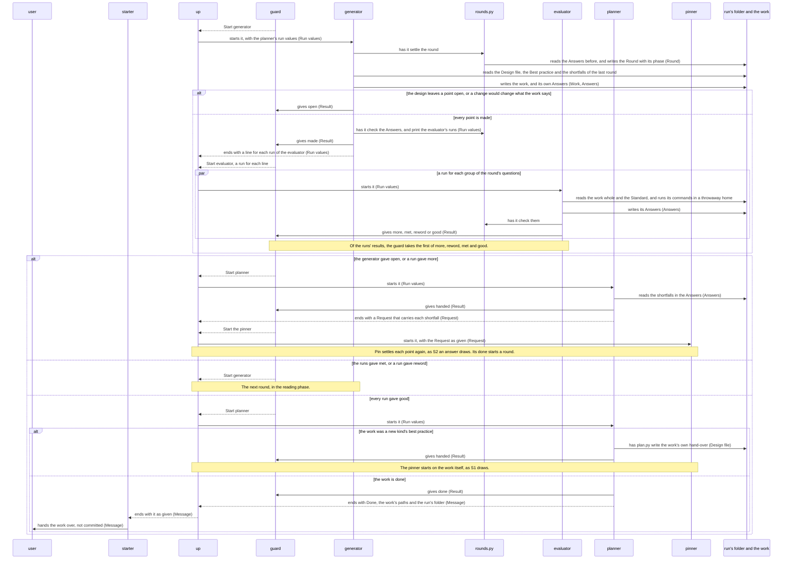
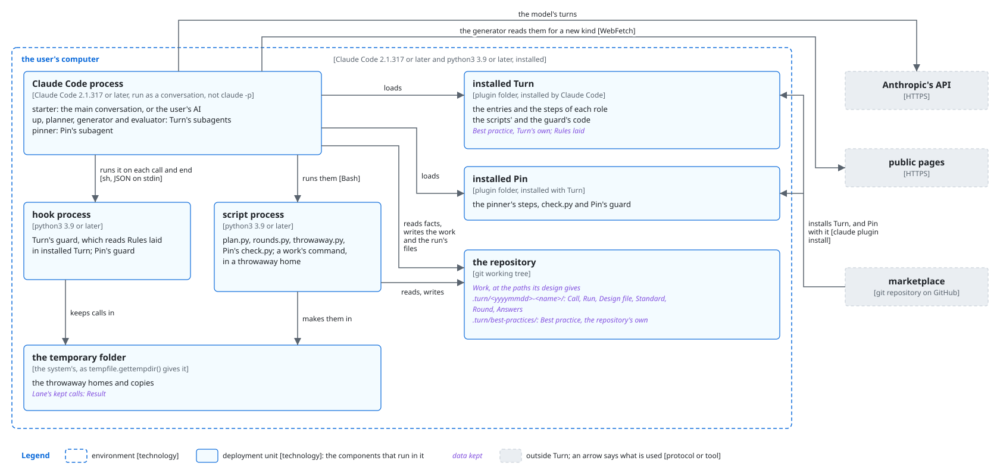
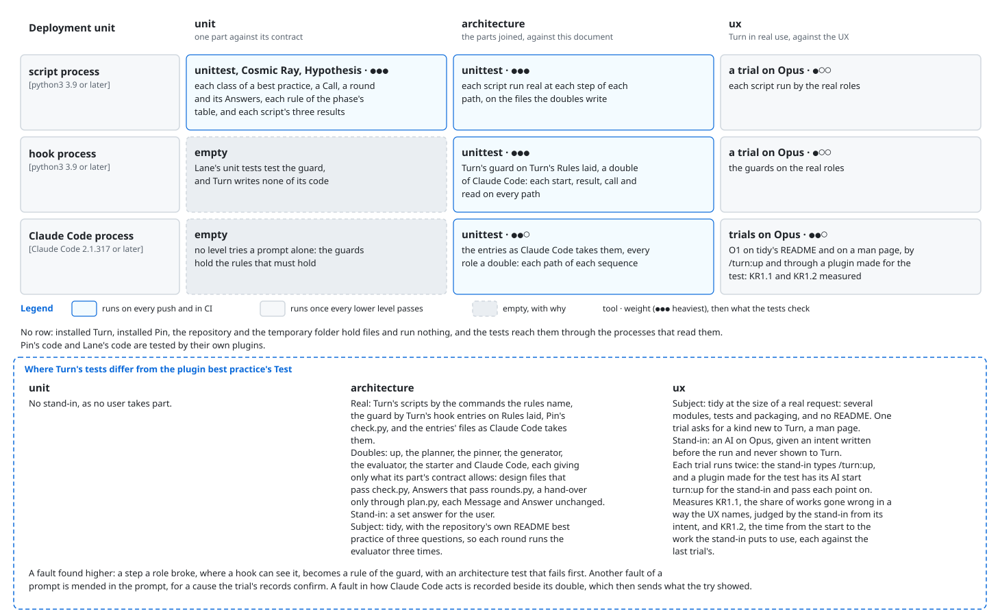

# Turn architecture

This document says how Turn is built to give [its product vision](../../../../../../dev/turn/product-vision.md).
Every kind of work goes through one course of subagents, moved by the routes of Lane, the plugin
that holds a subagent to the rules of its steps. The planner settles the kind of work. It hands Pin,
the plugin that settles a design with the user, the work's goal and the questions of the kind's best
practice. Pin settles the design with the user, one point at a time. The generator makes the work
from the design, against the kind's best practice. A fresh evaluator then answers each question as
the work's user would, never given the design. A round is one such making and its check. A question
not met goes back through Pin to its decision. Once every question is met, the rounds go on with how
the work reads. up, the subagent that starts each role, carries each point to the user, and each
answer back, as given.

## Principles

Turn builds on [the principles of the plugin best practice](../../../../../../dev/plugin-best-practice.md#principles),
and adds these.

### up is always a subagent

up runs as a subagent for every user, departing from
[Where the orchestrator runs](../../../../../../dev/plugin-best-practice.md#where-the-orchestrator-runs).

*Why*: Lane checks only subagents, so only a subagent's course is held to its routes. A course
held by nothing could skip the evaluator on the way to the user (KR1.1).

### Lane's routes decide each move

up decides no move. The guard, Lane's hook script laid into Turn, names each next start from
Lane's routes, departing from
[The orchestrator holds the whole and decides](../../../../../../dev/plugin-best-practice.md#the-orchestrator-holds-the-whole-and-decides),
as [Where the router keeps the course](../../../../../../dev/plugin-best-practice.md#where-the-router-keeps-the-course)
allows.

*Why*: a move that up chose would rest on its reading of a reply, which nothing holds. Such a move
could skip Pin or the evaluator, while a route holds on every run (KR1.1).

### No learning from each run

Turn does not take
[Learning from each run](../../../../../../dev/plugin-best-practice.md#learning-from-each-run). No role
follows the work once it is handed over.

*Why*: no step of the product vision follows the work handed over, and a step there would ask
the user more (KR1.2).

### One course for every kind

Every kind of work goes through the same roles, routes and rounds, and differs only in its best
practice. A kind new to Turn first gets its best practice as a work of its own, made by the same
course with `meta` as its best practice. No role names a kind of work, but the planner, which names
`meta`, `refactor-doc` and `refactor-code`.

*Why*: a new kind then needs only a best practice, which the user approves as they approve any
design (KR1.1). A fix to the course reaches every kind at once.

### Pin alone settles the design

After the planner's hand-over, only the pinner writes the design file and puts a point of the
design to the user. Each point that the work raises goes back to Pin in a Request: a question
not met, or a point that the design leaves open. No role of Turn changes a decision itself. The
planner asks the user one point only, the kind, and only before there is a design.

*Why*: the design file is then the one record of each point and who settled it, and Pin keeps what
the user's AI settled. A point that a role of Turn settles beside Pin could come out otherwise
than the user means it, or be asked again. A decision changed outside Pin leaves each decision
built on it as it was (KR1.1).

### The evaluator has only what the work's user has

The evaluator reads the work and the Standard: the best practice's goal and questions,
without the ways of meeting them. It never reads the design, the best practice's ways or the
generator's answers to the questions.

*Why*: the work's user never sees any of these. An evaluator that has the design judges whether the
work follows it, not what the work's user gets. One that has the ways checks how the work was made, not
what it gives (KR1.1).

### What the work says before how it says it

A phase is the set of questions that a round asks. The rounds of the content phase make what the
work says and does, by the kind's questions. The rounds of the reading phase then improve how the
work says it, by `refactor-doc` for a document or `refactor-code` for code, and change nothing that
the work says. A change to what the work says goes back to Pin, and the content phase follows again.

*Why*: no role improves a sentence before its content is settled, only to improve it again once the
content changes (KR1.2).

### A shortfall goes back to its decision

The generator makes the work only from the design. A question not met in the content phase goes
back to the decisions that serve it, through Pin. The generator then makes the work again from the
design. No role puts a fix onto the work beside the design.

*Why*: a fix beside the design is a part that no decision holds. The next round makes the work again
from the design, and loses the fix or keeps it with no one having settled it (KR1.1).

### Each role starts fresh from the run's folder

The planner, the generator and the evaluator start fresh each time up starts them, and carry on
from the files in the run's folder. A role resumed with the user's answer keeps its context.
up keeps no file.

*Why*: the evaluator then reads each round with fresh eyes (KR1.1). A run that stopped goes on from
its folder in a new session, and asks nothing again (KR1.2).

### Passed on as given

up passes on each point, each Request and each answer as it got them, and answers nothing of the
work itself. The planner hands Pin each point that the user's AI settled, as it was given.

*Why*: a point reworded on the way is a question that no role asked. An answer summed up loses what
the user meant (KR1.1), and a settled point reworded is asked again (KR1.2).

### Every user meets the same Turn

No line of Turn names a plugin that starts it. An AI reaches Turn only through `turn:up`, in the
forms that [Calling Turn](../../../../docs/calling.md) gives.

*Why*: a change made for one plugin's AI would reach every other user unseen, and could settle
their points otherwise than they meant (KR1.1).

### Turn changes only the work

The generator writes only the work and the run's folder. The generator and the evaluator run the
work's commands only in a throwaway copy of the repository, with a throwaway home. No role commits,
pushes or publishes.

*Why*: a command run as the work's user runs it, such as `tidy` on a Downloads folder, would
otherwise change the user's own files, which cannot be undone. The user would then stop
the run (KR1.1). What becomes of the work is the user's to decide, as
[Turn's README](../../../../README.md) says.

## User stories

- **S1**: As the user, I want to start Turn with my request, by typing `/turn:up` or, as an AI that
  asks for a person, by starting `turn:up` as [Calling Turn](../../../../docs/calling.md)
  says. Carries the request and the purpose put to confirm. From the product vision's intent,
  it also carries the kind asked where the request does not say it, a new kind's best practice made
  first, and a fault of Turn's own that stops the run.
- **S2**: As the user, I want to answer the point that Turn puts to me. Carries each fact to confirm
  and each point of intent, the design approved, a point of intent that comes up while the work is
  made, and the work handed over. From the product vision's intent, it also carries a wrong purpose, fact or
  design corrected, and a fault of Turn's own that stops the run.
- **S3**: As the user, I want to start Turn with a run's folder, alone or with a change. Carries,
  from the product vision's intent, a stopped run resumed, the work changed, and a fault of
  Turn's own that stops the run.

## Components



What each decides alone:

- **user**: what is theirs: the purpose, each fact and decision, the design.
- **starter**: nothing of the work; it puts each point, and passes each answer back, as given.
- **up**: the run's folder, the one given, else the one the request names, else a new one in
  `.turn/`; and which role an answer resumes, the one that asked.
- **guard**: whether a call or an end of a role keeps its rules, and which start is due next.
- **pinner**: everything in the design, as Pin's architecture says.
- **planner**: the kind and its best practice, whether a new kind's comes first, what each Request
  carries, where the work lies, and when the run is done.
- **generator**: the work, and each small point of making it, such as a phrase.
- **evaluator**: whether each question of its group is met.
- **plan.py**: whether a best practice holds its form.
- **rounds.py**: each round's phase and questions, their groups, and whether a role's Answers hold.
- **throwaway.py**: where a work's command runs.

- **up as a subagent, for the user who types `/turn:up` too,** over up in the main
  conversation: the main conversation passes each point by its steps alone, which no hook sees,
  while Lane holds a subagent to its routes (KR1.1). It costs a resume of up for each point, which
  passes up and the starter (KR1.2), and Turn runs only in an interactive session, where Claude Code
  starts the orchestrator again as a subagent it started ends
  ([the routes](../../../../../lane/docs/routes.md#what-the-orchestrator-is-told)).
- **Pin used as built, with Turn as Pin's maker AI and up as its go-between,** over a role of Turn
  that follows the pinner's steps itself: Turn copies none of Pin's rules, so the two cannot drift
  apart, and Pin runs as it was tested (KR1.1). It costs a route of Lane that names a subagent of a
  dependency and keeps its results, and a pinner that gives one result while a point waits and
  another once the design is confirmed.
- **The planner on both sides of Pin** over up handing Pin each point and the generator reading the
  design itself: one role decides what Turn hands Pin and what it takes from the design, and up stays
  a carrier (KR1.1). It costs a run of the planner each time the design goes to Pin or comes back
  (KR1.2).
- **A new kind's best practice made as a work of its own** over a step of its own that makes it
  faster: the user approves the kind's purpose and questions as they approve any design, and
  the course stays one for every kind (KR1.1). It costs a whole course more for the first work of a
  new kind (KR1.2).
- **One run of the generator for the whole work in each round** over runs side by side, one for
  each part that stands apart: parts made apart drift in voice and in what joins them (KR1.1). It
  costs a work whose parts stand apart being made one part after another (KR1.2).
- **One run of the evaluator for each group of the round's questions, all at once,** over one run
  for every question: each run is fresh on fewer questions (KR1.1), and the runs go side by side
  (KR1.2). It costs each run reading the whole work.
- **The role before a step handing up the next role's run values** over up reading them from the
  run's folder: Lane then lets up make no call but the start due, so every step up takes is held
  (KR1.1). It costs the planner's and the generator's replies carrying what up starts with.
- **No role of Turn but up starting a subagent** over a researcher in the background: Claude Code
  lets subagents start subagents only three layers below the main conversation, the user's AI may
  stand one layer down, and a child's end would start its role again while a point waits, so a run
  would break before the hand-over (KR1.1). It costs the pinner and the generator finding facts
  themselves, one after another, in their own context (KR1.2).

## Data model



- **Call**: the request, and what the user's AI settled.
- **Run**: the kind, and the works to make, in order.
- **Run values**: the one line a role is started with.
- **Work**: what the user wants made.
- **Best practice**: a kind's goal, template, questions and ways.
- **Standard**: a best practice without its ways.
- **Question**: one question of a best practice.
- **Design file**: Pin's design tree: the goal, questions and decisions.
- **Decision**: one point of the design, with who settled it.
- **Request**: what up starts the pinner with: each point to settle.
- **Round**: one round's phase and questions.
- **Answers**: met or not met, for each question of a round.
- **Result**: the word a role gives as it ends.
- **Rules laid**: Turn's rules and routes, as Lane laid them.
- **Message**: what up ends with, under a heading for the starter.
- **Answer**: the user's words, passed back as given.

## Sequences

### S1 and S3: the start



- **`asks`, a result whose route starts no one,** over a role that ends with no result while its
  point waits: the guard keeps going a role that ends with no result, and keeps up going while a
  start is due, so without `asks` the point would never reach the user (KR1.1). Once resumed,
  the role gives a later result, and the guard takes it over `asks`
  ([How a subagent gives its result](../../../../../lane/docs/routes.md#how-a-subagent-gives-its-result)).
  It costs each role that asks one result more.

### S2: an answer



### S2: the rounds



- **`rounds.py` settling the phase from the run's folder** over up passing the phase as a run value,
  from the result it was told: up would then decide a point of the work, and a run that stopped
  would lose its phase and repeat its rounds (KR1.2). It costs a run of `rounds.py` at each start of
  the generator.

## Deployment



The user installs Turn as [the README](../../../../README.md#installation) says, which installs
Pin with it, and types `/turn:up`, or their AI's plugin lists `turn` in its `dependencies` and
starts `turn:up` as [Calling Turn](../../../../docs/calling.md) says.

- **Python 3.9 and its standard library only, for Turn's scripts and the guard,** over a later
  Python or packages: the user installs nothing else for Turn, as
  [Python 3.9 and the standard library](../../../../../../dev/plugin-best-practice.md#python-39-and-the-standard-library)
  says, and starts sooner (KR1.2). It costs the code going without what later versions and packages
  give.
- **A run's folder in `.turn/<yyyymmdd>-<name>/` at the root of the repository, or where the
  user's AI says,** over a folder outside the repository: the user reads each check of the
  work there, and a run that stopped goes on from it in any session (KR1.2), as
  [Where a plugin writes its files](../../../../../../dev/plugin-best-practice.md#where-a-plugin-writes-its-files)
  says for what may be kept. It costs a folder in the user's repository that they keep out of
  their commits.
- **A new kind's best practice in `.turn/best-practices/`** over the run's folder: every later run
  in the repository finds it, and the planner takes it over Turn's own best practice of the same
  kind, as the user approved it for their work (KR1.1). It costs a later run of that kind
  missing what Turn's own best practice gains after it.
- **A work's command run in a throwaway copy of the repository, with a throwaway home in the
  temporary folder,** over the repository itself: the command cannot change the user's own
  files, as [Turn changes only the work](#turn-changes-only-the-work) says (KR1.1). It costs a
  command that needs a file outside the repository, such as one in the user's Downloads
  folder, a made-up one that `throwaway.py` puts in the throwaway home.
- **`throwaway.py` running every command of the work, in order, in one copy,** over a run for each
  command: the guard then names one command whole, with the run's folder as its value, while a rule
  that named each command as a value of its own would let every command through for a work that has
  none (KR1.1). It costs a role that cannot run one command alone, and each run of `throwaway.py`
  running them all (KR1.2).

## Directory structure

```text
plugins/turn/
├── .claude-plugin/plugin.json       Turn's manifest, with its dependency on Pin
├── skills/up/SKILL.md               the starter's steps for /turn:up
├── agents/<role>.md                 the entries of up, the planner, the generator and the evaluator
├── core/roles/<role>.md             the steps of up, the planner, the generator and the evaluator
├── core/domain/best-practices/      a folder for each kind: Best practice and its Questions, its
│                                    template, and its example with the example's figures in images/;
│                                    the examples of the README, the product vision and the architecture are
│                                    copies of Turn's own
├── core/domain/forms/               the forms of Call, Run, Standard, Round, Answers, Best practice
├── core/domain/                     the code of plan.py, rounds.py and throwaway.py
├── core/domain/tree.py              a link to Pin's tree.py: the form of the Design file
├── scripts/                         plan.py, rounds.py, throwaway.py
├── hooks/hooks.json                 the guard's hook entries
├── hooks/lanes.json                 Rules laid, with the routes on each Result
├── hooks/lane/                      the guard
├── docs/calling.md                  Calling Turn: the form of Call, Message and Answer
└── README.md, CHANGELOG.md, images/   for Turn's users

dev/turn/
├── product-vision.md, architecture.md, images/  Turn's product vision and architecture, with the architecture's figures
├── README.md, design-tree.md        for Turn's developers
├── cosmic-ray.toml                  the mutation testing
└── tests/
    ├── unit/                        unit tests, at the path of what each tests
    ├── architecture/                a test for each path of each sequence
    └── ux/                          the trials of O1, and the test plugin that starts turn:up

.turn/<yyyymmdd>-<name>/               Call, Run, Design file, Standard
.turn/<yyyymmdd>-<name>/verification/  Round, Answers; each round before in a folder of its number
.turn/<yyyymmdd>-<name>/best-practice/ the same, of a new kind's best practice made first
.turn/best-practices/                  Best practice, the repository's own
<the paths that the design gives>      Work
<temporary folder>/lane/               Result, as the guard keeps it
```

- **Each example of a document Turn has, its README, product vision and architecture, as a
  copy of it with its figures, made by `plan.py example` from the document its best practice names
  in `source`,** over the document kept as the example with a symbolic link to it: the developer
  reads the document where the plugin best practice keeps it, the copy ships with Turn for the
  generator to read as one work made by the template, and a copy shows on GitHub and on Windows,
  where a symbolic link shows as a line of text; `plan.py form` fails on a copy that differs from
  its document, so the two cannot drift (KR1.1). It costs a second copy of each document and its
  figures in the repository, and a run of `plan.py example` after each change to them.
- **The Request, the Design file and its Decisions in Pin's form**, which
  [the pinner](../../../../../pin/core/roles/pinner.md) gives, written and read by Pin's `tree.py`
  through a link, as [Code kept once](../../../../../../dev/plugin-best-practice.md#code-kept-once) says, over a copy
  of it in Turn: a form kept twice drifts, and Pin would refuse what Turn hands it (KR1.1). It costs
  a change to Pin's form changing what Turn hands Pin, with no line of Turn changed, and Turn's
  tests running Pin's code.
- **`hooks/lane/` as a link to Lane's code in this marketplace** over a copy, as
  [Code kept once](../../../../../../dev/plugin-best-practice.md#code-kept-once) says: a fix to the
  guard reaches every plugin it holds (KR1.1). It costs a fix in Lane reaching Turn's guard only once
  a developer lays Turn's rules again with Lane's `lay.py`.

## Tests

Turn tests by [Test in the plugin best practice](../../../../../../dev/plugin-best-practice.md#test),
and differs from them where this section says.



- **The script process at ●●● at unit and at architecture** over a lighter weight: a check that
  passes wrongly sends a gap into the work unseen, or hands the evaluator what the work's user never sees
  (KR1.1). It costs the most tests to keep up as the scripts change.
- **The hook process at ●●● at architecture** over a lighter weight: only the guard holds each role
  to its rules and the course to its routes, and a rule let through lets the evaluator read the
  design or the generator write beside the work (KR1.1). It costs architecture tests that run two
  plugins' guards on every call, the slowest of the tests that run on every push.
- **The Claude Code process at ●●○ at architecture** over ●●●: a test there only finds sooner an
  entry that Claude Code would not load as Turn needs, which every ux trial also meets before a
  user does (KR1.1). It costs such a fault showing only once a trial runs, where a heavier
  test would show it on the push.
- **The Claude Code process at ●●○ at ux, and the other rows at ●○○,** over trials weighed alike:
  only these trials run the prompts, while the other rows only confirm what lower levels have
  checked (KR1.1). It costs a prompt's fault showing only once every lower level passes.
- **Mutation testing on the unit tests alone** over all the tests: the unit tests are the ones that
  must catch every mutant, while the architecture tests run two plugins' guards on every call and
  outlast a mutant's time (KR1.1). It costs a mutant that only an architecture test catches counting
  as missed.
